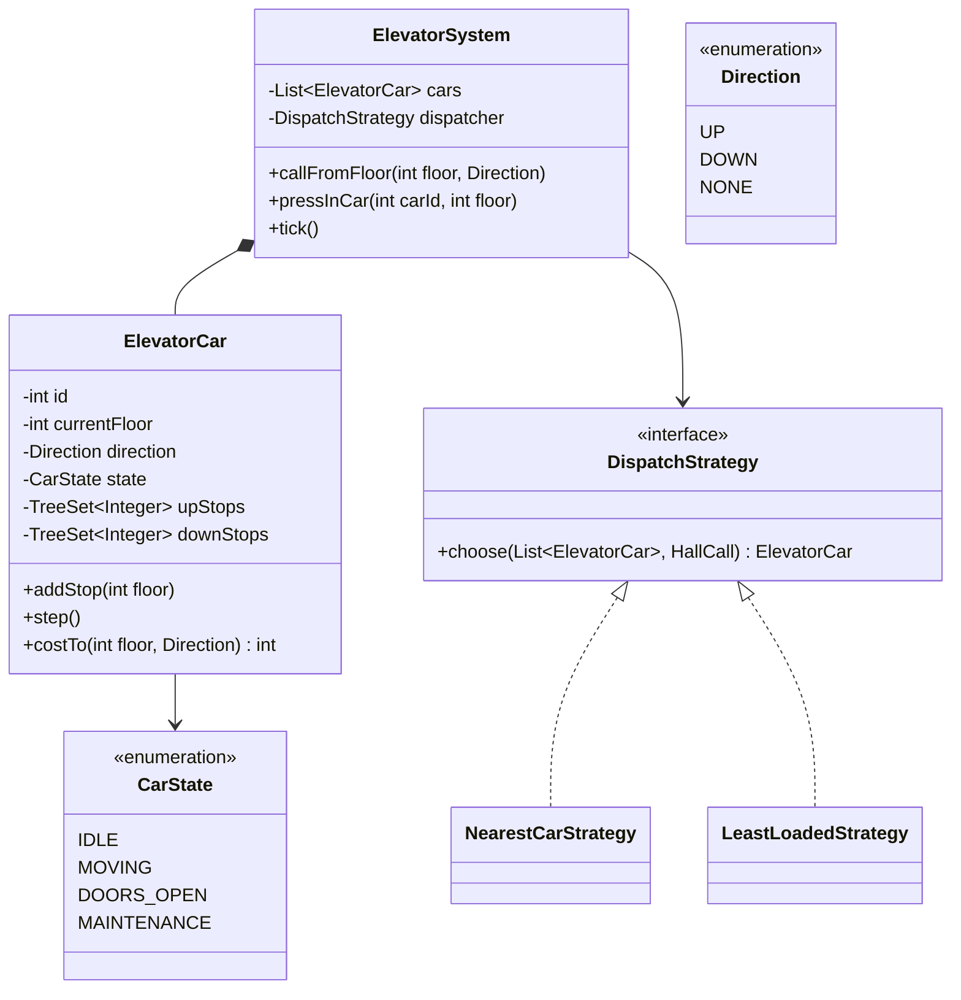

<Related ids={['state-pattern', 'strategy-pattern', 'observer-pattern', 'command-pattern', 'concurrency-for-lld']} />

An elevator system has two separate jobs that beginners usually tangle together. One is **moving a car**: going up and down and stopping at the right floors. The other is **deciding which car** answers when someone presses the button in a corridor. The interviewer wants to see you keep those apart, pick a sensible order for the stops, and remember that buttons are pressed while cars are moving.

We'll use the same six steps as every case study: requirements, entities, class design, code, a worked example, and follow-ups. (The [parking lot](/system-design/lld/lld-parking-lot) lesson explains the plan in detail.)

## Step 1: Pin down the requirements

<Dialogue>
<Turn who="you">How many floors and how many cars?</Turn>
<Turn who="them">N floors and M cars. Make both configurable.</Turn>
<Turn who="you">There are two kinds of button: the up/down buttons in the corridor, and the floor buttons inside a car. Should I handle both?</Turn>
<Turn who="them">Yes, both.</Turn>
<Turn who="you">Am I controlling real motors, or can I simulate time in steps?</Turn>
<Turn who="them">Simulate it. A car moves one floor per step.</Turn>
<Turn who="you">Any special modes, like maintenance or a fire alarm?</Turn>
<Turn who="them">Maintenance would be good. Fire mode can be a follow-up.</Turn>
<Turn who="you">What's the goal for scheduling: shortest wait, or just a fair, sensible order?</Turn>
<Turn who="them">A sensible order that doesn't leave anyone waiting forever.</Turn>
</Dialogue>

Two pieces of vocabulary make the rest of this lesson much easier, so introduce them out loud:

- A **hall call** comes from a corridor button: "someone on floor 7 wants to go **up**". It doesn't belong to any car yet; the system has to **choose** a car.
- A **car call** comes from a button inside a car: "this car should stop at floor 12". It already belongs to that car.

**The system must:**

1. Have N floors and M cars, each car moving one floor per time step.
2. Accept hall calls and assign each to a suitable car.
3. Accept car calls for a specific car.
4. Serve each car's stops in an order that's efficient and never starves a request.
5. Support taking a car out of service for maintenance.
6. Stay correct while buttons are pressed and cars move at the same time.

**Out of scope for now:** weight limits, fire mode, real motor and sensor control.

## Step 2: Find the core entities

| Noun | Make it… | Why |
| --- | --- | --- |
| Elevator car | a class | It has changing state: current floor, direction, stops to make, doors open or closed. |
| Direction | an enum | `UP`, `DOWN`, `NONE`. |
| Car state | an enum | `IDLE`, `MOVING`, `DOORS_OPEN`, `MAINTENANCE`. |
| Hall call | a record `HallCall(floor, direction)` | A small request value. |
| Car call | just a floor number passed to the car | It needs nothing more. |
| Choosing a car | an **interface** `DispatchStrategy` | There are many sensible rules (nearest, least busy, zoned), so make it swappable. |
| Elevator system | a class | The front door: receives button presses and drives time forward. |

## Step 3: Design each class

**`ElevatorCar`**: knows its floor, direction, state and the floors it still has to stop at. It can add a stop, move one step, and estimate how costly it would be to go to a given floor (the dispatcher uses that).

**`DispatchStrategy`**: one job, "given these cars and this hall call, which car should go?"

**`ElevatorSystem`**: knows all cars and the strategy. `callFromFloor` asks the strategy for a car and gives it the stop. `pressInCar` gives a stop straight to that car. `tick` moves every car one step.

The key design question is **the order in which a car visits its stops**. Say a car at floor 5 has stops at 2, 8 and 6:

<Approach verdict="bad" title="First come, first served">

Visit stops in the order they were pressed: 2, then 8, then 6. The car goes down 3 floors, up 6, then back down 2. Lots of wasted travel, and people inside watch the car pass their floor.

</Approach>

<Approach verdict="bad" title="Always go to the nearest stop">

From 5, go to 6, then 8, then 2. Better here, but in a busy building the car can keep bouncing between nearby floors while someone at the far end waits forever. That's **starvation**, and requirement 4 forbids it.

</Approach>

<Approach verdict="great" title="Keep going in one direction, then turn (LOOK)">

If the car is heading up, it serves every stop above it in order (6, then 8), and only turns round when there's nothing left above. Then it serves the stops below on the way down (2). Nobody waits more than one full sweep. This is how real lifts behave, and it's called the **LOOK** algorithm (a refinement of SCAN, often called "the elevator algorithm").

</Approach>

To make LOOK easy to code, keep stops in a **sorted set** (`TreeSet`). Then "is there any stop above me?" is a single call, `stops.ceiling(floor)`, in O(log n).



## Step 4: Write the code

<InterviewScope minutes="45–60" lines="50" write={["An `Elevator` that keeps a sorted set of stops and moves one floor per step", "A `DispatchStrategy` that picks which car answers a call", "A controller with hall calls and in-car buttons"]} say={["The LOOK algorithm: keep going while there are stops ahead", "Better dispatch rules (direction-aware, zoning)", "How a real system runs each car on its own thread"]} skip={["Door timers, weight limits and alarms", "Fire mode and VIP mode", "Energy optimisation"]} />

### The interview-sized version

Cars that serve stops in a sensible order, and a strategy that picks the nearest idle car. It's about **50 lines**, and it compiles and runs.

```java
enum Direction { UP, DOWN, IDLE }

class Elevator {
    final int id;
    int floor = 0;
    Direction direction = Direction.IDLE;
    private final TreeSet<Integer> stops = new TreeSet<>();      // sorted, so "next stop above me" is cheap

    Elevator(int id) { this.id = id; }

    void addStop(int f) {
        if (f == floor && direction == Direction.IDLE) return;   // already here: just open the doors
        stops.add(f);
        if (direction == Direction.IDLE) direction = f > floor ? Direction.UP : Direction.DOWN;
    }

    /** Move one floor. Keep going the same way while there are stops ahead, then turn (the LOOK algorithm). */
    void step() {
        if (stops.isEmpty()) { direction = Direction.IDLE; return; }
        if (direction == Direction.UP && stops.ceiling(floor) == null) direction = Direction.DOWN;
        if (direction == Direction.DOWN && stops.floor(floor) == null) direction = Direction.UP;
        floor += direction == Direction.UP ? 1 : -1;
        stops.remove(floor);                                     // arrived at a stop: doors open
        if (stops.isEmpty()) direction = Direction.IDLE;
    }

    int stopsLeft() { return stops.size(); }
}

interface DispatchStrategy { Elevator pick(List<Elevator> cars, int floor); }

class NearestIdleFirst implements DispatchStrategy {
    public Elevator pick(List<Elevator> cars, int floor) {
        return cars.stream()
                .min(Comparator.comparing((Elevator c) -> c.direction != Direction.IDLE)   // idle cars first
                        .thenComparingInt(c -> Math.abs(c.floor - floor)))                 // then the closest
                .orElseThrow();
    }
}

class ElevatorSystem {
    private final List<Elevator> cars;
    private final DispatchStrategy strategy;

    ElevatorSystem(List<Elevator> cars, DispatchStrategy strategy) { this.cars = cars; this.strategy = strategy; }

    synchronized Elevator callFromHall(int floor) {              // someone presses the button on a floor
        Elevator car = strategy.pick(cars, floor);
        car.addStop(floor);
        return car;
    }
    synchronized void pressInCar(int carId, int floor) { cars.get(carId).addStop(floor); }
    synchronized void tick() { cars.forEach(Elevator::step); }   // one time step for every car
}
```

**Reading it top to bottom:**

1. **`Elevator`** holds its floor, its direction and a `TreeSet` of stops. Sorted order is what makes LOOK cheap.
2. **`addStop`** ignores a press for the floor an idle car is already on (the doors just open). Otherwise it adds the stop and, if the car was idle, points it towards the new stop.
3. **`step`** is LOOK in three lines. Heading up but no stop at or above? Turn down. Heading down but no stop at or below? Turn up. Then move one floor and, if this floor was a stop, remove it (the doors open here).
4. **`NearestIdleFirst`** prefers idle cars, then the closest one. It's simple, and good enough to start with.
5. **`ElevatorSystem`** routes hall calls through the strategy and car calls straight to the car. `tick()` moves every car one step, which lets a test control time exactly. `synchronized` keeps button presses from interleaving with a tick.

<Callout type="tip" title="How to practise this">
Trace `step()` by hand: a car at floor 5 heading up with stops `{2, 6, 8}`. Write down its floor after each tick. Once that feels obvious, write the version above from memory.
</Callout>

### Growing it into the full design

The full car splits stops into "up" and "down" sets, models the doors, scores itself for the dispatcher and handles maintenance.

#### Requests

```java
public enum Direction { UP, DOWN, NONE }
public record HallCall(int floor, Direction direction) { }
```

#### The car

In plain steps, each `step()`:

1. If in maintenance, do nothing.
2. If the doors are open, count down; when the timer runs out, either start moving again or go idle.
3. If there are no stops, go idle.
4. Apply LOOK: turn round only when there are no stops left in the current direction.
5. Move one floor. If this floor is a stop in the current direction, remove it and open the doors.

And `costTo(floor, direction)` gives the dispatcher a rough score: the distance, plus a big penalty if the car is heading the wrong way and would have to finish its sweep first, plus a little for each stop it already has.

<FullCode title="Show the full code: The car: LOOK scheduling for its own stops (66 lines)">

```java
public final class ElevatorCar {
    private final int id;
    private final int minFloor, maxFloor;
    private int currentFloor;
    private Direction direction = Direction.NONE;
    private CarState state = CarState.IDLE;
    private final TreeSet<Integer> upStops = new TreeSet<>();
    private final TreeSet<Integer> downStops = new TreeSet<>();
    private int doorTicksRemaining;

    public ElevatorCar(int id, int minFloor, int maxFloor, int startFloor) {
        this.id = id; this.minFloor = minFloor; this.maxFloor = maxFloor; this.currentFloor = startFloor;
    }

    public synchronized void addStop(int floor) {
        if (floor < minFloor || floor > maxFloor) throw new IllegalArgumentException("No floor " + floor);
        if (state == CarState.MAINTENANCE) throw new IllegalStateException("Car " + id + " in maintenance");
        if (floor == currentFloor && state != CarState.MOVING) { openDoors(); return; }
        if (floor > currentFloor) upStops.add(floor);
        else if (floor < currentFloor) downStops.add(floor);
        else (direction == Direction.UP ? downStops : upStops).add(floor);   // passing it now: serve on the return sweep
        if (direction == Direction.NONE) direction = floor > currentFloor ? Direction.UP : Direction.DOWN;
    }

    /** One simulation tick: open/close doors or move one floor. */
    public synchronized void step() {
        switch (state) {
            case MAINTENANCE -> { return; }
            case DOORS_OPEN -> {
                if (--doorTicksRemaining <= 0) state = hasStops() ? CarState.MOVING : CarState.IDLE;
                return;
            }
            default -> { }
        }
        if (!hasStops()) { direction = Direction.NONE; state = CarState.IDLE; return; }

        // LOOK: reverse only when there are no more stops in the current direction
        if (direction == Direction.UP && upStops.isEmpty()) direction = Direction.DOWN;
        else if (direction == Direction.DOWN && downStops.isEmpty()) direction = Direction.UP;

        currentFloor += (direction == Direction.UP) ? 1 : -1;
        state = CarState.MOVING;

        TreeSet<Integer> stops = direction == Direction.UP ? upStops : downStops;
        if (stops.remove(currentFloor)) openDoors();
    }

    private void openDoors() { state = CarState.DOORS_OPEN; doorTicksRemaining = 2; }

    private boolean hasStops() { return !upStops.isEmpty() || !downStops.isEmpty(); }

    /** Rough cost for the dispatcher: distance, penalised if the car must reverse first. */
    public synchronized int costTo(int floor, Direction callDir) {
        if (state == CarState.MAINTENANCE) return Integer.MAX_VALUE;
        int distance = Math.abs(currentFloor - floor);
        boolean onTheWay =
                direction == Direction.NONE
             || (direction == Direction.UP   && floor >= currentFloor && callDir != Direction.DOWN)
             || (direction == Direction.DOWN && floor <= currentFloor && callDir != Direction.UP);
        int pendingStops = upStops.size() + downStops.size();
        return onTheWay ? distance + pendingStops : distance + 2 * (maxFloor - minFloor) + pendingStops;
    }

    public int id() { return id; }
    public synchronized int currentFloor() { return currentFloor; }
}
```

</FullCode>

There's one subtle rule that keeps this correct: **every floor in `upStops` is above the car, and every floor in `downStops` is below it.** As long as that holds, a sweep always reaches its stops.

The rule can break when someone presses the floor the car is **passing right now**. Suppose the car is moving down and is at floor 6 when someone inside presses 6. A naive `floor > currentFloor ? upStops : downStops` puts 6 into `downStops`, but the car is already leaving 6 behind, so it never comes back for it. The fix in `addStop` is to put that floor in the set for the **opposite** direction, so it's served on the return sweep.

<Callout type="note" title="Hall-call direction">
This version stops at a hall call whenever it passes the floor, even if the passenger wants to go the other way. Real controllers tag hall calls with their direction and only stop when travelling that way (or at the turnaround point). It's a good follow-up to mention: keep hall calls in per-direction sets and check the tag in `step()`.
</Callout>

#### Choosing a car

The dispatcher asks every car for its cost and picks the cheapest. Cars in maintenance report `Integer.MAX_VALUE`, so they never win. Note that each car's cost is read **once** into a local variable: costs can change while we're looping, and reading twice could compare two different values.

```java
public interface DispatchStrategy {
    ElevatorCar choose(List<ElevatorCar> cars, HallCall call);
}

public final class NearestSuitableCar implements DispatchStrategy {
    @Override public ElevatorCar choose(List<ElevatorCar> cars, HallCall call) {
        ElevatorCar best = null;
        int bestCost = Integer.MAX_VALUE;                 // cars in maintenance report MAX_VALUE and never win
        for (ElevatorCar c : cars) {
            int cost = c.costTo(call.floor(), call.direction());   // read each cost once: it can change concurrently
            if (cost < bestCost) { best = c; bestCost = cost; }
        }
        if (best == null) throw new NoElevatorAvailableException(call);
        return best;
    }
}
```

Other strategies worth naming: **zoning** (at rush hour, each car serves a range of floors), **least loaded**, and **destination dispatch** (people enter their floor in the lobby, and the system groups people going to nearby floors into the same car).

#### The system

The system stays thin: hall calls go through the strategy, car calls go straight to the car, and a scheduled clock calls `tick()` once a second.

```java
public final class ElevatorSystem {
    private final List<ElevatorCar> cars;
    private final DispatchStrategy dispatcher;

    public ElevatorSystem(List<ElevatorCar> cars, DispatchStrategy dispatcher) {
        this.cars = List.copyOf(cars); this.dispatcher = dispatcher;
    }

    public ElevatorCar callFromFloor(int floor, Direction dir) {
        ElevatorCar car = dispatcher.choose(cars, new HallCall(floor, dir));
        car.addStop(floor);
        return car;                                   // e.g., light up "car 2 arriving"
    }

    public void pressInCar(int carId, int floor) { car(carId).addStop(floor); }

    public void tick() { cars.forEach(ElevatorCar::step); }      // driven by a scheduler or a test

    private ElevatorCar car(int id) {
        return cars.stream().filter(c -> c.id() == id).findFirst()
                   .orElseThrow(() -> new IllegalArgumentException("No car " + id));
    }
}

// Real-time simulation
ScheduledExecutorService clock = Executors.newSingleThreadScheduledExecutor();
clock.scheduleAtFixedRate(system::tick, 0, 1, TimeUnit.SECONDS);
```

#### Concurrency

Buttons are pressed on many threads while the clock thread moves cars. Here's how this design copes:

- Each car's methods are `synchronized`, so adding a stop can never interleave with that car moving.
- The dispatcher reads several cars without a global lock. A car might move slightly while we decide, so the choice might not be perfect. That's acceptable: dispatch is a best guess anyway. If you need strict accuracy, lock the decision and the `addStop` together.
- An alternative is to give each car its own thread and a queue of commands. Then only that thread ever touches the car's state, and no locks are needed.

## Step 5: Trace a scenario

Two cars, floors 0 to 10. Car 1 is idle at floor 0; car 2 is idle at floor 8.

1. Someone on floor 7 presses **down**. Both cars are idle; car 2 is 1 floor away and car 1 is 7, so car 2 gets the call. It heads down.
2. Next tick: car 2 reaches floor 7, removes the stop and opens its doors.
3. The passenger presses **2** inside car 2. That's below the car, so it goes into car 2's down stops.
4. Meanwhile someone on floor 3 presses **up**. Car 2 is heading down and the caller wants up, so car 2 gets a big penalty. Car 1 is idle at 0, three floors away, so it wins.
5. Car 2 sweeps down to 2. Car 1 moves up to 3. Nobody is waiting more than one sweep.

## Step 6: Handle follow-up questions

**"Make hall calls direction-aware."** Store hall calls separately from car calls, tagged with direction. When moving up, stop at a floor only for a car call or an UP hall call. The highest pending DOWN call becomes the turnaround stop.

**"Add fire mode."** A building-wide switch in `ElevatorSystem`: clear every car's stops, send each to the ground floor, and put cars into a state that rejects new calls. The dispatcher sees them as infinitely costly.

**"Add a weight limit."** Track the load in each car. When overloaded, keep the doors open; when full, skip hall calls.

**"Use a different strategy at rush hour."** Because dispatch is a strategy, switch to zoning in the morning and back afterwards. The cars don't change.

**"Maintenance."** Already supported: a car in maintenance rejects stops and has infinite cost.

## Common mistakes

- **Mixing hall calls and car calls** into one list, so the system can't tell "choose a car" from "this car must stop".
- **Nearest-stop-first scheduling** that starves far floors.
- **Putting dispatch logic inside the car.** A car shouldn't know about other cars.
- **Forgetting that buttons and movement happen at the same time.**
- **A real-time loop with `Thread.sleep` everywhere**, instead of a `tick()` that tests can call directly.

## Patterns used

| Pattern | Where |
| --- | --- |
| **Strategy** | `DispatchStrategy` (nearest, zoned, least loaded) |
| **State** | `CarState` (an enum here; full State classes if modes like fire recall grow) |
| **Observer** | Floor displays and car panels listening for position and door events |
| **Command** | Button presses as request objects queued to each car (the one-thread-per-car variant) |
| **Facade** | `ElevatorSystem` |

## Interview questions

<QA q="How does an elevator decide the order of stops?">
It uses the LOOK algorithm: keep moving in the current direction while there are stops ahead, stopping at each; when none remain, reverse if there are stops the other way, otherwise go idle. Keeping stops in sorted sets makes the next stop cheap to find. This avoids both the wasted travel of first-come-first-served and the starvation of nearest-first.
</QA>

<QA q="How do you choose which elevator answers a hall call?">
Give each car a cost for the call: its distance to the floor, a large penalty if it's heading the wrong way, and a little for each stop it already has. Pick the cheapest, skipping cars in maintenance or full. Put this behind a DispatchStrategy so zoning for rush hour or destination dispatch can be swapped in.
</QA>

<QA q="What concurrency issues exist in an elevator system?">
Button presses arrive while the controller moves cars, so a car's stops and state must be updated without interleaving with its movement: guard each car with a lock, or give each car a single thread with a command queue. Dispatch reads several cars' states and can race with their movement; either accept a slightly stale choice or lock the decision together with the assignment.
</QA>

<Practice task="Make hall calls direction-aware: a car going up should not stop at floor 10 for someone who pressed DOWN there (unless it's the turnaround point). What do you store and check?">

Store hall calls separately from car calls, tagged with direction: `upHallCalls` and `downHallCalls` (sorted sets), plus `carCalls`. When moving up, stop at a floor if it's a car call or an UP hall call. When there are no more stops above, the highest pending DOWN hall call becomes the turnaround stop. Mirror this for moving down. The dispatcher's cost function already penalises cars travelling the wrong way for the call.

</Practice>

<Practice task="Add fire mode: on alarm, every car goes to the ground floor, opens its doors and ignores all calls until reset. Where does it live?">

A building-wide mode in `ElevatorSystem` that (1) clears every car's pending stops, (2) gives each car a single stop at the ground floor, and (3) puts cars into a `FIRE_RECALL` state that rejects new calls. The dispatcher sees cars in that state as infinitely costly. With full State classes per car, `FireRecallState` overrides `addStop` to reject and `step` to head down and hold the doors open; the existing states don't change.

</Practice>

<Takeaways>

- Keep hall calls (the system chooses a car) separate from car calls (they belong to one car).
- Each car serves its stops with LOOK: keep going while there are stops ahead, then turn. Sorted sets make it cheap.
- Choosing a car is a strategy based on a cost: distance, direction and how busy the car is.
- Drive time with a `tick()` so the design is easy to test, and guard each car's state against concurrent button presses.

</Takeaways>

## Further reading

- [Strategy](/system-design/lld/strategy-pattern), [State](/system-design/lld/state-pattern), [Concurrency for LLD](/system-design/lld/concurrency-for-lld).
- Disk-scheduling algorithms SCAN and LOOK (any operating systems textbook, e.g. Silberschatz et al., *Operating System Concepts*).
