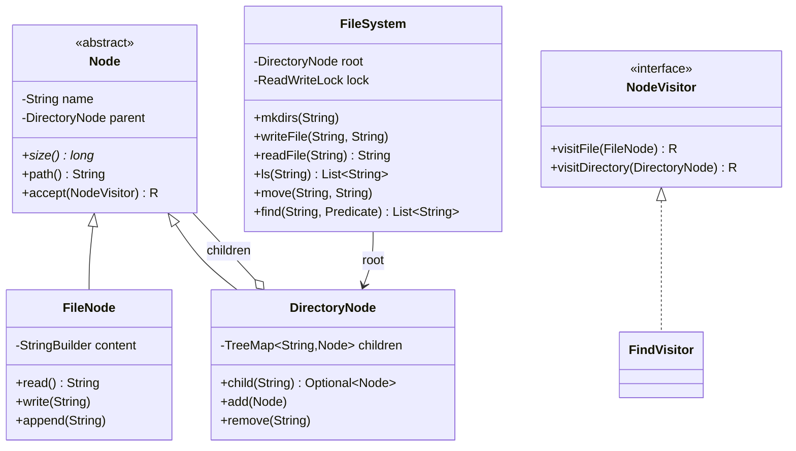

<Related ids={['composite-pattern', 'visitor-pattern', 'iterator-pattern', 'concurrency-for-lld']} />

"Design an in-memory file system" means supporting commands like `mkdir`, `ls`, writing and reading files, deleting, moving and searching, all on a tree that lives in memory. It's the textbook example of the **Composite** pattern, and a common machine-coding round (LeetCode 588 is a version of it). It tests how you model a tree, how carefully you handle paths and errors, and, in the follow-ups, how you work across the whole tree and keep it safe for many threads.

We'll use the same six steps as every case study: requirements, entities, class design, code, a worked example, and follow-ups. (The [parking lot](/system-design/lld/lld-parking-lot) lesson explains the plan in detail.)

## Step 1: Pin down the requirements

<Dialogue>
<Turn who="you">Paths look like `/a/b/c`? Always absolute?</Turn>
<Turn who="them">Yes, absolute. Supporting `.` and `..` would be good.</Turn>
<Turn who="you">Which commands?</Turn>
<Turn who="them">mkdir (creating parents too), write and append to a file, read, ls, delete, move, and size.</Turn>
<Turn who="you">What does `ls` return?</Turn>
<Turn who="them">Sorted names. On a file, just that file's name.</Turn>
<Turn who="you">How should errors look?</Turn>
<Turn who="them">Specific. "No such path" is different from "that's a file, not a folder".</Turn>
<Turn who="you">Many threads at once?</Turn>
<Turn who="them">Yes, eventually.</Turn>
</Dialogue>

**The file system must:**

1. Create folders, including any missing parents (`mkdir -p`).
2. Write, append to and read files.
3. List a folder's contents in sorted order (`ls`); `ls` on a file returns its name.
4. Report the size of a file or a whole folder.
5. Delete, and move or rename, files and folders.
6. Give a specific error for each kind of mistake.
7. Be safe to use from several threads.

**Out of scope for now:** permissions, links, saving to disk.

## Step 2: Find the core entities

| Noun | Make it… | Why |
| --- | --- | --- |
| File | a class | A name and its content. |
| Folder (directory) | a class | A name and its children, which can be files **or** folders. |
| Something in the tree | an abstract class `Node` | Files and folders share a name, a parent and a size. |
| Path | a list of names, after parsing | `"/a/./b/../c"` becomes `["a", "c"]` once, up front. |
| File system | a class | The front door: parses paths, finds nodes, reports errors, locks. |

The key decision is how files and folders relate:

<Approach verdict="bad" title="Two unrelated classes">

`File` and `Folder` with nothing in common. A folder needs two lists, `List<File> files` and `List<Folder> folders`, and every operation (size, delete, search) has to handle both, with `instanceof` checks everywhere.

</Approach>

<Approach verdict="great" title="One shared Node type (Composite)">

`FileNode` and `DirectoryNode` both extend `Node`. A folder holds `Map<String, Node>`, so its children can be either. Then `size()` on a file returns its length, and `size()` on a folder **adds up its children's sizes**, whatever they are. The recursion lives in the structure, and callers never need to know which kind they have. That's the **Composite** pattern: treat a single item and a group of items the same way.

</Approach>

## Step 3: Design each class

**`Node`** (abstract): knows its name and its parent folder. Every node can report its `size()` and its full `path()`.

**`FileNode`**: knows its content. It can read, write (replace) and append.

**`DirectoryNode`**: knows its children in a **`TreeMap`**, keyed by name. A `TreeMap` keeps keys sorted, so `ls` comes out in order for free, and finding a child by name is O(log n). It can add, remove and look up a child.

Only `DirectoryNode` has `add` and `remove`. That way, nobody can ever ask a file to hold a child.

Every node also knows its **parent**. That makes three things easy: building the full path, handling `..`, and stopping a folder being moved inside itself (more below).

**`FileSystem`**: does all the path work. Every command follows the same three steps:

1. **Parse** the path into clean parts.
2. **Walk** down the tree from the root, one part at a time, failing with a specific error if a part is missing or isn't a folder.
3. **Do** the command on the node found.



## Step 4: Write the code

<InterviewScope minutes="45–60" lines="70" write={["Files and folders sharing one `Node` type (Composite)", "Path splitting and walking the tree", "`mkdir -p`, write, read, `ls` and `size`"]} say={["`mv` and how to stop moving a folder inside itself", "Visitors for search and size reports", "Locking a tree: one lock first, finer locks later"]} skip={["Permissions, links and file handles", "Disk blocks and inodes"]} />

### The interview-sized version

A Composite tree with path handling and the five commands interviewers usually ask for. It's about **70 lines**, and it compiles and runs.

```java
abstract class Node {                                  // Composite: files and folders share one type
    final String name;
    Node(String name) { this.name = name; }
    abstract int size();
}

class FileNode extends Node {
    private final StringBuilder content = new StringBuilder();
    FileNode(String name) { super(name); }
    void append(String text) { content.append(text); }
    String read() { return content.toString(); }
    int size() { return content.length(); }
}

class Directory extends Node {
    final Map<String, Node> children = new TreeMap<>(); // sorted, so ls comes out in order
    Directory(String name) { super(name); }
    int size() { return children.values().stream().mapToInt(Node::size).sum(); }
}

class FileSystem {
    private final Directory root = new Directory("");

    synchronized void mkdir(String path) {             // like mkdir -p
        Directory dir = root;
        for (String part : parts(path)) {
            Node child = dir.children.computeIfAbsent(part, Directory::new);
            if (!(child instanceof Directory d)) throw new IllegalArgumentException(part + " is a file");
            dir = d;
        }
    }

    synchronized void writeFile(String path, String text) {
        List<String> p = parts(path);
        Directory parent = directoryAt(p.subList(0, p.size() - 1));
        Node node = parent.children.computeIfAbsent(p.get(p.size() - 1), FileNode::new);
        if (!(node instanceof FileNode file)) throw new IllegalArgumentException(path + " is a directory");
        file.append(text);
    }

    synchronized String read(String path) {
        if (!(nodeAt(parts(path)) instanceof FileNode file)) throw new IllegalArgumentException(path + " is a directory");
        return file.read();
    }

    synchronized List<String> ls(String path) {
        Node node = nodeAt(parts(path));
        return node instanceof Directory d ? List.copyOf(d.children.keySet()) : List.of(node.name);
    }

    synchronized int size(String path) { return nodeAt(parts(path)).size(); }

    private Node nodeAt(List<String> parts) {
        Node node = root;
        for (String part : parts) {
            if (!(node instanceof Directory d) || !d.children.containsKey(part))
                throw new IllegalArgumentException("No such path: /" + String.join("/", parts));
            node = d.children.get(part);
        }
        return node;
    }

    private Directory directoryAt(List<String> parts) {
        if (!(nodeAt(parts) instanceof Directory d)) throw new IllegalArgumentException("Not a directory");
        return d;
    }

    private static List<String> parts(String path) {
        return Arrays.stream(path.split("/")).filter(s -> !s.isEmpty()).toList();
    }
}
```

**Reading it top to bottom:**

1. **`Node`** declares `size()`. `FileNode.size()` is its content length; `Directory.size()` sums its children's sizes, recursively.
2. **`parts(path)`** splits on `/` and drops empty pieces, so `"/a//b/"` becomes `["a", "b"]`.
3. **`mkdir`** walks the parts. `computeIfAbsent` creates a missing folder as it goes (that's `mkdir -p`). If a part turns out to be a file, it fails.
4. **`writeFile`** finds the parent folder (every part except the last), then gets or creates the file. It refuses if the name is already a folder.
5. **`nodeAt`** is the shared "walk the tree" helper, with one clear error for a missing path.
6. **`ls`** returns the sorted child names of a folder, or just the name for a file.
7. Every public method is `synchronized`: one lock for the whole tree. Simple and correct.

<Callout type="tip" title="How to practise this">
Draw this tree first: `/` containing `docs` (containing `a.txt` and `b.txt`) and `notes.txt`. Then trace `size("/")`. Once the recursion feels obvious, write the code.
</Callout>

### Growing it into the full design

#### The nodes

`Node` is **sealed**: only `FileNode` and `DirectoryNode` may extend it. `path()` builds the full path by asking the parent for its path and adding this node's name.

```java
public abstract sealed class Node permits FileNode, DirectoryNode {
    private String name;
    private DirectoryNode parent;
    Node(String name) { this.name = name; }

    public abstract long size();
    public abstract <R> R accept(NodeVisitor<R> v);

    public String path() {
        if (parent == null) return "/";
        String p = parent.path();
        return (p.equals("/") ? "" : p) + "/" + name;
    }
    // name(), rename(), parent(), setParent() omitted
}

public final class FileNode extends Node {
    private final StringBuilder content = new StringBuilder();
    public long size() { return content.length(); }
    public String read() { return content.toString(); }
    public void write(String s) { content.setLength(0); content.append(s); }
    public void append(String s) { content.append(s); }
    public <R> R accept(NodeVisitor<R> v) { return v.visitFile(this); }
}

public final class DirectoryNode extends Node {
    private final TreeMap<String, Node> children = new TreeMap<>();   // sorted for ls
    public long size() { return children.values().stream().mapToLong(Node::size).sum(); }
    public Optional<Node> child(String name) { return Optional.ofNullable(children.get(name)); }
    public void add(Node n) { children.put(n.name(), n); n.setParent(this); }
    public void remove(String name) { Node n = children.remove(name); if (n != null) n.setParent(null); }
    public <R> R accept(NodeVisitor<R> v) { return v.visitDirectory(this); }
}
```

#### Parsing paths, including `.` and `..`

Clean the path once, then everything else works with a simple list. Use a stack: skip empty parts and `.`; for `..`, pop the last part (staying at the root if already there); push anything else.

```java
private List<String> parts(String path) {
    if (path == null || !path.startsWith("/")) throw new InvalidPathException(path);
    Deque<String> stack = new ArrayDeque<>();
    for (String part : path.split("/")) {
        if (part.isEmpty() || part.equals(".")) continue;
        if (part.equals("..")) { if (!stack.isEmpty()) stack.removeLast(); continue; }   // ".." at / stays at /
        stack.addLast(part);
    }
    return new ArrayList<>(stack);
}

private Node resolve(String path) {
    Node cur = root;
    for (String part : parts(path)) {
        if (!(cur instanceof DirectoryNode d)) throw new NotADirectoryException(cur.path());
        cur = d.child(part).orElseThrow(() -> new NoSuchPathException(path));
    }
    return cur;
}
```

So `/a/./b/../c` becomes `["a", "c"]`. `resolve` then walks the tree with a specific error for each problem: "not a directory" if we hit a file mid-path, "no such path" if a name is missing.

#### The commands

`writeFile` checks the parent exists, refuses if the name is a folder, overwrites an existing file, or creates a new one.

`move` is the one to study. In plain steps:

1. Find the source node.
2. Find the destination's parent folder.
3. **Walk up from the destination folder to the root.** If we meet the source on the way, the destination is **inside** the source. Refuse.
4. Refuse if the destination name is already taken.
5. Detach the source from its old parent, rename it, attach it to the new parent.

```java
public void writeFile(String path, String content) {
    write(() -> { fileForWrite(path).write(content); return null; });
}

private FileNode fileForWrite(String path) {
    List<String> p = parts(path);
    if (p.isEmpty()) throw new IsADirectoryException("/");
    DirectoryNode dir = existingDir(p.subList(0, p.size() - 1));       // parent must exist
    Node existing = dir.child(p.getLast()).orElse(null);
    if (existing instanceof DirectoryNode) throw new IsADirectoryException(path);
    if (existing instanceof FileNode f) return f;                        // overwrite
    FileNode f = new FileNode(p.getLast());
    dir.add(f);
    return f;
}

public List<String> ls(String path) {
    return read(() -> {
        Node n = resolve(path);
        if (n instanceof FileNode f) return List.of(f.name());
        return ((DirectoryNode) n).children().stream().map(Node::name).toList();
    });
}

public void move(String from, String to) {
    write(() -> {
        Node src = resolve(from);
        List<String> target = parts(to);
        DirectoryNode destParent = existingDir(target.subList(0, target.size() - 1));
        for (Node p = destParent; p != null; p = p.parent())             // walk up from the destination
            if (p == src) throw new InvalidMoveException("Cannot move " + from + " into itself");
        String newName = target.getLast();
        if (destParent.child(newName).isPresent()) throw new AlreadyExistsException(to);
        src.parent().remove(src.name());
        src.rename(newName);
        destParent.add(src);
        return null;
    });
}
```

Step 3 is what interviewers look for. Moving `/a` into `/a/b/c` would cut the `/a` subtree off from the root and make it its own ancestor, a loop. With parent pointers, checking costs only O(depth).

#### Working across the whole tree: Visitor

Requests like "find every `.log` file over 1 MB" or "total size by file type" go over every node. Putting each of these as a method on `Node` would bloat it. A **visitor** keeps them in their own classes: the visitor has one method per node type, and each node just calls the right one.

```java
public interface NodeVisitor<R> {
    R visitFile(FileNode f);
    R visitDirectory(DirectoryNode d);
}

public final class FindVisitor implements NodeVisitor<Void> {
    private final Predicate<Node> predicate;
    final List<String> matches = new ArrayList<>();
    FindVisitor(Predicate<Node> predicate) { this.predicate = predicate; }

    public Void visitFile(FileNode f) { if (predicate.test(f)) matches.add(f.path()); return null; }
    public Void visitDirectory(DirectoryNode d) {
        if (predicate.test(d)) matches.add(d.path());
        for (Node c : d.children()) c.accept(this);
        return null;
    }
}

fs.find("/", n -> n instanceof FileNode f && f.name().endsWith(".log") && f.size() > 1_000_000);
```

Because `Node` is sealed, a `switch` with pattern matching is an equally good modern alternative. ([Visitor](/system-design/lld/visitor-pattern) discusses the trade-off.)

#### Concurrency

The simplest correct design is **one read-write lock for the whole tree**. `ls`, `readFile`, `size` and `find` take the **read** lock and can run at the same time. Anything that changes the tree or a file takes the **write** lock and runs alone.

```java
private final ReadWriteLock lock = new ReentrantReadWriteLock();

private <T> T read(Callable<T> op) {
    lock.readLock().lock();
    try { return op.call(); } catch (RuntimeException e) { throw e; } catch (Exception e) { throw new IllegalStateException(e); }
    finally { lock.readLock().unlock(); }
}
```

If the interviewer pushes for more concurrency:

| Option | Idea | Catch |
| --- | --- | --- |
| A lock per folder, taken top-down | Lock each folder along the path ("lock coupling") | `move` needs two paths locked: lock them in a fixed order (by path string) to avoid deadlock |
| A lock per file for content | Writes to different files run in parallel | Changing the tree still needs folder locks |
| Copy-on-write tree | Writers build a new copy of the changed path and swap the root atomically | Readers never wait; every write creates objects |

In the round, the single read-write lock plus a sentence about lock coupling is the right depth. The reference solution creates 3,200 files from 16 threads at once and checks none are lost.

## Step 5: Trace some commands

1. `mkdir("/docs/2024")`: `docs` doesn't exist, so it's created; `2024` is created inside it.
2. `writeFile("/docs/2024/plan.txt", "hello")`: the parent `/docs/2024` exists; `plan.txt` is created with 5 characters.
3. `writeFile("/docs/2024", "x")`: the last part is a folder, so: "is a directory".
4. `ls("/docs")` → `["2024"]`. `ls("/docs/2024/plan.txt")` → `["plan.txt"]`.
5. `size("/")` → root asks `docs`, which asks `2024`, which asks `plan.txt`: 5.
6. `move("/docs", "/docs/2024/old")`: walking up from `/docs/2024` reaches `/docs`, the source itself. Refused: "cannot move into itself".
7. `readFile("/docs/../docs/2024/./plan.txt")`: the path cleans to `["docs", "2024", "plan.txt"]` → `"hello"`.

## Step 6: Handle follow-up questions

**"Make folder size O(1)."** Keep a cached size on each folder. When a file grows by n bytes, add n to every ancestor. When a node moves, subtract its size from the old ancestors and add it to the new ones. Writes become O(depth) instead of reads being O(whole subtree).

**"Add `du`: each child with its size, largest first."** A new visitor (or a method on the file system using one). The node classes don't change.

**"Symbolic links."** A third node type holding a target path. While resolving, a link restarts resolution from its target. Guard against loops (`a → b → a`) with a hop limit; Linux uses 40.

**"Permissions."** An owner and permission bits on each node, checked in `FileSystem` before every command.

**"Huge files."** Store content in fixed-size blocks instead of one string, as real file systems do.

## Common mistakes

- **Separate `File` and `Folder` lists** instead of one `Node` type.
- **Not checking for moving a folder inside itself.**
- **One vague error for everything**, instead of "no such path", "not a directory", "is a directory" and so on.
- **Parsing paths in every method** instead of once.
- **Putting `add`/`remove` on `Node`**, so files can be asked to hold children.
- **Sorting children on every `ls`** when a `TreeMap` keeps them sorted.

## Patterns used

| Pattern | Where |
| --- | --- |
| **Composite** | `Node`, `FileNode`, `DirectoryNode`; `size()` adds up recursively |
| **Visitor** | `find` and other whole-tree operations |
| **Facade** | `FileSystem` hides path parsing, errors and locking |
| **Iterator** (alternative) | Depth-first traversal for streaming very large trees |

## Interview questions

<QA q="Why is the file system a good fit for the Composite pattern?">
Files and folders form a tree of parts and wholes, and many operations (size, delete, search, permissions) must treat one file and a whole folder the same way. With a shared Node type, a folder carries out those operations by asking its children, so callers never check the type and the recursion is written once, in the structure itself.
</QA>

<QA q="How do you stop someone moving a directory into its own subdirectory?">
Before moving, walk up from the destination's parent folder to the root using parent pointers. If you meet the source node on the way, the destination is inside the source and the move would create a loop, so refuse it. With parent pointers this costs O(depth).
</QA>

<QA q="How would you make directory size O(1)?">
Cache a size on each folder and update it as things change: when a file grows by n bytes, add n to every ancestor's cached size; when a node is added, removed or moved, subtract its size from the old ancestors and add it to the new ones. Writes become O(depth) instead of reads being O(subtree size); do the updates under the same lock as the change.
</QA>

<Practice task="Add 'du -h'-style output: for a directory, print each child with its total size, largest first. Which class does the work?">

A new visitor (or a method on the file system that uses one): for each child of the folder, get `child.size()` (or the cached size), sort largest first, and format. Nothing in `FileNode` or `DirectoryNode` changes, which is the point of keeping whole-tree operations in visitors.

</Practice>

<Practice task="Support symbolic links. What changes in path resolution, and what new failure mode must you guard against?">

Add a `SymlinkNode` holding a target path. In `resolve`, when you reach a link in the middle of a path (or at the end, for reads), restart resolution from its target with the remaining parts added on. Guard against loops (`a → b → a`) with a hop limit (Linux uses 40) and fail with a clear error. `size` and `find` must decide whether to follow links; usually not, to avoid double counting and endless recursion.

</Practice>

<Takeaways>

- Composite: one `Node` type for files and folders, children only on folders, recursive operations in the structure.
- Clean each path once (`.`, `..`, extra slashes), then walk the tree with a specific error for each problem.
- Parent pointers give you `path()`, `..` and a safe `move`.
- Put whole-tree queries in visitors (or a sealed-type `switch`).
- One read-write lock is a correct starting point; name lock coupling and copy-on-write as next steps.

</Takeaways>

## Further reading

- [Composite](/system-design/lld/composite-pattern) and [Visitor](/system-design/lld/visitor-pattern).
- Remzi and Andrea Arpaci-Dusseau, *Operating Systems: Three Easy Pieces*: the file system chapters (free online).
