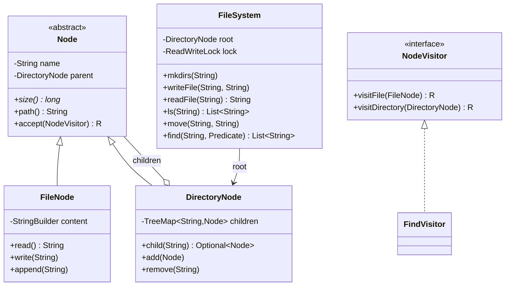

<Related ids={['composite-pattern', 'visitor-pattern', 'iterator-pattern', 'concurrency-for-lld']} />

"Design an in-memory file system" (`mkdir`, `ls`, read/write files, delete, move, find) is the textbook **Composite** problem, and a common machine-coding round in its own right (a version of it is LeetCode 588). It tests tree modelling, path parsing, precise error handling and — in the follow-ups — operations over the whole tree and thread safety.

## What the interviewer expects

The full design in this lesson is longer than anything you'd write in one round. It's there so you understand the edge cases and can answer follow-up questions. In the round itself, aim for this:

<InterviewScope minutes="45–60" lines="70" write={["Files and folders sharing one `Node` type (Composite)", "Path splitting and walking the tree", "`mkdir -p`, write, read, `ls` and `size`"]} say={["`mv` and how to stop moving a folder inside itself", "Visitors for search and size reports", "Locking a tree: one lock first, finer locks later"]} skip={["Permissions, links and file handles", "Disk blocks and inodes"]} />

### The interview-sized version

A Composite tree with path handling and the five commands interviewers usually ask for. It's about **70 lines**, and it compiles and runs.

```java
abstract class Node {                                  // Composite: files and folders share one type
    final String name;
    Node(String name) { this.name = name; }
    abstract int size();
}

class FileNode extends Node {
    private final StringBuilder content = new StringBuilder();
    FileNode(String name) { super(name); }
    void append(String text) { content.append(text); }
    String read() { return content.toString(); }
    int size() { return content.length(); }
}

class Directory extends Node {
    final Map<String, Node> children = new TreeMap<>(); // sorted, so ls comes out in order
    Directory(String name) { super(name); }
    int size() { return children.values().stream().mapToInt(Node::size).sum(); }
}

class FileSystem {
    private final Directory root = new Directory("");

    synchronized void mkdir(String path) {             // like mkdir -p
        Directory dir = root;
        for (String part : parts(path)) {
            Node child = dir.children.computeIfAbsent(part, Directory::new);
            if (!(child instanceof Directory d)) throw new IllegalArgumentException(part + " is a file");
            dir = d;
        }
    }

    synchronized void writeFile(String path, String text) {
        List<String> p = parts(path);
        Directory parent = directoryAt(p.subList(0, p.size() - 1));
        Node node = parent.children.computeIfAbsent(p.get(p.size() - 1), FileNode::new);
        if (!(node instanceof FileNode file)) throw new IllegalArgumentException(path + " is a directory");
        file.append(text);
    }

    synchronized String read(String path) {
        if (!(nodeAt(parts(path)) instanceof FileNode file)) throw new IllegalArgumentException(path + " is a directory");
        return file.read();
    }

    synchronized List<String> ls(String path) {
        Node node = nodeAt(parts(path));
        return node instanceof Directory d ? List.copyOf(d.children.keySet()) : List.of(node.name);
    }

    synchronized int size(String path) { return nodeAt(parts(path)).size(); }

    private Node nodeAt(List<String> parts) {
        Node node = root;
        for (String part : parts) {
            if (!(node instanceof Directory d) || !d.children.containsKey(part))
                throw new IllegalArgumentException("No such path: /" + String.join("/", parts));
            node = d.children.get(part);
        }
        return node;
    }

    private Directory directoryAt(List<String> parts) {
        if (!(nodeAt(parts) instanceof Directory d)) throw new IllegalArgumentException("Not a directory");
        return d;
    }

    private static List<String> parts(String path) {
        return Arrays.stream(path.split("/")).filter(s -> !s.isEmpty()).toList();
    }
}
```

<Callout type="tip" title="How to use the rest of this lesson">
Practise writing the short version above, in your own words, until you can do it in about 30 minutes. Then read the full design below for the edge cases and follow-up answers. Interviewers often ask about those, but they rarely ask you to type them all.
</Callout>

## 1. Requirements

| Question | Assumption |
| --- | --- |
| Paths | Absolute, `/`-separated; support `.` and `..` |
| Operations | `mkdir`, `mkdirs` (create parents), `writeFile`, `appendFile`, `readFile`, `ls`, `delete` (optionally recursive), `move`/rename, `size`, `find` |
| `ls` output | Sorted names; `ls` on a file returns just that file's name |
| Errors | Specific: no such path, not a directory, is a directory, already exists, directory not empty |
| Concurrency | Many threads may use the file system at once |
| Out of scope | Permissions, links, persistence (extensions) |

## 2. Model: Composite

Files and directories share an interface (name, parent, size), and a directory holds children of either kind. The size of a directory is the sum of its children's sizes — the recursion lives in the structure.



Design choices:

- **`TreeMap` for children**: `ls` must be sorted, and lookups by name are O(log n). A `HashMap` plus sorting on every `ls` also works.
- **Child management only on `DirectoryNode`** (the "safe" Composite variant): a file can never be asked to `add` a child.
- **Parent pointers** make `path()` and `..` easy, and let `move` detect cycles.
- **`FileSystem` is the facade**: it owns path parsing, error reporting and locking; nodes stay simple.

## 3. Implementation

### Nodes

```java
public abstract sealed class Node permits FileNode, DirectoryNode {
    private String name;
    private DirectoryNode parent;
    Node(String name) { this.name = name; }

    public abstract long size();
    public abstract <R> R accept(NodeVisitor<R> v);

    public String path() {
        if (parent == null) return "/";
        String p = parent.path();
        return (p.equals("/") ? "" : p) + "/" + name;
    }
    // name(), rename(), parent(), setParent() omitted
}

public final class FileNode extends Node {
    private final StringBuilder content = new StringBuilder();
    public long size() { return content.length(); }
    public String read() { return content.toString(); }
    public void write(String s) { content.setLength(0); content.append(s); }
    public void append(String s) { content.append(s); }
    public <R> R accept(NodeVisitor<R> v) { return v.visitFile(this); }
}

public final class DirectoryNode extends Node {
    private final TreeMap<String, Node> children = new TreeMap<>();   // sorted for ls
    public long size() { return children.values().stream().mapToLong(Node::size).sum(); }
    public Optional<Node> child(String name) { return Optional.ofNullable(children.get(name)); }
    public void add(Node n) { children.put(n.name(), n); n.setParent(this); }
    public void remove(String name) { Node n = children.remove(name); if (n != null) n.setParent(null); }
    public <R> R accept(NodeVisitor<R> v) { return v.visitDirectory(this); }
}
```

### Path parsing — normalise first

Turn a path string into clean components once, handling `.`, `..` and repeated slashes; everything else works on the list.

```java
private List<String> parts(String path) {
    if (path == null || !path.startsWith("/")) throw new InvalidPathException(path);
    Deque<String> stack = new ArrayDeque<>();
    for (String part : path.split("/")) {
        if (part.isEmpty() || part.equals(".")) continue;
        if (part.equals("..")) { if (!stack.isEmpty()) stack.removeLast(); continue; }   // ".." at / stays at /
        stack.addLast(part);
    }
    return new ArrayList<>(stack);
}

private Node resolve(String path) {
    Node cur = root;
    for (String part : parts(path)) {
        if (!(cur instanceof DirectoryNode d)) throw new NotADirectoryException(cur.path());
        cur = d.child(part).orElseThrow(() -> new NoSuchPathException(path));
    }
    return cur;
}
```

### Operations

```java
public void writeFile(String path, String content) {
    write(() -> { fileForWrite(path).write(content); return null; });
}

private FileNode fileForWrite(String path) {
    List<String> p = parts(path);
    if (p.isEmpty()) throw new IsADirectoryException("/");
    DirectoryNode dir = existingDir(p.subList(0, p.size() - 1));       // parent must exist
    Node existing = dir.child(p.getLast()).orElse(null);
    if (existing instanceof DirectoryNode) throw new IsADirectoryException(path);
    if (existing instanceof FileNode f) return f;                        // overwrite
    FileNode f = new FileNode(p.getLast());
    dir.add(f);
    return f;
}

public List<String> ls(String path) {
    return read(() -> {
        Node n = resolve(path);
        if (n instanceof FileNode f) return List.of(f.name());
        return ((DirectoryNode) n).children().stream().map(Node::name).toList();
    });
}

public void move(String from, String to) {
    write(() -> {
        Node src = resolve(from);
        List<String> target = parts(to);
        DirectoryNode destParent = existingDir(target.subList(0, target.size() - 1));
        for (Node p = destParent; p != null; p = p.parent())             // walk up from the destination
            if (p == src) throw new InvalidMoveException("Cannot move " + from + " into itself");
        String newName = target.getLast();
        if (destParent.child(newName).isPresent()) throw new AlreadyExistsException(to);
        src.parent().remove(src.name());
        src.rename(newName);
        destParent.add(src);
        return null;
    });
}
```

The **cycle check in `move`** is the detail interviewers look for: moving `/a` into `/a/b/c` would detach a subtree and make it its own ancestor. Walking up from the destination with parent pointers catches it in O(depth).

### Operations over the whole tree: Visitor

"Find all `.log` files larger than 1 MB" or "total size by extension" are operations across every node. A visitor keeps them out of the node classes:

```java
public interface NodeVisitor<R> {
    R visitFile(FileNode f);
    R visitDirectory(DirectoryNode d);
}

public final class FindVisitor implements NodeVisitor<Void> {
    private final Predicate<Node> predicate;
    final List<String> matches = new ArrayList<>();
    FindVisitor(Predicate<Node> predicate) { this.predicate = predicate; }

    public Void visitFile(FileNode f) { if (predicate.test(f)) matches.add(f.path()); return null; }
    public Void visitDirectory(DirectoryNode d) {
        if (predicate.test(d)) matches.add(d.path());
        for (Node c : d.children()) c.accept(this);
        return null;
    }
}

fs.find("/", n -> n instanceof FileNode f && f.name().endsWith(".log") && f.size() > 1_000_000);
```

Because `Node` is a **sealed** class, a `switch` with pattern matching is an equally good modern alternative to the visitor ([Visitor](/system-design/lld/visitor-pattern) discusses the trade-off).

## 4. Concurrency

The simplest correct design is **one read-write lock for the whole tree**: `ls`, `readFile`, `size` and `find` take the read lock and run in parallel; anything that changes structure or content takes the write lock.

```java
private final ReadWriteLock lock = new ReentrantReadWriteLock();

private <T> T read(Callable<T> op) {
    lock.readLock().lock();
    try { return op.call(); } catch (RuntimeException e) { throw e; } catch (Exception e) { throw new IllegalStateException(e); }
    finally { lock.readLock().unlock(); }
}
```

Finer-grained options, in increasing complexity:

| Option | Idea | Catch |
| --- | --- | --- |
| Lock per directory, acquired top-down | Lock each directory along the path ("lock coupling") | `move` needs two paths locked: lock in a global order (for example by path string) to avoid deadlock |
| Lock per file for content | Writes to different files proceed in parallel | Structure changes still need directory locks |
| Copy-on-write tree | Writers build a new path of nodes and swap the root atomically | Readers never block; writes allocate |

For an interview, the single read-write lock plus a sentence on lock coupling is the right depth. The reference solution creates 3,200 files from 16 threads concurrently and checks none are lost.

## 5. Patterns used

| Pattern | Where |
| --- | --- |
| **Composite** | `Node`, `FileNode`, `DirectoryNode`; recursive `size()` |
| **Visitor** | `find` and other whole-tree operations |
| **Facade** | `FileSystem` hides path parsing, errors and locking |
| **Iterator** (alternative) | Depth-first traversal for streaming large trees |

## 6. Extensions

- **Permissions**: an owner and mode bits on `Node`; check them in the facade before each operation (a protection proxy is another option).
- **Symbolic links**: a third `Node` kind holding a target path; `resolve` follows links with a hop limit to stop loops.
- **Large files**: store content in fixed-size blocks instead of one `StringBuilder`; this is how real file systems and HDFS work.
- **Size caching**: keep a running size on each directory and update ancestors on every write — O(depth) per write instead of O(subtree) per `size()`.

## Interview questions

<QA q="Why is the file system a good fit for the Composite pattern?">
Files and directories form a part-whole tree, and many operations (size, delete, search, permissions) must treat a single file and a whole directory uniformly. With a common Node type, a directory implements those operations by delegating to its children, so callers never branch on type and the recursion is defined once, in the structure itself.
</QA>

<QA q="How do you stop someone moving a directory into its own subdirectory?">
Before moving, walk up from the destination's parent directory to the root using parent pointers. If you meet the source node on the way, the destination is inside the source and the move would create a cycle, so reject it. With parent pointers this costs O(depth).
</QA>

<QA q="How would you make directory size O(1)?">
Cache a size field on each directory and update it incrementally: when a file grows by n bytes, add n to every ancestor's cached size; when a node is added, removed or moved, subtract its size from the old ancestors and add it to the new ones. Writes become O(depth) instead of reads being O(subtree size); do the updates under the same lock as the change.
</QA>

<Practice task="Add 'du -h'-style output: for a directory, print each child with its total size, largest first. Which class does the work?">

A new visitor (or a method on the facade that uses one): for each child of the directory, compute `child.size()` (or use cached sizes), sort descending, and format. Nothing in `FileNode` or `DirectoryNode` changes — that's the point of keeping whole-tree operations in visitors.

</Practice>

<Practice task="Support symbolic links. What changes in path resolution, and what new failure mode must you guard against?">

Add a `SymlinkNode` holding a target path. In `resolve`, when you reach a symlink in the middle of a path (or at the end, for reads), restart resolution from its target, appending the remaining components. Guard against loops (`a → b → a`) with a hop limit (Linux uses 40) and fail with a clear error. `size` and `find` must decide whether to follow links — usually not, to avoid double counting and infinite recursion.

</Practice>

<Takeaways>

- Composite models the tree: shared `Node` type, children only on directories, recursive operations in the structure.
- Normalise paths once (`.`, `..`, extra slashes) and give each failure its own exception.
- Use parent pointers for `path()`, `..` and cycle-safe `move`.
- Put whole-tree queries in visitors (or a sealed-type switch).
- One read-write lock is a correct baseline; name lock coupling and copy-on-write as next steps.

</Takeaways>

## Further reading

- [Composite](/system-design/lld/composite-pattern) and [Visitor](/system-design/lld/visitor-pattern).
- Remzi and Andrea Arpaci-Dusseau, *Operating Systems: Three Easy Pieces* — the file system chapters (free online).
