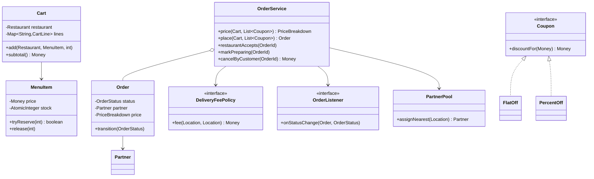
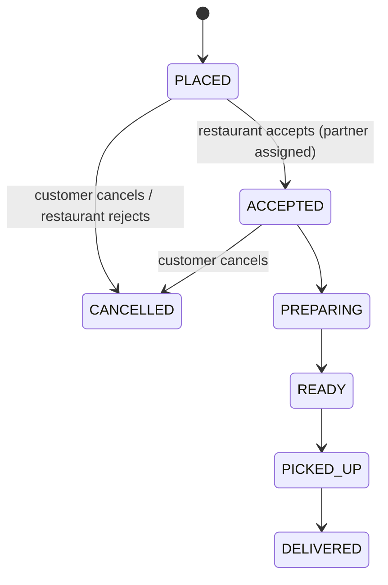

<Related ids={['state-pattern', 'strategy-pattern', 'observer-pattern', 'concurrency-for-lld', 'lld-cab-booking']} />

"Design Swiggy" (or Zomato) in an LLD round is about what happens to one order inside the app: you fill a cart from a restaurant, apply a coupon, place the order, the restaurant cooks it, a delivery partner picks it up, and you get a notification at every step. It uses most of the patterns from earlier case studies at once, so it's really a test of whether you can **combine** them without everything ending up in one giant `OrderService` class.

We'll use the same six steps as every case study: requirements, entities, class design, code, a worked example, and follow-ups. (The [parking lot](/system-design/lld/lld-parking-lot) lesson explains the plan in detail.)

## Step 1: Pin down the requirements

<Dialogue>
<Turn who="you">Can a cart hold items from more than one restaurant?</Turn>
<Turn who="them">No, one restaurant per cart, like the real apps.</Turn>
<Turn who="you">Do some items have limited stock?</Turn>
<Turn who="them">Yes. A restaurant might make only 10 thalis a day.</Turn>
<Turn who="you">How is the price made up?</Turn>
<Turn who="them">Items, plus a delivery fee based on distance, minus the best coupon, plus 5% tax.</Turn>
<Turn who="you">What stages does an order go through?</Turn>
<Turn who="them">Placed, accepted by the restaurant, preparing, ready, picked up, delivered.</Turn>
<Turn who="you">When can the customer cancel?</Turn>
<Turn who="them">Until the restaurant starts preparing. And the restaurant can reject a new order.</Turn>
<Turn who="you">Who gets notified, and when?</Turn>
<Turn who="them">Customer, restaurant and delivery partner, on every status change.</Turn>
</Dialogue>

**The system must:**

1. Let a customer build a cart from **one** restaurant's menu.
2. Price the order: subtotal + delivery fee − best coupon + tax, shown line by line.
3. Place the order, **reserving** limited-stock items so they're never oversold.
4. Move the order through its stages, rejecting impossible moves.
5. Allow cancellation until preparation starts, undoing everything the order reserved.
6. Assign the nearest free delivery partner when the restaurant accepts.
7. Notify everyone involved at every status change.

**Out of scope for now:** restaurant admin, ratings, live map tracking, refunds in detail.

## Step 2: Find the core entities

| Noun | Make it… | Why |
| --- | --- | --- |
| Restaurant | a class | A location and a menu. |
| Menu item | a class | Name and price, plus a **stock counter** that many orders change at once. |
| Cart | a class | Its lines **and its own rules** (one restaurant only). |
| Coupon | an **interface** | Flat off, percent off and more. Each offer is its own class. |
| Delivery fee | an interface | Distance-based now, maybe surge-based later. |
| Price breakdown | a record | Subtotal, fee, discount, tax, total. Frozen on the order. |
| Order | a class | Lines, price, status, delivery partner. |
| Order status | an enum + a table of allowed moves | The life cycle. |
| Delivery partner | a class | Location and whether they're free. |
| Order listener | an interface | Anything that wants to hear about status changes (Observer). |
| Order service | a class | The front door: price, place, accept, cancel. |

## Step 3: Design each class

The trick to this problem is putting each rule **next to the data it protects**:

| Rule | Lives in | Why there |
| --- | --- | --- |
| One restaurant per cart | `Cart.add` | The cart is the only thing that can break it. |
| How much a coupon takes off | each `Coupon` class | Each offer's maths is self-contained. |
| Don't sell more thalis than exist | `MenuItem.tryReserve` | The stock counter guards itself. |
| Which status changes are allowed | `Order.transition` | The order guards its own life cycle. |
| Who to tell about a change | `OrderListener`s | The service just announces; listeners decide. |

That leaves `OrderService` thin: it coordinates, but doesn't contain the rules.

**Notifications** are a good example of why this matters:

<Approach verdict="bad" title="The service calls every notifier directly">

```java
order.status = PREPARING;
pushService.notifyCustomer(order);
dashboard.update(order);
smsService.maybeSend(order);
```

Every new channel means editing the service, and every status change has to remember to call all of them.

</Approach>

<Approach verdict="great" title="Publish an event; listeners subscribe">

After every status change, the service calls `publish(order, status)`. The push service, the restaurant dashboard and the SMS service each register as listeners and decide what to do. Adding a new channel means adding one listener. `OrderService` never changes. That's the **Observer** pattern.

</Approach>



## Step 4: Write the code

<InterviewScope minutes="45–60" lines="70" write={["A cart that only allows one restaurant", "Coupons as a strategy", "An order state machine (an enum is enough)"]} say={["Reserving limited stock when the order is placed", "Delivery fee by distance, and a price breakdown", "Assigning a delivery partner"]} skip={["Restaurant admin and menus", "Ratings, refunds and live tracking"]} />

### The interview-sized version

Cart rules, a coupon strategy and an order life cycle that rejects impossible moves. It's about **70 lines**, and it compiles and runs.

```java
record MenuItem(String name, int price) { }

class Restaurant {
    final String id;
    final Map<String, MenuItem> menu = new HashMap<>();
    Restaurant(String id, List<MenuItem> items) { this.id = id; items.forEach(i -> menu.put(i.name(), i)); }
}

class Cart {                                          // the cart owns its own rules
    private String restaurantId;
    private final Map<MenuItem, Integer> lines = new LinkedHashMap<>();

    void add(Restaurant r, String itemName, int qty) {
        if (restaurantId != null && !restaurantId.equals(r.id)) throw new IllegalStateException("Cart has items from another restaurant");
        MenuItem item = r.menu.get(itemName);
        if (item == null) throw new IllegalArgumentException(itemName + " is not on the menu");
        restaurantId = r.id;
        lines.merge(item, qty, Integer::sum);
    }

    int subtotal() { return lines.entrySet().stream().mapToInt(e -> e.getKey().price() * e.getValue()).sum(); }
    boolean isEmpty() { return lines.isEmpty(); }
}

interface Coupon {                                    // Strategy: each offer is one class
    int discount(int subtotal);
    Coupon NONE = subtotal -> 0;
}

record PercentOff(int percent, int maxDiscount) implements Coupon {
    public int discount(int subtotal) { return Math.min(subtotal * percent / 100, maxDiscount); }
}

enum OrderStatus {                                    // an enum is enough for a simple state machine
    PLACED, PREPARING, OUT_FOR_DELIVERY, DELIVERED, CANCELLED;

    boolean canMoveTo(OrderStatus next) {
        return switch (this) {
            case PLACED -> next == PREPARING || next == CANCELLED;
            case PREPARING -> next == OUT_FOR_DELIVERY || next == CANCELLED;
            case OUT_FOR_DELIVERY -> next == DELIVERED;
            case DELIVERED, CANCELLED -> false;
        };
    }
}

class Order {
    final int id;
    final int total;
    OrderStatus status = OrderStatus.PLACED;
    Order(int id, int total) { this.id = id; this.total = total; }

    synchronized void moveTo(OrderStatus next) {
        if (!status.canMoveTo(next)) throw new IllegalStateException("Can't go from " + status + " to " + next);
        status = next;
    }
}

class OrderService {
    private int nextId = 1;

    synchronized Order place(Cart cart, Coupon coupon) {
        if (cart.isEmpty()) throw new IllegalArgumentException("Cart is empty");
        int subtotal = cart.subtotal();
        return new Order(nextId++, subtotal - coupon.discount(subtotal));
    }
}
```

**Reading it top to bottom:**

1. **`Cart.add`** enforces the one-restaurant rule and rejects items not on the menu, before changing anything.
2. **`Coupon`** is an interface with one method. `Coupon.NONE` is a handy "no coupon" value so callers never pass `null`. `PercentOff` takes a percentage but never more than a cap.
3. **`OrderStatus.canMoveTo`** is the whole life cycle in one `switch`: from each status, which statuses can come next. `DELIVERED` and `CANCELLED` lead nowhere.
4. **`Order.moveTo`** asks the enum and throws on an impossible move. It's `synchronized` so two status changes can't interleave.
5. **`OrderService.place`** refuses an empty cart, applies the coupon and creates the order.

Notice that "customers can't cancel once the food is out for delivery" isn't an `if` anywhere. It's simply that `OUT_FOR_DELIVERY` can't move to `CANCELLED`.

<Callout type="tip" title="How to practise this">
Draw the order states as boxes and arrows first. Then write `canMoveTo` straight from the drawing. Then add the cart and coupons.
</Callout>

### Growing it into the full design

#### The cart enforces its own rule

```java
public final class Cart {
    private Restaurant restaurant;
    private final Map<String, CartLine> lines = new LinkedHashMap<>();

    public void add(Restaurant r, MenuItem item, int qty) {
        if (qty <= 0) throw new IllegalArgumentException("quantity must be positive");
        if (restaurant != null && !restaurant.id().equals(r.id())) throw new DifferentRestaurantException();
        restaurant = r;
        lines.merge(item.id(), new CartLine(item, qty), (a, b) -> new CartLine(a.item(), a.quantity() + b.quantity()));
    }

    public Money subtotal() { return lines.values().stream().map(CartLine::total).reduce(Money.ZERO, Money::plus); }
}
```

The one-restaurant rule is a business rule, so the cart enforces it, not the controller or the service. (The app then asks "start a new cart?", but that's a UI decision.)

#### Pricing: coupons as strategies, and a full breakdown

In plain steps, `price(cart, coupons)`:

1. Add up the subtotal.
2. Work out the delivery fee from the restaurant to the customer.
3. Ask each coupon what it would take off, and keep the **best one** (not all of them).
4. Charge 5% tax on the discounted amount.
5. Return every number separately, not just the total.

```java
public interface Coupon {
    String code();
    Money discountFor(Money subtotal);                    // ZERO when it doesn't apply
}

public record FlatOff(String code, Money amount, Money minOrder) implements Coupon {
    public Money discountFor(Money s) { return s.compareTo(minOrder) >= 0 ? amount.min(s) : Money.ZERO; }
}

public record PercentOff(String code, int percent, Money cap, Money minOrder) implements Coupon {
    public Money discountFor(Money s) { return s.compareTo(minOrder) >= 0 ? s.percent(percent).min(cap) : Money.ZERO; }
}

public PriceBreakdown price(Cart cart, List<? extends Coupon> coupons) {
    Money subtotal = cart.subtotal();
    Money fee = deliveryFees.fee(cart.restaurant().location(), cart.customer().address());
    Coupon best = null; Money discount = Money.ZERO;
    for (Coupon c : coupons) {                                       // apply the best one, not all of them
        Money d = c.discountFor(subtotal);
        if (d.compareTo(discount) > 0) { best = c; discount = d; }
    }
    Money tax = subtotal.minus(discount).percent(5);                 // GST on food after discount
    Money total = subtotal.plus(fee).minus(discount).plus(tax);
    return new PriceBreakdown(subtotal, fee, discount, best == null ? null : best.code(), tax, total);
}
```

Why return a breakdown? The app shows each line to the customer, and support staff need to explain every charge. And **store** the breakdown on the order when it's placed: prices and coupons change later, but what this customer paid must not.

Money is stored as integer paise, as always. (The `List<? extends Coupon>` type lets callers pass a list mixing `FlatOff` and `PercentOff` directly.)

#### Placing an order: reserve limited stock safely

Ten thalis left, and a hundred hungry people tapping "order" at once. That's the same race as two cars and one parking spot.

`tryReserve` uses a **compare-and-set loop**: read the stock; if there's enough, try to swap it for the new value; if someone else changed it in between, read again and retry. `place` reserves every line of the cart, and if any line fails, it **gives back** the lines it already reserved. All or nothing.

```java
public boolean tryReserve(int qty) {                       // in MenuItem
    while (true) {
        int cur = stock.get();
        if (cur < qty) return false;
        if (stock.compareAndSet(cur, cur - qty)) return true;
    }
}

public Order place(Cart cart, List<? extends Coupon> coupons) {
    List<CartLine> reserved = new ArrayList<>();
    for (CartLine line : cart.lines()) {
        if (!line.item().tryReserve(line.quantity())) {
            reserved.forEach(l -> l.item().release(l.quantity()));    // roll back earlier lines
            throw new OutOfStockException(line.item().name());
        }
        reserved.add(line);
    }
    Order o = new Order(new OrderId(ids.incrementAndGet()), cart.customer(), cart.restaurant(), cart.lines(), price(cart, coupons));
    orders.put(o.id(), o);
    publish(o, OrderStatus.PLACED);
    return o;
}
```

The reference solution sends 100 orders at once for the last 6 thalis: exactly 6 succeed, and the stock ends at 0, never below. In a real app, payment would happen between reserving and `PLACED`, with the stock released if payment fails.

#### The order's life cycle



The full version uses a table of allowed moves:

```java
private static final Map<OrderStatus, Set<OrderStatus>> ALLOWED = Map.of(
        PLACED,    EnumSet.of(ACCEPTED, CANCELLED),
        ACCEPTED,  EnumSet.of(PREPARING, CANCELLED),
        PREPARING, EnumSet.of(READY),                     // no cancellation once cooking starts
        READY,     EnumSet.of(PICKED_UP),
        PICKED_UP, EnumSet.of(DELIVERED),
        DELIVERED, EnumSet.noneOf(OrderStatus.class),
        CANCELLED, EnumSet.noneOf(OrderStatus.class));

synchronized OrderStatus transition(OrderStatus next) {
    if (!ALLOWED.get(status).contains(next)) throw new IllegalTransitionException(status, next);
    OrderStatus prev = status;
    status = next;
    return prev;
}
```

The cancellation policy **is** this table. "No cancelling once cooking starts" is just the missing arrow from `PREPARING` to `CANCELLED`.

And every way an order can be cancelled must **undo what it reserved**: give back the stock, free the delivery partner and trigger the refund.

```java
private void cancel(Order o) {
    o.transition(OrderStatus.CANCELLED);                  // throws if not allowed; only one canceller wins
    o.lines().forEach(l -> l.item().release(l.quantity()));
    if (o.partner() != null) o.partner().free();
    publish(o, OrderStatus.CANCELLED);
}
```

Because `transition` is synchronized and checks the current status, a customer cancelling and the restaurant rejecting at the same moment can't **both** succeed, so the stock is given back only once.

#### Delivery partners and notifications

Assigning a partner reuses the cab-booking idea: sort free partners by distance to the **restaurant** and claim the first with a compare-and-set, falling back to the next if another order got them first. Assigning when the restaurant **accepts** (not when the order is placed) means the partner travels while the food cooks.

Every status change calls `publish`, and listeners take it from there.

## Step 5: Trace an order

Asha orders 2 thalis (stock: 3 left) and a lassi, with a 20%-off coupon capped at ₹100.

1. Her cart is from one restaurant, so `Cart.add` accepts every item.
2. Pricing: subtotal ₹500, delivery ₹40, the coupon is worth min(₹100, ₹100) = ₹100, tax 5% of ₹400 = ₹20. Total ₹460. The breakdown is stored on the order.
3. `place` reserves 2 thalis (stock 3 → 1) and the lassi. Status: `PLACED`. Listeners notify Asha and the restaurant.
4. Ben orders 2 thalis a second later. `tryReserve(2)` sees only 1 left and fails; Ben is told they're sold out. Nothing is reserved for him.
5. The restaurant accepts. A nearby partner is claimed. Status: `ACCEPTED`.
6. Asha cancels. `ACCEPTED → CANCELLED` is allowed, so the 2 thalis go back to stock (1 → 3), the partner is freed, and a refund starts.
7. Had she tried after `PREPARING`, the table would refuse the change and nothing would be undone.

## Step 6: Handle follow-up questions

**"Auto-reject if the restaurant doesn't accept within 3 minutes."** Schedule a timeout when the order is placed. When it fires, try `PLACED → CANCELLED`. If the restaurant accepted in the meantime, that move is no longer allowed, so the timeout does nothing.

**"Let a restaurant coupon and a platform coupon stack."** Pick the best coupon from each source, then apply them in a fixed order (restaurant first, platform on the reduced amount), never discounting more than the subtotal.

**"Coupons only for first orders or certain restaurants."** A chain of eligibility rules checked before a coupon's discount is applied.

**"One partner carries two orders from the same restaurant."** Assignment prefers partners already heading there.

**"Send an SMS when an order is late."** A new listener.

## Common mistakes

- **Putting every rule in `OrderService`**, so it becomes a 500-line class.
- **Overselling limited items** because stock is checked and then decremented in two steps.
- **Reserving some lines and not rolling back** when a later line fails.
- **Cancellation paths that forget to release stock or free the partner.**
- **Recomputing the price later** instead of storing what the customer paid.

## Patterns used

| Pattern | Where |
| --- | --- |
| **State** (table form) | The order life cycle and cancellation rules |
| **Strategy** | `Coupon` types, `DeliveryFeePolicy` |
| **Observer** | `OrderListener` on every status change |
| **Facade** | `OrderService` |
| **Repository** (implied) | Orders, restaurants and partners behind stores |

## Interview questions

<QA q="How do you stop an item with limited stock from being oversold?">
Treat stock as a shared counter and reserve it atomically when the order is placed: a compare-and-set loop that only decreases the count when enough remains (or a conditional UPDATE in the database). Reserve every line of the order or none, giving back earlier lines if a later one fails. Release the reservation on cancellation, rejection or payment failure.
</QA>

<QA q="Where do the cancellation rules live?">
In the order's table of allowed moves. Cancelling is only possible from states where the table allows a move to CANCELLED (PLACED and ACCEPTED here), so "no cancellations once preparation starts" needs no if-statements in the service. The service's cancel method performs the move and then undoes side effects: releasing stock, freeing the partner and issuing the refund.
</QA>

<QA q="Why store the price breakdown on the order instead of recomputing it?">
Prices, delivery fees, taxes and coupons change over time. What an order costs is a fact fixed when it was placed; recomputing it later would show the customer a different amount from what they paid and break refunds and accounting. Store the full breakdown (each part and the coupon used) as an unchangeable value on the order.
</QA>

<Practice task="Add 'restaurant auto-rejects if not accepted within 3 minutes'. Which components change?">

Schedule a timeout when the order is placed (a scheduler job keyed by order id). When it fires, call `restaurantRejects`, but only if the order is still `PLACED`. The table of allowed moves already makes this safe: if the restaurant accepted in the meantime, `PLACED → CANCELLED` no longer applies and the timeout does nothing. Cancel the timer on acceptance to avoid useless work.

</Practice>

<Practice task="Coupons can now stack: one restaurant coupon plus one platform coupon, each from a different source. How does pricing change?">

Group coupons by source and pick the best in each group, then apply them in a fixed order (restaurant discount first, platform discount on the reduced amount), making sure the total discount never exceeds the subtotal. Model each source's selection as a strategy and the stacking order as a small pipeline, so "best single coupon" is just the one-group setting.

</Practice>

<Takeaways>

- Put each rule next to its data: the cart enforces one restaurant, the stock counter guards itself, the order guards its moves.
- Price with coupon strategies, return a line-by-line breakdown, and freeze it on the order.
- Reserve limited stock atomically, all or nothing, and give it back on every cancellation path.
- The table of allowed moves is the cancellation policy.
- Announce every status change to listeners instead of calling each notifier.

</Takeaways>

## Further reading

- [State](/system-design/lld/state-pattern), [Observer](/system-design/lld/observer-pattern) and [Design a Cab Booking System](/system-design/lld/lld-cab-booking) (partner assignment).
- HLD context: [Event-Driven Architecture](/system-design/hld/event-driven-architecture).
