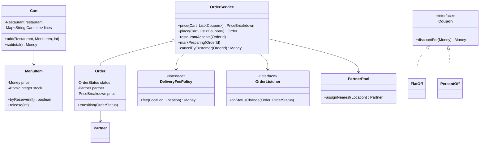
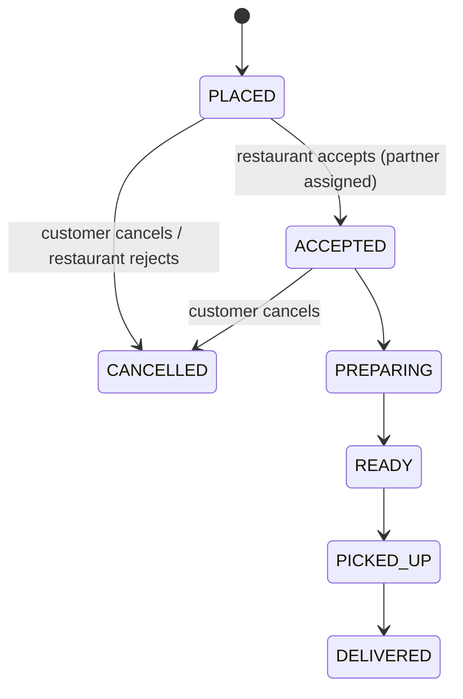

<Related ids={['state-pattern', 'strategy-pattern', 'observer-pattern', 'concurrency-for-lld', 'lld-cab-booking']} />

"Design Swiggy/Zomato" in an LLD round is about the order pipeline inside one service: restaurants and menus, a cart with business rules, a price breakdown with coupons, an **order state machine** with cancellation rules, delivery-partner assignment, and notifications on every status change. It combines most of the patterns from earlier case studies, so it's a good test of whether you can **compose** them without the design turning into one giant service class.

## What the interviewer expects

The full design in this lesson is longer than anything you'd write in one round. It's there so you understand the edge cases and can answer follow-up questions. In the round itself, aim for this:

<InterviewScope minutes="45–60" lines="70" write={["A cart that only allows one restaurant", "Coupons as a strategy", "An order state machine (an enum is enough)"]} say={["Reserving limited stock when the order is placed", "Delivery fee by distance, and a price breakdown", "Assigning a delivery partner"]} skip={["Restaurant admin and menus", "Ratings, refunds and live tracking"]} />

### The interview-sized version

Cart rules, a coupon strategy and an order lifecycle that rejects impossible moves. It's about **70 lines**, and it compiles and runs.

```java
record MenuItem(String name, int price) { }

class Restaurant {
    final String id;
    final Map<String, MenuItem> menu = new HashMap<>();
    Restaurant(String id, List<MenuItem> items) { this.id = id; items.forEach(i -> menu.put(i.name(), i)); }
}

class Cart {                                          // the cart owns its own rules
    private String restaurantId;
    private final Map<MenuItem, Integer> lines = new LinkedHashMap<>();

    void add(Restaurant r, String itemName, int qty) {
        if (restaurantId != null && !restaurantId.equals(r.id)) throw new IllegalStateException("Cart has items from another restaurant");
        MenuItem item = r.menu.get(itemName);
        if (item == null) throw new IllegalArgumentException(itemName + " is not on the menu");
        restaurantId = r.id;
        lines.merge(item, qty, Integer::sum);
    }

    int subtotal() { return lines.entrySet().stream().mapToInt(e -> e.getKey().price() * e.getValue()).sum(); }
    boolean isEmpty() { return lines.isEmpty(); }
}

interface Coupon {                                    // Strategy: each offer is one class
    int discount(int subtotal);
    Coupon NONE = subtotal -> 0;
}

record PercentOff(int percent, int maxDiscount) implements Coupon {
    public int discount(int subtotal) { return Math.min(subtotal * percent / 100, maxDiscount); }
}

enum OrderStatus {                                    // an enum is enough for a simple state machine
    PLACED, PREPARING, OUT_FOR_DELIVERY, DELIVERED, CANCELLED;

    boolean canMoveTo(OrderStatus next) {
        return switch (this) {
            case PLACED -> next == PREPARING || next == CANCELLED;
            case PREPARING -> next == OUT_FOR_DELIVERY || next == CANCELLED;
            case OUT_FOR_DELIVERY -> next == DELIVERED;
            case DELIVERED, CANCELLED -> false;
        };
    }
}

class Order {
    final int id;
    final int total;
    OrderStatus status = OrderStatus.PLACED;
    Order(int id, int total) { this.id = id; this.total = total; }

    synchronized void moveTo(OrderStatus next) {
        if (!status.canMoveTo(next)) throw new IllegalStateException("Can't go from " + status + " to " + next);
        status = next;
    }
}

class OrderService {
    private int nextId = 1;

    synchronized Order place(Cart cart, Coupon coupon) {
        if (cart.isEmpty()) throw new IllegalArgumentException("Cart is empty");
        int subtotal = cart.subtotal();
        return new Order(nextId++, subtotal - coupon.discount(subtotal));
    }
}
```

<Callout type="tip" title="How to use the rest of this lesson">
Practise writing the short version above, in your own words, until you can do it in about 30 minutes. Then read the full design below for the edge cases and follow-up answers. Interviewers often ask about those, but they rarely ask you to type them all.
</Callout>

## 1. Requirements

| Question | Assumption |
| --- | --- |
| Browse | Restaurants with menus; items have prices and may have **limited daily stock** |
| Cart | Items from **one restaurant** only (the real apps' rule); quantities |
| Price | Subtotal + delivery fee (distance-based) − best applicable coupon + tax |
| Order lifecycle | Placed → accepted by restaurant → preparing → ready → picked up → delivered |
| Cancellation | Customer can cancel until preparation starts (full refund); restaurant can reject a placed order |
| Delivery | Nearest free delivery partner assigned when the restaurant accepts |
| Notifications | Customer, restaurant and partner are told about every status change |
| Concurrency | Many customers order the same limited item; many orders compete for partners |

## 2. Class design



## 3. Cart rules live in the cart

```java
public final class Cart {
    private Restaurant restaurant;
    private final Map<String, CartLine> lines = new LinkedHashMap<>();

    public void add(Restaurant r, MenuItem item, int qty) {
        if (qty <= 0) throw new IllegalArgumentException("quantity must be positive");
        if (restaurant != null && !restaurant.id().equals(r.id())) throw new DifferentRestaurantException();
        restaurant = r;
        lines.merge(item.id(), new CartLine(item, qty), (a, b) -> new CartLine(a.item(), a.quantity() + b.quantity()));
    }

    public Money subtotal() { return lines.values().stream().map(CartLine::total).reduce(Money.ZERO, Money::plus); }
}
```

The single-restaurant rule is a business invariant, so the cart enforces it — not the controller and not the service. (The apps then ask "start a new cart?", which is a UI decision.)

## 4. Pricing: strategies and a transparent breakdown

```java
public interface Coupon {
    String code();
    Money discountFor(Money subtotal);                    // ZERO when it doesn't apply
}

public record FlatOff(String code, Money amount, Money minOrder) implements Coupon {
    public Money discountFor(Money s) { return s.compareTo(minOrder) >= 0 ? amount.min(s) : Money.ZERO; }
}

public record PercentOff(String code, int percent, Money cap, Money minOrder) implements Coupon {
    public Money discountFor(Money s) { return s.compareTo(minOrder) >= 0 ? s.percent(percent).min(cap) : Money.ZERO; }
}

public PriceBreakdown price(Cart cart, List<? extends Coupon> coupons) {
    Money subtotal = cart.subtotal();
    Money fee = deliveryFees.fee(cart.restaurant().location(), cart.customer().address());
    Coupon best = null; Money discount = Money.ZERO;
    for (Coupon c : coupons) {                                       // apply the best one, not all of them
        Money d = c.discountFor(subtotal);
        if (d.compareTo(discount) > 0) { best = c; discount = d; }
    }
    Money tax = subtotal.minus(discount).percent(5);                 // GST on food after discount
    Money total = subtotal.plus(fee).minus(discount).plus(tax);
    return new PriceBreakdown(subtotal, fee, discount, best == null ? null : best.code(), tax, total);
}
```

- Return a **breakdown**, not just a total: the app shows every line, and support needs to explain charges.
- Store the breakdown on the order at placement — prices and coupons change later, the order's price must not.
- Money in **integer paise**; percentages computed in integers.
- `List<? extends Coupon>` instead of `List<Coupon>` lets callers pass `List.of(new FlatOff(...), new PercentOff(...))` directly — the reference solution hit exactly this compile error before the wildcard was added.

## 5. Placing an order: reserve limited stock atomically

A limited item (10 thalis a day) is a shared counter that many customers decrement at once — the parking-spot race again. Reserve with compare-and-set, all lines or none:

```java
public boolean tryReserve(int qty) {                       // in MenuItem
    while (true) {
        int cur = stock.get();
        if (cur < qty) return false;
        if (stock.compareAndSet(cur, cur - qty)) return true;
    }
}

public Order place(Cart cart, List<? extends Coupon> coupons) {
    List<CartLine> reserved = new ArrayList<>();
    for (CartLine line : cart.lines()) {
        if (!line.item().tryReserve(line.quantity())) {
            reserved.forEach(l -> l.item().release(l.quantity()));    // roll back earlier lines
            throw new OutOfStockException(line.item().name());
        }
        reserved.add(line);
    }
    Order o = new Order(new OrderId(ids.incrementAndGet()), cart.customer(), cart.restaurant(), cart.lines(), price(cart, coupons));
    orders.put(o.id(), o);
    publish(o, OrderStatus.PLACED);
    return o;
}
```

The reference solution sends 100 concurrent orders for the last 6 thalis: exactly 6 succeed and stock ends at 0. Payment would sit between reservation and `PLACED` — with the reservation released if payment fails (the booking-system pattern).

## 6. The order state machine



```java
private static final Map<OrderStatus, Set<OrderStatus>> ALLOWED = Map.of(
        PLACED,    EnumSet.of(ACCEPTED, CANCELLED),
        ACCEPTED,  EnumSet.of(PREPARING, CANCELLED),
        PREPARING, EnumSet.of(READY),                     // no cancellation once cooking starts
        READY,     EnumSet.of(PICKED_UP),
        PICKED_UP, EnumSet.of(DELIVERED),
        DELIVERED, EnumSet.noneOf(OrderStatus.class),
        CANCELLED, EnumSet.noneOf(OrderStatus.class));

synchronized OrderStatus transition(OrderStatus next) {
    if (!ALLOWED.get(status).contains(next)) throw new IllegalTransitionException(status, next);
    OrderStatus prev = status;
    status = next;
    return prev;
}
```

The cancellation policy *is* the transition table: "customers can't cancel once preparation starts" is simply the absence of `PREPARING → CANCELLED`. Every cancellation path must also **undo side effects** — release stock, free the partner, trigger the refund:

```java
private void cancel(Order o) {
    o.transition(OrderStatus.CANCELLED);                  // throws if not allowed; only one canceller wins
    o.lines().forEach(l -> l.item().release(l.quantity()));
    if (o.partner() != null) o.partner().free();
    publish(o, OrderStatus.CANCELLED);
}
```

Because `transition` is synchronized and checks the current state, a customer cancellation and a restaurant rejection arriving together can't both release the stock.

## 7. Delivery partners and notifications

Partner assignment reuses the cab-booking idea: sort free partners by distance to the **restaurant** and claim the first one with a compare-and-set, falling back to the next if another order won it. Assigning at acceptance (not at placement) means the partner travels while the food cooks.

Every transition calls `publish`, and listeners decide what to do — push to the customer app, update the restaurant dashboard, alert the partner. Adding SMS for delayed orders is a new listener, not a change to `OrderService` (Observer).

## 8. Patterns used

| Pattern | Where |
| --- | --- |
| **State** (table form) | Order lifecycle and cancellation rules |
| **Strategy** | `Coupon` types, `DeliveryFeePolicy` |
| **Observer** | `OrderListener` on every status change |
| **Facade** | `OrderService` |
| **Repository** (implied) | Orders, restaurants, partners behind stores |

## 9. Extensions

- **Scheduled orders**: place now, release to the restaurant at a time — a job in the [Job Scheduler](/system-design/lld/lld-job-scheduler).
- **Coupon eligibility rules** (first order, specific restaurants, payment method): a `CouponRule` chain evaluated before `discountFor`.
- **Batching**: one partner carries two orders from the same restaurant — assignment considers partners already heading there.
- **ETA**: preparation time per restaurant plus travel time; update and publish as the order progresses.

## Interview questions

<QA q="How do you stop an item with limited stock from being oversold?">
Treat stock as a shared counter and reserve atomically at order placement: a compare-and-set loop that only decrements when enough stock remains (or a conditional UPDATE in the database). Reserve all lines of the order or none, rolling back earlier lines if a later one fails. Release the reservation on cancellation, rejection or payment failure.
</QA>

<QA q="Where do the cancellation rules live?">
In the order's transition table. Cancellation is allowed only from states where the table permits a move to CANCELLED — PLACED and ACCEPTED here — so 'no cancellations once preparation starts' needs no if-statements in the service. The service's cancel method performs the transition and then undoes side effects: releasing stock, freeing the partner and issuing the refund.
</QA>

<QA q="Why store the price breakdown on the order instead of recomputing it?">
Prices, delivery fees, taxes and coupons change over time. An order's charges are a fact fixed at the moment it was placed; recomputing later would show the customer a different amount than they paid and break refunds and accounting. Store the full breakdown (each component and the coupon used) as an immutable value on the order.
</QA>

<Practice task="Add 'restaurant auto-rejects if not accepted within 3 minutes'. Which components change?">

Schedule a timeout when the order is placed (a scheduler job keyed by order id). When it fires, call `restaurantRejects` — but only if the order is still `PLACED`. The transition table already makes this safe: if the restaurant accepted in the meantime, `PLACED → CANCELLED` is no longer valid and the timeout does nothing. Cancel the timer on acceptance to avoid useless work.

</Practice>

<Practice task="Coupons can now stack: one restaurant coupon plus one platform coupon, each from a different source. How does pricing change?">

Group coupons by source and pick the best per group, then apply them in a defined order (restaurant discount first, platform discount on the reduced amount) with a guard that the total discount never exceeds the subtotal. Model each source's selection as a strategy and the stacking order as a small pipeline, so the "best single coupon" behaviour is just the one-group configuration.

</Practice>

<Takeaways>

- Put invariants where the data is: the cart enforces one restaurant; the order enforces its transitions.
- Price with strategies and return an itemised breakdown; freeze it on the order.
- Reserve limited stock atomically, all-or-nothing, and release it on every cancellation path.
- The transition table is the cancellation policy; every exit undoes side effects.
- Publish every status change to listeners instead of calling notifiers directly.

</Takeaways>

## Further reading

- [State](/system-design/lld/state-pattern), [Observer](/system-design/lld/observer-pattern) and [Design a Cab Booking System](/system-design/lld/lld-cab-booking) (partner assignment).
- HLD context: [Event-Driven Architecture](/system-design/hld/event-driven-architecture).
