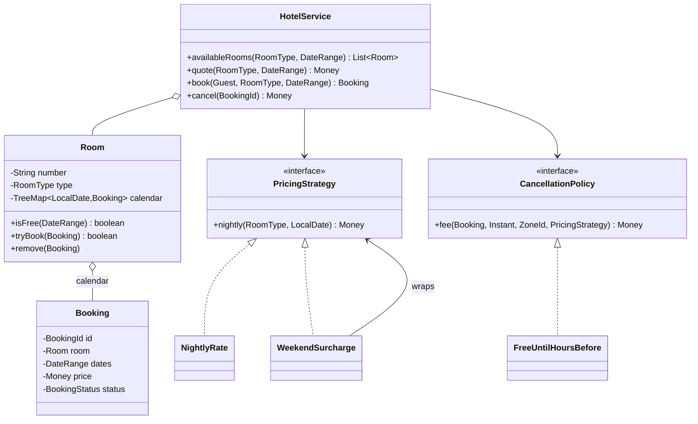

<Related ids={['lld-movie-ticket-booking', 'strategy-pattern', 'decorator-pattern', 'concurrency-for-lld']} />

Hotel booking looks like movie booking, with one big difference. A cinema seat is booked for **one show**. A hotel room is booked for **a range of nights**: check in on the 10th, leave on the 12th. So "is this room free?" becomes "does this date range **overlap** any existing booking?" That's where most candidates slip: an off-by-one on the checkout day, scanning every booking ever made, or two guests getting the same room.

We'll use the same six steps as every case study: requirements, entities, class design, code, a worked example, and follow-ups. (The [parking lot](/system-design/lld/lld-parking-lot) lesson explains the plan in detail.)

## Step 1: Pin down the requirements

<Dialogue>
<Turn who="you">One hotel or a chain?</Turn>
<Turn who="them">One hotel. Rooms have a number and a type, like deluxe or suite.</Turn>
<Turn who="you">Does a guest pick a specific room, or just a type?</Turn>
<Turn who="them">Just a type. The system picks a free room.</Turn>
<Turn who="you">If one guest checks out on the 12th, can the next guest check in on the 12th?</Turn>
<Turn who="them">Of course. That's normal.</Turn>
<Turn who="you">How is the price worked out?</Turn>
<Turn who="them">Per night, by room type. Friday and Saturday nights cost 25% more.</Turn>
<Turn who="you">Can guests cancel?</Turn>
<Turn who="them">Free until 48 hours before check-in. After that, they pay for the first night.</Turn>
<Turn who="you">Will many guests book at once?</Turn>
<Turn who="them">Yes, especially on busy weekends.</Turn>
</Dialogue>

The checkout question looks trivial, but it decides how you store dates, and the next section shows why it matters so much.

**The system must:**

1. Hold a hotel's rooms, each with a number and a type.
2. Search for free rooms of a type for a check-in and check-out date.
3. Book a room of a type for a date range. The checkout day is free for the next guest.
4. Price each night by type, with a weekend surcharge.
5. Cancel bookings, free until 48 hours before check-in.
6. Never give one room to two guests for overlapping nights, even when booking at the same time.

**Out of scope for now:** payment, overbooking, several hotels.

## Step 2: Find the core entities

| Noun | Make it… | Why |
| --- | --- | --- |
| Room | a class | A number, a type, and its bookings. |
| Room type | an enum | A fixed set of values. |
| Date range (a stay) | a record `DateRange(checkIn, checkOut)` | Two dates plus an overlap rule. Making it a class means the rule is written once. |
| Booking | a class | Guest, room, dates, price, status. |
| Pricing | an interface | Weekend now, seasonal and festival pricing later. |
| Cancellation rule | an interface | Hotels change this often. |
| Hotel service | a class | The front door: search, quote, book, cancel. |

### The most important decision: how to store a stay

A guest who arrives on the 10th and leaves on the 12th stays two **nights**: the 10th and the 11th.

<Approach verdict="bad" title="Closed range: [10th, 12th]">

Treat both dates as "taken". Now a guest arriving on the 12th looks like they overlap, so you add `+1` here and `-1` there to fix it. Those adjustments are the classic source of off-by-one bugs.

</Approach>

<Approach verdict="great" title="Half-open range: [10th, 12th)">

Include check-in, **exclude** check-out. The stay covers the nights of the 10th and 11th. A guest leaving on the 12th and another arriving on the 12th simply don't overlap. The number of nights is `checkOut − checkIn`. No adjustments anywhere.

</Approach>

With half-open ranges, two stays overlap if and only if **each one starts before the other ends**:

```java
public record DateRange(LocalDate checkIn, LocalDate checkOut) {
    public DateRange {
        if (!checkOut.isAfter(checkIn)) throw new IllegalArgumentException("stay must be at least one night");
    }
    /** Two half-open ranges overlap iff each starts before the other ends. */
    public boolean overlaps(DateRange o) { return checkIn.isBefore(o.checkOut) && o.checkIn.isBefore(checkOut); }
    public List<LocalDate> nights() { return checkIn.datesUntil(checkOut).toList(); }
}
```

Try it: [10, 12) and [12, 14). Does 10 come before 14? Yes. Does 12 come before 12? **No.** So they don't overlap. Correct.

## Step 3: Design each class

**`Room`**: knows its number, type and bookings. It can say whether it's free for a date range, and **check-and-book in one step** so two threads can't both succeed.

**`Booking`**: knows the guest, room, dates, price and status (confirmed or cancelled).

**`PricingStrategy`**: one job, "what does this room type cost on this night?" Pricing **per night**, not per stay, is what lets weekend and seasonal rules combine.

**`CancellationPolicy`**: one job, "what's the fee for cancelling this booking now?"

**`HotelService`**: `availableRooms`, `quote`, `book` and `cancel`. `book` tries each room of the requested type until one accepts.

How do we check if a room is free, quickly?

<Approach verdict="good" title="Scan all the room's bookings">

Loop through every booking and test overlap. Simple and correct, and fine in an interview to start with. But it's O(n) per room, and a room's history grows forever.

</Approach>

<Approach verdict="great" title="A sorted calendar per room">

Keep each room's bookings in a `TreeMap` sorted by check-in date. Because a room's bookings never overlap each other, **only one booking can possibly clash**: the latest one that starts before the new stay ends. One `lowerEntry` lookup finds it, so the check is O(log n).

</Approach>



## Step 4: Write the code

<InterviewScope minutes="45–60" lines="50" write={["Half-open date ranges (you leave on the check-out day)", "Search free rooms of a type, then book one", "`synchronized` booking so a room is never sold twice"]} say={["A sorted calendar per room for fast availability checks", "A lock per room instead of one global lock", "Weekend pricing and cancellation rules as strategies"]} skip={["Payments and loyalty points", "Overbooking policies"]} />

### The interview-sized version

The date-range rule and an atomic check-and-book. Most bugs in this problem live in those two places. It's about **50 lines**, and it compiles and runs.

```java
record DateRange(LocalDate checkIn, LocalDate checkOut) {            // [checkIn, checkOut): you leave on checkOut
    DateRange {
        if (!checkOut.isAfter(checkIn)) throw new IllegalArgumentException("Stay at least one night");
    }
    boolean overlaps(DateRange o) { return checkIn.isBefore(o.checkOut) && o.checkIn.isBefore(checkOut); }
    long nights() { return ChronoUnit.DAYS.between(checkIn, checkOut); }
}

enum RoomType { STANDARD, DELUXE }

class Room {
    final String number;
    final RoomType type;
    final int pricePerNight;
    final List<Booking> bookings = new ArrayList<>();

    Room(String number, RoomType type, int pricePerNight) { this.number = number; this.type = type; this.pricePerNight = pricePerNight; }

    boolean isFree(DateRange dates) {
        return bookings.stream().filter(b -> b.active).noneMatch(b -> b.dates.overlaps(dates));
    }
}

class Booking {
    final String guest;
    final Room room;
    final DateRange dates;
    boolean active = true;

    Booking(String guest, Room room, DateRange dates) { this.guest = guest; this.room = room; this.dates = dates; }
    int price() { return (int) dates.nights() * room.pricePerNight; }
}

class Hotel {
    private final List<Room> rooms;
    Hotel(List<Room> rooms) { this.rooms = rooms; }

    synchronized List<Room> search(RoomType type, DateRange dates) {
        return rooms.stream().filter(r -> r.type == type && r.isFree(dates)).toList();
    }

    // synchronized: "is it free?" and "book it" happen as one step, so two guests can't get the same room
    synchronized Booking book(String guest, RoomType type, DateRange dates) {
        Room room = search(type, dates).stream().findFirst()
                .orElseThrow(() -> new IllegalStateException("No " + type + " room for those dates"));
        Booking booking = new Booking(guest, room, dates);
        room.bookings.add(booking);
        return booking;
    }

    synchronized void cancel(Booking booking) { booking.active = false; }
}
```

**Reading it top to bottom:**

1. **`DateRange`** refuses a stay of zero nights, has the two-comparison overlap test, and counts nights.
2. **`Room.isFree`** scans the room's active bookings for an overlap. (The simple scan; the full version uses the sorted calendar.)
3. **`Booking.price`** is nights × the room's nightly price.
4. **`Hotel.search`** returns rooms of the right type that are free for those dates.
5. **`Hotel.book`** is `synchronized`, so "find a free room" and "add the booking" happen as one step. Without it, two guests could both see room 101 as free and both get it.
6. **`cancel`** marks the booking inactive, so `isFree` ignores it from then on.

<Callout type="tip" title="How to practise this">
Before writing any classes, write `DateRange.overlaps` and test it on paper: [10,12) vs [12,14), [10,12) vs [11,13), [10,15) vs [11,12). Then build the rest around it.
</Callout>

### Growing it into the full design

#### The room's sorted calendar

`isFree` finds the booking with the latest check-in **before** the new checkout, and tests just that one. `tryBook` does the check and the insert under the room's own lock.

```java
public final class Room {
    private final TreeMap<LocalDate, Booking> calendar = new TreeMap<>();

    public synchronized boolean isFree(DateRange r) {
        Map.Entry<LocalDate, Booking> before = calendar.lowerEntry(r.checkOut());   // O(log n)
        return before == null || !before.getValue().dates().overlaps(r);
    }

    /** Check and insert atomically for this room. */
    public synchronized boolean tryBook(Booking b) {
        if (!isFree(b.dates())) return false;
        calendar.put(b.dates().checkIn(), b);
        return true;
    }

    public synchronized void remove(Booking b) { calendar.remove(b.dates().checkIn(), b); }
}
```

**Why is checking one neighbour enough?** Any booking that overlaps the new stay must start before the new stay ends. Take the latest such booking. If it doesn't overlap, then every earlier booking ended even sooner (bookings in one room never overlap each other), so none of them can overlap either. It's the same idea as LeetCode's "My Calendar" problems.

There's another way to store availability: a **count of free rooms per type, per night** (`Map<LocalDate, Integer>`). It makes "how many deluxe rooms are free each night?" trivial, and it's what large systems use when guests book a type. The specific room is then assigned at check-in.

#### Booking by type, safely

In plain steps:

1. Quote the price.
2. Go through the rooms of the requested type.
3. For each one, try to book it. `tryBook` checks and inserts under that room's lock.
4. If another guest got there first, `tryBook` returns `false`; just try the next room.
5. If no room accepts, there's no availability.

```java
public Booking book(Guest guest, RoomType type, DateRange range) {
    Money price = quote(type, range);
    for (Room room : rooms) {
        if (room.type() != type) continue;
        Booking b = new Booking(new BookingId(ids.incrementAndGet()), guest, room, range, price);
        if (room.tryBook(b)) {                         // atomic per room; lost a race? try the next room
            bookings.put(b.id(), b);
            return b;
        }
    }
    throw new NoAvailabilityException(type, range);
}
```

The lock is **per room**, so guests booking different rooms never wait for each other. It's the same "list the candidates, then claim one atomically" shape as parking spots. The reference solution has 60 guests race for 3 rooms with overlapping dates and checks that exactly 3 bookings exist and none overlap.

In a database, the equivalent guarantee is an **exclusion constraint** (in PostgreSQL, `EXCLUDE USING gist (room_id WITH =, stay WITH &&)`), or one row per room-night with a unique constraint. See [Schema Design for LLD](/system-design/lld/lld-schema-design).

#### Pricing per night: Strategy plus Decorator

`WeekendSurcharge` **wraps** another pricing strategy: it asks the inner one for the base price, then adds 25% on Fridays and Saturdays. The quote for a stay is the sum over its nights.

```java
public interface PricingStrategy { Money nightly(RoomType type, LocalDate night); }

public final class WeekendSurcharge implements PricingStrategy {
    private final PricingStrategy inner; private final int percent;
    public Money nightly(RoomType type, LocalDate night) {
        Money base = inner.nightly(type, night);
        DayOfWeek d = night.getDayOfWeek();
        return (d == DayOfWeek.FRIDAY || d == DayOfWeek.SATURDAY) ? base.plus(base.percent(percent)) : base;
    }
}

public Money quote(RoomType type, DateRange range) {
    return range.nights().stream().map(n -> pricing.nightly(type, n)).reduce(Money.ZERO, Money::plus);
}
```

Because each rule wraps another, rules stack: a festival surcharge wraps the weekend surcharge, which wraps the base rate. Watch which nights count as "weekend": a Friday-to-Sunday stay has Friday and Saturday **nights**, so both get the surcharge.

#### Cancellation as a strategy

The free-cancellation deadline is 48 hours before check-in **at 14:00 in the hotel's time zone**. A guest booking from another country still loses free cancellation based on the hotel's clock.

```java
public final class FreeUntilHoursBefore implements CancellationPolicy {
    public Money fee(Booking b, Instant now, ZoneId zone, PricingStrategy pricing) {
        Instant checkIn = b.dates().checkIn().atTime(14, 0).atZone(zone).toInstant();   // check-in time, hotel's zone
        return Duration.between(now, checkIn).toHours() >= hours ? Money.ZERO
                : pricing.nightly(b.room().type(), b.dates().checkIn());
    }
}
```

Also make the booking's change from `CONFIRMED` to `CANCELLED` synchronized, so cancelling twice fails instead of freeing the room twice.

## Step 5: Trace a booking race

Two deluxe rooms, 101 and 102. Room 101 is booked for [10th, 12th).

1. Asha asks for a deluxe room for [12th, 14th). Room 101: the latest booking starting before the 14th is [10, 12). Does it overlap [12, 14)? 12 is not before 12, so **no**. Room 101 is free, and Asha gets it.
2. At the same moment, Ben and Chen both ask for a deluxe room for [13th, 15th).
3. Both try room 101 first. Ben takes 101's lock first: [12, 14) overlaps [13, 15), so 101 is taken. He moves on to 102, takes its lock, finds it free and books it.
4. Chen tries 101 (taken), then 102. By now Ben's booking is in 102's calendar, so 102 is taken too. Chen gets "no availability".
5. Nobody was double-booked, and nobody waited on a hotel-wide lock.

## Step 6: Handle follow-up questions

**"Hold the room while the guest pays."** A booking in a `HELD` state with an expiry, freed by a sweeper, exactly as in [Movie Ticket Booking](/system-design/lld/lld-movie-ticket-booking).

**"A family wants two deluxe rooms, all or nothing."** Lock the two rooms **in a fixed order** (by room number) so two families can't deadlock, check both are free, book both, then unlock. If either is taken, release and try another pair.

**"Add seasonal pricing that stacks with weekends."** Another decorator. Say how they combine: wrapping one inside the other multiplies the percentages; if the business wants them added, compute both in one rule.

**"Overbooking."** Hotels sell slightly more than they have, expecting no-shows. Use per-night counts with a configurable overbooking limit.

**"Many hotels and city search."** That's the HLD version: an index from city and date to availability counts.

## Common mistakes

- **Closed date ranges** and the off-by-one bugs that follow.
- **Checking availability, then booking, without a lock** around both.
- **One global lock** for the whole hotel.
- **Pricing per stay** instead of per night, so weekend nights inside a longer stay are priced wrong.
- **Computing deadlines in the server's or guest's time zone** instead of the hotel's.

## Patterns used

| Pattern | Where |
| --- | --- |
| **Strategy** | `PricingStrategy`, `CancellationPolicy` |
| **Decorator** | `WeekendSurcharge` (and seasonal or promo pricing) over a base rate |
| **Facade** | `HotelService` |
| **Repository** (implied) | Rooms and bookings |

## Interview questions

<QA q="How do you check whether a room is free for a date range efficiently?">
Keep each room's bookings in a sorted map keyed by check-in date. Because a room's bookings never overlap, only the booking with the latest check-in before the new checkout date can clash; find it with lowerEntry and test overlap with the half-open rule (start1 before end2 and start2 before end1). That's O(log n) per room instead of scanning every booking.
</QA>

<QA q="Why model stays as half-open ranges?">
A stay occupies nights, not days. With [checkIn, checkOut), one guest's checkout date can be the next guest's check-in date without overlapping, the number of nights is checkOut minus checkIn, and the overlap test needs no adjustments. Closed ranges need plus-one and minus-one corrections everywhere and cause frequent off-by-one bugs.
</QA>

<QA q="Two guests book the last deluxe room for overlapping dates at the same moment. What happens?">
Booking by type goes through the candidate rooms and calls tryBook on each, which checks and inserts under that room's lock. Only one of the two guests can insert an overlapping range into that room; the other sees it as taken and moves on, getting "no availability" if there's no other room. Locks are per room, so bookings for different rooms go ahead in parallel.
</QA>

<Practice task="Guests want to book 'any 2 deluxe rooms' for a family, all or nothing. How do you make that atomic without a global lock?">

Find candidate rooms, then lock the rooms you intend to use **in a fixed global order** (by room number) to avoid deadlock, check that all of them are free, insert into both, and release. If either isn't free, release and try the next combination. Alternatively, keep per-night counts per type and take two units per night in one atomic step. Mention the deadlock risk of locking rooms in random order.

</Practice>

<Practice task="Add seasonal pricing: Dec 20 – Jan 5 is +40%, and it stacks with the weekend surcharge. Where does it go, and in what order do the decorators apply?">

A `SeasonalSurcharge` decorator that checks whether the night falls inside the season. The wrapping order defines the maths: `Seasonal(Weekend(base))` applies 25% and then 40% on top (multiplied); if the business wants the percentages added (65% in total), compute both from the base inside one rule instead. Say which you chose. This is exactly the kind of ambiguity interviewers like to probe.

</Practice>

<Takeaways>

- Store stays as half-open date ranges; overlap is two comparisons.
- A sorted calendar per room gives O(log n) availability checks, because only one neighbour can clash.
- Book by type by trying candidate rooms, each claimed atomically under its own lock.
- Price per night with stackable decorators, and compute deadlines in the hotel's time zone.

</Takeaways>

## Further reading

- [Design a Movie Ticket Booking System](/system-design/lld/lld-movie-ticket-booking): holds and payment.
- PostgreSQL documentation: range types and exclusion constraints.
