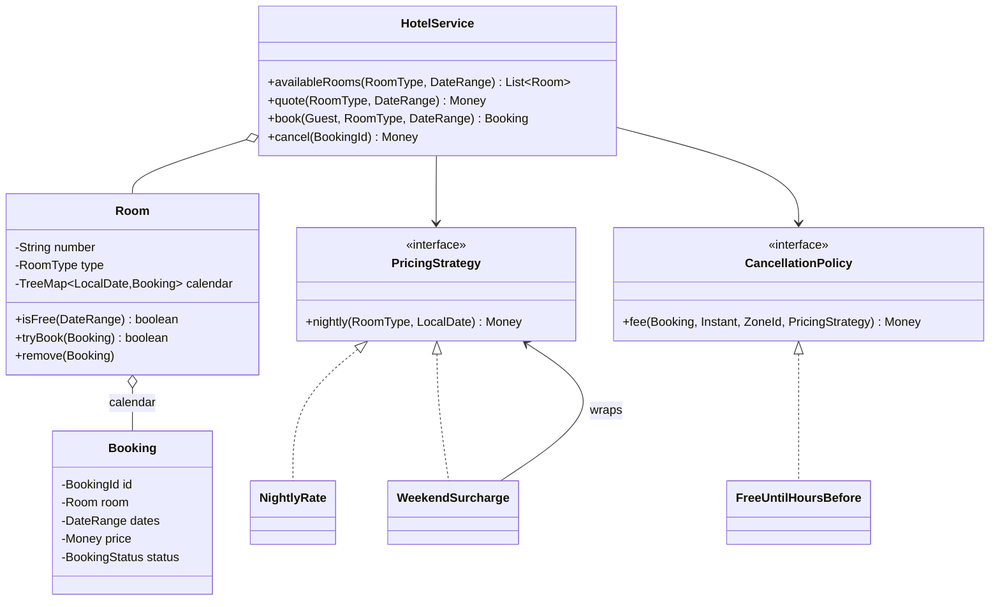

<Related ids={['lld-movie-ticket-booking', 'strategy-pattern', 'decorator-pattern', 'concurrency-for-lld']} />

Hotel booking looks like movie booking, but the resource is different: a seat is booked for **one show**; a room is booked for a **range of nights**. That turns availability into an **interval-overlap** problem, and it's where most candidates slip — off-by-one on checkout day, O(n) scans of every booking, or double bookings under concurrency.

## What the interviewer expects

The full design in this lesson is longer than anything you'd write in one round. It's there so you understand the edge cases and can answer follow-up questions. In the round itself, aim for this:

<InterviewScope minutes="45–60" lines="50" write={["Half-open date ranges (you leave on the check-out day)", "Search free rooms of a type, then book one", "`synchronized` booking so a room is never sold twice"]} say={["A sorted calendar per room for fast availability checks", "A lock per room instead of one global lock", "Weekend pricing and cancellation rules as strategies"]} skip={["Payments and loyalty points", "Overbooking policies"]} />

### The interview-sized version

The date-range rule and an atomic check-and-book. Most bugs in this problem live in those two places. It's about **50 lines**, and it compiles and runs.

```java
record DateRange(LocalDate checkIn, LocalDate checkOut) {            // [checkIn, checkOut): you leave on checkOut
    DateRange {
        if (!checkOut.isAfter(checkIn)) throw new IllegalArgumentException("Stay at least one night");
    }
    boolean overlaps(DateRange o) { return checkIn.isBefore(o.checkOut) && o.checkIn.isBefore(checkOut); }
    long nights() { return ChronoUnit.DAYS.between(checkIn, checkOut); }
}

enum RoomType { STANDARD, DELUXE }

class Room {
    final String number;
    final RoomType type;
    final int pricePerNight;
    final List<Booking> bookings = new ArrayList<>();

    Room(String number, RoomType type, int pricePerNight) { this.number = number; this.type = type; this.pricePerNight = pricePerNight; }

    boolean isFree(DateRange dates) {
        return bookings.stream().filter(b -> b.active).noneMatch(b -> b.dates.overlaps(dates));
    }
}

class Booking {
    final String guest;
    final Room room;
    final DateRange dates;
    boolean active = true;

    Booking(String guest, Room room, DateRange dates) { this.guest = guest; this.room = room; this.dates = dates; }
    int price() { return (int) dates.nights() * room.pricePerNight; }
}

class Hotel {
    private final List<Room> rooms;
    Hotel(List<Room> rooms) { this.rooms = rooms; }

    synchronized List<Room> search(RoomType type, DateRange dates) {
        return rooms.stream().filter(r -> r.type == type && r.isFree(dates)).toList();
    }

    // synchronized: "is it free?" and "book it" happen as one step, so two guests can't get the same room
    synchronized Booking book(String guest, RoomType type, DateRange dates) {
        Room room = search(type, dates).stream().findFirst()
                .orElseThrow(() -> new IllegalStateException("No " + type + " room for those dates"));
        Booking booking = new Booking(guest, room, dates);
        room.bookings.add(booking);
        return booking;
    }

    synchronized void cancel(Booking booking) { booking.active = false; }
}
```

<Callout type="tip" title="How to use the rest of this lesson">
Practise writing the short version above, in your own words, until you can do it in about 30 minutes. Then read the full design below for the edge cases and follow-up answers. Interviewers often ask about those, but they rarely ask you to type them all.
</Callout>

## 1. Requirements

| Question | Assumption |
| --- | --- |
| Inventory | One hotel; rooms with a number and a type (deluxe, suite) |
| Search | Available rooms of a type for a check-in/check-out range |
| Book | By room type — the system picks any free room of that type |
| Dates | A stay is a set of **nights**; the checkout day is free for the next guest |
| Price | Per night by type; Friday and Saturday nights +25% |
| Cancel | Free until 48 hours before check-in (14:00 local); after that, the first night is charged |
| Concurrency | Many guests book the same type for overlapping dates at once |

## 2. The date-range model: half-open intervals

Represent a stay as **`[checkIn, checkOut)`** — the nights from check-in up to, but not including, checkout:

```java
public record DateRange(LocalDate checkIn, LocalDate checkOut) {
    public DateRange {
        if (!checkOut.isAfter(checkIn)) throw new IllegalArgumentException("stay must be at least one night");
    }
    /** Two half-open ranges overlap iff each starts before the other ends. */
    public boolean overlaps(DateRange o) { return checkIn.isBefore(o.checkOut) && o.checkIn.isBefore(checkOut); }
    public List<LocalDate> nights() { return checkIn.datesUntil(checkOut).toList(); }
}
```

With half-open ranges, a guest leaving on the 12th and another arriving on the 12th **don't** overlap — no special cases. The overlap test is two comparisons. Closed ranges `[checkIn, checkOut]` force `+1`/`−1` adjustments everywhere and are the classic source of off-by-one bugs.

## 3. Class design



## 4. Availability per room: a sorted calendar

Each room keeps its confirmed bookings in a `TreeMap` keyed by check-in date. Because a room's bookings never overlap each other, **only one booking can possibly clash with a new range**: the last one that starts before the new range ends.

```java
public final class Room {
    private final TreeMap<LocalDate, Booking> calendar = new TreeMap<>();

    public synchronized boolean isFree(DateRange r) {
        Map.Entry<LocalDate, Booking> before = calendar.lowerEntry(r.checkOut());   // O(log n)
        return before == null || !before.getValue().dates().overlaps(r);
    }

    /** Check and insert atomically for this room. */
    public synchronized boolean tryBook(Booking b) {
        if (!isFree(b.dates())) return false;
        calendar.put(b.dates().checkIn(), b);
        return true;
    }

    public synchronized void remove(Booking b) { calendar.remove(b.dates().checkIn(), b); }
}
```

Why is checking one neighbour enough? Any booking that overlaps `[in, out)` must start before `out`. If the latest such booking doesn't overlap, every earlier one ends even sooner (they don't overlap each other), so none can. That's O(log n) per check instead of scanning every booking — the same idea as LeetCode's "My Calendar" problems.

An alternative representation is a **per-night inventory** (`Map<LocalDate, Integer>` of free rooms per type), which makes "how many deluxe rooms are free each night" trivial and is what larger systems use when guests book a type rather than a room. Converting to specific rooms then happens at check-in.

## 5. Booking by type, safely under concurrency

```java
public Booking book(Guest guest, RoomType type, DateRange range) {
    Money price = quote(type, range);
    for (Room room : rooms) {
        if (room.type() != type) continue;
        Booking b = new Booking(new BookingId(ids.incrementAndGet()), guest, room, range, price);
        if (room.tryBook(b)) {                         // atomic per room; lost a race? try the next room
            bookings.put(b.id(), b);
            return b;
        }
    }
    throw new NoAvailabilityException(type, range);
}
```

The lock is **per room**: guests booking different rooms never wait for each other, and each room's check-and-insert is atomic. This is the same "candidates + atomic claim" shape as parking spots and drivers. The reference solution has 60 guests race for 3 rooms over overlapping dates and checks that exactly 3 bookings exist, none overlapping, plus a randomised test of 2,000 bookings and cancellations against a brute-force overlap check.

In a database, the equivalent is an **exclusion constraint** (PostgreSQL `EXCLUDE USING gist (room_id WITH =, stay WITH &&)`) or a per-night row with a unique constraint — see [Schema Design for LLD](/system-design/lld/lld-schema-design).

## 6. Pricing per night: Strategy + Decorator

```java
public interface PricingStrategy { Money nightly(RoomType type, LocalDate night); }

public final class WeekendSurcharge implements PricingStrategy {
    private final PricingStrategy inner; private final int percent;
    public Money nightly(RoomType type, LocalDate night) {
        Money base = inner.nightly(type, night);
        DayOfWeek d = night.getDayOfWeek();
        return (d == DayOfWeek.FRIDAY || d == DayOfWeek.SATURDAY) ? base.plus(base.percent(percent)) : base;
    }
}

public Money quote(RoomType type, DateRange range) {
    return range.nights().stream().map(n -> pricing.nightly(type, n)).reduce(Money.ZERO, Money::plus);
}
```

Pricing **per night** (not per stay) is what makes weekend, seasonal and event pricing composable: a festival surcharge is another decorator; a long-stay discount is a decorator on the quote. Note which nights count as "weekend": a Friday-to-Sunday stay has Friday and Saturday **nights**.

## 7. Cancellation as a strategy

```java
public final class FreeUntilHoursBefore implements CancellationPolicy {
    public Money fee(Booking b, Instant now, ZoneId zone, PricingStrategy pricing) {
        Instant checkIn = b.dates().checkIn().atTime(14, 0).atZone(zone).toInstant();   // check-in time, hotel's zone
        return Duration.between(now, checkIn).toHours() >= hours ? Money.ZERO
                : pricing.nightly(b.room().type(), b.dates().checkIn());
    }
}
```

Two details that matter: deadlines are computed in the **hotel's time zone** (a guest in another country still loses free cancellation at 14:00 hotel time minus 48 hours), and the booking's own status transition (`CONFIRMED → CANCELLED`) is synchronized, so a double cancel fails instead of freeing the room twice.

## 8. Patterns used

| Pattern | Where |
| --- | --- |
| **Strategy** | `PricingStrategy`, `CancellationPolicy` |
| **Decorator** | `WeekendSurcharge` (and seasonal or promo pricing) over a base rate |
| **Facade** | `HotelService` |
| **Repository** (implied) | Rooms and bookings |

## 9. Extensions

- **Holds during payment**: a booking in `HELD` state with an expiry, released by a sweeper — exactly as in [Movie Ticket Booking](/system-design/lld/lld-movie-ticket-booking).
- **Overbooking**: hotels deliberately sell more than capacity for a type based on expected no-shows; per-night inventory with a configurable overbook limit.
- **Room changes mid-stay**: split one stay into two bookings on different rooms.
- **Multiple hotels and search**: an index from (city, date) to availability counts; that's the HLD version.

## Interview questions

<QA q="How do you check whether a room is free for a date range efficiently?">
Keep each room's bookings in a sorted map keyed by check-in date. Since a room's bookings never overlap, only the booking with the latest check-in before the new checkout date can clash; look it up with lowerEntry and test overlap with the half-open rule (start1 before end2 and start2 before end1). That's O(log n) per room instead of scanning all bookings.
</QA>

<QA q="Why model stays as half-open ranges?">
A stay occupies nights, not days. With [checkIn, checkOut), one guest's checkout date can be the next guest's check-in date without overlapping, the number of nights is checkOut minus checkIn, and the overlap test needs no adjustments. Closed ranges need plus-one and minus-one corrections everywhere and are a frequent off-by-one bug.
</QA>

<QA q="Two guests book the last deluxe room for overlapping dates at the same moment. What happens?">
Booking by type iterates candidate rooms and calls tryBook on each, which checks and inserts under that room's lock. Only one of the two guests can insert an overlapping range into that room; the other sees it as taken and moves on to the next deluxe room, and gets 'no availability' if there isn't one. Locks are per room, so bookings for different rooms proceed in parallel.
</QA>

<Practice task="Guests want to book 'any 2 deluxe rooms' for a family, all or nothing. How do you make that atomic without a global lock?">

Find candidate rooms, then lock the rooms you intend to use **in a global order** (by room number) to avoid deadlock, check all of them are free, insert into both, and release. If either isn't free, release and try the next combination. Alternatively, use per-night inventory counts and decrement two units per night in one atomic step. Mention the deadlock risk of locking rooms in arbitrary order.

</Practice>

<Practice task="Add seasonal pricing: Dec 20 – Jan 5 is +40%, and it stacks with the weekend surcharge. Where does it go, and in what order do the decorators apply?">

A `SeasonalSurcharge` decorator that checks whether the night falls inside a configured season. Wrap order defines the maths: `Seasonal(Weekend(base))` applies 25% then 40% on top (multiplicative); if the business wants the percentages added (65% total), compute both from the base inside one rule instead. State the choice explicitly — this is exactly the kind of ambiguity interviewers like to probe.

</Practice>

<Takeaways>

- Model stays as half-open date ranges; overlap is two comparisons.
- Per-room sorted calendars give O(log n) availability checks; only one neighbour can clash.
- Book by type with candidate rooms and an atomic per-room claim — no global lock.
- Price per night with composable decorators; compute deadlines in the hotel's time zone.

</Takeaways>

## Further reading

- [Design a Movie Ticket Booking System](/system-design/lld/lld-movie-ticket-booking) — holds and payment.
- PostgreSQL documentation — range types and exclusion constraints.
