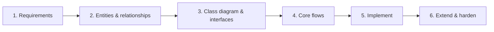
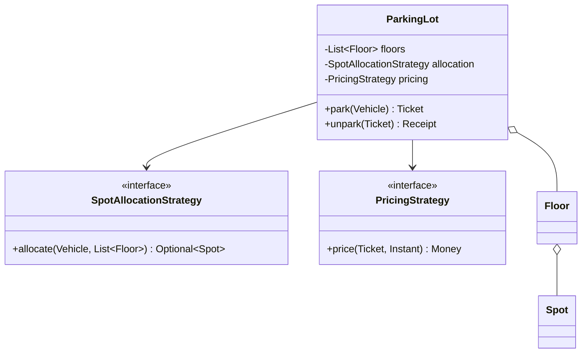

Low-level design (LLD) interviews test whether you can turn a problem into **well-structured, working, extensible code**. Where HLD is about boxes and arrows between services, LLD is about classes, interfaces, responsibilities and the interactions between objects inside one service.

There are two common formats, and preparing for the wrong one is a classic mistake.

## The two formats

| | Design round (whiteboard / OOD) | Machine-coding round |
| --- | --- | --- |
| Duration | 45–60 min | 60–120 min (sometimes take-home) |
| Output | Class diagram, key interfaces, core method signatures, maybe some code | Running, demoable code in an IDE |
| Focus | Modelling, responsibilities, patterns, extensibility | All of that **plus** correctness, code quality, edge cases, a working demo |
| Typical companies | Big tech design rounds | Indian product companies (Flipkart, Swiggy, Uber India, PhonePe, Razorpay…), many startups |
| Common prompts | Parking lot, elevator, chess, library | Splitwise, snake & ladder, parking lot, cab booking, rate limiter, cache |

<Callout type="interview">
Ask at the start: "Do you want working code, or a design with key classes and interfaces?" The answer decides how you spend the next hour.
</Callout>

## How much code is enough?

Less than most people fear. The case studies on this site include a **full reference design** (often 200–350 lines) so you can learn every edge case. Nobody types that in one round. What interviewers actually expect:

| | Design round (45–60 min) | Machine-coding round (60–120 min) |
| --- | --- | --- |
| Code you write | Key interfaces and the 2–3 core methods, often 30–80 lines | A working core with a small demo, usually 100–200 lines |
| Everything else | Explained out loud, or drawn on the class diagram | Explained, or added only if time is left |
| What wins | Clear classes and a good answer to "how would you add X?" | Code that runs, reads well and handles the obvious edge cases |

Every case study now starts with a **"What the interviewer expects"** box and an **interview-sized version** of about 30–70 lines. Practise that version until you can write it from memory, then use the full design to prepare for follow-up questions.

<Callout type="tip" title="Say it instead of typing it">
For anything outside the core, a sentence is often worth more than code: "Payment is behind an interface; I'd call it outside the lock so a slow gateway doesn't block other gates." That shows the same understanding in ten seconds.
</Callout>

## What interviewers score

| Signal | What strong looks like |
| --- | --- |
| **Requirement gathering** | Narrows scope, lists core use cases, states assumptions |
| **Modelling** | Right entities with clear, single responsibilities; sensible relationships |
| **Abstraction & extensibility** | Interfaces at the points that vary; adding a new type means adding a class, not editing ten `if`s |
| **Design principles & patterns** | Applies SOLID and patterns *where they fit*, can explain why |
| **Code quality** | Readable names, small methods, no god classes, immutability where sensible, proper exceptions |
| **Correctness & edge cases** | Handles invalid input, empty states, concurrent access |
| **Communication** | Thinks aloud, explains trade-offs, takes hints well |

## The framework



### Step 1 — Clarify requirements (5 min)

LLD prompts are as vague as HLD ones. "Design a parking lot" could mean one floor or a multi-storey garage with EV charging, monthly passes and payment kiosks.

- List **functional requirements** as use cases: *park a vehicle, issue a ticket, compute fee, free the spot, show availability*.
- Ask about **variation points** — these become your interfaces: vehicle types? spot types? pricing rules? payment methods?
- Ask about **scale and concurrency** at the object level: multiple entry gates at once? (→ thread-safe allocation).
- Explicitly **descope**: "I'll skip reservations and admin UI unless you want them."

### Step 2 — Identify entities and relationships (5–10 min)

A reliable technique is **noun–verb analysis**: nouns in the requirements are candidate classes; verbs are candidate methods (and tell you *which* class owns them).

```text
"A vehicle enters through a gate, the system assigns the nearest free spot of the right size
 and issues a ticket. On exit, the fee is computed from duration and vehicle type and paid."

Nouns → Vehicle, Gate, Spot, Ticket, Fee/PricingStrategy, Payment, ParkingLot, Floor
Verbs → enter, assign spot, issue ticket, compute fee, pay, exit
```

Then decide relationships: a `ParkingLot` *has* `Floor`s (composition), a `Floor` *has* `Spot`s, a `Ticket` *references* a `Vehicle` and a `Spot` (association), `Car` *is a* `Vehicle` (inheritance — or a `VehicleType` enum if behaviour doesn't differ).

<Callout type="tip" title="Enum or class hierarchy?">
If variants differ only in **data** (a motorbike needs a small spot), an `enum` with fields is simpler. If they differ in **behaviour** (different fee algorithms), use an interface with implementations. Interviewers notice over-modelled hierarchies as much as under-modelled ones.
</Callout>

### Step 3 — Class diagram and interfaces (10 min)

Sketch classes with key fields and methods, and mark the **interfaces at variation points**. Keep it to the important 8–15 classes.



### Step 4 — Walk through core flows (5 min)

Trace each main use case through the objects, ideally as a sequence: *gate → lot.park(vehicle) → strategy.allocate → spot.occupy → new Ticket*. This catches missing responsibilities before you code.

### Step 5 — Implement (the bulk of machine coding)

Order matters when time is limited:

1. **Models** (entities, enums, value objects) — small and immutable where possible.
2. **Interfaces** for the variation points.
3. **Core service logic** for the main flow.
4. A **driver/demo** (`main` or a test) that exercises the happy path.
5. Edge cases and validation.
6. Extra features only after the core works.

Keep everything **in memory** (maps and lists in repository classes) unless told otherwise; mention that a database would sit behind the repository interface.

### Step 6 — Extend and harden

Interviewers almost always add a twist: *"Now add EV charging spots"*, *"Support weekend pricing"*, *"What if two gates assign the same spot?"* A good design absorbs these by **adding a class** (new strategy, new spot type) rather than rewriting. Then discuss thread safety, error handling and how you'd test it.

## Code-quality checklist for the round

- **Package/layer separation**: `model`, `service`, `strategy`, `repository`, `exception`.
- **No god class**: if `ParkingLotService` has 600 lines, responsibilities are leaking.
- **Program to interfaces** at variation points; constructors take dependencies (dependency injection by hand is fine).
- **Validate inputs** and throw specific exceptions (`SpotUnavailableException`, not `RuntimeException("error")`).
- **Immutability** for value objects (`Money`, `Ticket` once issued).
- **Thread safety** for shared mutable state when multiple actors exist.
- **Meaningful names** over comments.

<Callout type="warning" title="Common ways to fail">

- Spending 30 minutes on a perfect class diagram and leaving no time to code.
- Pattern stuffing — adding a Factory, Builder, Observer and Visitor to a tic-tac-toe game.
- One giant class with `if (type == ...)` chains everywhere.
- Code that doesn't compile or run at the end of a machine-coding round.
- Ignoring concurrency when the problem clearly has concurrent actors (gates, users booking seats).

</Callout>

## Interview questions

<QA q="How do you decide what should be an interface versus a concrete class?">
Introduce an interface where you expect variation or need substitution: different algorithms (pricing, allocation, splitting), external dependencies you want to swap or mock (payment gateway, notification sender, storage), or multiple implementations from the start. Don't create interfaces for classes with a single obvious implementation and no testing need — that's speculative generality. A good test: can you name two realistic implementations?
</QA>

<QA q="You have 90 minutes for a machine-coding round. How do you allocate time?">
Roughly: 10 minutes on requirements and entities, 10 on class design and interfaces, 50 on implementing models, services and a working demo of the main flow, 10 on edge cases, validation and a quick test, and the remaining 10 on extensions or concurrency the interviewer asks about. The non-negotiable goal is a runnable demo of the core flow; polish comes after.
</QA>

<QA q="What is noun–verb analysis and what are its limits?">
Extract nouns from the requirements as candidate classes and verbs as candidate methods. It gives a quick first cut, but it over-generates (not every noun deserves a class — some are attributes like "fee" or "colour"), misses abstractions that aren't named in the prompt (strategies, repositories), and doesn't tell you where behaviour belongs. Refine by asking which object has the information needed for each behaviour (information expert) and what varies.
</QA>

<Practice task="Run steps 1 and 2 of the framework on 'Design a meeting-room booking system for an office' — list your clarifying questions, assumptions and the entities you'd model.">

Questions: how many buildings, floors and rooms; room attributes (capacity, video equipment); booking granularity (15-minute slots?); recurring meetings; who can cancel; concurrency (many people booking the same room at 10:00); notifications. Assumptions to write down: one building, 15-minute slots, no recurrence initially. Entities: `Room` (capacity, features), `Booking` (room, organiser, a half-open time range, attendees), `User`, `BookingService` (facade), `RoomSearch` (filter by capacity, features and free time), and per-room sorted bookings for conflict checks — the hotel-booking idea. Variation points: room-selection strategy (smallest room that fits), notification channels.

</Practice>

<Takeaways>

- Clarify whether the round wants a design or working code.
- Requirements → entities → class diagram with interfaces → flows → implementation → extensions.
- Put interfaces exactly where requirements vary; keep everything else simple.
- In machine coding, a working, well-structured core beats an ambitious, half-finished design.
- Expect a twist; good abstractions let you absorb it by adding a class.

</Takeaways>

## Further reading

- Gamma, Helm, Johnson and Vlissides, *Design Patterns: Elements of Reusable Object-Oriented Software* (1994).
- Craig Larman, *Applying UML and Patterns* (3rd ed., 2004) — responsibility assignment (GRASP) and noun–verb analysis.
- Alexander Shvets, *Dive Into Design Patterns* (Refactoring.Guru) — an accessible catalogue of the GoF patterns.
- Next: [OOP Fundamentals in Java](/system-design/lld/oop-fundamentals).
