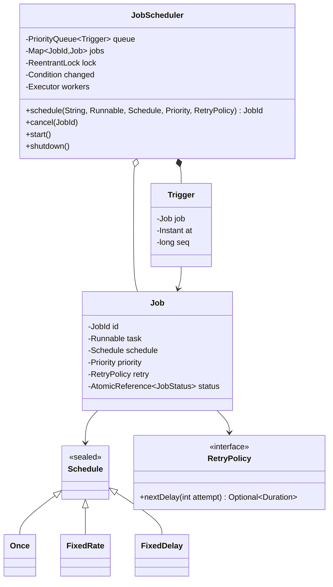

<Related ids={['concurrency-for-lld', 'command-pattern', 'strategy-pattern', 'observer-pattern']} />

A job scheduler runs code **later**: "send this reminder at 9 am", "refresh the cache every 5 minutes", "retry this upload in 30 seconds". Java's `ScheduledExecutorService`, Quartz and cron all do this. It's a concurrency problem dressed up as an LLD problem. The interviewer wants to see three things: a **queue ordered by run time**, a thread that **sleeps until the next job is due** without checking the clock over and over, and a **worker pool** so one slow job doesn't hold up the rest.

We'll use the same six steps as every case study: requirements, entities, class design, code, a worked example, and follow-ups. (The [parking lot](/system-design/lld/lld-parking-lot) lesson explains the plan in detail.)

## Step 1: Pin down the requirements

<Dialogue>
<Turn who="you">What kinds of schedule? Once at a time, and repeating?</Turn>
<Turn who="them">Once, and repeating every N seconds.</Turn>
<Turn who="you">For repeating jobs, is it "every N from the start" or "N after the last run finishes"?</Turn>
<Turn who="them">Good question. Support both.</Turn>
<Turn who="you">If a job fails?</Turn>
<Turn who="them">Retry a few times with growing delays, then mark it failed.</Turn>
<Turn who="you">Can jobs be cancelled?</Turn>
<Turn who="them">Yes, any time. A cancelled job must never start again.</Turn>
<Turn who="you">If two jobs are due at the same moment?</Turn>
<Turn who="them">High priority first.</Turn>
<Turn who="you">If the machine was asleep for an hour, should an every-minute job run 60 times to catch up?</Turn>
<Turn who="them">No. Once is enough.</Turn>
</Dialogue>

The "every N from the start" or "N after it finishes" question shows real experience. The two have names, **fixed rate** and **fixed delay**, and the difference is explained below.

**The scheduler must:**

1. Run a job once at a given time, at a **fixed rate**, or with a **fixed delay** between runs.
2. Run high-priority jobs first when several are due together.
3. Retry failures with growing delays, then mark the job failed.
4. Cancel a job at any time; it never starts again.
5. Run jobs on a pool of worker threads, so a slow job doesn't delay others.
6. After a pause, run a missed repeating job once, not once per missed slot.

**Out of scope for now:** saving jobs to disk, several machines, cron expressions.

## Step 2: Find the core entities

| Noun | Make it… | Why |
| --- | --- | --- |
| Job | a class | The **definition**: the code to run, its schedule, priority, retry rule and status. Lives as long as the job does. |
| Trigger | a record | **One upcoming run**: "run this job at this time". A repeating job creates a new trigger after each run. |
| Schedule | a sealed interface with `Once`, `FixedRate`, `FixedDelay` | Three kinds, each working out the next run differently. |
| Priority | an enum | `HIGH`, `NORMAL`, `LOW`. |
| Retry rule | an interface `RetryPolicy` | "How long until the next attempt, or give up?" |
| Scheduler | a class | The queue, the dispatcher thread and the worker pool. |

Separating **Job** from **Trigger** keeps the queue simple: it only ever holds "what runs next, and when".

## Step 3: Design the scheduler

Three moving parts:

1. **A priority queue of triggers**, ordered by time (then priority, then the order they were added). The earliest trigger is always at the head, available in O(1).
2. **One dispatcher thread** that waits until the head trigger is due, takes it off the queue and hands it to a worker.
3. **A worker pool** that actually runs the job code.

How should the dispatcher wait?

<Approach verdict="bad" title="Check every millisecond">

```java
while (true) { if (queue.peek().runAt <= now()) run(); Thread.sleep(1); }
```

It burns CPU when nothing is due, and is still up to 1 ms late.

</Approach>

<Approach verdict="bad" title="Sleep exactly until the head is due">

`Thread.sleep(head.runAt - now)`. Efficient, until someone schedules a job that's due **sooner** than the one we're sleeping for. We'd sleep straight past it.

</Approach>

<Approach verdict="great" title="Wait with a timeout, and be woken when the queue changes">

Wait on a condition (or `wait(timeout)`) for exactly as long as the head needs. Whenever a job is scheduled, **signal** the dispatcher. It wakes up, looks at the head again (which may now be the new, earlier job) and recalculates how long to wait. No wasted CPU, and never late.

</Approach>

And why a separate worker pool? If the dispatcher ran the job itself, a job that takes 10 seconds would make every other job up to 10 seconds late.

**Fixed rate vs fixed delay**, the distinction every interviewer asks about:

| | Fixed rate | Fixed delay |
| --- | --- | --- |
| Next run | Previous **scheduled** time + period | Previous **finish** time + delay |
| Use for | Metrics, heartbeats: "every minute, on the minute" | Cleanup, polling: "rest between runs" |
| If a run is slow | The next may start right away | There's always a gap |



## Step 4: Write the code

<InterviewScope minutes="45–60" lines="40" write={["A priority queue ordered by run time", "One dispatcher thread that sleeps until the next job is due", "A worker pool that runs jobs, and repeating jobs"]} say={["Fixed rate vs fixed delay", "Retries with back-off", "Why cancelling by marking is cheaper than searching the heap"]} skip={["Cron expressions", "Running across many machines"]} />

### The interview-sized version

A time-ordered queue, a dispatcher that wakes up exactly when needed, and workers that run the jobs. It's about **40 lines**, and it compiles and runs.

```java
record Job(String id, long runAt, Runnable task, long repeatEveryMillis) { }   // repeatEveryMillis = 0: run once

class Scheduler {
    private final PriorityQueue<Job> queue = new PriorityQueue<>(Comparator.comparingLong(Job::runAt));
    private final Set<String> cancelled = ConcurrentHashMap.newKeySet();
    private final ExecutorService workers;
    private final Thread dispatcher = new Thread(this::dispatchLoop);
    private volatile boolean running = true;

    Scheduler(int workerThreads) {
        workers = Executors.newFixedThreadPool(workerThreads);
        dispatcher.setDaemon(true);
        dispatcher.start();
    }

    synchronized void schedule(Job job) {
        queue.add(job);
        notify();                                    // wake the dispatcher: this job may now be the earliest
    }

    void cancel(String id) { cancelled.add(id); }   // checked when the job comes due: no searching the heap

    private synchronized void dispatchLoop() {
        try {
            while (running) {
                Job next = queue.peek();
                long now = System.currentTimeMillis();
                if (next == null) { wait(); continue; }                              // nothing to do
                if (next.runAt() > now) { wait(next.runAt() - now); continue; }      // sleep until due (or a new job)
                queue.poll();
                if (cancelled.contains(next.id())) continue;
                workers.submit(next.task());         // run on the pool, so a slow job never blocks the loop
                if (next.repeatEveryMillis() > 0)
                    queue.add(new Job(next.id(), next.runAt() + next.repeatEveryMillis(), next.task(), next.repeatEveryMillis()));
            }
        } catch (InterruptedException e) {
            Thread.currentThread().interrupt();
        }
    }

    void shutdown() { running = false; dispatcher.interrupt(); workers.shutdown(); }
}
```

**Reading it top to bottom:**

1. **`Job`** holds an id, when to run, the code, and how often to repeat (0 means once).
2. The **queue** is a `PriorityQueue` ordered by `runAt`, so `peek()` is always the next job due.
3. **`schedule`** adds a job and calls `notify()`. That wakes the dispatcher in case this job is now the earliest.
4. **`dispatchLoop`** (on its own thread):
   - Nothing queued → `wait()` until something is scheduled.
   - The head isn't due yet → `wait(howLongUntilDue)`. Either the time passes, or `notify` wakes it early, and it loops round and checks again.
   - The head is due → take it off, skip it if cancelled, hand it to the worker pool, and if it repeats, queue the next run.
5. **`cancel`** just adds the id to a set. The job is skipped when it comes due. Removing it from the middle of a heap would be O(n); this is O(1).

<Callout type="tip" title="How to practise this">
Explain out loud what happens when the dispatcher is waiting 60 seconds for job A and someone schedules job B due in 5 seconds. (`notify` wakes it, it peeks, sees B, and waits 5 seconds instead.) Then write the code.
</Callout>

### Growing it into the full design

#### Jobs, triggers and schedules

A trigger orders by time, then priority, then a sequence number, so two triggers with the same time and priority run in the order they were added:

```java
/** Ordered by time, then priority, then insertion order (FIFO for equal keys). */
public record Trigger(Job job, Instant at, long seq) implements Comparable<Trigger> {
    public int compareTo(Trigger o) {
        int c = at.compareTo(o.at);
        if (c != 0) return c;
        c = job.priority.compareTo(o.job.priority);
        return c != 0 ? c : Long.compare(seq, o.seq);
    }
}

public sealed interface Schedule {
    Instant first();
    record Once(Instant first) implements Schedule { }
    record FixedRate(Instant first, Duration period) implements Schedule { }
    record FixedDelay(Instant first, Duration delay) implements Schedule { }
}
```

`Schedule` is a **sealed** interface: the compiler knows the only kinds are `Once`, `FixedRate` and `FixedDelay`, so a `switch` over them can't forget one.

#### The dispatcher

Same idea as the short version, with a `ReentrantLock` and a `Condition` called `changed`:

```java
private void loop() {
    while (running) {
        lock.lock();
        try {
            while (running) {
                Trigger head = queue.peek();
                if (head == null) { changed.await(); continue; }              // nothing scheduled: sleep
                long waitNanos = Duration.between(clock.instant(), head.at()).toNanos();
                if (waitNanos <= 0) break;                                    // due
                changed.awaitNanos(waitNanos);                                // woken early by schedule()
            }
        } catch (InterruptedException e) {
            Thread.currentThread().interrupt();
            return;
        } finally { lock.unlock(); }
        runDue();
    }
}

private void enqueue(Job job, Instant at) {
    lock.lock();
    try {
        queue.add(new Trigger(job, at, seq.incrementAndGet()));
        changed.signal();
    } finally { lock.unlock(); }
}
```

Note the **inner `while`**: after every wake-up, the dispatcher re-reads the head and re-checks whether it's due. That makes spurious wake-ups (Java allows a waiting thread to wake for no reason) and early signals harmless. "Always wait in a loop that re-checks the condition" is the rule for condition variables.

#### Taking due jobs off the queue and running them

`runDue` pops every due trigger **under the lock**, then hands them to workers **outside** it. `dispatch` uses a compare-and-set on the job's status: if the job was cancelled in the meantime, it isn't `SCHEDULED` any more, so it doesn't start.

```java
public void runDue() {
    List<Trigger> due = new ArrayList<>();
    lock.lock();
    try {
        Instant now = clock.instant();
        while (!queue.isEmpty() && !queue.peek().at().isAfter(now)) due.add(queue.poll());
    } finally { lock.unlock(); }
    for (Trigger t : due) dispatch(t);
}

private void dispatch(Trigger t) {
    Job job = t.job();
    if (!job.status.compareAndSet(JobStatus.SCHEDULED, JobStatus.RUNNING)) return;   // cancelled meanwhile
    workers.execute(() -> execute(job, t.at()));
}
```

Making `runDue()` public has a bonus: a test can use a **fake clock** and run jobs inline (`Runnable::run`), with no real waiting at all.

#### Running, rescheduling and retrying

After a job runs:

- **Success**: work out the next run from the schedule. `Once` → done. `FixedRate` → the previous **scheduled** time plus the period; if that's already in the past (the machine was asleep), keep adding periods until it's in the future, so it runs **once** and lines up again. `FixedDelay` → now plus the delay.
- **Failure**: ask the retry policy for a delay. If there is one, queue a retry; otherwise mark the job `FAILED`. The exponential policy waits 1×, 2×, 4×... the base delay.

```java
private void execute(Job job, Instant scheduledFor) {
    try {
        job.task.run();
        job.attempt = 0;
        reschedule(job, scheduledFor);
    } catch (RuntimeException e) {
        Optional<Duration> delay = job.retry.nextDelay(++job.attempt);
        if (delay.isPresent() && job.status.compareAndSet(JobStatus.RUNNING, JobStatus.SCHEDULED)) {
            enqueue(job, clock.instant().plus(delay.get()));                  // backoff
        } else {
            job.status.compareAndSet(JobStatus.RUNNING, JobStatus.FAILED);
        }
    }
}

private void reschedule(Job job, Instant scheduledFor) {
    Instant next = switch (job.schedule) {
        case Schedule.Once o -> null;
        case Schedule.FixedRate r -> {
            Instant n = scheduledFor.plus(r.period());                        // aligned to the original grid
            Instant now = clock.instant();
            while (!n.isAfter(now)) n = n.plus(r.period());                   // skip missed runs, don't burst
            yield n;
        }
        case Schedule.FixedDelay d -> clock.instant().plus(d.delay());        // from completion
    };
    if (next == null) { job.status.compareAndSet(JobStatus.RUNNING, JobStatus.SUCCEEDED); return; }
    if (job.status.compareAndSet(JobStatus.RUNNING, JobStatus.SCHEDULED)) enqueue(job, next);
}

public interface RetryPolicy {
    Optional<Duration> nextDelay(int attempt);                                // empty = give up
    static RetryPolicy exponential(int maxAttempts, Duration base) {
        return a -> a >= maxAttempts ? Optional.empty() : Optional.of(base.multipliedBy(1L << (a - 1)));
    }
}
```

#### Cancelling safely

Cancelling sets the job's status to `CANCELLED`. A trigger for a cancelled job is simply ignored when it reaches the head. A job cancelled **while it's running** finishes its current run; then `reschedule` sees it's no longer `RUNNING` and doesn't queue another. Every status change is a compare-and-set, so cancel, finish and retry can't overwrite each other.

| Shared state | Protection |
| --- | --- |
| The priority queue | One lock, held only to add or remove |
| The dispatcher's sleep and wake-up | A `Condition` on the same lock, signalled on every add |
| Job status | `AtomicReference` with compare-and-set changes |
| Job code | Runs on the worker pool, never under the scheduler's lock |

The reference solution schedules 1,100 real jobs, cancels 100, and checks that the other 1,000 each run exactly once and never early.

## Step 5: Trace a timeline

It's 10:00:00. The scheduler is empty, and the dispatcher is waiting with no timeout.

1. `schedule(report, once at 10:05)`. Signal. The dispatcher wakes, sees the head is due in 5 minutes, and waits 5 minutes.
2. At 10:00:10, `schedule(heartbeat, fixed rate every 30 s from 10:00:20)`. Signal. The dispatcher wakes, sees the heartbeat is now the head (due in 10 seconds), and waits 10 seconds.
3. At 10:00:20, the heartbeat is due. It goes to a worker. Its next run is 10:00:50, queued straight away.
4. The heartbeat throws an exception. The retry policy says "try again in 1 second", so a retry trigger is queued for 10:00:21.
5. At 10:01:00 someone cancels the report. Its status becomes `CANCELLED`. At 10:05 its trigger reaches the head, `dispatch` sees it's not `SCHEDULED`, and drops it.

## Step 6: Handle follow-up questions

**"Kill a job that runs too long."** Submit it to get a `Future`, and schedule a watchdog at start + timeout that calls `future.cancel(true)`. Treat that as a failure, so the retry rule applies. The job code must respond to interruption.

**"At most 2 report jobs running at once."** A `Semaphore` per job type. In `dispatch`, `tryAcquire` first; if there's no permit, re-queue the trigger a little later. Never make the dispatcher **wait** for a permit: that would stall every other job.

**"Survive restarts."** Store jobs and their next run times in a database and reload them at startup. Decide what to do about runs missed while down.

**"Several scheduler machines."** Only one may run each trigger: claim it with a conditional database update or a lease. See [Design a Distributed Job Scheduler](/system-design/hld/design-job-scheduler).

**"Millions of timers."** A **hierarchical timing wheel** (used by Kafka and Netty) gives O(1) add and cancel instead of O(log n).

## Common mistakes

- **Polling the clock in a tight loop.**
- **Sleeping a fixed time** and missing a newly added, earlier job.
- **Running job code on the dispatcher thread.**
- **Using `if` instead of `while`** around the wait.
- **Removing cancelled jobs from the middle of the heap** (O(n)) instead of skipping them.
- **Firing every missed run** after a pause.

## Patterns used

| Pattern | Where |
| --- | --- |
| **Command** | Each job's `Runnable`: an action stored as an object |
| **Strategy** | `RetryPolicy`, and the `Schedule` kinds (a `CronSchedule` would be another) |
| **Producer–consumer** | `schedule()` produces triggers; the dispatcher and workers consume them |
| **Observer** (follow-up) | Listeners for job succeeded and failed events |

## Interview questions

<QA q="How does the scheduler know when to wake up without polling?">
The dispatcher waits on a condition variable with a timeout equal to the time until the earliest trigger in a time-ordered priority queue. Adding a job signals the condition, because the new job may be earlier than the current head; the dispatcher wakes, re-reads the head and works out the wait again. Waiting in a loop that re-checks the condition makes spurious or early wake-ups harmless.
</QA>

<QA q="What's the difference between fixed-rate and fixed-delay scheduling?">
Fixed rate works out the next run from the previous scheduled time, so runs stay on a grid (every minute, on the minute) and a slow run may be followed straight away by the next. Fixed delay works out the next run from when the previous run finished, guaranteeing a gap between runs. Java's ScheduledExecutorService offers both as scheduleAtFixedRate and scheduleWithFixedDelay.
</QA>

<QA q="The machine was asleep for an hour. What should a job scheduled every minute do when it wakes?">
It's a policy decision, so state one. Firing 60 catch-up runs at once usually hurts (a burst against other systems), so a common choice is to run once and line up with the next grid point, which is what this design does. Some jobs (billing, for example) must account for every missed period; they should work out what they missed from the data rather than rely on how many times the timer fired.
</QA>

<Practice task="Add a per-job timeout: if a run takes longer than its limit, it is interrupted and treated as a failure (so the retry policy applies). Where does the code go?">

Run job code with `ExecutorService.submit` to get a `Future`, and schedule a watchdog (on the same scheduler or a small `ScheduledExecutorService`) at start + timeout that calls `future.cancel(true)`. In `execute`, treat `CancellationException` or `InterruptedException` from the task as a failure and go through the retry path. Jobs must respond to interruption for this to work, so document it.

</Practice>

<Practice task="Add 'at most N jobs of the same type running at once' (for example, at most 2 report generations). How do you enforce it without blocking the dispatcher?">

Keep a `Semaphore` (or counter) per job type. In `dispatch`, `tryAcquire` before handing the job to a worker; if no permit is free, re-queue the trigger a short delay later (or park it in a waiting list for that type, drained when a permit is released). Release the permit in a `finally` after the run. Never make the dispatcher thread wait on the semaphore; it would stall every other job.

</Practice>

<Takeaways>

- Separate jobs (definitions) from triggers (upcoming runs); order triggers by time, then priority, then sequence.
- One dispatcher waits until the head is due and is woken when an earlier job arrives; workers run the job code.
- Fixed rate stays on its grid and skips missed runs; fixed delay counts from when the last run finished.
- Cancel by marking the status, and skip cancelled jobs when they come due.
- Expose `runDue()` and inject the clock so tests run instantly.

</Takeaways>

## Further reading

- Java SE API: the `ScheduledThreadPoolExecutor` and `DelayQueue` source code (the same design).
- George Varghese and Tony Lauck, "Hashed and Hierarchical Timing Wheels" (SOSP, 1987).
- HLD view: [Design a Distributed Job Scheduler](/system-design/hld/design-job-scheduler).
