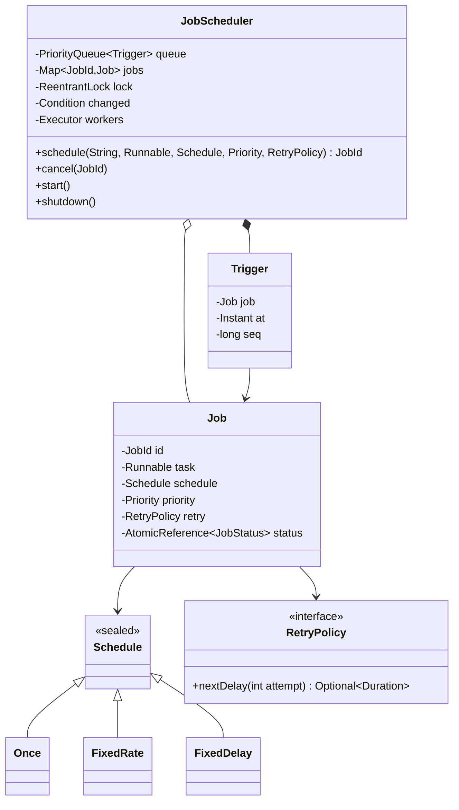

<Related ids={['concurrency-for-lld', 'command-pattern', 'strategy-pattern', 'observer-pattern']} />

"Design a task scheduler" — run jobs at a time, on a fixed rate, or with a delay between runs; with priorities, retries and cancellation — is a concurrency problem dressed as an LLD problem. The interviewer wants to see a **priority queue ordered by time**, a dispatcher that **sleeps until the next job is due without busy-waiting**, a worker pool, and precise answers about edge cases (missed runs, retries, cancelling a running job). It's what `ScheduledThreadPoolExecutor`, Quartz and cron do inside.

## 1. Requirements

| Question | Assumption |
| --- | --- |
| Schedules | One-time at an instant; **fixed rate** (every N, aligned to the start); **fixed delay** (N after the previous run *finishes*) |
| Priority | At the same due time, HIGH before NORMAL before LOW |
| Failures | Per-job retry policy with exponential backoff, then mark failed |
| Cancellation | Any time; a cancelled job never starts again |
| Execution | A bounded worker pool; a slow job must not delay others' start times |
| Missed runs | If the process was paused, a fixed-rate job runs **once** and realigns — no burst of catch-up runs |
| Out of scope | Persistence and multiple nodes (extensions); cron expressions (a `Schedule` implementation) |

## 2. Design



The key split: a **Job** is the long-lived definition (what, how often, how to retry); a **Trigger** is one queue entry — "run this job at this instant". A recurring job produces a new trigger after each run.

```java
/** Ordered by time, then priority, then insertion order (FIFO for equal keys). */
public record Trigger(Job job, Instant at, long seq) implements Comparable<Trigger> {
    public int compareTo(Trigger o) {
        int c = at.compareTo(o.at);
        if (c != 0) return c;
        c = job.priority.compareTo(o.job.priority);
        return c != 0 ? c : Long.compare(seq, o.seq);
    }
}

public sealed interface Schedule {
    Instant first();
    record Once(Instant first) implements Schedule { }
    record FixedRate(Instant first, Duration period) implements Schedule { }
    record FixedDelay(Instant first, Duration delay) implements Schedule { }
}
```

## 3. The dispatcher: sleep until the next job, wake early when needed

One thread owns the queue's head. It waits on a `Condition` for exactly as long as the earliest trigger needs, and `schedule()` signals it — because a newly added job might be **earlier** than the one it's waiting for.

```java
private void loop() {
    while (running) {
        lock.lock();
        try {
            while (running) {
                Trigger head = queue.peek();
                if (head == null) { changed.await(); continue; }              // nothing scheduled: sleep
                long waitNanos = Duration.between(clock.instant(), head.at()).toNanos();
                if (waitNanos <= 0) break;                                    // due
                changed.awaitNanos(waitNanos);                                // woken early by schedule()
            }
        } catch (InterruptedException e) {
            Thread.currentThread().interrupt();
            return;
        } finally { lock.unlock(); }
        runDue();
    }
}

private void enqueue(Job job, Instant at) {
    lock.lock();
    try {
        queue.add(new Trigger(job, at, seq.incrementAndGet()));
        changed.signal();
    } finally { lock.unlock(); }
}
```

The loop re-checks the head after every wake-up, so spurious wake-ups and early signals are harmless — the classic **condition-variable pattern**: always wait in a loop that re-tests the condition.

`runDue()` pops every due trigger under the lock, then hands them to the worker pool **outside** the lock. The dispatcher never runs job code itself, so a slow job can't delay the next job's start.

```java
public void runDue() {
    List<Trigger> due = new ArrayList<>();
    lock.lock();
    try {
        Instant now = clock.instant();
        while (!queue.isEmpty() && !queue.peek().at().isAfter(now)) due.add(queue.poll());
    } finally { lock.unlock(); }
    for (Trigger t : due) dispatch(t);
}

private void dispatch(Trigger t) {
    Job job = t.job();
    if (!job.status.compareAndSet(JobStatus.SCHEDULED, JobStatus.RUNNING)) return;   // cancelled meanwhile
    workers.execute(() -> execute(job, t.at()));
}
```

Making `runDue()` public has a second benefit: tests can drive the scheduler with a **fake clock** and an inline executor (`Runnable::run`) — completely deterministic, no sleeps.

## 4. Running, rescheduling and retrying

```java
private void execute(Job job, Instant scheduledFor) {
    try {
        job.task.run();
        job.attempt = 0;
        reschedule(job, scheduledFor);
    } catch (RuntimeException e) {
        Optional<Duration> delay = job.retry.nextDelay(++job.attempt);
        if (delay.isPresent() && job.status.compareAndSet(JobStatus.RUNNING, JobStatus.SCHEDULED)) {
            enqueue(job, clock.instant().plus(delay.get()));                  // backoff
        } else {
            job.status.compareAndSet(JobStatus.RUNNING, JobStatus.FAILED);
        }
    }
}

private void reschedule(Job job, Instant scheduledFor) {
    Instant next = switch (job.schedule) {
        case Schedule.Once o -> null;
        case Schedule.FixedRate r -> {
            Instant n = scheduledFor.plus(r.period());                        // aligned to the original grid
            Instant now = clock.instant();
            while (!n.isAfter(now)) n = n.plus(r.period());                   // skip missed runs, don't burst
            yield n;
        }
        case Schedule.FixedDelay d -> clock.instant().plus(d.delay());        // from completion
    };
    if (next == null) { job.status.compareAndSet(JobStatus.RUNNING, JobStatus.SUCCEEDED); return; }
    if (job.status.compareAndSet(JobStatus.RUNNING, JobStatus.SCHEDULED)) enqueue(job, next);
}

public interface RetryPolicy {
    Optional<Duration> nextDelay(int attempt);                                // empty = give up
    static RetryPolicy exponential(int maxAttempts, Duration base) {
        return a -> a >= maxAttempts ? Optional.empty() : Optional.of(base.multipliedBy(1L << (a - 1)));
    }
}
```

| | Fixed rate | Fixed delay |
| --- | --- | --- |
| Next run | Previous **scheduled** time + period | Previous **finish** time + delay |
| Use for | Metrics, heartbeats — "every minute on the minute" | Cleanup, polling — "rest between runs" |
| Slow run | Next run may start immediately | Always a gap |
| Can overlap? | Not here: a job runs again only after it was rescheduled | Never |

## 5. Cancellation without searching the heap

Removing an arbitrary element from a `PriorityQueue` is O(n). Instead, cancellation flips the job's status, and the dispatcher **lazily drops** cancelled triggers when they reach the head (`dispatch` refuses to start a job that isn't `SCHEDULED`). A job cancelled **while running** finishes its current run, and then `reschedule` sees it's no longer `RUNNING` and doesn't re-enqueue it. Every status change is a compare-and-set, so cancel, finish and retry can't trample each other.

## 6. Concurrency summary

| Shared state | Protection |
| --- | --- |
| Priority queue | One lock; held only to add or pop |
| Dispatcher sleep/wake | `Condition` on the same lock; `signal` on every enqueue |
| Job status | `AtomicReference` with compare-and-set transitions |
| Job code | Runs on the worker pool, never under the scheduler lock |

The reference solution schedules 1,100 real-time jobs, cancels 100, and checks that the other 1,000 each run exactly once and never before their time.

## 7. Patterns used

| Pattern | Where |
| --- | --- |
| **Command** | Each job's `Runnable` — the request as an object |
| **Strategy** | `RetryPolicy`, and `Schedule` variants (a `CronSchedule` would be another) |
| **Producer–consumer** | `schedule()` produces triggers; dispatcher and workers consume |
| **Observer** (extension) | Listeners for job succeeded/failed events (alerts, metrics) |

## 8. Extensions

- **Persistence**: store jobs and next-run times in a database; on startup, reload. Decide what happens to runs missed while down (skip, run once, run all).
- **Multiple scheduler nodes**: only one node may fire a given trigger — claim it with a conditional update (`UPDATE ... SET owner = me WHERE id = ? AND owner IS NULL`) or a lease. See the HLD case [Design a Distributed Job Scheduler](/system-design/hld/design-job-scheduler).
- **Timeouts**: run jobs via `Future` and cancel ones exceeding a limit.
- **Huge numbers of timers**: a **hierarchical timing wheel** (used in Kafka and Netty) gives O(1) insert and cancel instead of O(log n).

## Interview questions

<QA q="How does the scheduler know when to wake up without polling?">
The dispatcher waits on a condition variable with a timeout equal to the time until the earliest trigger in a time-ordered priority queue. Adding a job signals the condition, because the new job may be earlier than the current head; the dispatcher wakes, re-reads the head and recomputes the wait. Waiting in a loop that re-checks the condition makes spurious or early wake-ups harmless.
</QA>

<QA q="What's the difference between fixed-rate and fixed-delay scheduling?">
Fixed rate computes the next run from the previous scheduled time, so runs stay aligned to a grid (every minute on the minute) and a slow run may be followed immediately by the next. Fixed delay computes the next run from when the previous run finished, guaranteeing a gap between runs. Java's ScheduledExecutorService offers both as scheduleAtFixedRate and scheduleWithFixedDelay.
</QA>

<QA q="The machine was asleep for an hour. What should a job scheduled every minute do when it wakes?">
It's a policy decision; state one. Firing 60 catch-up runs at once is usually harmful (a burst against downstream systems), so a common choice is to run once and realign to the next grid point, which is what this design does. Some jobs (billing, for example) must account for every missed period — they should compute what they missed from data rather than rely on the number of timer firings.
</QA>

<Practice task="Add a per-job timeout: if a run takes longer than its limit, it is interrupted and treated as a failure (so the retry policy applies). Where does the code go?">

Run job code via `ExecutorService.submit` to get a `Future`, and schedule a watchdog (on the same scheduler or a small `ScheduledExecutorService`) at start + timeout that calls `future.cancel(true)`. In `execute`, treat `CancellationException`/`InterruptedException` from the task as a failure and go through the retry path. Jobs must respond to interruption for this to work — document it.

</Practice>

<Practice task="Add 'at most N jobs of the same type running at once' (for example, at most 2 report generations). How do you enforce it without blocking the dispatcher?">

Keep a `Semaphore` (or counter) per job type. In `dispatch`, `tryAcquire` before handing the job to a worker; if no permit is available, re-enqueue the trigger a short delay later (or park it in a per-type waiting queue that is drained when a permit is released). Release the permit in a `finally` after the run. Never block the dispatcher thread on the semaphore — it would stall every other job.

</Practice>

<Takeaways>

- Separate jobs (definitions) from triggers (queue entries); order triggers by time, priority, then sequence.
- One dispatcher waits on a condition until the head is due and is signalled when an earlier job arrives; workers run the job code.
- Fixed rate realigns to its grid (skip missed runs); fixed delay counts from completion.
- Cancel lazily with status flags and compare-and-set transitions.
- Expose a `runDue()` driven by an injected clock for deterministic tests.

</Takeaways>

## Further reading

- Java SE API — `ScheduledThreadPoolExecutor` and `DelayQueue` source code (the same design).
- George Varghese and Tony Lauck, "Hashed and Hierarchical Timing Wheels" (SOSP, 1987).
- HLD view: [Design a Distributed Job Scheduler](/system-design/hld/design-job-scheduler).
