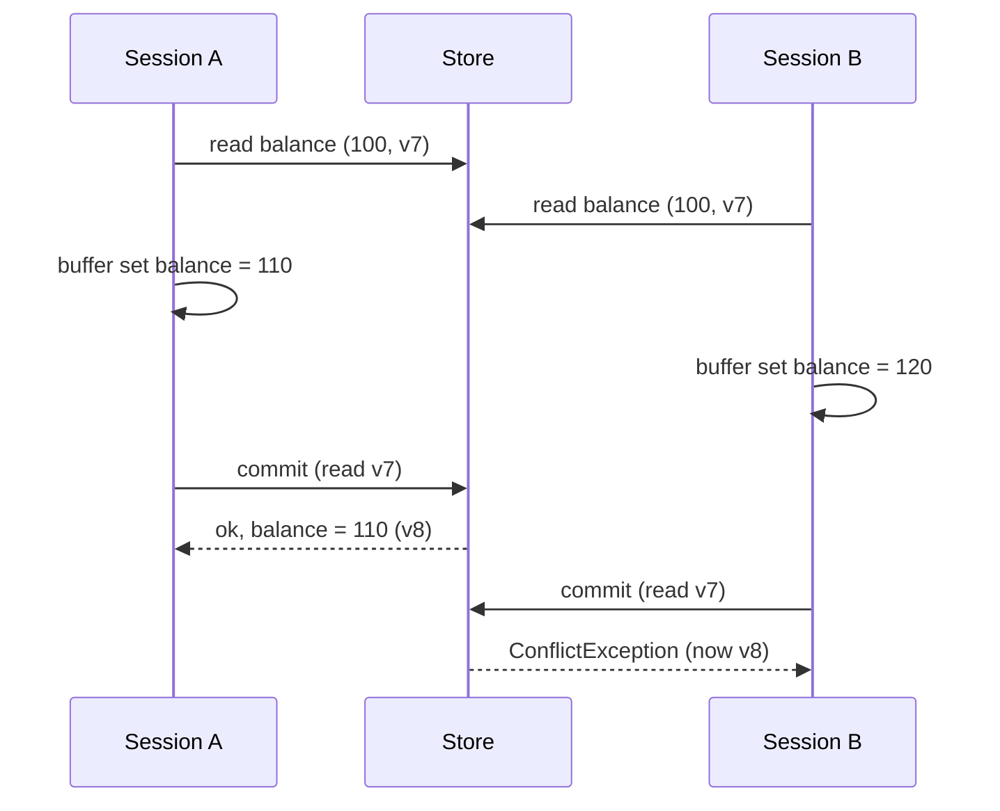
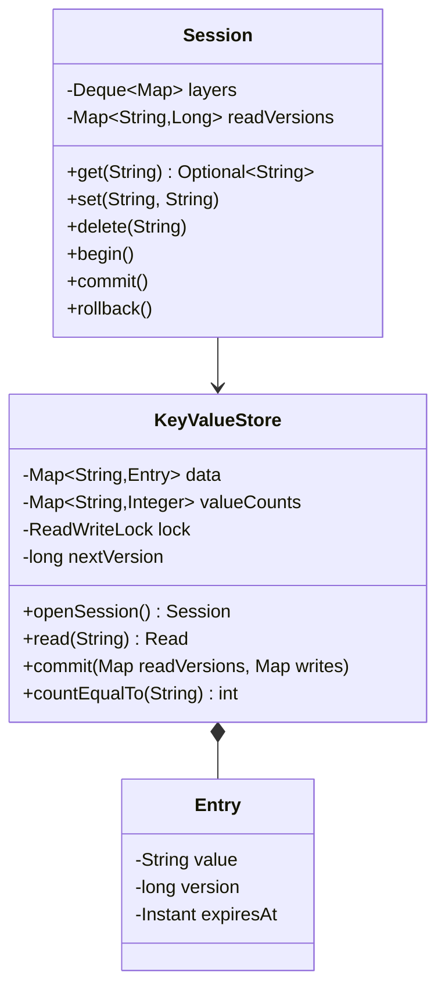

<Related ids={['concurrency-for-lld', 'command-pattern', 'memento-pattern', 'lld-lru-cache', 'interview-grade-code']} />

"Build an in-memory key-value store with transactions" starts out trivially: `get` and `set` on a `HashMap`. Then the interviewer adds `BEGIN`, `COMMIT` and `ROLLBACK`, then lets you start a transaction inside another one, then adds a second client. Suddenly you're building a tiny database, and the real question is whether you understand **what a transaction promises**: all of its changes happen, or none do, and nobody sees half of them.

We'll use the same six steps as every case study: requirements, entities, class design, code, a worked example, and follow-ups. (The [parking lot](/system-design/lld/lld-parking-lot) lesson explains the plan in detail.)

## Step 1: Pin down the requirements

<Dialogue>
<Turn who="you">Which operations? `get`, `set`, `delete`?</Turn>
<Turn who="them">Yes, plus "how many keys have this value?"</Turn>
<Turn who="you">Can transactions be nested, a BEGIN inside a BEGIN?</Turn>
<Turn who="them">Yes.</Turn>
<Turn who="you">When I COMMIT an inner transaction, does it commit everything, or just fold into the outer one?</Turn>
<Turn who="them">Fold into the outer one. Only the outermost COMMIT makes changes permanent.</Turn>
<Turn who="you">And ROLLBACK undoes only the innermost transaction?</Turn>
<Turn who="them">Right.</Turn>
<Turn who="you">Is there one client, or many at the same time?</Turn>
<Turn who="them">Start with one. Then tell me what changes with many.</Turn>
</Dialogue>

<Callout type="interview">
Always pin down the commit rule. "Does COMMIT commit only the innermost transaction or all of them?" Both versions appear in interviews. Folding the innermost into its parent is the general case; "commit all" is just a loop on top.
</Callout>

**The store must:**

1. Support `get`, `set` and `delete`.
2. Support `begin`, `commit` and `rollback`, nested to any depth.
3. Make an inner `commit` fold its changes into the outer transaction; only the outermost `commit` makes them permanent.
4. Make `rollback` throw away only the innermost transaction's changes.
5. Inside a transaction, `get` must see that transaction's own changes.
6. (Many clients) never show one client another client's uncommitted changes, and never silently lose an update.

**Out of scope for now:** saving to disk, replication.

## Step 2: Find the core pieces

| Piece | Make it… | Why |
| --- | --- | --- |
| The committed data | a `Map<String, String>` | The permanent state. |
| An open transaction's changes | a `Map` per transaction, kept on a **stack** | Nested transactions are a stack: the innermost is on top. |
| A deleted key inside a transaction | `null` in that transaction's map | So a transaction can hide a key without touching the real data. |
| A client (with many clients) | a `Session` class | Each client's open transactions are private to it. |

The central decision is **where uncommitted changes live**.

<Approach verdict="bad" title="Write straight to the data and remember how to undo it">

On `set`, change the real map and record the old value in an undo list; `rollback` replays the undo list. It works for one client. But with several clients, everyone else can see changes that might still be rolled back. That's called a **dirty read**.

</Approach>

<Approach verdict="bad" title="Copy the whole map on every BEGIN">

`rollback` just restores the copy. Simple, but copying a million keys every time someone types `BEGIN` is far too slow.

</Approach>

<Approach verdict="great" title="Keep each transaction's changes in its own layer">

`begin` pushes an empty map onto a stack. Writes go into the top map. Reads look through the maps **from the top down**, then fall back to the real data. Then:

- **rollback** = throw the top map away. Instant.
- **commit (inner)** = copy the top map's entries into the one below it.
- **commit (outermost)** = copy them into the real data.

Nothing is ever undone, because nothing permanent was touched until the final commit.

</Approach>

## Step 3: Design the store

With one client, everything fits in a single class, `KvStore`:

- **`get(key)`**: check each layer from newest to oldest; the first one that mentions the key wins (even if it says `null`, meaning "deleted"). Otherwise read the real data.
- **`set` / `delete`**: if a transaction is open, record the change in the top layer; otherwise change the real data.
- **`begin`**: push a new empty layer.
- **`rollback`**: pop the top layer and drop it.
- **`commit`**: pop the top layer and **replay its changes as writes**. If another layer is underneath, they land there; if not, they land in the real data. One method handles both cases.

With **many clients**, each client gets a `Session` holding its own stack of layers, and a shared `KeyValueStore` holds the committed data. A new problem appears: two clients read the same value, and both write back a change.



Without protection, B's commit would overwrite A's. That's a **lost update**. The fix is **optimistic concurrency control**:

1. Every committed key has a **version number** that goes up on every write.
2. When a transaction reads a key, it remembers the version it saw.
3. At the outermost commit, under one lock, the store checks that every key the transaction read **still has that version**. If any changed, the commit fails with a conflict, and the client retries.

"Optimistic" because it assumes conflicts are rare: nobody waits for a lock while working, and the check happens only at the end.



## Step 4: Write the code

<InterviewScope minutes="45–60" lines="30" write={["`get`, `set`, `delete`", "A stack of change layers for nested BEGIN, COMMIT and ROLLBACK", "Deletes inside a transaction (store `null` as \"deleted\")"]} say={["Many clients at once: versions and optimistic checks at commit", "What isolation level this gives", "TTL on keys"]} skip={["Persistence, logs and recovery", "Replication"]} />

### The interview-sized version

Nested transactions with a stack of maps: the version most rounds expect. It's about **30 lines**, and it compiles and runs.

```java
class KvStore {
    private final Map<String, String> data = new HashMap<>();
    // One layer of changes per open BEGIN, newest first. A null value means "deleted in this layer".
    private final Deque<Map<String, String>> transactions = new ArrayDeque<>();

    String get(String key) {
        for (Map<String, String> layer : transactions)       // newest layer wins
            if (layer.containsKey(key)) return layer.get(key);
        return data.get(key);
    }

    void set(String key, String value) { write(key, value); }
    void delete(String key)            { write(key, null); }

    void begin() { transactions.push(new HashMap<>()); }

    void rollback() {
        if (transactions.isEmpty()) throw new IllegalStateException("No transaction");
        transactions.pop();                                  // just throw the layer away
    }

    void commit() {
        if (transactions.isEmpty()) throw new IllegalStateException("No transaction");
        Map<String, String> top = transactions.pop();
        top.forEach(this::write);                            // fold into the parent layer, or the store
    }

    private void write(String key, String value) {
        if (!transactions.isEmpty()) { transactions.peek().put(key, value); return; }
        if (value == null) data.remove(key); else data.put(key, value);
    }
}
```

**Reading it top to bottom:**

1. **`transactions`** is the stack of layers. `ArrayDeque` iterates from the most recently pushed, so the `for` loop in `get` checks the newest layer first.
2. **`get`** uses `containsKey`, not `get(...) != null`. That matters: a layer that contains `key → null` means "deleted in this transaction", and we must return `null` rather than falling through to the old value.
3. **`set`** and **`delete`** both go through `write`; delete just writes `null`.
4. **`rollback`** pops the top layer. That's it.
5. **`commit`** pops the top layer and calls `write` for each entry. Because `write` sends changes to whatever is now on top (or to the real data if the stack is empty), the same code handles both inner and outermost commits.

<Callout type="tip" title="How to practise this">
Run this by hand: `set a 1`, `begin`, `set a 2`, `begin`, `delete a`, `get a` (null), `rollback`, `get a` (2), `commit`, `get a` (2). If you can predict every answer, you understand the design.
</Callout>

### Growing it into the full design: many clients

#### The shared store: versions and one atomic commit

The store keeps each key's value, version and optional expiry. `commit` takes the versions the transaction read and the writes it wants to make, and **under the write lock**: checks every version, then applies every write. Both happen together, so no other commit can sneak in between.

<FullCode title="Show the full code: The store: versions, one lock, atomic validate-and-apply (55 lines)">

```java
public final class KeyValueStore {
    private record Entry(String value, long version, Instant expiresAt) {
        boolean isLive(Instant now) { return expiresAt == null || now.isBefore(expiresAt); }
    }
    public record Read(Optional<String> value, long version) { }

    private final Map<String, Entry> data = new HashMap<>();
    private final Map<String, Integer> valueCounts = new HashMap<>();   // for O(1) countEqualTo
    private final ReadWriteLock lock = new ReentrantReadWriteLock();
    private final Clock clock;
    private long nextVersion = 1;

    public Read read(String key) {
        lock.readLock().lock();
        try {
            Entry e = data.get(key);
            if (e == null || !e.isLive(clock.instant())) return new Read(Optional.empty(), versionOf(e));
            return new Read(Optional.of(e.value()), e.version());
        } finally { lock.readLock().unlock(); }
    }

    /** Validates every read version, then applies every write — all under one write lock. */
    public void commit(Map<String, Long> readVersions, Map<String, Write> writes) {
        lock.writeLock().lock();
        try {
            Instant now = clock.instant();
            for (var r : readVersions.entrySet()) {
                Entry e = data.get(r.getKey());
                long current = (e == null || !e.isLive(now)) ? versionOf(e) : e.version();
                if (current != r.getValue()) throw new ConflictException(r.getKey());
            }
            writes.forEach((key, w) -> apply(key, w, now));
        } finally { lock.writeLock().unlock(); }
    }

    private void apply(String key, Write w, Instant now) {
        Entry old = data.get(key);
        if (old != null) valueCounts.merge(old.value(), -1, (a, b) -> a + b == 0 ? null : a + b);
        long version = nextVersion++;
        if (w.value().isEmpty()) {
            data.put(key, new Entry(null, version, now));                 // tombstone keeps the version
        } else {
            Instant exp = w.ttl() == null ? null : now.plus(w.ttl());
            data.put(key, new Entry(w.value().get(), version, exp));
            valueCounts.merge(w.value().get(), 1, Integer::sum);
        }
    }

    private static long versionOf(Entry e) { return e == null ? 0 : e.version(); }
}

public record Write(Optional<String> value, Duration ttl) {               // empty value = delete
    static Write set(String v, Duration ttl) { return new Write(Optional.of(v), ttl); }
    static Write delete() { return new Write(Optional.empty(), null); }
}
```

</FullCode>

Why does `delete` leave a **tombstone** (an entry with no value but a new version) instead of removing the key? Suppose A reads key `k` and finds nothing (version 0). Then B creates `k` and deletes it. If deleting removed the entry, `k` would look like version 0 again, and A's commit would pass even though `k` changed twice under it. With a tombstone, `k` is at a newer version, so A's commit correctly fails. (A background job can clear old tombstones later.)

The store also keeps a count of how many keys hold each value, so `countEqualTo(value)` is O(1).

#### The session: the same layers, plus remembered versions

The session is the interview version with one addition: the first time a transaction reads a key from the store, it records the version (`readVersions`). The outermost commit sends those versions to the store for checking.

<FullCode title="Show the full code: The session: a stack of write layers (42 lines)">

```java
public final class Session {
    private final KeyValueStore store;
    private final Deque<Map<String, Write>> layers = new ArrayDeque<>();   // one per BEGIN
    private final Map<String, Long> readVersions = new HashMap<>();        // first version seen per key

    public Optional<String> get(String key) {
        for (Map<String, Write> layer : layers) {                          // newest first: read your own writes
            Write w = layer.get(key);
            if (w != null) return w.value();
        }
        KeyValueStore.Read r = store.read(key);
        if (!layers.isEmpty()) readVersions.putIfAbsent(key, r.version()); // remember what we based decisions on
        return r.value();
    }

    public void set(String key, String value) { write(key, Write.set(value, null)); }
    public void delete(String key)            { write(key, Write.delete()); }

    private void write(String key, Write w) {
        if (layers.isEmpty()) store.commit(Map.of(), Map.of(key, w));      // no transaction: auto-commit
        else layers.peekFirst().put(key, w);
    }

    public void begin() { layers.push(new LinkedHashMap<>()); }

    public void rollback() {
        if (layers.isEmpty()) throw new NoTransactionException();
        layers.pop();
        if (layers.isEmpty()) readVersions.clear();
    }

    public void commit() {
        if (layers.isEmpty()) throw new NoTransactionException();
        Map<String, Write> top = layers.pop();
        if (!layers.isEmpty()) { layers.peekFirst().putAll(top); return; } // inner: merge into the parent
        try {
            store.commit(readVersions, top);                               // outermost: validate and publish
        } finally {
            readVersions.clear();
        }
    }
}
```

</FullCode>

Notice what we **didn't** need: no undo log, and no copying the whole map on `begin`.

#### What a client does on conflict

```java
while (true) {
    session.begin();
    int balance = Integer.parseInt(session.get("balance").orElse("0"));
    session.set("balance", String.valueOf(balance + 10));
    try { session.commit(); break; }
    catch (ConflictException e) { /* someone else won; read again and retry */ }
}
```

The reference solution runs 16 threads each adding 1 to the same counter 500 times this way, and ends at exactly 8,000. No update is lost.

#### What isolation level is this?

Interviewers like this question. Every successful transaction behaves as though it ran entirely at the moment it committed, because the version check and the writes happen together under one lock. That's the strongest level, **serializable**.

One subtlety worth mentioning: *while* a transaction is running, it might read key `a` before another client's commit and key `b` after it, seeing a mix that never existed. The commit will then fail, so nothing wrong is saved, but code that acts on those reads before committing should be aware of it. Snapshot reads (see the practice exercise) remove this.

| Approach | How | Trade-off |
| --- | --- | --- |
| **Buffered writes + versions** (this design) | Writes stay in session layers; versions checked at commit | Free rollback; conflicts found late; great when conflicts are rare |
| **Undo log** | Write directly; keep old values; restore on rollback | Simple for one client; others see uncommitted data unless you add locks |
| **Pessimistic locking** | Lock each key on first use until commit | No retries, but risk of deadlock and less concurrency |
| **Multi-version snapshots (MVCC)** | Keep several versions; each transaction reads a snapshot | Consistent reads without locks (PostgreSQL, MySQL InnoDB); more memory |

#### Expiry (TTL)

Store an expiry time with each entry and treat expired entries as missing when read (**lazy expiry**). Add a scheduled cleanup, or a priority queue ordered by expiry, so keys that are never read again still get removed. Pass in a `Clock` so tests can move time forward.

## Step 5: Trace two clients

Committed: `balance = 100` (version 7).

1. A: `begin`, `get balance` → 100, remembers version 7. `set balance 110` goes into A's layer.
2. B: `begin`, `get balance` → 100 (A's change is private), remembers version 7. `set balance 120` goes into B's layer.
3. A: `commit`. Under the lock, `balance` is still version 7, so the write is applied: `balance = 110`, version 8.
4. B: `commit`. Under the lock, `balance` is now version 8, not 7. **Conflict.** Nothing is written.
5. B retries: reads 110 (version 8), writes 120, commits successfully. Both updates happened, in order.

## Step 6: Handle follow-up questions

**"Add an atomic increment that never needs a retry."** Outside a transaction, do it in the store under the write lock: read, add, write, all in one step. Inside a transaction, store it as an "increment by N" change that the store applies to whatever the value is at commit time, like Redis `INCR`.

**"Reads inside a transaction must all see the data as it was at BEGIN."** Keep several versions per key and stamp each commit with a number. `begin` records the current number; reads return the newest version at or before it. That's snapshot isolation (MVCC).

**"Survive a restart."** Append every committed batch to a log file and flush it to disk before replying. On startup, replay the log. Take snapshots now and then so replay stays short.

**"Range queries."** Swap `HashMap` for `TreeMap` (or `ConcurrentSkipListMap`).

**"Split across machines."** Hash keys to several stores. Transactions across stores then need two-phase commit, which is a good place to stop and discuss trade-offs.

## Common mistakes

- **Using `layer.get(key) != null`** instead of `containsKey`, so deletes inside a transaction don't hide the old value.
- **Writing straight to the shared data** and showing other clients uncommitted changes.
- **An inner COMMIT that writes to the permanent data** instead of the parent layer.
- **Checking versions and applying writes in two separate steps**, leaving a gap for another commit.
- **Removing deleted keys outright**, so their version resets.

## Patterns used

| Pattern | Where |
| --- | --- |
| **Command** (implicit) | Buffered `Write` objects applied at commit |
| **Memento**-like layers | Each `begin` starts a layer that can be thrown away |
| **Facade** | `Session` hides versions and layers from clients |
| **Strategy** (follow-up) | Eviction policy when memory is limited (see [LRU Cache](/system-design/lld/lld-lru-cache)) |

## Interview questions

<QA q="How do you implement nested transactions?">
Keep a stack of change layers per session. BEGIN pushes an empty layer; writes go into the top layer; reads check layers from the top down before falling back to committed data. ROLLBACK pops the top layer. COMMIT pops it and merges its changes into the layer below; only when the stack becomes empty are the changes written to the shared store. This gives read-your-own-writes, instant rollback and correct nesting.
</QA>

<QA q="Two clients both read a balance of 100 and write 110 and 120. How do you prevent the lost update?">
Give every key a version and remember the version each transaction read. At commit, under one lock, check that all read versions are unchanged before applying the writes. The first commit succeeds and bumps the version; the second sees a newer version and fails with a conflict, so the client re-reads and retries. Alternatives are pessimistic locks on read, or an atomic compare-and-set API.
</QA>

<QA q="Why buffer writes instead of writing to the map and keeping an undo log?">
Writing directly makes uncommitted data visible to other clients (dirty reads) unless you also lock keys until commit. Buffering keeps uncommitted writes private, makes rollback instant, and lets the commit check and apply everything in one atomic step. The undo-log approach is fine for a single-client store, which is how the problem is sometimes asked.
</QA>

<Practice task="Add an atomic increment(key, delta) that never needs a client retry loop. Where does it go and how does it interact with transactions?">

Outside a transaction, implement it in the store under the write lock: read the current value, add, write, bump the version, all in one step, so no conflict is possible. Inside a transaction, it's a read plus a write in the session (so it records the read version and can conflict at commit), or, to avoid conflicts, buffer it as an "increment" change that the store applies to whatever the current value is at commit time (an order-independent operation, like Redis INCR).

</Practice>

<Practice task="The interviewer asks for SNAPSHOT reads: within a transaction, every read must see the database as of BEGIN, even if others commit meanwhile. What changes?">

Keep several versions per key (a short list) and stamp each commit with a global commit number. On `begin`, record the current commit number as the snapshot. Reads return the newest version at or below the snapshot. Writes still buffer; at commit, check that no other transaction committed a newer version of any key you **wrote** (first committer wins). Old versions can be removed once no open transaction's snapshot is older than them. That's MVCC with snapshot isolation.

</Practice>

<Takeaways>

- Keep each transaction's changes in its own layer on a stack: reads see your own changes, rollback is instant, nesting is natural.
- An inner commit folds into its parent; only the outermost commit touches the real data.
- With many clients, prevent lost updates with versions: check what you read at commit time, under one lock.
- Keep tombstones so deletes advance versions.
- Know which isolation level you provide, and the alternatives.

</Takeaways>

## Further reading

- Martin Kleppmann, *Designing Data-Intensive Applications* (2017): chapter 7, "Transactions" (lost updates, snapshot isolation, serializability).
- H. T. Kung and John T. Robinson, "On Optimistic Methods for Concurrency Control" (ACM TODS, 1981).
- [Concurrency for LLD](/system-design/lld/concurrency-for-lld).
- HLD context: [Transactions & Isolation Levels](/system-design/hld/transactions-and-isolation) and [Design a Distributed Key-Value Store](/system-design/hld/design-key-value-store).
