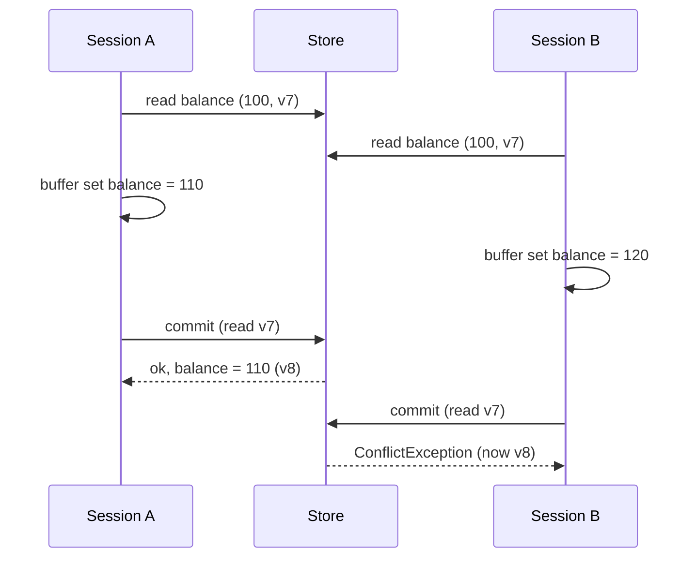
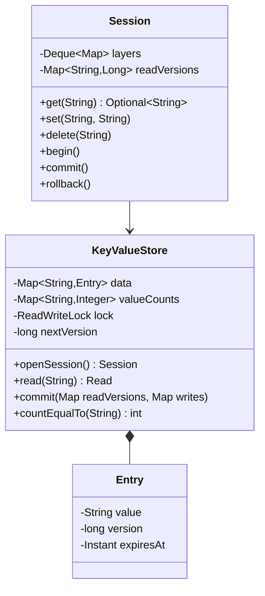

<Related ids={['concurrency-for-lld', 'command-pattern', 'memento-pattern', 'lld-lru-cache', 'interview-grade-code']} />

"Build an in-memory key-value store that supports transactions" is a favourite machine-coding prompt because it starts trivially (`get`/`set`) and then goes deep fast: **nested transactions**, **rollback**, **isolation between clients**, **TTL**, and **lost updates** under concurrency. It's a miniature database, and the interviewer is checking whether you understand what a transaction actually promises.

## 1. Requirements

| Question | Assumption |
| --- | --- |
| Operations | `get`, `set`, `delete`, `countEqualTo(value)` |
| Transactions | `begin`, `commit`, `rollback`, **nested** (a `begin` inside a `begin`) |
| Semantics | Inner `commit` merges into the parent; only the outermost `commit` makes changes visible to others; `rollback` discards the innermost transaction |
| Multiple clients | Yes — each client has a session; others must not see uncommitted writes |
| Conflicts | Two clients doing read-modify-write on the same key must not lose an update |
| Expiry | Optional TTL per key |
| Out of scope | Persistence (discussed as an extension) |

<Callout type="interview">
Pin down the commit semantics first. "Does COMMIT commit only the innermost transaction or all of them?" Both appear in interviews. This design commits the innermost into its parent, which is the general case — "commit all" is just a loop.
</Callout>

## 2. The two key decisions

**Where do uncommitted writes live?** Not in the shared map — then other clients would see them (a *dirty read*). Each session keeps a **stack of write layers**, one per `begin`. Reads check the layers newest-first, then the committed data. Rollback is just popping a layer; inner commit is merging the top layer into the one below.

**How do concurrent sessions avoid lost updates?** Use **optimistic concurrency control**: every committed key carries a **version**. When a session reads a key inside a transaction, it remembers the version it saw. At the outermost commit, under one lock, the store checks that every key read is still at that version; if any changed, the commit fails with a conflict and the client retries.



Without the version check, B's commit would overwrite A's — the classic **lost update**.

## 3. Class design



## 4. Implementation

### The store: versions, one lock, atomic validate-and-apply

```java
public final class KeyValueStore {
    private record Entry(String value, long version, Instant expiresAt) {
        boolean isLive(Instant now) { return expiresAt == null || now.isBefore(expiresAt); }
    }
    public record Read(Optional<String> value, long version) { }

    private final Map<String, Entry> data = new HashMap<>();
    private final Map<String, Integer> valueCounts = new HashMap<>();   // for O(1) countEqualTo
    private final ReadWriteLock lock = new ReentrantReadWriteLock();
    private final Clock clock;
    private long nextVersion = 1;

    public Read read(String key) {
        lock.readLock().lock();
        try {
            Entry e = data.get(key);
            if (e == null || !e.isLive(clock.instant())) return new Read(Optional.empty(), versionOf(e));
            return new Read(Optional.of(e.value()), e.version());
        } finally { lock.readLock().unlock(); }
    }

    /** Validates every read version, then applies every write — all under one write lock. */
    public void commit(Map<String, Long> readVersions, Map<String, Write> writes) {
        lock.writeLock().lock();
        try {
            Instant now = clock.instant();
            for (var r : readVersions.entrySet()) {
                Entry e = data.get(r.getKey());
                long current = (e == null || !e.isLive(now)) ? versionOf(e) : e.version();
                if (current != r.getValue()) throw new ConflictException(r.getKey());
            }
            writes.forEach((key, w) -> apply(key, w, now));
        } finally { lock.writeLock().unlock(); }
    }

    private void apply(String key, Write w, Instant now) {
        Entry old = data.get(key);
        if (old != null) valueCounts.merge(old.value(), -1, (a, b) -> a + b == 0 ? null : a + b);
        long version = nextVersion++;
        if (w.value().isEmpty()) {
            data.put(key, new Entry(null, version, now));                 // tombstone keeps the version
        } else {
            Instant exp = w.ttl() == null ? null : now.plus(w.ttl());
            data.put(key, new Entry(w.value().get(), version, exp));
            valueCounts.merge(w.value().get(), 1, Integer::sum);
        }
    }

    private static long versionOf(Entry e) { return e == null ? 0 : e.version(); }
}

public record Write(Optional<String> value, Duration ttl) {               // empty value = delete
    static Write set(String v, Duration ttl) { return new Write(Optional.of(v), ttl); }
    static Write delete() { return new Write(Optional.empty(), null); }
}
```

Why keep a **tombstone** on delete instead of removing the key? Its version. If A reads key `k` (absent, version 0), B creates and deletes `k`, and A then commits a write based on "k is absent" — with the tombstone, `k` is at a newer version and A's commit conflicts, as it should. Without it, the version would silently return to 0. (A background compactor can drop old tombstones once no transaction could still be holding their version.)

### The session: a stack of write layers

```java
public final class Session {
    private final KeyValueStore store;
    private final Deque<Map<String, Write>> layers = new ArrayDeque<>();   // one per BEGIN
    private final Map<String, Long> readVersions = new HashMap<>();        // first version seen per key

    public Optional<String> get(String key) {
        for (Map<String, Write> layer : layers) {                          // newest first: read your own writes
            Write w = layer.get(key);
            if (w != null) return w.value();
        }
        KeyValueStore.Read r = store.read(key);
        if (!layers.isEmpty()) readVersions.putIfAbsent(key, r.version()); // remember what we based decisions on
        return r.value();
    }

    public void set(String key, String value) { write(key, Write.set(value, null)); }
    public void delete(String key)            { write(key, Write.delete()); }

    private void write(String key, Write w) {
        if (layers.isEmpty()) store.commit(Map.of(), Map.of(key, w));      // no transaction: auto-commit
        else layers.peekFirst().put(key, w);
    }

    public void begin() { layers.push(new LinkedHashMap<>()); }

    public void rollback() {
        if (layers.isEmpty()) throw new NoTransactionException();
        layers.pop();
        if (layers.isEmpty()) readVersions.clear();
    }

    public void commit() {
        if (layers.isEmpty()) throw new NoTransactionException();
        Map<String, Write> top = layers.pop();
        if (!layers.isEmpty()) { layers.peekFirst().putAll(top); return; } // inner: merge into the parent
        try {
            store.commit(readVersions, top);                               // outermost: validate and publish
        } finally {
            readVersions.clear();
        }
    }
}
```

That's the whole transaction engine. Notice what we **didn't** need: no undo log, no copying the whole map on `begin`. Buffering writes makes rollback free.

### A client retry loop

```java
while (true) {
    session.begin();
    int balance = Integer.parseInt(session.get("balance").orElse("0"));
    session.set("balance", String.valueOf(balance + 10));
    try { session.commit(); break; }
    catch (ConflictException e) { /* someone else won; read again and retry */ }
}
```

The reference solution runs 16 threads × 500 increments of one counter this way and ends at exactly 8,000.

## 5. What isolation level is this?

Reads inside a transaction see committed data at the time of the read plus the session's own writes; the commit fails if anything it **read** has changed since. Because validation and apply happen together under one lock, every successful transaction behaves as if it ran entirely at its commit point — the result is **serializable**. Two transactions that only **write** the same key without reading it ("blind writes") don't conflict: last commit wins, which is still consistent with that commit order.

One subtlety worth mentioning: *while it is running*, a transaction can observe an inconsistent mix (key `a` before another commit, key `b` after it). The commit will fail, so nothing bad is persisted — but code that acts on those reads before committing (say, throws on an "impossible" combination) must tolerate it. Snapshot reads (see the practice exercise below) remove that wrinkle.

## 6. Alternatives worth naming

| Approach | How | Trade-off |
| --- | --- | --- |
| **Buffered writes + OCC** (this design) | Writes in session layers; validate versions at commit | Rollback free; conflicts detected late; great when contention is low |
| **Undo log** | Write directly; record old values per transaction; rollback restores | Simple for a single client; others see uncommitted data unless you add locking |
| **Pessimistic locking** | Lock keys on first read/write until commit | No retries, but deadlock risk and lower concurrency |
| **MVCC snapshots** | Keep multiple versions; each transaction reads a snapshot | Consistent reads without locks (Postgres, InnoDB); more memory and garbage collection |

## 7. TTL

Store `expiresAt` with each entry and treat expired entries as absent on read (**lazy expiry**). Add **active expiry** — a scheduled task, or a priority queue ordered by expiry time — so keys that are never read again still get reclaimed. Inject a `Clock` so expiry is testable.

## 8. Patterns used

| Pattern | Where |
| --- | --- |
| **Command** (implicit) | Buffered `Write` objects applied at commit |
| **Memento**-like layering | Each `begin` starts a layer that can be discarded |
| **Facade** | `Session` hides versions and layering from clients |
| **Strategy** (extension) | Eviction policy when memory is bounded (see [LRU Cache](/system-design/lld/lld-lru-cache)) |

## 9. Extensions

- **Persistence**: append every committed write batch to a write-ahead log and fsync before acknowledging; rebuild by replaying the log; snapshot periodically to bound replay time.
- **Range queries**: swap `HashMap` for `TreeMap` (or a `ConcurrentSkipListMap`).
- **Sharding**: hash keys to N independent stores, each with its own lock — transactions across shards then need two-phase commit, which is a good place to stop and discuss trade-offs.

## Interview questions

<QA q="How do you implement nested transactions?">
Keep a stack of write layers per session. BEGIN pushes an empty layer; writes go into the top layer; reads check layers from the top down before falling back to committed data. ROLLBACK pops the top layer. COMMIT pops it and merges its writes into the layer below; only when the stack becomes empty are the writes published to the shared store. This gives read-your-own-writes, free rollback and correct nesting.
</QA>

<QA q="Two clients both read a balance of 100 and write 110 and 120. How do you prevent the lost update?">
Give every key a version and remember the version each transaction read. At commit, under one lock, check that all read versions are unchanged before applying the writes. The first commit succeeds and bumps the version; the second sees a newer version and fails with a conflict, so the client re-reads and retries. Alternatives are pessimistic locks on read, or an atomic compare-and-set API.
</QA>

<QA q="Why buffer writes instead of writing to the map and keeping an undo log?">
Writing directly makes uncommitted data visible to other clients (dirty reads) unless you also lock keys until commit. Buffering keeps uncommitted writes private, makes rollback a constant-time discard, and lets the commit validate and apply everything atomically. The undo-log approach is fine for a single-client store, which is how the problem is sometimes posed.
</QA>

<Practice task="Add an atomic increment(key, delta) that never needs a client retry loop. Where does it go and how does it interact with transactions?">

Outside a transaction, implement it in the store under the write lock: read the current value, add, write, bump the version — one atomic step, so no conflict is possible. Inside a transaction, it's a read plus a write in the session (so it records the read version and can conflict at commit) — or, to avoid conflicts, buffer it as an "increment" write that the store applies relative to whatever the current value is at commit time (a commutative operation, like Redis INCR).

</Practice>

<Practice task="The interviewer asks for SNAPSHOT reads: within a transaction, every read must see the database as of BEGIN, even if others commit meanwhile. What changes?">

Keep multiple versions per key (a small version list) and stamp each commit with a global commit number. On `begin`, record the current commit number as the snapshot. Reads return the newest version at or below the snapshot. Writes still buffer; at commit, check that no other transaction committed a newer version of any key you **wrote** (first-committer-wins). Old versions can be garbage-collected once no open transaction's snapshot is older than them. That's MVCC with snapshot isolation.

</Practice>

<Takeaways>

- Buffer uncommitted writes per session in a stack of layers: read-your-writes, free rollback, natural nesting.
- Prevent lost updates with versions: validate what you read at commit, under one lock.
- Keep tombstones so deletes advance versions; compact them later.
- Name the isolation level you provide and the alternatives (undo log, pessimistic locks, MVCC).

</Takeaways>

## Further reading

- Martin Kleppmann, *Designing Data-Intensive Applications* (2017) — chapter 7, "Transactions" (lost updates, snapshot isolation, serializability).
- H. T. Kung and John T. Robinson, "On Optimistic Methods for Concurrency Control" (ACM TODS, 1981).
- [Concurrency for LLD](/system-design/lld/concurrency-for-lld).
- HLD context: [Transactions & Isolation Levels](/system-design/hld/transactions-and-isolation) and [Design a Distributed Key-Value Store](/system-design/hld/design-key-value-store).
