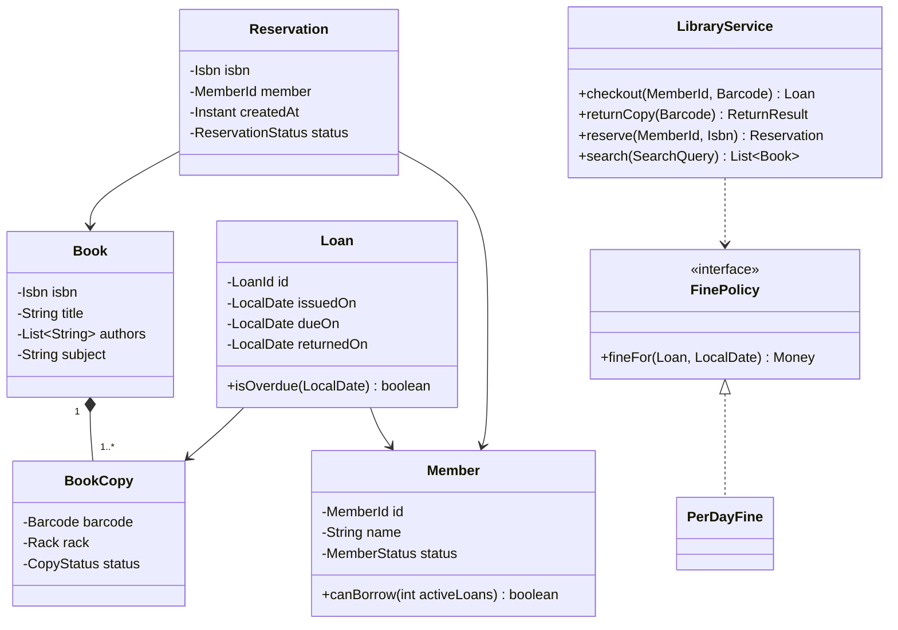

<Related ids={['class-relationships-uml', 'strategy-pattern', 'observer-pattern', 'state-pattern', 'interview-grade-code', 'concurrency-for-lld']} />

The library system is a classic **domain-modelling** problem. There's little algorithmic difficulty; the grading is about getting the entities and relationships right — especially the difference between a **book** (a title) and a **book copy** (a physical item) — and handling business rules like borrowing limits, reservations and fines cleanly.

## What the interviewer expects

The full design in this lesson is longer than anything you'd write in one round. It's there so you understand the edge cases and can answer follow-up questions. In the round itself, aim for this:

<InterviewScope minutes="45–60" lines="70" write={["Book vs BookCopy (title vs the thing on the shelf)", "`borrow()` and `returnCopy()` with a loan limit", "A `FinePolicy` interface with a per-day fine"]} say={["Reservations as a queue per book, with a notification", "Blocking members who owe fines", "Search by title, author or ISBN"]} skip={["Librarian admin screens", "Payments for fines", "Persistence"]} />

### The interview-sized version

Members borrow and return copies, limits are enforced, and late returns are fined through a policy. It's about **70 lines**, and it compiles and runs.

```java
record Book(String isbn, String title) { }

class BookCopy {                                   // a Book is the title; a copy is the thing on the shelf
    final String barcode;
    final Book book;
    String borrowedBy;                             // member id, or null when on the shelf
    LocalDate dueDate;
    BookCopy(String barcode, Book book) { this.barcode = barcode; this.book = book; }
}

class Member {
    static final int MAX_LOANS = 3;
    final String id;
    final List<BookCopy> loans = new ArrayList<>();
    Member(String id) { this.id = id; }
}

interface FinePolicy { int fine(LocalDate due, LocalDate returned); }

class PerDayFine implements FinePolicy {
    private final int perDay;
    PerDayFine(int perDay) { this.perDay = perDay; }
    public int fine(LocalDate due, LocalDate returned) {
        long lateDays = ChronoUnit.DAYS.between(due, returned);
        return lateDays > 0 ? (int) lateDays * perDay : 0;
    }
}

class Library {
    private final Map<String, BookCopy> copies = new HashMap<>();
    private final Map<String, Member> members = new HashMap<>();
    private final FinePolicy finePolicy;

    Library(FinePolicy finePolicy) { this.finePolicy = finePolicy; }
    void addCopy(BookCopy c) { copies.put(c.barcode, c); }
    void addMember(Member m) { members.put(m.id, m); }

    synchronized void borrow(String memberId, String barcode, LocalDate today) {
        Member m = find(members, memberId);
        BookCopy c = find(copies, barcode);
        if (c.borrowedBy != null) throw new IllegalStateException("Copy " + barcode + " is already out");
        if (m.loans.size() >= Member.MAX_LOANS) throw new IllegalStateException("Loan limit reached");
        c.borrowedBy = memberId;
        c.dueDate = today.plusDays(14);
        m.loans.add(c);
    }

    synchronized int returnCopy(String barcode, LocalDate today) {          // returns the fine
        BookCopy c = find(copies, barcode);
        if (c.borrowedBy == null) throw new IllegalStateException("Copy " + barcode + " is not on loan");
        members.get(c.borrowedBy).loans.remove(c);
        int fine = finePolicy.fine(c.dueDate, today);
        c.borrowedBy = null;
        c.dueDate = null;
        return fine;
    }

    synchronized List<BookCopy> search(String titleWord) {                  // free copies only
        String w = titleWord.toLowerCase();
        return copies.values().stream()
                .filter(c -> c.borrowedBy == null && c.book.title().toLowerCase().contains(w))
                .toList();
    }

    private static <T> T find(Map<String, T> map, String id) {
        T value = map.get(id);
        if (value == null) throw new IllegalArgumentException("Not found: " + id);
        return value;
    }
}
```

<Callout type="tip" title="How to use the rest of this lesson">
Practise writing the short version above, in your own words, until you can do it in about 30 minutes. Then read the full design below for the edge cases and follow-up answers. Interviewers often ask about those, but they rarely ask you to type them all.
</Callout>

## 1. Requirements

- Catalogue: books with ISBN, title, authors, subject; each book has one or more **physical copies** (barcode, rack location).
- Search by title, author, subject.
- Members borrow copies: at most 5 at a time, for 14 days.
- Return copies; compute **fines** for late returns (₹10/day; configurable).
- **Reserve** a book (title) when no copy is available; when a copy is returned, the first reserver is notified and the copy is held for them for 2 days.
- Librarians add/remove books and copies, block members.
- Out of scope: payments (fines are tracked, paid at the desk), e-books.

## 2. Domain model

The most important modelling decision:

| | `Book` | `BookCopy` |
| --- | --- | --- |
| Represents | A title (ISBN) | A physical item (barcode) |
| Borrowed? | No — you can't borrow a "title" | Yes |
| Reserved? | **Yes** — members reserve a title, any copy will do | No |
| Status | — | AVAILABLE, LOANED, ON_HOLD, LOST |

Getting this wrong (one `Book` class with a quantity field) makes loans, holds and lost items impossible to model properly.



## 3. Implementation

### Models

<FullCode title="Show the full code: Models (45 lines)">

```java
public enum CopyStatus { AVAILABLE, LOANED, ON_HOLD, LOST }
public enum MemberStatus { ACTIVE, BLOCKED }

public record Book(Isbn isbn, String title, List<String> authors, String subject) { }

public final class BookCopy {
    private final Barcode barcode;
    private final Isbn isbn;
    private CopyStatus status = CopyStatus.AVAILABLE;
    private MemberId heldFor;                         // set when ON_HOLD
    private LocalDate holdUntil;

    public void checkOut(MemberId member) {
        boolean allowed = status == CopyStatus.AVAILABLE
                || (status == CopyStatus.ON_HOLD && member.equals(heldFor));
        if (!allowed) throw new CopyNotAvailableException(barcode, status);
        status = CopyStatus.LOANED;
        heldFor = null; holdUntil = null;
    }

    public void checkIn() { requireStatus(CopyStatus.LOANED); status = CopyStatus.AVAILABLE; }

    public void holdFor(MemberId member, LocalDate until) {
        requireStatus(CopyStatus.AVAILABLE);
        status = CopyStatus.ON_HOLD; heldFor = member; holdUntil = until;
    }

    public void releaseHold() { requireStatus(CopyStatus.ON_HOLD); status = CopyStatus.AVAILABLE; heldFor = null; holdUntil = null; }

    public boolean holdExpired(LocalDate today) { return status == CopyStatus.ON_HOLD && today.isAfter(holdUntil); }
    // ...
}

public final class Loan {
    private final LoanId id;
    private final Barcode barcode;
    private final MemberId member;
    private final LocalDate issuedOn, dueOn;
    private LocalDate returnedOn;

    public boolean isActive() { return returnedOn == null; }
    public boolean isOverdue(LocalDate today) { return isActive() && today.isAfter(dueOn); }
    public long daysLate(LocalDate on) { return Math.max(0, ChronoUnit.DAYS.between(dueOn, on)); }
    void close(LocalDate on) { if (!isActive()) throw new IllegalStateException("already returned"); returnedOn = on; }
}
```

</FullCode>

The copy guards its own state transitions — business rules live with the data (tell, don't ask).

### Policies as strategies

```java
public interface FinePolicy { Money fineFor(Loan loan, LocalDate returnedOn); }

public final class PerDayFine implements FinePolicy {
    private final Money perDay; private final Money cap;
    public Money fineFor(Loan loan, LocalDate on) {
        Money fine = perDay.times(loan.daysLate(on));
        return fine.compareTo(cap) > 0 ? cap : fine;
    }
}

public interface BorrowingPolicy {
    int maxActiveLoans(Member m);
    Period loanPeriod(Member m);
}
```

Different member tiers (student, faculty, premium) get different `BorrowingPolicy` implementations — no `if (member.type == FACULTY)` scattered around.

### The service

<FullCode title="Show the full code: The service (66 lines)">

```java
public final class LibraryService {
    private final CopyRepository copies;
    private final LoanRepository loans;
    private final MemberRepository members;
    private final ReservationQueue reservations;
    private final BorrowingPolicy borrowing;
    private final FinePolicy finePolicy;
    private final FineLedger ledger;                       // outstanding fines per member
    private final Notifier notifier;
    private final Clock clock;

    public synchronized Loan checkout(MemberId memberId, Barcode barcode) {
        Member member = members.get(memberId);
        if (member.status() == MemberStatus.BLOCKED) throw new MemberBlockedException(memberId);
        if (loans.activeCountFor(memberId) >= borrowing.maxActiveLoans(member))
            throw new LoanLimitExceededException(memberId);
        if (ledger.outstandingFor(memberId).isPositive())
            throw new OutstandingFinesException(memberId);

        BookCopy copy = copies.get(barcode);
        copy.checkOut(memberId);                              // validates AVAILABLE or held for this member
        reservations.fulfilledBy(copy.isbn(), memberId);       // clears their reservation if any

        LocalDate today = LocalDate.now(clock);
        Loan loan = Loan.issue(barcode, memberId, today, today.plus(borrowing.loanPeriod(member)));
        loans.save(loan);
        return loan;
    }

    public synchronized ReturnResult returnCopy(Barcode barcode) {
        Loan loan = loans.activeFor(barcode).orElseThrow(() -> new NoActiveLoanException(barcode));
        LocalDate today = LocalDate.now(clock);
        loan.close(today);
        Money fine = finePolicy.fineFor(loan, today);
        if (fine.isPositive()) ledger.record(loan.member(), fine);

        BookCopy copy = copies.get(barcode);
        copy.checkIn();
        offerToNextReserver(copy, today);                    // a return becomes a hold if someone is waiting
        return new ReturnResult(loan, fine);
    }

    public synchronized Reservation reserve(MemberId memberId, Isbn isbn) {
        if (copies.anyAvailable(isbn)) throw new CopyAvailableException(isbn);   // just borrow it
        return reservations.enqueue(isbn, memberId, clock.instant());           // FIFO per title; rejects duplicates
    }

    /** Scheduled daily: holds not collected in time pass to the next reserver, or back to the shelf. */
    public synchronized void expireHolds() {
        LocalDate today = LocalDate.now(clock);
        for (BookCopy copy : copies.onHold()) {
            if (copy.holdExpired(today)) {
                copy.releaseHold();
                offerToNextReserver(copy, today);
            }
        }
    }

    private void offerToNextReserver(BookCopy copy, LocalDate today) {
        reservations.pollNext(copy.isbn()).ifPresent(next -> {
            LocalDate collectBy = today.plusDays(2);
            copy.holdFor(next.member(), collectBy);
            notifier.copyReady(next.member(), copy.isbn(), collectBy);
        });
    }
}
```

</FullCode>

### Search

Keep search behind an interface (`CatalogSearch`) with an in-memory implementation that maintains indexes (`Map<String, Set<Isbn>>` by lower-cased author, title words, subject). In a real system this would be a search engine — see [Search & Inverted Indexes](/system-design/hld/search-systems).

## 4. Concurrency

Two members could try to check out the same copy simultaneously (self-checkout kiosks), or a return and a reservation could interleave. For an interview, synchronising the service's mutating operations (as above) is a correct baseline; finer-grained options are a lock per copy/ISBN or optimistic versioning in the database.

## 5. Patterns used

| Pattern | Where |
| --- | --- |
| **Strategy** | `FinePolicy`, `BorrowingPolicy`, search implementations |
| **Observer** | Notifications when a reserved copy becomes available or a loan is overdue |
| **State** | `CopyStatus` transitions guarded inside `BookCopy` |
| **Repository** | Copy, loan, member and reservation repositories |
| **Facade** | `LibraryService` |

## Interview questions

<QA q="Why separate Book from BookCopy?">
A book (ISBN) is the bibliographic title — what members search for and reserve — while copies are physical items with their own barcode, location and status that are actually loaned, held, lost or damaged. Modelling only a Book with a count can't track which copy a member has, where each copy is, or that one copy is lost while another is on hold. It's a classic one-to-many composition.
</QA>

<QA q="How do reservations interact with returns?">
Reservations are per title in FIFO order. When a copy of that title is returned, instead of becoming available it moves to ON_HOLD for the first waiting member, who is notified and gets a pickup window. Checkout allows an on-hold copy only for that member. If the hold expires, it passes to the next reserver or becomes available. Checkout also clears the member's reservation when they borrow the title.
</QA>

<Practice task="Students may borrow 3 books for 14 days, faculty 10 for 60 days, and faculty pay no fines. Add this without if-statements in LibraryService.">

`BorrowingPolicy` already takes a `Member`, so add a membership type to `Member` and choose policies per type: `StudentBorrowing(3, 14 days)`, `FacultyBorrowing(10, 60 days)` — or one data-driven policy reading a table of limits per type. Fines: `FinePolicy` by member type too (`NoFine` for faculty), selected by a small registry (`Map<MemberType, FinePolicy>`). The service calls `policyFor(member)` and never branches on the type.

</Practice>

<Practice task="A member reports a book lost. What happens to the loan, the copy, the fines and any reservations for that title?">

Mark the copy `LOST` (a terminal status for that barcode), close the loan with a lost outcome, and charge a replacement fee via a `LostItemPolicy` (book price plus processing fee) on top of any overdue fine. Reservations stay queued for the title — they'll be served by other copies; if no copies remain, notify the waiting members. If the book is found later, a librarian action returns the copy to `AVAILABLE` and optionally refunds the replacement fee.

</Practice>

<Takeaways>

- Model titles (Book) and physical items (BookCopy) separately — the key domain decision.
- Guard state transitions inside entities; keep rules like fines and loan limits as strategies.
- Reservations are a FIFO queue per title that converts returns into holds.
- Inject Clock for due dates, fines and hold expiry.

</Takeaways>

## Further reading

- Eric Evans, *Domain-Driven Design* (2003) — entities, value objects and aggregates.
- [Class Relationships & UML](/system-design/lld/class-relationships-uml).
