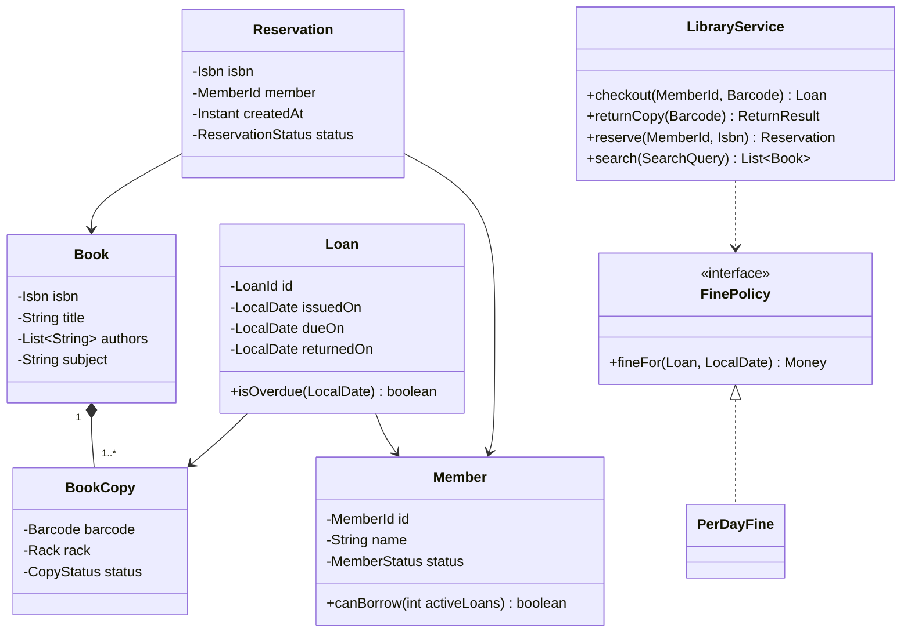

<Related ids={['class-relationships-uml', 'strategy-pattern', 'observer-pattern', 'state-pattern', 'interview-grade-code', 'concurrency-for-lld']} />

The library system has no tricky algorithm. It's a **modelling** question: the interviewer wants to see you turn a real-world situation into the right classes, with each rule living in the right place. One decision matters more than any other here: the difference between a **book** (a title, like *Clean Code*) and a **copy** of that book (one physical item on a shelf, with a barcode). Get that right and the rest falls into place.

We'll use the same six steps as every case study: requirements, entities, class design, code, a worked example, and follow-ups. (The [parking lot](/system-design/lld/lld-parking-lot) lesson explains the plan in detail.)

## Step 1: Pin down the requirements

<Dialogue>
<Turn who="you">Can the library hold several copies of the same book?</Turn>
<Turn who="them">Yes, popular books have several.</Turn>
<Turn who="you">How many books can a member borrow, and for how long?</Turn>
<Turn who="them">Up to 5 at a time, for 14 days.</Turn>
<Turn who="you">What happens when a book comes back late?</Turn>
<Turn who="them">There's a fine, ₹10 a day. The amount might change.</Turn>
<Turn who="you">If every copy is out, can a member reserve the book?</Turn>
<Turn who="them">Yes. When a copy comes back, the first person in line is notified and it's held for them for 2 days.</Turn>
<Turn who="you">What should search support?</Turn>
<Turn who="them">Title, author and subject.</Turn>
<Turn who="you">Do I need to handle paying fines?</Turn>
<Turn who="them">No, just record them. People pay at the desk.</Turn>
</Dialogue>

Listen to how the interviewer used two different words. A member **borrows a copy** (a specific item), but **reserves a book** (any copy will do). That's your hint that these are two different classes.

**The system must:**

1. Keep a catalogue of books, each with one or more physical copies.
2. Let members search by title, author or subject.
3. Let a member borrow a copy, at most 5 at a time, for 14 days.
4. On return, charge a fine for each day late (rule may change).
5. Let a member reserve a book when no copy is free. A returned copy is held for the first person waiting, who is notified and has 2 days to collect it.
6. Not let two people borrow the same copy at once.

**Out of scope for now:** paying fines, e-books, librarian admin screens.

## Step 2: Find the core entities

| Noun | Make it… | Why |
| --- | --- | --- |
| Book | a record | The title: ISBN, name, authors, subject. Members search for and **reserve** books. It never changes. |
| Book copy | a class | One physical item with a barcode. It's what gets **borrowed**, held or lost, so it has changing status. |
| Member | a class | Who's borrowing. Can be active or blocked. |
| Loan | a class | "This member has this copy, due on this date." Recording loans separately keeps history and makes fines easy. |
| Reservation | a record | "This member is waiting for this book." Kept in a first-come, first-served queue per book. |
| Fine rule | an **interface** `FinePolicy` | Requirement 4 says it may change. |
| Library | a class | The front door: borrow, return, reserve, search. |

Here is the decision that sinks most weak answers:

<Approach verdict="bad" title="One Book class with a quantity">

```java
class Book { String isbn; String title; int availableCopies; }
```

Borrowing just decrements a number. But now you can't say **which** copy Asha has, where each copy sits, or that one copy is lost while another is waiting for Ben. Every follow-up question becomes painful.

</Approach>

<Approach verdict="great" title="Book (the title) and BookCopy (the item)">

| | `Book` | `BookCopy` |
| --- | --- | --- |
| Represents | A title (ISBN) | A physical item (barcode) |
| Can be borrowed? | No, you can't borrow a title | Yes |
| Can be reserved? | **Yes**, any copy will do | No |
| Has a status? | No | AVAILABLE, LOANED, ON_HOLD, LOST |

One book has many copies. Loans point to copies; reservations point to books.

</Approach>

## Step 3: Design each class

**`BookCopy`**: knows its barcode, which book it is, and its status. It can be checked out, checked in, held for a member, and released from a hold. Each of these **checks the current status first**: you can't check out a copy that's already on loan, and only the right member can take a copy that's on hold. Putting those rules inside the copy means no other class can break them.

**`Loan`**: knows the copy, the member, the issue date, the due date and the return date. It can tell you if it's overdue and how many days late it is.

**`FinePolicy`**: one job, "how much is the fine for this loan, returned on this date?"

**`BorrowingPolicy`**: how many loans and for how long, for this member. Students and staff can get different rules without `if (member.type == …)` checks everywhere.

**`LibraryService`**: `checkout`, `returnCopy`, `reserve`, and a daily `expireHolds` job. It checks the member's limits, asks the copy to change status, records the loan and handles the reservation queue.



## Step 4: Write the code

<InterviewScope minutes="45–60" lines="70" write={["Book vs BookCopy (title vs the thing on the shelf)", "`borrow()` and `returnCopy()` with a loan limit", "A `FinePolicy` interface with a per-day fine"]} say={["Reservations as a queue per book, with a notification", "Blocking members who owe fines", "Search by title, author or ISBN"]} skip={["Librarian admin screens", "Payments for fines", "Persistence"]} />

### The interview-sized version

Members borrow and return copies, limits are enforced, and late returns are fined through a policy. It's about **70 lines**, and it compiles and runs.

```java
record Book(String isbn, String title) { }

class BookCopy {                                   // a Book is the title; a copy is the thing on the shelf
    final String barcode;
    final Book book;
    String borrowedBy;                             // member id, or null when on the shelf
    LocalDate dueDate;
    BookCopy(String barcode, Book book) { this.barcode = barcode; this.book = book; }
}

class Member {
    static final int MAX_LOANS = 3;
    final String id;
    final List<BookCopy> loans = new ArrayList<>();
    Member(String id) { this.id = id; }
}

interface FinePolicy { int fine(LocalDate due, LocalDate returned); }

class PerDayFine implements FinePolicy {
    private final int perDay;
    PerDayFine(int perDay) { this.perDay = perDay; }
    public int fine(LocalDate due, LocalDate returned) {
        long lateDays = ChronoUnit.DAYS.between(due, returned);
        return lateDays > 0 ? (int) lateDays * perDay : 0;
    }
}

class Library {
    private final Map<String, BookCopy> copies = new HashMap<>();
    private final Map<String, Member> members = new HashMap<>();
    private final FinePolicy finePolicy;

    Library(FinePolicy finePolicy) { this.finePolicy = finePolicy; }
    void addCopy(BookCopy c) { copies.put(c.barcode, c); }
    void addMember(Member m) { members.put(m.id, m); }

    synchronized void borrow(String memberId, String barcode, LocalDate today) {
        Member m = find(members, memberId);
        BookCopy c = find(copies, barcode);
        if (c.borrowedBy != null) throw new IllegalStateException("Copy " + barcode + " is already out");
        if (m.loans.size() >= Member.MAX_LOANS) throw new IllegalStateException("Loan limit reached");
        c.borrowedBy = memberId;
        c.dueDate = today.plusDays(14);
        m.loans.add(c);
    }

    synchronized int returnCopy(String barcode, LocalDate today) {          // returns the fine
        BookCopy c = find(copies, barcode);
        if (c.borrowedBy == null) throw new IllegalStateException("Copy " + barcode + " is not on loan");
        members.get(c.borrowedBy).loans.remove(c);
        int fine = finePolicy.fine(c.dueDate, today);
        c.borrowedBy = null;
        c.dueDate = null;
        return fine;
    }

    synchronized List<BookCopy> search(String titleWord) {                  // free copies only
        String w = titleWord.toLowerCase();
        return copies.values().stream()
                .filter(c -> c.borrowedBy == null && c.book.title().toLowerCase().contains(w))
                .toList();
    }

    private static <T> T find(Map<String, T> map, String id) {
        T value = map.get(id);
        if (value == null) throw new IllegalArgumentException("Not found: " + id);
        return value;
    }
}
```

**Reading it top to bottom:**

1. **`Book`** is a record: the title. **`BookCopy`** is the item, with `borrowedBy` (null when on the shelf) and a due date.
2. **`Member`** keeps a list of their current loans, so "has this member hit the limit?" is `loans.size()`. (The short version uses a fixed limit of 3; in the full version the limit comes from a policy.)
3. **`FinePolicy`** has one method. `PerDayFine` counts the days between due and returned, and charges only if that's positive.
4. **`borrow`** looks up the member and copy (throwing clearly if either doesn't exist), refuses if the copy is already out or the member is at the limit, and only then records the loan.
5. **`returnCopy`** refuses if the copy isn't on loan, removes it from the member's list, asks the policy for the fine and puts the copy back on the shelf.
6. **`search`** returns free copies whose title contains the word. In a real library this would use an index (see the full version).

This short version keeps the loan details on the copy itself to save lines. The full version moves them into a separate `Loan` class, which keeps history and makes overdue checks simpler.

<Callout type="tip" title="How to practise this">
Start by writing just `Book`, `BookCopy` and `Member` and explaining the difference out loud. Then add `borrow` and `returnCopy`. Aim to finish in about 30 minutes.
</Callout>

### Growing it into the full design

#### The models

`BookCopy` is where the important rules live. Read `checkOut`: a copy can be taken if it's available, **or** if it's on hold for exactly this member. Anything else throws. `holdFor` and `releaseHold` move a copy in and out of the reserved shelf.

<FullCode title="Show the full code: Models (45 lines)">

```java
public enum CopyStatus { AVAILABLE, LOANED, ON_HOLD, LOST }
public enum MemberStatus { ACTIVE, BLOCKED }

public record Book(Isbn isbn, String title, List<String> authors, String subject) { }

public final class BookCopy {
    private final Barcode barcode;
    private final Isbn isbn;
    private CopyStatus status = CopyStatus.AVAILABLE;
    private MemberId heldFor;                         // set when ON_HOLD
    private LocalDate holdUntil;

    public void checkOut(MemberId member) {
        boolean allowed = status == CopyStatus.AVAILABLE
                || (status == CopyStatus.ON_HOLD && member.equals(heldFor));
        if (!allowed) throw new CopyNotAvailableException(barcode, status);
        status = CopyStatus.LOANED;
        heldFor = null; holdUntil = null;
    }

    public void checkIn() { requireStatus(CopyStatus.LOANED); status = CopyStatus.AVAILABLE; }

    public void holdFor(MemberId member, LocalDate until) {
        requireStatus(CopyStatus.AVAILABLE);
        status = CopyStatus.ON_HOLD; heldFor = member; holdUntil = until;
    }

    public void releaseHold() { requireStatus(CopyStatus.ON_HOLD); status = CopyStatus.AVAILABLE; heldFor = null; holdUntil = null; }

    public boolean holdExpired(LocalDate today) { return status == CopyStatus.ON_HOLD && today.isAfter(holdUntil); }
    // ...
}

public final class Loan {
    private final LoanId id;
    private final Barcode barcode;
    private final MemberId member;
    private final LocalDate issuedOn, dueOn;
    private LocalDate returnedOn;

    public boolean isActive() { return returnedOn == null; }
    public boolean isOverdue(LocalDate today) { return isActive() && today.isAfter(dueOn); }
    public long daysLate(LocalDate on) { return Math.max(0, ChronoUnit.DAYS.between(dueOn, on)); }
    void close(LocalDate on) { if (!isActive()) throw new IllegalStateException("already returned"); returnedOn = on; }
}
```

</FullCode>

This style is called **"tell, don't ask"**. The service doesn't ask "what's your status?" and then decide; it tells the copy "check out to this member" and the copy decides if that's allowed.

#### Policies as strategies

The fine rule and the borrowing rule are both interfaces. The full `PerDayFine` also caps the fine, so a book lost for a year doesn't produce an absurd number.

```java
public interface FinePolicy { Money fineFor(Loan loan, LocalDate returnedOn); }

public final class PerDayFine implements FinePolicy {
    private final Money perDay; private final Money cap;
    public Money fineFor(Loan loan, LocalDate on) {
        Money fine = perDay.times(loan.daysLate(on));
        return fine.compareTo(cap) > 0 ? cap : fine;
    }
}

public interface BorrowingPolicy {
    int maxActiveLoans(Member m);
    Period loanPeriod(Member m);
}
```

#### `LibraryService`

**`checkout(member, copy)`**, in plain steps:

1. Refuse if the member is blocked, already has the maximum number of loans, or owes fines.
2. Ask the copy to check out to this member. It refuses if it's on loan, or on hold for someone else.
3. If this member had reserved this book, mark the reservation as fulfilled.
4. Create a loan with today's date and the due date from the borrowing policy.

**`returnCopy(copy)`**:

1. Find the active loan for this copy and close it.
2. Ask the fine policy for the fine and record it against the member.
3. Check the copy back in.
4. If anyone is waiting for this book, **hold the copy for them** instead of putting it on the shelf, and notify them. They have 2 days.

**`expireHolds()`** runs once a day. Any hold that wasn't collected in time passes to the next person in line, or the copy goes back on the shelf.

<FullCode title="Show the full code: The service (66 lines)">

```java
public final class LibraryService {
    private final CopyRepository copies;
    private final LoanRepository loans;
    private final MemberRepository members;
    private final ReservationQueue reservations;
    private final BorrowingPolicy borrowing;
    private final FinePolicy finePolicy;
    private final FineLedger ledger;                       // outstanding fines per member
    private final Notifier notifier;
    private final Clock clock;

    public synchronized Loan checkout(MemberId memberId, Barcode barcode) {
        Member member = members.get(memberId);
        if (member.status() == MemberStatus.BLOCKED) throw new MemberBlockedException(memberId);
        if (loans.activeCountFor(memberId) >= borrowing.maxActiveLoans(member))
            throw new LoanLimitExceededException(memberId);
        if (ledger.outstandingFor(memberId).isPositive())
            throw new OutstandingFinesException(memberId);

        BookCopy copy = copies.get(barcode);
        copy.checkOut(memberId);                              // validates AVAILABLE or held for this member
        reservations.fulfilledBy(copy.isbn(), memberId);       // clears their reservation if any

        LocalDate today = LocalDate.now(clock);
        Loan loan = Loan.issue(barcode, memberId, today, today.plus(borrowing.loanPeriod(member)));
        loans.save(loan);
        return loan;
    }

    public synchronized ReturnResult returnCopy(Barcode barcode) {
        Loan loan = loans.activeFor(barcode).orElseThrow(() -> new NoActiveLoanException(barcode));
        LocalDate today = LocalDate.now(clock);
        loan.close(today);
        Money fine = finePolicy.fineFor(loan, today);
        if (fine.isPositive()) ledger.record(loan.member(), fine);

        BookCopy copy = copies.get(barcode);
        copy.checkIn();
        offerToNextReserver(copy, today);                    // a return becomes a hold if someone is waiting
        return new ReturnResult(loan, fine);
    }

    public synchronized Reservation reserve(MemberId memberId, Isbn isbn) {
        if (copies.anyAvailable(isbn)) throw new CopyAvailableException(isbn);   // just borrow it
        return reservations.enqueue(isbn, memberId, clock.instant());           // FIFO per title; rejects duplicates
    }

    /** Scheduled daily: holds not collected in time pass to the next reserver, or back to the shelf. */
    public synchronized void expireHolds() {
        LocalDate today = LocalDate.now(clock);
        for (BookCopy copy : copies.onHold()) {
            if (copy.holdExpired(today)) {
                copy.releaseHold();
                offerToNextReserver(copy, today);
            }
        }
    }

    private void offerToNextReserver(BookCopy copy, LocalDate today) {
        reservations.pollNext(copy.isbn()).ifPresent(next -> {
            LocalDate collectBy = today.plusDays(2);
            copy.holdFor(next.member(), collectBy);
            notifier.copyReady(next.member(), copy.isbn(), collectBy);
        });
    }
}
```

</FullCode>

Notice that the service gets a `Clock` from outside instead of calling `LocalDate.now()` directly. That's what lets a test say "it's now 20 days later" and check the fine, without waiting 20 days.

#### Search

Keep search behind an interface (`CatalogSearch`). An in-memory version keeps indexes: a map from each lower-cased author name, title word and subject to the set of matching ISBNs. A real library would use a search engine; see [Search & Inverted Indexes](/system-design/hld/search-systems).

#### Concurrency

Two members at self-checkout kiosks could try to borrow the same copy at the same moment, or a return could interleave with a reservation. Making the service's changing methods `synchronized` is a correct starting point. If that becomes a bottleneck, lock per copy or per book instead, or use optimistic version numbers in the database.

## Step 5: Trace a reservation

The library has one copy of *Clean Code* (barcode `C-1`).

1. Asha borrows `C-1`. The copy becomes LOANED; a loan is created, due in 14 days.
2. Ben searches, finds no free copy and reserves *Clean Code*. He's first in the queue.
3. Asha returns `C-1` 3 days late. Her loan is closed and ₹30 is recorded against her.
4. Because Ben is waiting, `C-1` becomes ON_HOLD for Ben until two days from now, and Ben is notified.
5. Chen tries to borrow `C-1`. The copy refuses: it's held for someone else.
6. Asha now tries to borrow another book. She's refused until she pays her ₹30.
7. Ben collects `C-1`. The copy accepts because it's held for him; his reservation is cleared.

## Step 6: Handle follow-up questions

**"Students may borrow 3 books for 14 days; staff 10 books for 60 days and no fines."** Pick a `BorrowingPolicy` and a `FinePolicy` per member type, for example from a `Map<MemberType, FinePolicy>`. The service asks for "the policy for this member" and never branches on the type.

**"A member reports a book lost."** Mark the copy LOST, close the loan with a "lost" outcome and charge a replacement fee through a `LostItemPolicy`. Reservations for the book stay queued; other copies will serve them.

**"Send a reminder two days before a book is due."** A daily job finds loans due in two days and notifies the members (Observer for the notifications).

**"Search should be fast for a million books."** Index by author, title word and subject, or put the catalogue in a search engine. The `CatalogSearch` interface means the service doesn't change.

## Common mistakes

- **One `Book` class with a count** instead of separate copies.
- **Letting the service set `copy.status = LOANED` directly**, so the rules for status changes are scattered.
- **Forgetting the hold window**: a returned copy goes straight back on the shelf while someone has been waiting for weeks.
- **Calling `LocalDate.now()` inside the logic**, which makes fines and due dates impossible to test.
- **Hard-coding member types** with `if (type == STUDENT)` in several places.

## Patterns used

| Pattern | Where |
| --- | --- |
| **Strategy** | `FinePolicy`, `BorrowingPolicy`, search implementations |
| **Observer** | Notifications when a reserved copy is ready or a loan is overdue |
| **State** | `CopyStatus` changes guarded inside `BookCopy` |
| **Repository** | Copy, loan, member and reservation storage |
| **Facade** | `LibraryService` |

## Interview questions

<QA q="Why separate Book from BookCopy?">
A book (ISBN) is the title, which members search for and reserve. Copies are physical items with their own barcode, location and status, and they're what actually gets borrowed, held or lost. A Book with a count can't track which copy a member has, where each copy is, or that one copy is lost while another is on hold. It's a classic one-to-many relationship.
</QA>

<QA q="How do reservations interact with returns?">
Reservations are per book, in first-come, first-served order. When a copy of that book is returned, instead of becoming available it is held for the first waiting member, who is notified and gets a pickup window. Checkout allows a held copy only for that member. If the hold expires, it passes to the next member or the copy becomes available. Borrowing the book also clears that member's reservation.
</QA>

<Practice task="Students may borrow 3 books for 14 days, faculty 10 for 60 days, and faculty pay no fines. Add this without if-statements in LibraryService.">

`BorrowingPolicy` already takes a `Member`, so add a membership type to `Member` and choose policies per type: `StudentBorrowing(3, 14 days)`, `FacultyBorrowing(10, 60 days)`, or one data-driven policy reading a table of limits per type. Fines work the same way (`NoFine` for faculty), chosen through a small registry (`Map<MemberType, FinePolicy>`). The service calls `policyFor(member)` and never branches on the type.

</Practice>

<Practice task="A member reports a book lost. What happens to the loan, the copy, the fines and any reservations for that title?">

Mark the copy `LOST` (a final status for that barcode), close the loan with a lost outcome, and charge a replacement fee through a `LostItemPolicy` (book price plus a processing fee) on top of any overdue fine. Reservations stay queued for the book and will be served by other copies; if no copies remain, notify the waiting members. If the book turns up later, a librarian puts the copy back to `AVAILABLE` and may refund the replacement fee.

</Practice>

<Takeaways>

- Model the title (`Book`) and the physical item (`BookCopy`) separately. That's the key decision.
- Members borrow copies but reserve books.
- Let each copy guard its own status changes; keep fines and loan limits as swappable policies.
- Reservations are a queue per book that turns a return into a hold.
- Pass in a `Clock` so due dates, fines and hold expiry can be tested.

</Takeaways>

## Further reading

- Eric Evans, *Domain-Driven Design* (2003): entities, value objects and aggregates.
- [Class Relationships & UML](/system-design/lld/class-relationships-uml).
