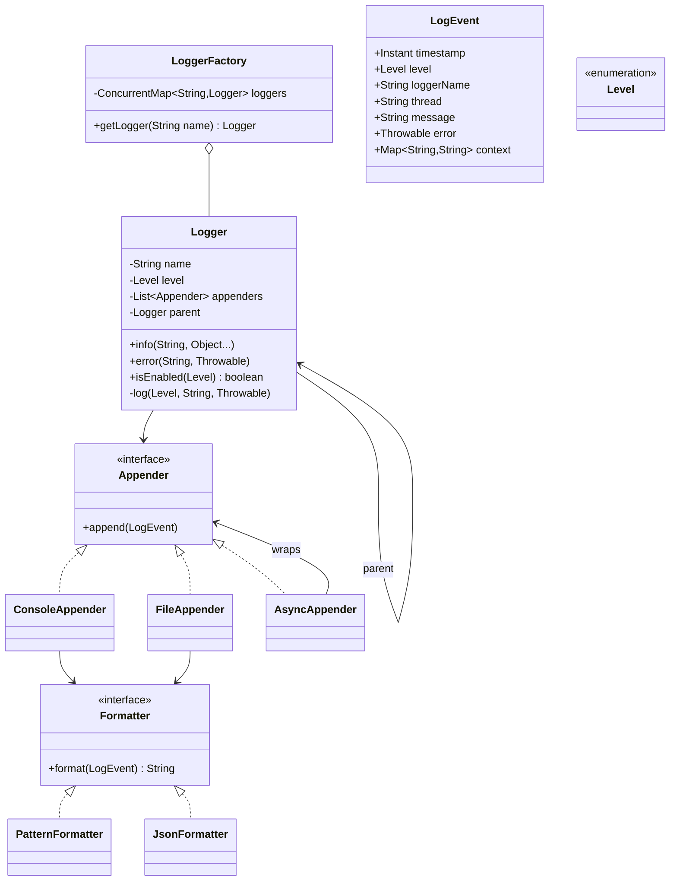

<Related ids={['chain-of-responsibility-pattern', 'strategy-pattern', 'singleton-pattern', 'observer-pattern', 'concurrency-for-lld', 'decorator-pattern']} />

"Design a logger like Log4j/SLF4J" is a favourite because it's a pure LLD problem with no business domain to learn — the interviewer can focus entirely on abstractions, extensibility and concurrency. The standard decomposition (logger → appenders → formatters, filtered by level) is worth knowing cold.

## 1. Requirements

- Log messages at levels: TRACE < DEBUG < INFO < WARN < ERROR < FATAL.
- Each logger has a minimum level; messages below it are discarded cheaply.
- Multiple **destinations** (appenders): console, file, remote/network, database — configurable per logger.
- Configurable **format** per destination: plain text, JSON, pattern (`%d %level [%thread] %logger - %msg`).
- Named, hierarchical loggers (`com.shop.payment`) that inherit configuration from parents.
- **Thread-safe**; must not slow down the application — async logging.
- Extensions: file rotation, per-appender level filters, MDC (contextual fields like request IDs).

## 2. Class design



Responsibilities:

- **Logger** — the API; decides *whether* to log (level check) and creates the event.
- **Appender** — decides *where* the event goes.
- **Formatter** — decides *how* it looks.
- **LoggerFactory** — creates and caches named loggers and applies configuration.

## 3. Implementation

### Levels and events

```java
public enum Level {
    TRACE, DEBUG, INFO, WARN, ERROR, FATAL;
    public boolean isAtLeast(Level other) { return compareTo(other) >= 0; }
}

public record LogEvent(Instant timestamp, Level level, String loggerName, String thread,
                       String message, Throwable error, Map<String, String> context) { }
```

### Formatters (Strategy)

```java
public interface Formatter { String format(LogEvent e); }

public final class PatternFormatter implements Formatter {
    private static final DateTimeFormatter TS = DateTimeFormatter.ISO_INSTANT;
    @Override public String format(LogEvent e) {
        String line = "%s %-5s [%s] %s - %s".formatted(TS.format(e.timestamp()), e.level(),
                e.thread(), e.loggerName(), e.message());
        return e.error() == null ? line : line + System.lineSeparator() + stackTrace(e.error());
    }
}

public final class JsonFormatter implements Formatter {
    @Override public String format(LogEvent e) { /* serialise fields + context as one JSON object per line */ }
}
```

### Appenders

```java
public interface Appender extends AutoCloseable {
    void append(LogEvent event);
    @Override default void close() { }
}

public final class ConsoleAppender implements Appender {
    private final Formatter formatter;
    private final Level threshold;                    // per-appender filter
    public ConsoleAppender(Formatter f, Level threshold) { this.formatter = f; this.threshold = threshold; }

    @Override public void append(LogEvent e) {
        if (!e.level().isAtLeast(threshold)) return;
        PrintStream out = e.level().isAtLeast(Level.ERROR) ? System.err : System.out;
        out.println(formatter.format(e));
    }
}

public final class FileAppender implements Appender {
    private final Formatter formatter;
    private final BufferedWriter writer;
    private final ReentrantLock lock = new ReentrantLock();   // serialise writes to one file

    @Override public void append(LogEvent e) {
        String line = formatter.format(e);                     // format outside the lock
        lock.lock();
        try {
            writer.write(line);
            writer.newLine();
            if (e.level().isAtLeast(Level.ERROR)) writer.flush();   // don't lose errors on crash
        } catch (IOException io) {
            System.err.println("FileAppender failed: " + io.getMessage());   // logging must never throw into app code
        } finally {
            lock.unlock();
        }
    }
}
```

### Async appender (Decorator + producer–consumer)

```java
public final class AsyncAppender implements Appender {
    private final Appender delegate;
    private final BlockingQueue<LogEvent> queue;
    private final Thread worker;
    private final AtomicLong dropped = new AtomicLong();
    private volatile boolean running = true;

    public AsyncAppender(Appender delegate, int capacity) {
        this.delegate = delegate;
        this.queue = new ArrayBlockingQueue<>(capacity);
        this.worker = new Thread(this::drain, "async-appender");
        this.worker.setDaemon(true);
        this.worker.start();
    }

    @Override public void append(LogEvent e) {
        if (queue.offer(e)) return;
        // Back-pressure policy: never block the app on DEBUG/INFO; wait briefly for errors
        if (e.level().isAtLeast(Level.ERROR)) {
            try {
                if (queue.offer(e, 50, TimeUnit.MILLISECONDS)) return;
            } catch (InterruptedException ie) {
                Thread.currentThread().interrupt();
            }
        }
        dropped.incrementAndGet();                              // count every lost event, errors included
    }

    private void drain() {
        while (running || !queue.isEmpty()) {
            try {
                LogEvent e = queue.poll(200, TimeUnit.MILLISECONDS);
                if (e != null) delegate.append(e);
            } catch (InterruptedException ie) {
                Thread.currentThread().interrupt();
                return;
            } catch (RuntimeException ex) {
                System.err.println("Appender failed: " + ex);       // keep draining
            }
        }
    }

    @Override public void close() {
        running = false;
        try { worker.join(5_000); } catch (InterruptedException ie) { Thread.currentThread().interrupt(); }
        delegate.close();
    }
}
```

The application thread only enqueues; I/O happens on the worker. Key decisions stated explicitly: **bounded queue**, **drop policy** by level, and **drain on shutdown**.

### Logger

```java
public final class Logger {
    private final String name;
    private final Logger parent;
    private volatile Level level;                      // null → inherit from parent
    private final List<Appender> appenders = new CopyOnWriteArrayList<>();
    private volatile boolean additive = true;          // also send to parent's appenders

    Logger(String name, Logger parent) { this.name = name; this.parent = parent; }

    public boolean isEnabled(Level l) { return l.isAtLeast(effectiveLevel()); }

    public void info(String msg, Object... args)  { log(Level.INFO, msg, null, args); }
    public void error(String msg, Throwable t)    { log(Level.ERROR, msg, t); }
    // trace/debug/warn/fatal similarly

    private void log(Level l, String template, Throwable t, Object... args) {
        if (!isEnabled(l)) return;                     // cheap check before any formatting work
        var event = new LogEvent(Instant.now(), l, name, Thread.currentThread().getName(),
                                 MessageFormatter.format(template, args), t, LogContext.snapshot());
        for (Logger lg = this; lg != null; lg = lg.additive ? lg.parent : null) {
            for (Appender a : lg.appenders) a.append(event);
        }
    }

    private Level effectiveLevel() {
        for (Logger lg = this; lg != null; lg = lg.parent) if (lg.level != null) return lg.level;
        return Level.INFO;
    }

    public void setLevel(Level l) { this.level = l; }
    public void addAppender(Appender a) { appenders.add(a); }
}
```

Note the **level check before building the message** — the whole point of `logger.debug("x={}", x)` with placeholders instead of string concatenation is to skip formatting work when DEBUG is off.

`LogContext` is a `ThreadLocal<Map<String,String>>` (the MDC) for request IDs and user IDs — remember to clear it at the end of each request, especially with thread pools.

### Factory

```java
public final class LoggerFactory {
    private static final LoggerFactory INSTANCE = new LoggerFactory();     // or inject one instance
    private final ConcurrentMap<String, Logger> loggers = new ConcurrentHashMap<>();
    private final Logger root = new Logger("", null);

    public static Logger getLogger(String name) { return INSTANCE.loggerFor(name); }
    public static Logger getLogger(Class<?> type) { return getLogger(type.getName()); }

    private Logger loggerFor(String name) {
        Logger existing = loggers.get(name);
        if (existing != null) return existing;
        Logger parent = parentOf(name);                    // resolve the parent chain first...
        return loggers.computeIfAbsent(name, n -> new Logger(n, parent));   // ...then create atomically
    }

    private Logger parentOf(String name) {
        int dot = name.lastIndexOf('.');
        return dot < 0 ? root : loggerFor(name.substring(0, dot));
    }
}
```

<Callout type="warning">
Notice the parent is resolved **before** `computeIfAbsent`. The tempting one-liner `loggers.computeIfAbsent(name, n -> new Logger(n, parentOf(n)))` calls back into the same `ConcurrentHashMap` from inside its mapping function, which is unsupported and can throw `IllegalStateException` ("Recursive update") or deadlock. Mentioning this nuance shows real concurrency awareness.
</Callout>

## 4. Patterns used

| Pattern | Where |
| --- | --- |
| **Strategy** | `Formatter` implementations; `Appender` implementations |
| **Chain of Responsibility** | Event passes up the logger hierarchy (additivity); level filters at each appender |
| **Decorator** | `AsyncAppender` wraps any appender; also buffering or filtering appenders |
| **Observer** | Appenders as subscribers of log events from a logger |
| **Singleton / Factory** | `LoggerFactory` caches one logger per name |
| **Producer–consumer** | Async appender queue |

## 5. Extensions

- **Rolling files**: a `RollingFileAppender` with a `RolloverPolicy` strategy (size-based, time-based); rename and open a new file under the lock.
- **Runtime reconfiguration**: reload levels/appenders from config; levels are `volatile`, appender lists copy-on-write.
- **Remote appender**: batch events and ship to a log service with retries — wrap it in `AsyncAppender`.
- **Sampling/rate limiting**: a filter appender that drops repetitive messages.

## Interview questions

<QA q="Why use placeholders like logger.debug('x={}', x) instead of string concatenation?">
With concatenation the message string is built before the call even when DEBUG is disabled, wasting CPU and allocations on hot paths. With placeholders, the logger first checks whether the level is enabled and only formats the message if it is. For expensive arguments, guard explicitly with isDebugEnabled() or pass a Supplier.
</QA>

<QA q="How do you make logging not slow down the application?">
Check the level before doing any work, and move I/O off the calling thread: application threads enqueue events into a bounded queue and a background worker formats and writes them. Choose a policy for when the queue is full — drop lower-severity events and count drops, or block briefly for errors — and drain the queue on shutdown so errors aren't lost.
</QA>

<QA q="How do multiple threads safely write to the same log file?">
Serialise the actual write with a lock per file appender (format the message outside the lock to keep the critical section short), or funnel all events through a single writer thread via an async appender so only one thread touches the file. Flush on error-level events or periodically, and never let an I/O exception propagate into application code.
</QA>

<Practice task="Add a RollingFileAppender that starts a new file when the current one exceeds 100 MB, keeping the last 5 files. Where does the rollover decision live?">

Make rollover a strategy: `RolloverPolicy.shouldRoll(currentSize, now)` with `SizeBasedPolicy` and `TimeBasedPolicy` implementations. The appender tracks bytes written; under its write lock, after each write it asks the policy, and if needed closes the writer, renames `app.log` → `app.1.log` (shifting older ones, deleting `app.5.log`), and opens a fresh file. Wrap it in `AsyncAppender` so the rename never blocks application threads.

</Practice>

<Practice task="A bug makes one line log 50,000 times per second and floods the disk. Add protection without losing other messages.">

A filter decorator in front of the appender that rate-limits per message template (the format string before arguments, plus logger name): a token bucket per template, e.g. 10 per second. Excess events are dropped and counted; once per interval it emits "suppressed N similar messages". Keep the per-template map bounded (LRU) so the filter itself can't leak memory.

</Practice>

<Takeaways>

- Logger decides whether, appenders decide where, formatters decide how.
- Check the level before formatting; use placeholders.
- Async appender = decorator + bounded producer–consumer queue with an explicit drop policy and drain on shutdown.
- Hierarchical loggers inherit levels and pass events up (chain of responsibility).

</Takeaways>

## Further reading

- [SLF4J manual](https://www.slf4j.org/manual.html) and the [Logback architecture chapter](https://logback.qos.ch/manual/architecture.html).
- LMAX Disruptor (used by Log4j 2's async loggers) — a high-performance alternative to blocking queues.
