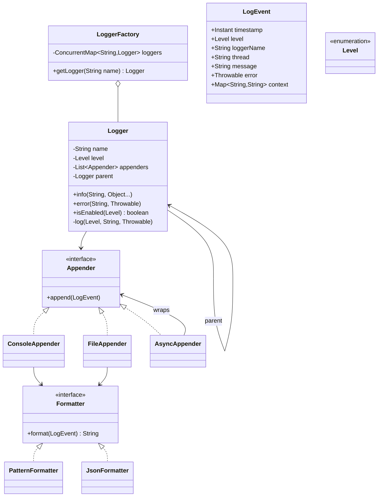

<Related ids={['chain-of-responsibility-pattern', 'strategy-pattern', 'singleton-pattern', 'observer-pattern', 'concurrency-for-lld', 'decorator-pattern']} />

"Design a logging library like Log4j or SLF4J" is a favourite because there's no business domain to learn. You've used `log.info("...")` a thousand times. That frees the interviewer to focus entirely on **how you split responsibilities**, how easy it is to add new outputs, and how you keep logging from slowing down the app.

The standard design has three parts, and once you see them the rest is detail:

- The **logger** decides **whether** to log (is this level switched on?).
- The **appender** decides **where** the line goes (console, file, network).
- The **formatter** decides **how** it looks (plain text, JSON).

We'll use the same six steps as every case study: requirements, entities, class design, code, a worked example, and follow-ups. (The [parking lot](/system-design/lld/lld-parking-lot) lesson explains the plan in detail.)

## Step 1: Pin down the requirements

<Dialogue>
<Turn who="you">Which log levels?</Turn>
<Turn who="them">The usual: debug, info, warn, error. Maybe trace and fatal.</Turn>
<Turn who="you">Can each logger have its own minimum level? Say, debug for the payment code but only warnings elsewhere?</Turn>
<Turn who="them">Yes.</Turn>
<Turn who="you">Where can logs go?</Turn>
<Turn who="them">Console and file to start. Possibly a remote log service later. One message might go to several places.</Turn>
<Turn who="you">Should the format be configurable?</Turn>
<Turn who="them">Yes. Plain text for the console, JSON for the log service.</Turn>
<Turn who="you">How important is speed?</Turn>
<Turn who="them">Very. Logging must never noticeably slow down a request.</Turn>
</Dialogue>

**The library must:**

1. Log messages at ordered levels (DEBUG &lt; INFO &lt; WARN &lt; ERROR).
2. Let each logger have a minimum level; anything below is dropped cheaply.
3. Send each message to one or more destinations.
4. Let each destination have its own format.
5. Give out one logger per name (`LoggerFactory.get("payments")` always returns the same logger).
6. Be thread-safe, and not slow the application down.

**Out of scope for now:** configuration files, network appenders in detail.

## Step 2: Find the core entities

| Noun | Make it… | Why |
| --- | --- | --- |
| Level | an enum | A fixed, **ordered** set. Declaring them in severity order means `compareTo` does the filtering. |
| Log event | a record | The message, level, logger name and time, bundled once and passed around. |
| Logger | a class | The API the app calls; holds the minimum level and its destinations. |
| Destination | an **interface** `Appender` | Console, file, network: same job, different behaviour. |
| Format | an **interface** `Formatter` | Plain, pattern, JSON. |
| Logger registry | a `LoggerFactory` | Creates each named logger once and caches it. |

Why split appender and formatter? Consider the alternative:

<Approach verdict="bad" title="One class per combination">

`ConsoleTextLogger`, `ConsoleJsonLogger`, `FileTextLogger`, `FileJsonLogger`... With 3 destinations and 3 formats you need 9 classes, and every new format adds 3 more.

</Approach>

<Approach verdict="great" title="Two independent interfaces">

An appender **has** a formatter. 3 appenders + 3 formatters = 6 classes, combined freely: `new FileAppender(new JsonFormatter())`. A new format is one new class that works with every destination.

</Approach>

## Step 3: Design each class

**`Logger`**: knows its name, minimum level and appenders. `info(msg)`, `error(msg)` and friends all call one private `log(level, msg)`, which:

1. **First** checks the level. If it's below the minimum, return immediately, before doing any work.
2. Builds a `LogEvent`.
3. Hands it to every appender.

**`Appender`**: one method, `append(event)`. Each appender asks its formatter for the text and writes it somewhere.

**`Formatter`**: one method, `format(event)`, returning a string.

**`LoggerFactory`**: `get(name)` returns the existing logger for that name, or creates one.

Now the speed requirement. Writing to a file or the network can take milliseconds, and the request thread is waiting.

<Approach verdict="bad" title="Write directly on the calling thread">

Every `log.info` waits for the disk. Under load, a slow disk slows every request.

</Approach>

<Approach verdict="great" title="Hand events to a background thread">

The calling thread puts the event on a **bounded queue** and returns immediately. One background thread takes events off the queue and writes them. This is the **producer–consumer** pattern, and it's packaged as an `AsyncAppender` that **wraps** any other appender (a Decorator). You must decide what happens if the queue fills up: usually drop low-priority messages and count them, but wait briefly for errors.

</Approach>



## Step 4: Write the code

<InterviewScope minutes="45–60" lines="40" write={["Levels as an enum, and a `Logger` that filters by level", "`Appender` and `Formatter` interfaces with one simple version each", "A factory that returns one logger per name"]} say={["An async appender with a queue, so logging never slows the request", "File rotation and JSON output", "Logger hierarchy (`com.app` → `com.app.db`)"]} skip={["Configuration files", "Network appenders and back-pressure details"]} />

### The interview-sized version

Loggers with levels, pluggable appenders and formatters. That is the design interviewers look for. It's about **40 lines**, and it compiles and runs.

```java
enum Level { DEBUG, INFO, WARN, ERROR }            // declaration order = severity order

record LogEvent(Level level, String logger, String message, long timeMillis) { }

interface Formatter { String format(LogEvent e); }  // Strategy: how a line looks

class SimpleFormatter implements Formatter {
    public String format(LogEvent e) { return e.timeMillis() + " [" + e.level() + "] " + e.logger() + " - " + e.message(); }
}

interface Appender { void append(LogEvent e); }     // where a line goes: console, file, network

class ConsoleAppender implements Appender {
    private final Formatter formatter;
    ConsoleAppender(Formatter formatter) { this.formatter = formatter; }
    public synchronized void append(LogEvent e) { System.out.println(formatter.format(e)); }
}

class Logger {
    private final String name;
    private volatile Level minLevel = Level.INFO;
    private final List<Appender> appenders = new CopyOnWriteArrayList<>();   // safe to read while others log

    Logger(String name) { this.name = name; }
    void addAppender(Appender a) { appenders.add(a); }
    void setLevel(Level level) { minLevel = level; }

    void debug(String msg) { log(Level.DEBUG, msg); }
    void info(String msg)  { log(Level.INFO, msg); }
    void warn(String msg)  { log(Level.WARN, msg); }
    void error(String msg) { log(Level.ERROR, msg); }

    private void log(Level level, String msg) {
        if (level.compareTo(minLevel) < 0) return;                       // filtered out cheaply
        LogEvent event = new LogEvent(level, name, msg, System.currentTimeMillis());
        for (Appender a : appenders) a.append(event);
    }
}

class LoggerFactory {                               // same name -> same logger
    private static final Map<String, Logger> loggers = new ConcurrentHashMap<>();
    static Logger get(String name) { return loggers.computeIfAbsent(name, Logger::new); }
}
```

**Reading it top to bottom:**

1. **`Level`** lists the levels in severity order, so `level.compareTo(minLevel) < 0` means "less severe than the minimum".
2. **`LogEvent`** bundles everything about one message.
3. **`Formatter`** and **`Appender`** are one-method interfaces. `ConsoleAppender` takes a formatter in its constructor, which is how the two combine. Its `append` is `synchronized` so lines from different threads don't get mixed together.
4. **`Logger.log`** checks the level **first** and returns before creating any objects. On a hot path with debug switched off, that's almost free.
5. `minLevel` is `volatile`, so a level change made on one thread is seen by all others. The appender list is a `CopyOnWriteArrayList`, so adding an appender while other threads are logging is safe.
6. **`LoggerFactory.get`** uses `computeIfAbsent`, so two threads asking for the same name at once still get the same logger.

<Callout type="tip" title="How to practise this">
Say the one-line summary out loud before writing anything: "logger decides whether, appender decides where, formatter decides how." Then write the interfaces, then the logger.
</Callout>

### Growing it into the full design

#### Levels and events

The full event also records the thread, an optional exception, and context such as a request id.

```java
public enum Level {
    TRACE, DEBUG, INFO, WARN, ERROR, FATAL;
    public boolean isAtLeast(Level other) { return compareTo(other) >= 0; }
}

public record LogEvent(Instant timestamp, Level level, String loggerName, String thread,
                       String message, Throwable error, Map<String, String> context) { }
```

#### Formatters

`PatternFormatter` produces a readable line (`2026-01-01T10:00:00Z INFO  [main] payments - charged`) and adds the stack trace for errors. `JsonFormatter` writes one JSON object per line, which log services can search.

```java
public interface Formatter { String format(LogEvent e); }

public final class PatternFormatter implements Formatter {
    private static final DateTimeFormatter TS = DateTimeFormatter.ISO_INSTANT;
    @Override public String format(LogEvent e) {
        String line = "%s %-5s [%s] %s - %s".formatted(TS.format(e.timestamp()), e.level(),
                e.thread(), e.loggerName(), e.message());
        return e.error() == null ? line : line + System.lineSeparator() + stackTrace(e.error());
    }
}

public final class JsonFormatter implements Formatter {
    @Override public String format(LogEvent e) { /* serialise fields + context as one JSON object per line */ }
}
```

#### Appenders

`ConsoleAppender` sends errors to `System.err` and everything else to `System.out`. `FileAppender` has three habits worth copying:

- It **formats outside the lock** and only holds the lock while writing, so threads wait as briefly as possible.
- It **flushes immediately on errors**, so the most important lines survive a crash.
- It **never lets an exception escape**. A full disk must not crash the app because it tried to log.

```java
public interface Appender extends AutoCloseable {
    void append(LogEvent event);
    @Override default void close() { }
}

public final class ConsoleAppender implements Appender {
    private final Formatter formatter;
    private final Level threshold;                    // per-appender filter
    public ConsoleAppender(Formatter f, Level threshold) { this.formatter = f; this.threshold = threshold; }

    @Override public void append(LogEvent e) {
        if (!e.level().isAtLeast(threshold)) return;
        PrintStream out = e.level().isAtLeast(Level.ERROR) ? System.err : System.out;
        out.println(formatter.format(e));
    }
}

public final class FileAppender implements Appender {
    private final Formatter formatter;
    private final BufferedWriter writer;
    private final ReentrantLock lock = new ReentrantLock();   // serialise writes to one file

    @Override public void append(LogEvent e) {
        String line = formatter.format(e);                     // format outside the lock
        lock.lock();
        try {
            writer.write(line);
            writer.newLine();
            if (e.level().isAtLeast(Level.ERROR)) writer.flush();   // don't lose errors on crash
        } catch (IOException io) {
            System.err.println("FileAppender failed: " + io.getMessage());   // logging must never throw into app code
        } finally {
            lock.unlock();
        }
    }
}
```

#### The async appender

The calling thread only does `queue.offer(e)`. A background thread `drain`s the queue and passes each event to the real appender. Decisions to state out loud:

- **Bounded queue**, so memory can't grow without limit.
- **When full**: drop debug and info immediately; wait up to 50 ms for errors. Count everything dropped.
- **On shutdown**: stop accepting, then let the worker finish what's in the queue, so the last errors before a crash are written.

<FullCode title="Show the full code: Async appender (Decorator + producer–consumer) (48 lines)">

```java
public final class AsyncAppender implements Appender {
    private final Appender delegate;
    private final BlockingQueue<LogEvent> queue;
    private final Thread worker;
    private final AtomicLong dropped = new AtomicLong();
    private volatile boolean running = true;

    public AsyncAppender(Appender delegate, int capacity) {
        this.delegate = delegate;
        this.queue = new ArrayBlockingQueue<>(capacity);
        this.worker = new Thread(this::drain, "async-appender");
        this.worker.setDaemon(true);
        this.worker.start();
    }

    @Override public void append(LogEvent e) {
        if (queue.offer(e)) return;
        // Back-pressure policy: never block the app on DEBUG/INFO; wait briefly for errors
        if (e.level().isAtLeast(Level.ERROR)) {
            try {
                if (queue.offer(e, 50, TimeUnit.MILLISECONDS)) return;
            } catch (InterruptedException ie) {
                Thread.currentThread().interrupt();
            }
        }
        dropped.incrementAndGet();                              // count every lost event, errors included
    }

    private void drain() {
        while (running || !queue.isEmpty()) {
            try {
                LogEvent e = queue.poll(200, TimeUnit.MILLISECONDS);
                if (e != null) delegate.append(e);
            } catch (InterruptedException ie) {
                Thread.currentThread().interrupt();
                return;
            } catch (RuntimeException ex) {
                System.err.println("Appender failed: " + ex);       // keep draining
            }
        }
    }

    @Override public void close() {
        running = false;
        try { worker.join(5_000); } catch (InterruptedException ie) { Thread.currentThread().interrupt(); }
        delegate.close();
    }
}
```

</FullCode>

#### The logger, with a hierarchy

Real logging libraries arrange loggers by name, like packages: `com.shop.payment` is a child of `com.shop`. If a logger has no level of its own, it uses its parent's. And events also go to the parent's appenders ("additivity"), so one appender on the root logger catches everything.

```java
public final class Logger {
    private final String name;
    private final Logger parent;
    private volatile Level level;                      // null → inherit from parent
    private final List<Appender> appenders = new CopyOnWriteArrayList<>();
    private volatile boolean additive = true;          // also send to parent's appenders

    Logger(String name, Logger parent) { this.name = name; this.parent = parent; }

    public boolean isEnabled(Level l) { return l.isAtLeast(effectiveLevel()); }

    public void info(String msg, Object... args)  { log(Level.INFO, msg, null, args); }
    public void error(String msg, Throwable t)    { log(Level.ERROR, msg, t); }
    // trace/debug/warn/fatal similarly

    private void log(Level l, String template, Throwable t, Object... args) {
        if (!isEnabled(l)) return;                     // cheap check before any formatting work
        var event = new LogEvent(Instant.now(), l, name, Thread.currentThread().getName(),
                                 MessageFormatter.format(template, args), t, LogContext.snapshot());
        for (Logger lg = this; lg != null; lg = lg.additive ? lg.parent : null) {
            for (Appender a : lg.appenders) a.append(event);
        }
    }

    private Level effectiveLevel() {
        for (Logger lg = this; lg != null; lg = lg.parent) if (lg.level != null) return lg.level;
        return Level.INFO;
    }

    public void setLevel(Level l) { this.level = l; }
    public void addAppender(Appender a) { appenders.add(a); }
}
```

The level check comes **before** the message is built. That's why `log.debug("x={}", x)` with a placeholder is better than `log.debug("x=" + x)`: with the placeholder, the string is never built when debug is off.

`LogContext` is a `ThreadLocal` map (often called the MDC) for values like a request id, which every line logged during that request then carries. Clear it at the end of each request, especially with thread pools that reuse threads.

#### The factory

```java
public final class LoggerFactory {
    private static final LoggerFactory INSTANCE = new LoggerFactory();     // or inject one instance
    private final ConcurrentMap<String, Logger> loggers = new ConcurrentHashMap<>();
    private final Logger root = new Logger("", null);

    public static Logger getLogger(String name) { return INSTANCE.loggerFor(name); }
    public static Logger getLogger(Class<?> type) { return getLogger(type.getName()); }

    private Logger loggerFor(String name) {
        Logger existing = loggers.get(name);
        if (existing != null) return existing;
        Logger parent = parentOf(name);                    // resolve the parent chain first...
        return loggers.computeIfAbsent(name, n -> new Logger(n, parent));   // ...then create atomically
    }

    private Logger parentOf(String name) {
        int dot = name.lastIndexOf('.');
        return dot < 0 ? root : loggerFor(name.substring(0, dot));
    }
}
```

<Callout type="warning">
The parent is looked up **before** `computeIfAbsent`. The tempting one-liner `loggers.computeIfAbsent(name, n -> new Logger(n, parentOf(n)))` calls back into the same `ConcurrentHashMap` from inside its own update, which isn't allowed. It can throw `IllegalStateException` ("Recursive update") or even deadlock. Mentioning this shows real concurrency awareness.
</Callout>

## Step 5: Trace a log call

Setup: logger `com.shop.payment` at level INFO, with an `AsyncAppender` wrapping a `FileAppender` with a `JsonFormatter`.

1. The app calls `log.debug("cart={}", cart)`. DEBUG is below INFO, so `log` returns at once. The cart is never turned into a string.
2. The app calls `log.error("charge failed", ex)`. ERROR passes the level check.
3. A `LogEvent` is created with the time, level, thread name, message and exception.
4. The `AsyncAppender` puts it on its queue and returns. The request thread carries on.
5. The background thread takes the event, the `JsonFormatter` turns it into one JSON line, and the `FileAppender` writes it under its lock and flushes, because it's an error.

## Step 6: Handle follow-up questions

**"Start a new file every 100 MB, keeping the last 5."** A `RollingFileAppender` with a `RolloverPolicy` strategy (by size or by time). Under the write lock, after each write, ask the policy; if it says roll, close the file, rename `app.log` to `app.1.log` (shifting older ones and deleting `app.5.log`), and open a fresh file.

**"A bug logs the same line 50,000 times a second."** A filter decorator that rate-limits per message template (a token bucket per template, say 10 a second), and every so often logs "suppressed N similar messages".

**"Change levels without restarting."** Reload them from config. Levels are `volatile` and appender lists are copy-on-write, so changing them while the app runs is safe.

**"Send logs to a remote service."** A network appender that batches events and retries, wrapped in `AsyncAppender`.

## Common mistakes

- **Building the message before checking the level.**
- **One class per destination-and-format combination.**
- **Writing to disk on the request thread.**
- **An unbounded queue** in the async appender, which can run the app out of memory.
- **Letting an I/O error from logging crash the app.**
- **Calling back into a `ConcurrentHashMap` from inside `computeIfAbsent`.**

## Patterns used

| Pattern | Where |
| --- | --- |
| **Strategy** | `Formatter` implementations; `Appender` implementations |
| **Chain of Responsibility** | Events passing up the logger hierarchy; level filters on each appender |
| **Decorator** | `AsyncAppender` wraps any appender; so do filtering or buffering appenders |
| **Observer** | Appenders receiving events from a logger |
| **Singleton / Factory** | `LoggerFactory` keeps one logger per name |
| **Producer–consumer** | The async appender's queue |

## Interview questions

<QA q="Why use placeholders like logger.debug('x={}', x) instead of string concatenation?">
With concatenation, the message string is built before the call even when DEBUG is off, wasting CPU and memory on hot paths. With placeholders, the logger first checks whether the level is enabled and only builds the message if it is. For expensive arguments, check isDebugEnabled() first or pass a Supplier.
</QA>

<QA q="How do you make logging not slow down the application?">
Check the level before doing any work, and move I/O off the calling thread: application threads put events on a bounded queue, and a background thread formats and writes them. Choose what happens when the queue is full (drop lower-severity events and count them, or wait briefly for errors) and drain the queue on shutdown so errors aren't lost.
</QA>

<QA q="How do multiple threads safely write to the same log file?">
Serialise the actual write with a lock per file appender (formatting the message outside the lock to keep the locked part short), or send all events through a single writer thread with an async appender so only one thread touches the file. Flush on errors or periodically, and never let an I/O exception reach application code.
</QA>

<Practice task="Add a RollingFileAppender that starts a new file when the current one exceeds 100 MB, keeping the last 5 files. Where does the rollover decision live?">

Make rollover a strategy: `RolloverPolicy.shouldRoll(currentSize, now)` with `SizeBasedPolicy` and `TimeBasedPolicy`. The appender tracks bytes written; under its write lock, after each write it asks the policy, and if needed closes the writer, renames `app.log` → `app.1.log` (shifting older ones and deleting `app.5.log`), and opens a fresh file. Wrap it in `AsyncAppender` so the rename never blocks application threads.

</Practice>

<Practice task="A bug makes one line log 50,000 times per second and floods the disk. Add protection without losing other messages.">

A filter decorator in front of the appender that rate-limits per message template (the format string before arguments, plus the logger name): a token bucket per template, for example 10 per second. Extra events are dropped and counted; once per interval it logs "suppressed N similar messages". Keep the per-template map bounded (LRU) so the filter itself can't leak memory.

</Practice>

<Takeaways>

- The logger decides whether, the appender decides where, the formatter decides how.
- Check the level before doing any work, and use placeholders.
- Keep appenders and formatters as separate interfaces so they combine freely.
- An async appender is a decorator around a bounded queue, with a clear drop policy and a drain on shutdown.
- Named loggers form a hierarchy that inherits levels and passes events up.

</Takeaways>

## Further reading

- [SLF4J manual](https://www.slf4j.org/manual.html) and the [Logback architecture chapter](https://logback.qos.ch/manual/architecture.html).
- LMAX Disruptor (used by Log4j 2's async loggers): a high-performance alternative to blocking queues.
