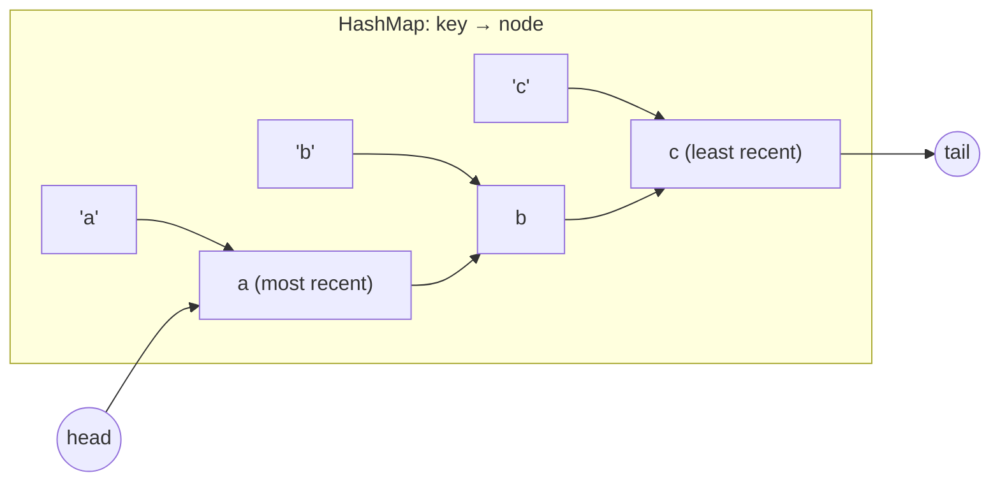
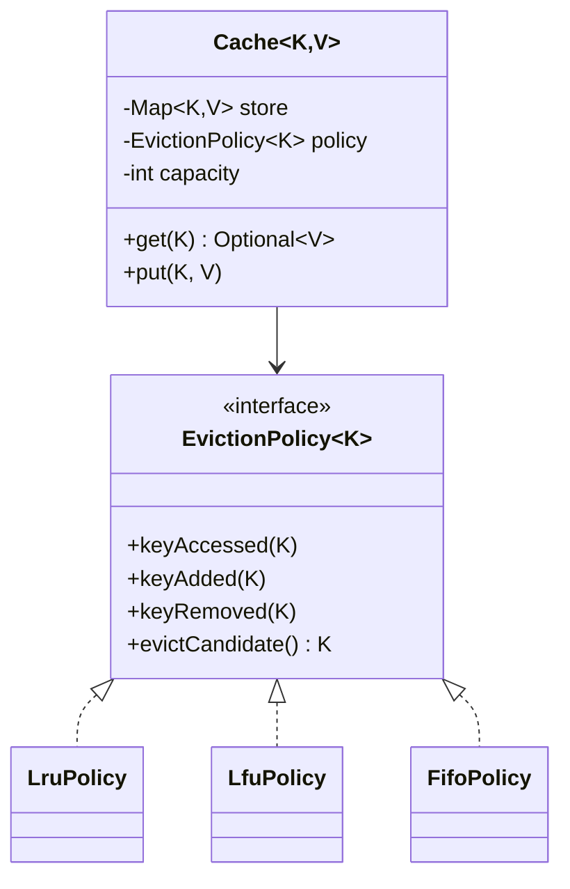

<Related ids={['strategy-pattern', 'concurrency-for-lld', 'decorator-pattern', 'interview-grade-code']} />

"Design an LRU cache" is half data-structures question, half LLD question. The data-structure half: **O(1) `get` and `put`** with a hash map plus a doubly linked list. The LLD half: generics, a pluggable **eviction policy**, **TTL**, and **thread safety** — the follow-ups that distinguish senior answers.

## What the interviewer expects

The full design in this lesson is longer than anything you'd write in one round. It's there so you understand the edge cases and can answer follow-up questions. In the round itself, aim for this:

<InterviewScope minutes="30–45" lines="50" write={["A `HashMap` plus a doubly linked list with sentinel nodes", "`get` and `put` in O(1), evicting the least recently used", "`synchronized` methods for thread safety"]} say={["Why `LinkedHashMap` can do this in 10 lines, and why they want to see it by hand", "Pluggable eviction (LFU, FIFO) behind an interface", "Lock striping or a concurrent cache for heavy traffic"]} skip={["TTL expiry, unless asked", "Metrics and size by bytes"]} />

### The interview-sized version

The classic answer: a map for lookup and a linked list for order, both changed in O(1). It's about **50 lines**, and it compiles and runs.

```java
class LruCache<K, V> {
    private final int capacity;
    private final Map<K, Node<K, V>> map = new HashMap<>();      // key -> node, for O(1) lookup
    private final Node<K, V> head = new Node<>(null, null);      // sentinel: most recently used side
    private final Node<K, V> tail = new Node<>(null, null);      // sentinel: least recently used side

    LruCache(int capacity) {
        if (capacity <= 0) throw new IllegalArgumentException("capacity must be positive");
        this.capacity = capacity;
        head.next = tail;
        tail.prev = head;
    }

    synchronized V get(K key) {
        Node<K, V> node = map.get(key);
        if (node == null) return null;
        moveToFront(node);                                       // reading counts as "used"
        return node.value;
    }

    synchronized void put(K key, V value) {
        Node<K, V> node = map.get(key);
        if (node != null) { node.value = value; moveToFront(node); return; }
        if (map.size() == capacity) {                            // full: drop the least recently used
            Node<K, V> lru = tail.prev;
            unlink(lru);
            map.remove(lru.key);
        }
        node = new Node<>(key, value);
        map.put(key, node);
        addFront(node);
    }

    synchronized int size() { return map.size(); }

    private void moveToFront(Node<K, V> n) { unlink(n); addFront(n); }
    private void unlink(Node<K, V> n) { n.prev.next = n.next; n.next.prev = n.prev; }
    private void addFront(Node<K, V> n) { n.next = head.next; n.prev = head; head.next.prev = n; head.next = n; }

    private static final class Node<K, V> {
        final K key;
        V value;
        Node<K, V> prev, next;
        Node(K key, V value) { this.key = key; this.value = value; }
    }
}
```

<Callout type="tip" title="How to use the rest of this lesson">
Practise writing the short version above, in your own words, until you can do it in about 30 minutes. Then read the full design below for the edge cases and follow-up answers. Interviewers often ask about those, but they rarely ask you to type them all.
</Callout>

## 1. Requirements

- `get(key)` returns the value or empty; counts as a use.
- `put(key, value)` inserts or updates; counts as a use.
- Fixed capacity; when full, evict the **least recently used** entry.
- Both operations **O(1)**.
- Extensions: other eviction policies (LFU, FIFO), per-entry TTL, thread-safety, stats (hits/misses), eviction listeners.

## 2. Core idea

- A **HashMap** gives O(1) lookup from key to node.
- A **doubly linked list** keeps entries in recency order: most recent at the head, least recent at the tail. Moving a node to the head or removing the tail is O(1) because each node knows its neighbours.



Sentinel head and tail nodes remove null checks at the ends.

## 3. Implementation (single-threaded)

<FullCode title="Show the full code: Implementation (single-threaded) (62 lines)">

```java
public final class LruCache<K, V> {
    private static final class Node<K, V> {
        final K key;
        V value;
        Node<K, V> prev, next;
        Node(K key, V value) { this.key = key; this.value = value; }
    }

    private final int capacity;
    private final Map<K, Node<K, V>> index;
    private final Node<K, V> head = new Node<>(null, null);    // sentinel: most-recent side
    private final Node<K, V> tail = new Node<>(null, null);    // sentinel: least-recent side

    public LruCache(int capacity) {
        if (capacity <= 0) throw new IllegalArgumentException("capacity must be positive");
        this.capacity = capacity;
        this.index = new HashMap<>(capacity * 4 / 3 + 1);
        head.next = tail;
        tail.prev = head;
    }

    public Optional<V> get(K key) {
        Node<K, V> node = index.get(key);
        if (node == null) return Optional.empty();
        moveToHead(node);
        return Optional.of(node.value);
    }

    public void put(K key, V value) {
        Objects.requireNonNull(key);
        Node<K, V> node = index.get(key);
        if (node != null) {                      // update existing
            node.value = value;
            moveToHead(node);
            return;
        }
        if (index.size() == capacity) {          // evict least recently used
            Node<K, V> lru = tail.prev;
            unlink(lru);
            index.remove(lru.key);
        }
        node = new Node<>(key, value);
        index.put(key, node);
        addAfterHead(node);
    }

    public int size() { return index.size(); }

    private void moveToHead(Node<K, V> n) { unlink(n); addAfterHead(n); }

    private void addAfterHead(Node<K, V> n) {
        n.prev = head;
        n.next = head.next;
        head.next.prev = n;
        head.next = n;
    }

    private void unlink(Node<K, V> n) {
        n.prev.next = n.next;
        n.next.prev = n.prev;
    }
}
```

</FullCode>

<Callout type="tip" title="The JDK shortcut">
`LinkedHashMap` with `accessOrder = true` plus an overridden `removeEldestEntry` is a complete LRU cache in a few lines. Mention it — then implement the map + list version if the interviewer wants to see the mechanics.

```java
public final class SimpleLru<K, V> extends LinkedHashMap<K, V> {
    private final int capacity;
    public SimpleLru(int capacity) { super(16, 0.75f, true); this.capacity = capacity; }
    @Override protected boolean removeEldestEntry(Map.Entry<K, V> eldest) { return size() > capacity; }
}
```

</Callout>

## 4. Making eviction pluggable

An LLD interviewer will ask: "What if we want LFU or FIFO?" Separate **storage** from the **eviction policy**:



```java
public interface EvictionPolicy<K> {
    void keyAdded(K key);
    void keyAccessed(K key);
    void keyRemoved(K key);
    K evictCandidate();                        // which key to evict next
}

public final class Cache<K, V> {
    private final int capacity;
    private final Map<K, V> store = new HashMap<>();
    private final EvictionPolicy<K> policy;
    private final List<BiConsumer<K, V>> evictionListeners = new CopyOnWriteArrayList<>();

    public Cache(int capacity, EvictionPolicy<K> policy) { this.capacity = capacity; this.policy = policy; }

    public Optional<V> get(K key) {
        V v = store.get(key);
        if (v != null) policy.keyAccessed(key);
        return Optional.ofNullable(v);
    }

    public void put(K key, V value) {
        if (store.containsKey(key)) {
            store.put(key, value);
            policy.keyAccessed(key);
            return;
        }
        if (store.size() == capacity) {
            K victim = policy.evictCandidate();
            V old = store.remove(victim);
            policy.keyRemoved(victim);
            evictionListeners.forEach(l -> l.accept(victim, old));
        }
        store.put(key, value);
        policy.keyAdded(key);
    }

    public void onEviction(BiConsumer<K, V> listener) { evictionListeners.add(listener); }
}
```

Simple policies can lean on `LinkedHashSet`, which keeps insertion order with O(1) add, remove and "first element":

```java
public final class LruPolicy<K> implements EvictionPolicy<K> {
    private final LinkedHashSet<K> order = new LinkedHashSet<>();
    public void keyAdded(K key)    { order.add(key); }
    public void keyAccessed(K key) { order.remove(key); order.add(key); }   // move to the most-recent end
    public void keyRemoved(K key)  { order.remove(key); }
    public K evictCandidate()      { return order.iterator().next(); }       // least recent
}

public final class FifoPolicy<K> implements EvictionPolicy<K> {
    private final LinkedHashSet<K> order = new LinkedHashSet<>();
    public void keyAdded(K key)    { order.add(key); }
    public void keyAccessed(K key) { }                                       // accesses don't matter
    public void keyRemoved(K key)  { order.remove(key); }
    public K evictCandidate()      { return order.iterator().next(); }
}
```

(The hand-written doubly linked list from section 3 does the same job as `LinkedHashSet` here; interviewers usually want to see it once, then accept the library class.)

### O(1) LFU

LFU evicts the least frequently used key (ties broken by recency). The O(1) design keeps:

- `key → frequency`,
- `frequency → LinkedHashSet<key>` (insertion-ordered set gives recency within a frequency),
- `minFrequency`.

On access, move the key from bucket `f` to `f + 1`; if bucket `minFrequency` became empty and `f == minFrequency`, increment `minFrequency`. On insert, `minFrequency = 1`. Evict the first key of the `minFrequency` bucket.

```java
public final class LfuPolicy<K> implements EvictionPolicy<K> {
    private final Map<K, Integer> freq = new HashMap<>();
    private final Map<Integer, LinkedHashSet<K>> buckets = new HashMap<>();   // frequency → keys, oldest first
    private int minFrequency;

    public void keyAdded(K key) {
        freq.put(key, 1);
        buckets.computeIfAbsent(1, f -> new LinkedHashSet<>()).add(key);
        minFrequency = 1;                                  // a new key is always the least frequent
    }

    public void keyAccessed(K key) {
        int f = freq.get(key);
        LinkedHashSet<K> bucket = buckets.get(f);
        bucket.remove(key);
        if (bucket.isEmpty()) {
            buckets.remove(f);
            if (minFrequency == f) minFrequency = f + 1;   // the key we moved is now the minimum
        }
        freq.put(key, f + 1);
        buckets.computeIfAbsent(f + 1, x -> new LinkedHashSet<>()).add(key);
    }

    public void keyRemoved(K key) {
        Integer f = freq.remove(key);
        if (f == null) return;
        LinkedHashSet<K> bucket = buckets.get(f);
        bucket.remove(key);
        if (bucket.isEmpty()) buckets.remove(f);
    }

    public K evictCandidate() { return buckets.get(minFrequency).iterator().next(); }   // ties → least recent
}
```

`keyRemoved` doesn't need to repair `minFrequency`: the cache only removes the eviction candidate and then immediately adds a new key, which resets the minimum to 1.

## 5. TTL (expiry)

Store an expiry time with each entry and treat expired entries as misses:

```java
private record Entry<V>(V value, Instant expiresAt) {
    boolean isExpired(Instant now) { return expiresAt != null && !now.isBefore(expiresAt); }
}
```

- **Lazy expiry** on `get` (cheap, always correct).
- **Active cleanup**: a scheduled task, or a priority queue/`DelayQueue` ordered by expiry, to reclaim memory from entries that are never read again.
- Inject a `Clock` so TTL logic is testable.

## 6. Thread safety

The map and the linked list must change **together** atomically — a `ConcurrentHashMap` alone is not enough, because `get` also mutates the list (moves the node to the head).

**Option 1 — one lock** (simple, correct, the right first answer):

```java
private final ReentrantLock lock = new ReentrantLock();

public Optional<V> get(K key) {
    lock.lock();
    try { return delegate.get(key); } finally { lock.unlock(); }
}
```

Note that a `ReadWriteLock` doesn't help for LRU: `get` is a **write** to the recency list.

**Option 2 — segmentation (striping)**: split the cache into S independent segments by `hash(key) % S`, each with its own lock and capacity/S. Contention drops by roughly S×; LRU becomes approximate globally (exact per segment). This is how high-throughput caches scale.

**Option 3 — approximate recency** (what production caches do): Caffeine records accesses in lock-free buffers and applies them to the policy in batches, and uses W-TinyLFU for a better hit ratio than pure LRU. Mention it as the "real-world" answer.

## 7. Patterns used

| Pattern | Where |
| --- | --- |
| **Strategy** | `EvictionPolicy` (LRU, LFU, FIFO) |
| **Observer** | Eviction listeners |
| **Decorator** | `SynchronizedCache`, `StatsCache`, `LoadingCache` wrapping a base cache |
| **Proxy** | A read-through cache in front of a repository |

## Interview questions

<QA q="Why do you need both a hash map and a doubly linked list?">
The hash map gives O(1) lookup from key to entry, but no ordering. The doubly linked list gives an O(1)-maintainable recency order — move a node to the front on access, remove the tail on eviction — because each node can be unlinked using its prev and next pointers. Storing the list node in the map combines both: find in O(1), reorder in O(1).
</QA>

<QA q="Why isn't a ConcurrentHashMap enough to make the LRU cache thread-safe?">
Each operation updates two structures — the map and the recency list — and even get modifies the list. ConcurrentHashMap only makes individual map operations atomic; the list updates and the combination with the map are still racy, corrupting links or evicting wrongly. You need a lock around the compound operation, segmented locks, or a design like Caffeine's that buffers access events and applies them under a lock.
</QA>

<QA q="How would you implement LFU in O(1)?">
Keep a map from key to (value, frequency), a map from frequency to an insertion-ordered set of keys, and the current minimum frequency. On access, remove the key from its frequency bucket and add it to frequency + 1, updating minFrequency if its old bucket was the minimum and is now empty. On insert of a new key, evict the oldest key in the minFrequency bucket if full, then add the new key with frequency 1 and set minFrequency to 1.
</QA>

<Practice task="Make the cache scale to 32 threads without one global lock, accepting that LRU becomes approximate. Sketch it.">

Stripe it: N independent `LruCache` segments (N a power of two, e.g. 16), each with capacity / N and its own lock; route keys with `hash(key) & (N − 1)` (after spreading the hash bits). Gets and puts on different segments run in parallel. Eviction is LRU *within* a segment, so globally it's approximate — acceptable for most caches. Mention Caffeine's alternative (buffer access events and replay them under a lock) as the production-grade answer.

</Practice>

<Practice task="Entries with a TTL that are never read again still occupy memory. Add active expiry without scanning the whole cache.">

Keep a priority queue (or `DelayQueue`) of (expiresAt, key), ordered by expiry. A background task — or every `put` — pops entries whose time has passed and removes them from the cache if the cached entry still has that same expiry (it may have been overwritten with a new TTL). This is O(log n) per entry instead of a full scan. Lazy expiry on `get` stays as the correctness guarantee; active expiry is about reclaiming memory.

</Practice>

<Takeaways>

- LRU = hash map (lookup) + doubly linked list (recency), both O(1); sentinels simplify edge cases.
- LinkedHashMap with access order is the built-in shortcut.
- Make eviction a strategy so LFU/FIFO plug in; add TTL with an injected Clock.
- Thread safety needs atomic map-plus-list updates: one lock, segments, or buffered access recording.

</Takeaways>

## Further reading

- Java SE API — `LinkedHashMap` (access-order mode and `removeEldestEntry`).
- Einziger, Friedman and Manes, "TinyLFU: A Highly Efficient Cache Admission Policy" (2017) and the [Caffeine](https://github.com/ben-manes/caffeine) wiki.
- HLD context: [Caching](/system-design/hld/caching).
