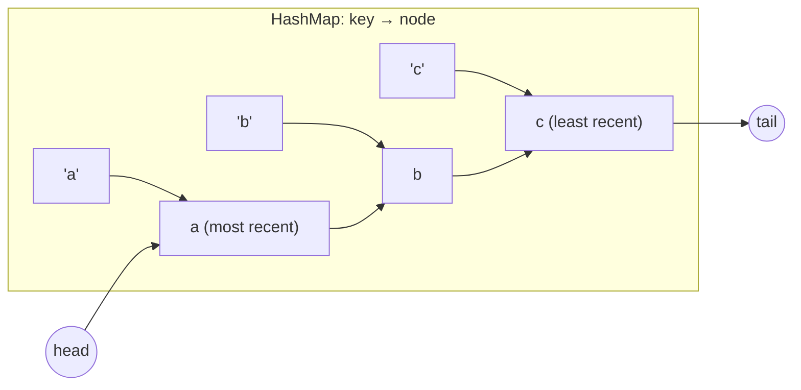
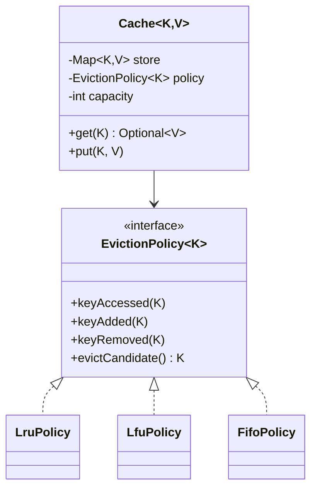

<Related ids={['strategy-pattern', 'concurrency-for-lld', 'decorator-pattern', 'interview-grade-code']} />

"Design an LRU cache" is half a data-structures question and half an LLD question. The data-structures half: make `get` and `put` run in **O(1)**. The LLD half comes in the follow-ups: can you swap in a different eviction rule, add expiry, and make it safe for many threads?

**LRU** means *least recently used*. The cache has a fixed size. When it's full and a new item arrives, it throws out the item nobody has touched for the longest time. The idea is that something you used a moment ago is likely to be used again soon.

We'll use the same six steps as every case study: requirements, entities, class design, code, a worked example, and follow-ups. (The [parking lot](/system-design/lld/lld-parking-lot) lesson explains the plan in detail.)

## Step 1: Pin down the requirements

<Dialogue>
<Turn who="you">So `get(key)` returns the value if it's there, and `put(key, value)` adds or updates it?</Turn>
<Turn who="them">Yes.</Turn>
<Turn who="you">Does a `get` count as "using" the key, so it becomes the most recent?</Turn>
<Turn who="them">Yes, both get and put count as a use.</Turn>
<Turn who="you">What complexity are you looking for?</Turn>
<Turn who="them">Both operations in O(1).</Turn>
<Turn who="you">Will several threads use it at once?</Turn>
<Turn who="them">Start single-threaded, then tell me how you'd make it thread-safe.</Turn>
<Turn who="you">Any other eviction rules, or expiry times?</Turn>
<Turn who="them">Possibly later. Keep it in mind.</Turn>
</Dialogue>

**The cache must:**

1. Return the value for a key, or "not found". A hit counts as a use.
2. Insert or update a key. That also counts as a use.
3. Hold at most `capacity` entries. When full, evict the least recently used one.
4. Do both operations in O(1).
5. Be easy to extend: other eviction rules, expiry, thread safety.

## Step 2: Find the core pieces

This problem is less about domain nouns and more about **which data structures** to combine. Ask what each operation needs:

| Need | Which structure gives it in O(1)? |
| --- | --- |
| Find the entry for a key | A **hash map** |
| Know which entry is least recently used | Something **ordered by recency** |
| Move an entry to "most recent" when it's used | A list where you can **remove from the middle** cheaply |
| Remove the oldest entry | Taking from **one end** of that list |

Now try the options for "ordered by recency":

<Approach verdict="bad" title="A map plus a timestamp on each entry">

Store the last-used time with each value. Finding the oldest means scanning every entry: O(n) per eviction.

</Approach>

<Approach verdict="bad" title="A map plus an ArrayList or a queue">

Moving an item to the front of an array means shifting everything after it: O(n). A plain queue can't remove from the middle at all.

</Approach>

<Approach verdict="great" title="A map plus a doubly linked list">

Keep entries in a **doubly linked list**, most recent at the head and least recent at the tail. Each node knows its neighbours, so once you **have** the node you can unlink it and move it to the head in O(1). The map stores `key → node`, so you can find any node in O(1). Together, every operation is O(1).

</Approach>



## Step 3: Design the pieces

**`Node`**: knows its key, value and its previous and next nodes. It stores the **key** as well as the value, because when we evict the tail node we need to remove its key from the map too.

**The list**: two **sentinel** nodes, `head` and `tail`, that never hold data. With them, every real node always has a node on both sides, so adding and removing never needs "what if the list is empty?" checks.

**`LruCache`**: knows the capacity, the map and the list. Its two public methods:

- **`get(key)`**: look up the node. Not there? Return nothing. Otherwise move it to the head and return its value.
- **`put(key, value)`**: if the key exists, update the value and move it to the head. If not and the cache is full, remove the node just before `tail` (the least recent) from both the list and the map. Then create a node, add it to the map and put it at the head.

And three tiny private helpers do all the pointer work: `unlink`, `addFront` and `moveToFront`.

Step through it to see the list and map change together:

<LruViz />

## Step 4: Write the code

<InterviewScope minutes="30–45" lines="50" write={["A `HashMap` plus a doubly linked list with sentinel nodes", "`get` and `put` in O(1), evicting the least recently used", "`synchronized` methods for thread safety"]} say={["Why `LinkedHashMap` can do this in 10 lines, and why they want to see it by hand", "Pluggable eviction (LFU, FIFO) behind an interface", "Lock striping or a concurrent cache for heavy traffic"]} skip={["TTL expiry, unless asked", "Metrics and size by bytes"]} />

### The interview-sized version

The classic answer: a map for lookup and a linked list for order, both changed in O(1). It's about **50 lines**, and it compiles and runs.

```java
class LruCache<K, V> {
    private final int capacity;
    private final Map<K, Node<K, V>> map = new HashMap<>();      // key -> node, for O(1) lookup
    private final Node<K, V> head = new Node<>(null, null);      // sentinel: most recently used side
    private final Node<K, V> tail = new Node<>(null, null);      // sentinel: least recently used side

    LruCache(int capacity) {
        if (capacity <= 0) throw new IllegalArgumentException("capacity must be positive");
        this.capacity = capacity;
        head.next = tail;
        tail.prev = head;
    }

    synchronized V get(K key) {
        Node<K, V> node = map.get(key);
        if (node == null) return null;
        moveToFront(node);                                       // reading counts as "used"
        return node.value;
    }

    synchronized void put(K key, V value) {
        Node<K, V> node = map.get(key);
        if (node != null) { node.value = value; moveToFront(node); return; }
        if (map.size() == capacity) {                            // full: drop the least recently used
            Node<K, V> lru = tail.prev;
            unlink(lru);
            map.remove(lru.key);
        }
        node = new Node<>(key, value);
        map.put(key, node);
        addFront(node);
    }

    synchronized int size() { return map.size(); }

    private void moveToFront(Node<K, V> n) { unlink(n); addFront(n); }
    private void unlink(Node<K, V> n) { n.prev.next = n.next; n.next.prev = n.prev; }
    private void addFront(Node<K, V> n) { n.next = head.next; n.prev = head; head.next.prev = n; head.next = n; }

    private static final class Node<K, V> {
        final K key;
        V value;
        Node<K, V> prev, next;
        Node(K key, V value) { this.key = key; this.value = value; }
    }
}
```

**Reading it top to bottom:**

1. The constructor links `head` straight to `tail`: an empty list.
2. **`get`**: one map lookup, then `moveToFront`, because reading counts as a use.
3. **`put`** on an existing key: update the value in place and move it to the front. The size doesn't change, so nothing is evicted.
4. **`put`** on a new key when full: `tail.prev` is the least recent node. Unlink it **and** remove its key from the map. Forgetting the map is the most common bug.
5. **`unlink`** joins a node's neighbours to each other. **`addFront`** slots a node in right after `head`. Draw four boxes and arrows the first time; the order of the four assignments in `addFront` matters.
6. `synchronized` makes it safe for several threads (more on that below).

<Callout type="tip" title="How to practise this">
Draw the list on paper with capacity 2 and run: put a, put b, get a, put c. Which key gets evicted? (Answer: b, because a was used more recently.) Then write the code without looking.
</Callout>

### Growing it into the full design

#### The same thing, with `Optional` and checks

The full single-threaded version is the same algorithm, returning `Optional` instead of `null` and rejecting null keys.

<FullCode title="Show the full code: Implementation (single-threaded) (62 lines)">

```java
public final class LruCache<K, V> {
    private static final class Node<K, V> {
        final K key;
        V value;
        Node<K, V> prev, next;
        Node(K key, V value) { this.key = key; this.value = value; }
    }

    private final int capacity;
    private final Map<K, Node<K, V>> index;
    private final Node<K, V> head = new Node<>(null, null);    // sentinel: most-recent side
    private final Node<K, V> tail = new Node<>(null, null);    // sentinel: least-recent side

    public LruCache(int capacity) {
        if (capacity <= 0) throw new IllegalArgumentException("capacity must be positive");
        this.capacity = capacity;
        this.index = new HashMap<>(capacity * 4 / 3 + 1);
        head.next = tail;
        tail.prev = head;
    }

    public Optional<V> get(K key) {
        Node<K, V> node = index.get(key);
        if (node == null) return Optional.empty();
        moveToHead(node);
        return Optional.of(node.value);
    }

    public void put(K key, V value) {
        Objects.requireNonNull(key);
        Node<K, V> node = index.get(key);
        if (node != null) {                      // update existing
            node.value = value;
            moveToHead(node);
            return;
        }
        if (index.size() == capacity) {          // evict least recently used
            Node<K, V> lru = tail.prev;
            unlink(lru);
            index.remove(lru.key);
        }
        node = new Node<>(key, value);
        index.put(key, node);
        addAfterHead(node);
    }

    public int size() { return index.size(); }

    private void moveToHead(Node<K, V> n) { unlink(n); addAfterHead(n); }

    private void addAfterHead(Node<K, V> n) {
        n.prev = head;
        n.next = head.next;
        head.next.prev = n;
        head.next = n;
    }

    private void unlink(Node<K, V> n) {
        n.prev.next = n.next;
        n.next.prev = n.prev;
    }
}
```

</FullCode>

<Callout type="tip" title="The JDK shortcut">
`LinkedHashMap` can keep entries in **access order** and lets you override `removeEldestEntry`. That's a complete LRU cache in a few lines. Mention it, and then write the map-plus-list version if the interviewer wants to see the mechanics (they usually do).

```java
public final class SimpleLru<K, V> extends LinkedHashMap<K, V> {
    private final int capacity;
    public SimpleLru(int capacity) { super(16, 0.75f, true); this.capacity = capacity; }
    @Override protected boolean removeEldestEntry(Map.Entry<K, V> eldest) { return size() > capacity; }
}
```

</Callout>

#### Follow-up 1: "What if we want LFU or FIFO instead?"

Split the cache into two jobs: **storing** values, and **deciding what to evict**. The second job goes behind an `EvictionPolicy` interface. The cache tells the policy whenever a key is added, used or removed, and asks it "which key should go?" when it's full.



```java
public interface EvictionPolicy<K> {
    void keyAdded(K key);
    void keyAccessed(K key);
    void keyRemoved(K key);
    K evictCandidate();                        // which key to evict next
}

public final class Cache<K, V> {
    private final int capacity;
    private final Map<K, V> store = new HashMap<>();
    private final EvictionPolicy<K> policy;
    private final List<BiConsumer<K, V>> evictionListeners = new CopyOnWriteArrayList<>();

    public Cache(int capacity, EvictionPolicy<K> policy) { this.capacity = capacity; this.policy = policy; }

    public Optional<V> get(K key) {
        V v = store.get(key);
        if (v != null) policy.keyAccessed(key);
        return Optional.ofNullable(v);
    }

    public void put(K key, V value) {
        if (store.containsKey(key)) {
            store.put(key, value);
            policy.keyAccessed(key);
            return;
        }
        if (store.size() == capacity) {
            K victim = policy.evictCandidate();
            V old = store.remove(victim);
            policy.keyRemoved(victim);
            evictionListeners.forEach(l -> l.accept(victim, old));
        }
        store.put(key, value);
        policy.keyAdded(key);
    }

    public void onEviction(BiConsumer<K, V> listener) { evictionListeners.add(listener); }
}
```

Simple policies can use `LinkedHashSet`, which keeps insertion order and supports O(1) add, remove and "give me the first one":

```java
public final class LruPolicy<K> implements EvictionPolicy<K> {
    private final LinkedHashSet<K> order = new LinkedHashSet<>();
    public void keyAdded(K key)    { order.add(key); }
    public void keyAccessed(K key) { order.remove(key); order.add(key); }   // move to the most-recent end
    public void keyRemoved(K key)  { order.remove(key); }
    public K evictCandidate()      { return order.iterator().next(); }       // least recent
}

public final class FifoPolicy<K> implements EvictionPolicy<K> {
    private final LinkedHashSet<K> order = new LinkedHashSet<>();
    public void keyAdded(K key)    { order.add(key); }
    public void keyAccessed(K key) { }                                       // accesses don't matter
    public void keyRemoved(K key)  { order.remove(key); }
    public K evictCandidate()      { return order.iterator().next(); }
}
```

The only difference between LRU and FIFO: on access, LRU moves the key to the end, and FIFO does nothing. (The hand-written linked list does the same job as `LinkedHashSet`. Interviewers usually want to see it once, then accept the library class.)

#### LFU in O(1)

**LFU** (*least frequently used*) evicts the key used the fewest times; among ties, the one used least recently. The trick to O(1) is to group keys by how often they've been used:

- `key → frequency`
- `frequency → keys with that frequency, oldest first` (a `LinkedHashSet`)
- `minFrequency`, the smallest frequency that has any keys

On access, move the key from bucket `f` to bucket `f + 1`. If bucket `f` is now empty and it was the minimum, the minimum becomes `f + 1`. A new key always starts at frequency 1, so the minimum resets to 1. To evict, take the first key in the `minFrequency` bucket.

```java
public final class LfuPolicy<K> implements EvictionPolicy<K> {
    private final Map<K, Integer> freq = new HashMap<>();
    private final Map<Integer, LinkedHashSet<K>> buckets = new HashMap<>();   // frequency → keys, oldest first
    private int minFrequency;

    public void keyAdded(K key) {
        freq.put(key, 1);
        buckets.computeIfAbsent(1, f -> new LinkedHashSet<>()).add(key);
        minFrequency = 1;                                  // a new key is always the least frequent
    }

    public void keyAccessed(K key) {
        int f = freq.get(key);
        LinkedHashSet<K> bucket = buckets.get(f);
        bucket.remove(key);
        if (bucket.isEmpty()) {
            buckets.remove(f);
            if (minFrequency == f) minFrequency = f + 1;   // the key we moved is now the minimum
        }
        freq.put(key, f + 1);
        buckets.computeIfAbsent(f + 1, x -> new LinkedHashSet<>()).add(key);
    }

    public void keyRemoved(K key) {
        Integer f = freq.remove(key);
        if (f == null) return;
        LinkedHashSet<K> bucket = buckets.get(f);
        bucket.remove(key);
        if (bucket.isEmpty()) buckets.remove(f);
    }

    public K evictCandidate() { return buckets.get(minFrequency).iterator().next(); }   // ties → least recent
}
```

`keyRemoved` doesn't need to fix `minFrequency`: the cache only removes the eviction candidate and then immediately adds a new key, which resets the minimum to 1.

#### Follow-up 2: "Add expiry (TTL)."

Store an expiry time with each entry, and treat an expired entry as missing:

```java
private record Entry<V>(V value, Instant expiresAt) {
    boolean isExpired(Instant now) { return expiresAt != null && !now.isBefore(expiresAt); }
}
```

- **Lazy expiry**: check on `get`. Cheap and always correct.
- **Active cleanup**: a scheduled task (or a priority queue ordered by expiry) removes entries that will never be read again, so they stop using memory.
- Pass in a `Clock` so tests can jump forward in time.

#### Follow-up 3: "Make it thread-safe."

The map and the list must change **together**. Here's the trap:

<Approach verdict="bad" title="Swap HashMap for ConcurrentHashMap">

That makes individual map operations safe, but the list is still unprotected, and even `get` changes the list (it moves a node). Two threads moving nodes at once can corrupt the links.

</Approach>

<Approach verdict="bad" title="A read-write lock, with get taking the read lock">

Sounds clever, but in an LRU cache `get` **writes**: it moves the node to the front. So every operation needs the write lock, and you've gained nothing.

</Approach>

<Approach verdict="good" title="One lock around every operation">

Simple and correct. This is the right first answer.

```java
private final ReentrantLock lock = new ReentrantLock();

public Optional<V> get(K key) {
    lock.lock();
    try { return delegate.get(key); } finally { lock.unlock(); }
}
```

</Approach>

<Approach verdict="great" title="Split the cache into segments">

Divide it into, say, 16 independent caches, each with its own lock and 1/16 of the capacity. Pick the segment by `hash(key) % 16`. Threads working on different segments don't block each other. Eviction is now exact within a segment but only approximate overall, which is fine for nearly every real use.

</Approach>

For the "how do real systems do it?" question: the Caffeine library records accesses in lock-free buffers, applies them to the policy in batches, and uses an eviction rule called W-TinyLFU that beats plain LRU on hit rate.

## Step 5: Trace it

Capacity 2.

1. `put(a, 1)`: list is `head → a → tail`.
2. `put(b, 2)`: `head → b → a → tail`.
3. `get(a)` returns 1 and moves a to the front: `head → a → b → tail`.
4. `put(c, 3)`: the cache is full. The least recent is `tail.prev`, which is **b**. Unlink b and remove it from the map. Add c: `head → c → a → tail`.
5. `get(b)` returns nothing. `get(a)` returns 1.

## Common mistakes

- **Not storing the key in the node**, so after evicting the tail you can't remove it from the map.
- **Forgetting that `get` counts as a use** and must move the node.
- **Updating an existing key by inserting a second node**, which leaves a stale node in the list.
- **Assuming `ConcurrentHashMap` makes the whole thing thread-safe.**
- **Getting the four pointer assignments in `addFront` in the wrong order.** Draw it.

## Patterns used

| Pattern | Where |
| --- | --- |
| **Strategy** | `EvictionPolicy` (LRU, LFU, FIFO) |
| **Observer** | Eviction listeners |
| **Decorator** | `SynchronizedCache`, `StatsCache`, `LoadingCache` wrapping a base cache |
| **Proxy** | A read-through cache in front of a repository |

## Interview questions

<QA q="Why do you need both a hash map and a doubly linked list?">
The hash map gives O(1) lookup from key to entry, but no order. The doubly linked list keeps recency order and lets you move a node to the front or remove the tail in O(1), because each node can be unlinked using its own prev and next pointers. Storing the list node in the map combines both: find in O(1), reorder in O(1).
</QA>

<QA q="Why isn't a ConcurrentHashMap enough to make the LRU cache thread-safe?">
Each operation updates two structures, the map and the recency list, and even get changes the list. ConcurrentHashMap only makes single map operations atomic; the list updates, and keeping them in step with the map, are still unprotected and can corrupt the links or evict the wrong entry. You need a lock around the combined operation, segmented locks, or a design like Caffeine's that buffers accesses and applies them under a lock.
</QA>

<QA q="How would you implement LFU in O(1)?">
Keep a map from key to frequency, a map from frequency to an insertion-ordered set of keys, and the current minimum frequency. On access, move the key from its frequency bucket to the next one, raising the minimum if its old bucket was the minimum and is now empty. On inserting a new key, evict the oldest key in the minimum bucket if full, then add the new key with frequency 1 and set the minimum to 1.
</QA>

<Practice task="Make the cache scale to 32 threads without one global lock, accepting that LRU becomes approximate. Sketch it.">

Stripe it: N independent `LruCache` segments (N a power of two, such as 16), each with capacity / N and its own lock; route keys with `hash(key) & (N − 1)` (after spreading the hash bits). Gets and puts on different segments run in parallel. Eviction is LRU *within* a segment, so overall it's approximate, which is acceptable for most caches. Mention Caffeine's alternative (buffer access events and replay them under a lock) as the production-grade answer.

</Practice>

<Practice task="Entries with a TTL that are never read again still occupy memory. Add active expiry without scanning the whole cache.">

Keep a priority queue (or `DelayQueue`) of (expiresAt, key), ordered by expiry. A background task, or every `put`, pops entries whose time has passed and removes them from the cache if the cached entry still has that same expiry (it may have been overwritten with a new TTL). That's O(log n) per entry instead of a full scan. Lazy expiry on `get` stays as the guarantee of correctness; active expiry is about freeing memory.

</Practice>

<Takeaways>

- LRU = a hash map (find a node) plus a doubly linked list (recency order). Both operations are O(1).
- Store the key in each node, and use sentinel head and tail nodes to avoid edge cases.
- `LinkedHashMap` in access order is the built-in shortcut; mention it, then write it by hand.
- Make eviction a strategy so LFU and FIFO plug in; add TTL with an injected `Clock`.
- For thread safety, the map and list must change together: one lock first, segments to scale.

</Takeaways>

## Further reading

- Java SE API: `LinkedHashMap` (access-order mode and `removeEldestEntry`).
- Einziger, Friedman and Manes, "TinyLFU: A Highly Efficient Cache Admission Policy" (2017), and the [Caffeine](https://github.com/ben-manes/caffeine) wiki.
- HLD context: [Caching](/system-design/hld/caching).
