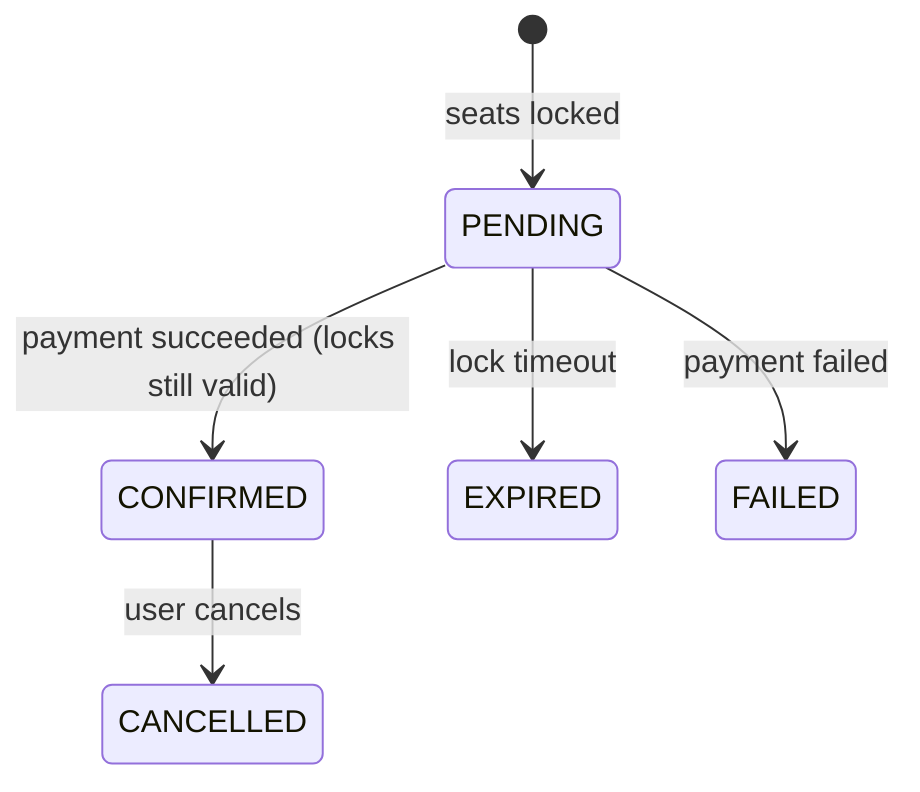
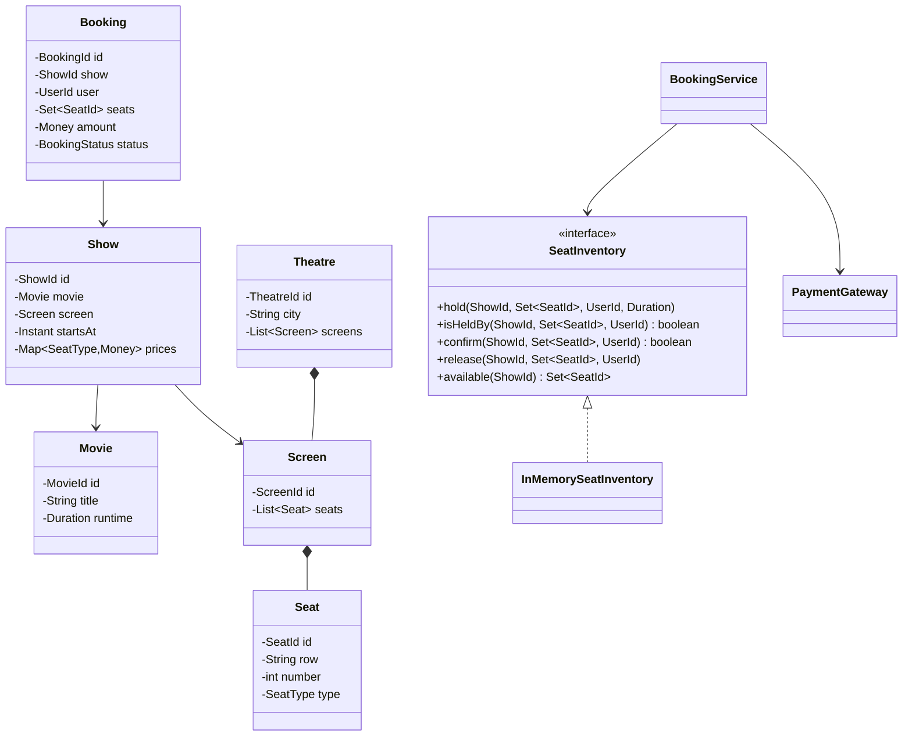

<Related ids={['concurrency-for-lld', 'state-pattern', 'strategy-pattern', 'observer-pattern', 'interview-grade-code']} />

Think of booking a movie ticket on an app like BookMyShow. You pick two seats, and the app gives you a few minutes to pay. During those minutes nobody else can take your seats. Now picture a blockbuster's first show, with thousands of people tapping on the same seats at the same moment. The whole interview is about one promise: **no seat is ever sold twice**, while still letting people hold seats while they pay.

(This is the in-process object design. The large-scale version, with many servers and a database, is the HLD case study [Design a Ticket Booking System](/system-design/hld/design-ticket-booking).)

We'll use the same six steps as every case study: requirements, entities, class design, code, a worked example, and follow-ups. (The [parking lot](/system-design/lld/lld-parking-lot) lesson explains the plan in detail.)

## Step 1: Pin down the requirements

<Dialogue>
<Turn who="you">Should I cover browsing cities, cinemas and movies, or focus on booking?</Turn>
<Turn who="them">Mention the model, but focus on booking.</Turn>
<Turn who="you">When a user picks seats, are they reserved while they pay?</Turn>
<Turn who="them">Yes, for a few minutes. If they don't pay in time, the seats go back.</Turn>
<Turn who="you">Can a user pick several seats at once? What if one of them is already taken?</Turn>
<Turn who="them">Up to 10 seats. If any seat is taken, the whole selection fails.</Turn>
<Turn who="you">Are there different seat types with different prices?</Turn>
<Turn who="them">Yes: regular, premium, recliner.</Turn>
<Turn who="you">What if payment succeeds but the user took too long and lost the seats?</Turn>
<Turn who="them">Good question. You tell me.</Turn>
</Dialogue>

That last answer is a hint: the interviewer **will** come back to it. Note it down.

**The system must:**

1. Model cinemas, screens, seats, movies and shows (a movie on a screen at a time).
2. Show which seats are free for a show.
3. Let a user **hold** 1–10 seats for a few minutes, all or nothing.
4. Confirm the booking when payment succeeds, if the hold is still theirs.
5. Release held seats if payment fails or time runs out.
6. **Never** let two users book the same seat for the same show.

**Out of scope for now:** search, coupons, refunds on cancellation, cinema admin.

## Step 2: Find the core entities

| Noun | Make it… | Why |
| --- | --- | --- |
| Movie | a record | Title and running time. |
| Theatre, Screen | classes | A theatre has screens; a screen has seats. |
| Seat | a record | Row, number, type. **It never changes.** |
| Show | a class | A movie on a screen at a time, with prices. |
| Booking | a class | Who booked which seats for which show, the amount and the status. |
| Seat availability | a class `SeatInventory` behind an interface | Free, held or booked, **per show**. This is where the concurrency lives. |
| Payment | an interface | A black box we call. |
| Booking service | a class | The front door: hold seats, confirm, release. |

The modelling decision that trips people up:

<Approach verdict="bad" title="Put a status on Seat">

```java
class Seat { String row; int number; SeatStatus status; }
```

Seat F7 is a physical chair in Screen 2. It's free for the 6 pm show and booked for the 9 pm show **at the same time**. A single `status` field can't say both.

</Approach>

<Approach verdict="great" title="Availability belongs to a (show, seat) pair">

The `Seat` describes the chair and never changes. Whether it's free, held or booked is stored per show, in the seat inventory. Each show gets its own set of holds and bookings.

</Approach>

## Step 3: Design each class

**`SeatInventory`**: for each show, knows every seat, the current **holds** (who holds a seat, until when) and the **booked** seats. It can:

- `hold(show, seats, user, duration)`: hold **all** the seats or none.
- `confirm(show, seats, user)`: turn the user's holds into bookings, but only if they still hold every seat.
- `release(show, seats, user)`: give the seats back (only the holder can).
- `available(show)`: list the free seats.

**`BookingService`**: `holdSeats` validates the request, asks the inventory to hold, and creates a `PENDING` booking. `confirm` charges the payment and confirms the seats.

**`Booking`** moves through a small life cycle:



Now the central question: **how do we stop two users holding the same seat?**

<Approach verdict="bad" title="Check, then hold, with no lock">

```java
if (seat.isFree()) seat.hold(user);   // users A and B both see "free"…
```

Both users run the check before either holds the seat, so both think they've got it. This **check-then-act race** is the bug the interviewer is waiting for.

</Approach>

<Approach verdict="good" title="One lock for the whole system">

Wrap `hold` and `confirm` in one global lock. Correct, but a user booking *Movie A* in Mumbai now waits for someone booking *Movie B* in Delhi.

</Approach>

<Approach verdict="great" title="One lock per show">

Seats in different shows never interfere, so give each show its own lock. Inside it, check **every** requested seat, then hold **every** seat. Users of different shows never wait for each other, and within a show, two users can't both get F7.

Crucially, holds **and** bookings for a show sit under the **same** lock. If they had separate locks, a hold could be granted on a seat at the very moment another thread is booking it.

</Approach>



## Step 4: Write the code

<InterviewScope minutes="45–60" lines="50" write={["Seats with FREE, HELD and BOOKED states", "Hold seats all-or-nothing, with an expiry", "Confirm only if the hold is still yours"]} say={["Taking payment between hold and confirm, outside the lock", "A lock per show instead of one global lock", "Pricing by seat type or time as a strategy"]} skip={["Cinema and movie admin", "Coupons and refunds", "Search and listings"]} />

### The interview-sized version

The heart of the problem: holding seats safely while two users race for the same one. It's about **50 lines**, and it compiles and runs.

```java
enum SeatState { FREE, HELD, BOOKED }

class Seat {
    final String id;
    SeatState state = SeatState.FREE;
    String heldBy;
    long holdUntil;

    Seat(String id) { this.id = id; }

    boolean availableAt(long now) {                   // an expired hold counts as free
        return state == SeatState.FREE || (state == SeatState.HELD && now >= holdUntil);
    }
}

class Show {
    static final long HOLD_MILLIS = 10 * 60 * 1000;   // seats are held for 10 minutes while the user pays
    private final Map<String, Seat> seats = new LinkedHashMap<>();

    Show(List<String> seatIds) { seatIds.forEach(id -> seats.put(id, new Seat(id))); }

    // synchronized: two users can never hold the same seat
    synchronized boolean hold(String user, List<String> seatIds, long now) {
        List<Seat> wanted = seatIds.stream().map(this::seat).toList();
        if (!wanted.stream().allMatch(s -> s.availableAt(now))) return false;   // all or nothing
        for (Seat s : wanted) { s.state = SeatState.HELD; s.heldBy = user; s.holdUntil = now + HOLD_MILLIS; }
        return true;
    }

    synchronized void confirm(String user, List<String> seatIds, long now) {   // called after payment succeeds
        List<Seat> wanted = seatIds.stream().map(this::seat).toList();
        for (Seat s : wanted)
            if (s.state != SeatState.HELD || !user.equals(s.heldBy) || now >= s.holdUntil)
                throw new IllegalStateException("Seat " + s.id + " is no longer held for " + user);
        for (Seat s : wanted) s.state = SeatState.BOOKED;
    }

    synchronized List<String> available(long now) {
        return seats.values().stream().filter(s -> s.availableAt(now)).map(s -> s.id).toList();
    }

    private Seat seat(String id) {
        Seat s = seats.get(id);
        if (s == null) throw new IllegalArgumentException("No seat " + id);
        return s;
    }
}
```

**Reading it top to bottom:**

1. Each **`Seat`** in a `Show` has a state, who holds it and until when. (In this short version, the show owns its seats' states, which is the "per show" idea in its simplest form.)
2. **`availableAt(now)`**: a seat is free if it's `FREE`, **or** if it's `HELD` but the hold has run out. That's **lazy expiry**: no timer is needed to free seats; an expired hold simply counts as free the next time anyone looks.
3. **`hold`** is `synchronized`, so only one user at a time can be inside it for this show. It checks **all** the seats first and only then marks them all `HELD`. If any is taken, it returns `false` and changes nothing.
4. **`confirm`** runs after payment. It checks each seat is still held by **this** user and the hold hasn't expired, then marks them all `BOOKED`.
5. Time is passed in as `now`, so tests can jump ahead 11 minutes and check the hold has expired.

<Callout type="tip" title="How to practise this">
Write `Seat` and `hold` first, and say out loud why `hold` must be synchronized. Then add `confirm`. Finally, explain what happens between `hold` and `confirm` (payment), which is the next section.
</Callout>

### Growing it into the full design

#### The seat inventory

The full inventory works the same way with real types: a `ShowSeats` object per show holds all seats, the holds (with owner and expiry) and the booked set, and `synchronized (s)` locks that one show.

<FullCode title="Show the full code: Seat inventory — the core (68 lines)">

```java
public interface SeatInventory {
    void hold(ShowId show, Set<SeatId> seats, UserId user, Duration ttl);   // all or nothing
    boolean isHeldBy(ShowId show, Set<SeatId> seats, UserId user);
    boolean confirm(ShowId show, Set<SeatId> seats, UserId user);           // held by user → booked, atomically
    void release(ShowId show, Set<SeatId> seats, UserId user);
    Set<SeatId> available(ShowId show);
}

public final class InMemorySeatInventory implements SeatInventory {
    private record Hold(UserId user, Instant expiresAt) {
        boolean isExpired(Instant now) { return !now.isBefore(expiresAt); }
    }

    private static final class ShowSeats {                  // guarded by its own monitor
        final Set<SeatId> all;
        final Map<SeatId, Hold> holds = new HashMap<>();
        final Set<SeatId> booked = new HashSet<>();
        ShowSeats(Set<SeatId> all) { this.all = Set.copyOf(all); }
    }

    private final Map<ShowId, ShowSeats> shows = new ConcurrentHashMap<>();
    private final Clock clock;

    public InMemorySeatInventory(Clock clock) { this.clock = clock; }

    @Override public void hold(ShowId show, Set<SeatId> wanted, UserId user, Duration ttl) {
        ShowSeats s = seats(show);
        synchronized (s) {                                    // check every seat, then set every seat
            Instant now = clock.instant();
            for (SeatId seat : wanted) {
                if (!s.all.contains(seat)) throw new InvalidSelectionException("Unknown seat " + seat);
                if (s.booked.contains(seat)) throw new SeatUnavailableException(seat);
                Hold h = s.holds.get(seat);
                if (h != null && !h.isExpired(now) && !h.user().equals(user)) throw new SeatUnavailableException(seat);
            }
            Hold hold = new Hold(user, now.plus(ttl));
            wanted.forEach(seat -> s.holds.put(seat, hold));
        }
    }

    @Override public boolean confirm(ShowId show, Set<SeatId> wanted, UserId user) {
        ShowSeats s = seats(show);
        synchronized (s) {
            if (!heldBy(s, wanted, user, clock.instant())) return false;   // lapsed or taken over
            wanted.forEach(seat -> { s.holds.remove(seat); s.booked.add(seat); });
            return true;
        }
    }

    @Override public void release(ShowId show, Set<SeatId> wanted, UserId user) {
        ShowSeats s = seats(show);
        synchronized (s) {
            wanted.forEach(seat -> {
                Hold h = s.holds.get(seat);
                if (h != null && h.user().equals(user)) s.holds.remove(seat);   // only the owner releases
            });
        }
    }

    private static boolean heldBy(ShowSeats s, Set<SeatId> wanted, UserId user, Instant now) {
        for (SeatId seat : wanted) {
            Hold h = s.holds.get(seat);
            if (h == null || h.isExpired(now) || !h.user().equals(user)) return false;
        }
        return true;
    }
    // isHeldBy and available follow the same pattern under the same monitor; seats(show) looks up or throws
}
```

</FullCode>

Points to say out loud:

- **All or nothing**: every requested seat is held, or none are. No half-selections left lying around.
- **One lock per show**: different shows never wait for each other.
- **Lazy expiry**: an expired hold counts as free next time anyone checks. A background job can tidy up, but correctness doesn't depend on it.
- **Behind an interface**: with several servers, you'd swap this for Redis (one key per seat, set only if absent, with an expiry) or conditional database updates, and the booking service wouldn't change.

#### The booking service and the payment problem

Remember the interviewer's "you tell me"? Here's the problem: payment takes time. What if the user's hold expires **while** they're paying, and someone else books the seat?

`confirm(bookingId, payment)` handles it in three steps:

1. **Before charging**, check the user still holds the seats. If the hold has already lapsed, mark the booking expired and **don't take any money**.
2. **Charge the payment, outside any lock.** Payment can take seconds; holding the show's lock that long would freeze everyone else booking that show. The booking id is passed as an idempotency key, so a retried request can't charge twice.
3. **Atomically turn holds into bookings.** If this fails because the hold ran out *during* payment, mark the booking expired and **refund** the money.

<FullCode title="Show the full code: Booking service (43 lines)">

```java
public final class BookingService {
    private final SeatInventory inventory;
    private final BookingRepository bookings;
    private final PaymentGateway payments;
    private final PricingStrategy pricing;
    private final Duration holdTtl = Duration.ofMinutes(5);

    public Booking holdSeats(UserId user, ShowId show, Set<SeatId> seats) {
        if (seats.isEmpty() || seats.size() > 10) throw new InvalidSelectionException("1–10 seats per booking");
        inventory.hold(show, seats, user, holdTtl);            // atomic: unknown, booked or held → throws
        Booking booking = Booking.pending(show, user, seats, pricing.price(show, seats));
        bookings.save(booking);
        return booking;
    }

    public Booking confirm(BookingId id, PaymentDetails paymentDetails) {
        Booking b = bookings.get(id);
        if (b.status() != BookingStatus.PENDING) throw new IllegalStateException("Booking is " + b.status());

        // 1. Don't charge for a hold that has already lapsed
        if (!inventory.isHeldBy(b.show(), b.seats(), b.user())) {
            b.markExpired();
            throw new BookingExpiredException(id);
        }

        // 2. Charge outside any lock; the booking id is the idempotency key
        PaymentResult result = payments.charge(b.amount(), paymentDetails, id.value());
        if (!result.success()) {
            b.markFailed();
            inventory.release(b.show(), b.seats(), b.user());
            return b;
        }

        // 3. Hold → booked atomically; if the hold lapsed *during* payment, compensate
        if (!inventory.confirm(b.show(), b.seats(), b.user())) {
            b.markExpired();
            payments.refund(result.paymentId());
            throw new BookingExpiredException(id);
        }
        b.markConfirmed(result.paymentId());
        return b;
    }
}
```

</FullCode>

Undoing an action when a later step fails (here, a refund) is called a **compensating action**. To make step 3 rare, set the hold time comfortably longer than the payment provider's timeout, and show the user a countdown.

#### Other places the design can change

- **`PricingStrategy`**: price by seat type, plus weekend or prime-time extras. Wrap strategies to stack rules: `new WeekendSurcharge(new SeatTypePricing(...))`.
- **`PaymentGateway`**: an adapter per payment provider.
- **Notifications**: observers send an email or SMS when a booking is confirmed or cancelled.
- **`CancellationPolicy`**: how much to refund depending on how long before the show.

## Step 5: Trace two users racing

Show S1 at 9 pm. Asha and Ben both want seats F7 and F8.

1. Asha calls `hold(S1, [F7, F8])`. She gets S1's lock, checks both seats are free, holds both for 5 minutes and releases the lock.
2. Ben calls `hold(S1, [F8, F9])` a millisecond later. He waits for the lock, then finds F8 held by Asha. The hold fails; F9 is **not** held either (all or nothing).
3. Asha pays. Before charging, the service checks her hold: still valid. The payment goes through.
4. `confirm` takes S1's lock, checks F7 and F8 are still Asha's, and marks them booked.
5. If Asha had walked away instead, her holds would expire after 5 minutes. The next time anyone asks, F7 and F8 count as free.

## Step 6: Handle follow-up questions

**"Run this on several servers."** In-memory locks only work inside one process. Move seat state to Redis (one key per show-seat, set only if absent, with an expiry; a Lua script makes multi-seat holds all-or-nothing) or to a database (`UPDATE … WHERE status = 'AVAILABLE'`, plus a unique constraint on show and seat for bookings). The `SeatInventory` interface means the service doesn't change.

**"Clean up expired holds and mark their bookings expired."** A scheduled job takes each show's lock and removes expired holds. If a confirm is racing with it, the shared lock means one of them wins cleanly.

**"Don't let people leave a single empty seat between taken seats."** Check it inside `hold`, under the show's lock, because it depends on neighbouring seats. Make it a pluggable rule so cinemas can turn it off.

**"Weekend pricing."** A new pricing strategy, or a wrapper around the existing one.

## Common mistakes

- **Storing a booking status on `Seat`**, ignoring that the same seat is in many shows.
- **Checking availability and holding in two separate steps** without a lock.
- **Holding some of the requested seats** when one of them fails.
- **Charging the card while holding the lock.**
- **Charging without checking the hold first**, or confirming without a refund path when the hold was lost.

## Patterns used

| Pattern | Where |
| --- | --- |
| **Strategy** | `PricingStrategy`, `CancellationPolicy`, `SeatInventory` implementations (in-memory, Redis, database) |
| **State** | `BookingStatus` (PENDING → CONFIRMED / EXPIRED / FAILED → CANCELLED) |
| **Observer** | Notifications on booking events |
| **Adapter** | Payment gateway integrations |
| **Facade** | `BookingService` |

## Interview questions

<QA q="How do you prevent two users from booking the same seat?">
Keep all seat state for a show, holds and bookings, in one place guarded by one lock per show (or, with several servers, conditional writes per seat). Holding checks every requested seat and then sets every seat, all or nothing, with an owner and an expiry. Confirming moves seats from held to booked under the same lock, only if the user still holds all of them. Using the same lock for both is what stops a hold being granted on a seat that is being booked at that moment.
</QA>

<QA q="What happens if the user's seat lock expires while they're paying?">
First, check the hold before charging: if it has already lapsed, mark the booking expired without taking money. If it lapses while the payment is in progress and another user books the seats, the final atomic confirm fails; mark the booking expired and refund. To make this rare, set the hold time longer than the payment provider's timeout and show a countdown.
</QA>

<QA q="How would this design change for multiple application servers?">
In-memory locks only work within one process. Replace the SeatInventory with a shared implementation: Redis keys per (show, seat) set only if absent and with an expiry (with a Lua script for all-or-nothing multi-seat holds), or conditional updates on seat rows in a database (UPDATE … WHERE status = 'AVAILABLE'), with a unique constraint on (show, seat) for confirmed bookings as the final guarantee. Because seat state is behind an interface, the booking service doesn't change.
</QA>

<Practice task="Expired holds are only cleaned up lazily. Add a sweeper that frees them and marks PENDING bookings as EXPIRED. What race must it handle?">

A scheduled task goes through the shows (or a priority queue of hold expiries), and under each show's lock removes holds whose time has passed and marks the matching `PENDING` bookings `EXPIRED`. The race: a user whose payment just succeeded may be calling `confirm` at the same moment. Because `confirm` moves seats from held to booked under the same per-show lock and checks expiry there, whichever runs first wins cleanly. If the sweeper wins, confirm fails and refunds; if confirm wins, the sweeper finds no hold to expire.

</Practice>

<Practice task="Add a rule: a selection may not leave a single empty seat between booked or held seats in the same row. Where does the check go?">

In the hold step, inside the per-show lock, because it depends on the current state of neighbouring seats: after tentatively adding the requested seats, scan the affected rows and reject if any free seat would have both neighbours taken (the ends of a row count as walls). Make it a pluggable `SeatSelectionRule` so cinemas can turn it off. Checking outside the lock would let two users each create a gap the other's check didn't see.

</Practice>

<Takeaways>

- A seat's availability belongs to the (show, seat) pair, not to the physical seat.
- Hold all requested seats at once, with an owner and an expiry, under one lock per show.
- Check the hold before charging, charge outside the lock, and refund if the hold was lost.
- Keep seat state, pricing and payment behind interfaces so each can change or scale on its own.

</Takeaways>

## Further reading

- [Concurrency for LLD](/system-design/lld/concurrency-for-lld), [State](/system-design/lld/state-pattern).
- HLD view: [Design a Ticket Booking System](/system-design/hld/design-ticket-booking).
