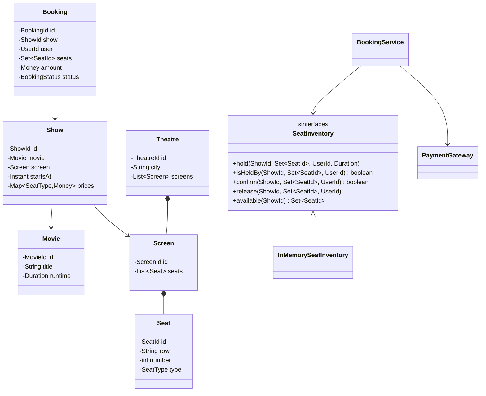
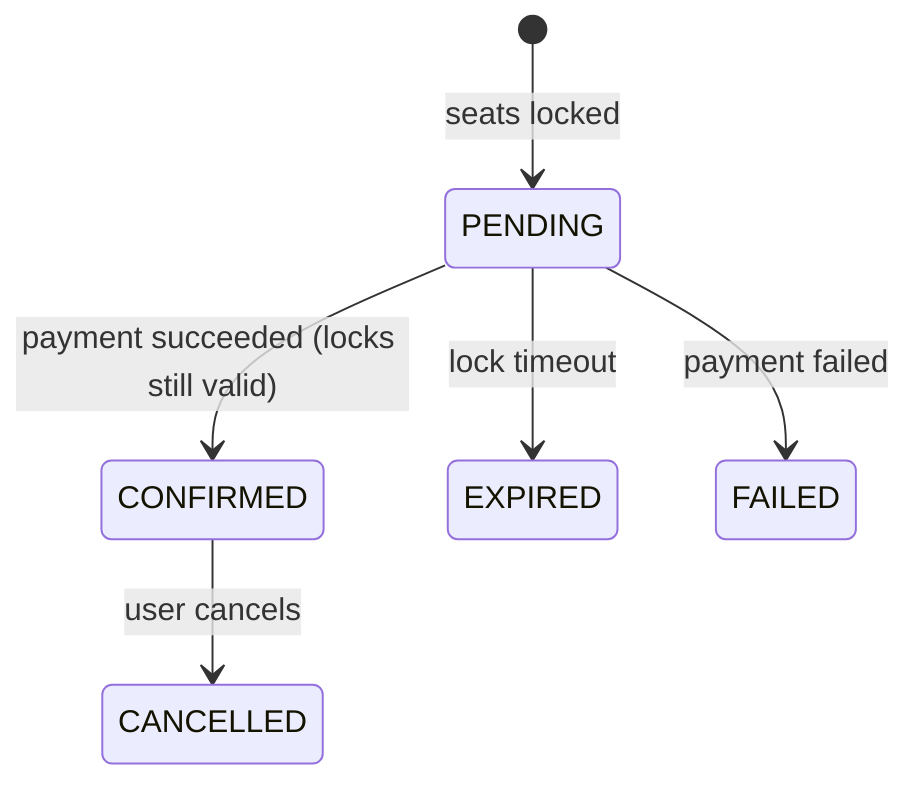

<Related ids={['concurrency-for-lld', 'state-pattern', 'strategy-pattern', 'observer-pattern', 'interview-grade-code']} />

BookMyShow-style booking is the LLD problem where **concurrency is the whole point**: many users select the same seats for a popular show at the same moment, and the design must guarantee no double booking while letting users hold seats during payment. (The large-scale version is the HLD case study [Design a Ticket Booking System](/system-design/hld/design-ticket-booking); this is the in-process object design.)

## What the interviewer expects

The full design in this lesson is longer than anything you'd write in one round. It's there so you understand the edge cases and can answer follow-up questions. In the round itself, aim for this:

<InterviewScope minutes="45–60" lines="50" write={["Seats with FREE, HELD and BOOKED states", "Hold seats all-or-nothing, with an expiry", "Confirm only if the hold is still yours"]} say={["Taking payment between hold and confirm, outside the lock", "A lock per show instead of one global lock", "Pricing by seat type or time as a strategy"]} skip={["Cinema and movie admin", "Coupons and refunds", "Search and listings"]} />

### The interview-sized version

The heart of the problem: holding seats safely while two users race for the same one. It's about **50 lines**, and it compiles and runs.

```java
enum SeatState { FREE, HELD, BOOKED }

class Seat {
    final String id;
    SeatState state = SeatState.FREE;
    String heldBy;
    long holdUntil;

    Seat(String id) { this.id = id; }

    boolean availableAt(long now) {                   // an expired hold counts as free
        return state == SeatState.FREE || (state == SeatState.HELD && now >= holdUntil);
    }
}

class Show {
    static final long HOLD_MILLIS = 10 * 60 * 1000;   // seats are held for 10 minutes while the user pays
    private final Map<String, Seat> seats = new LinkedHashMap<>();

    Show(List<String> seatIds) { seatIds.forEach(id -> seats.put(id, new Seat(id))); }

    // synchronized: two users can never hold the same seat
    synchronized boolean hold(String user, List<String> seatIds, long now) {
        List<Seat> wanted = seatIds.stream().map(this::seat).toList();
        if (!wanted.stream().allMatch(s -> s.availableAt(now))) return false;   // all or nothing
        for (Seat s : wanted) { s.state = SeatState.HELD; s.heldBy = user; s.holdUntil = now + HOLD_MILLIS; }
        return true;
    }

    synchronized void confirm(String user, List<String> seatIds, long now) {   // called after payment succeeds
        List<Seat> wanted = seatIds.stream().map(this::seat).toList();
        for (Seat s : wanted)
            if (s.state != SeatState.HELD || !user.equals(s.heldBy) || now >= s.holdUntil)
                throw new IllegalStateException("Seat " + s.id + " is no longer held for " + user);
        for (Seat s : wanted) s.state = SeatState.BOOKED;
    }

    synchronized List<String> available(long now) {
        return seats.values().stream().filter(s -> s.availableAt(now)).map(s -> s.id).toList();
    }

    private Seat seat(String id) {
        Seat s = seats.get(id);
        if (s == null) throw new IllegalArgumentException("No seat " + id);
        return s;
    }
}
```

<Callout type="tip" title="How to use the rest of this lesson">
Practise writing the short version above, in your own words, until you can do it in about 30 minutes. Then read the full design below for the edge cases and follow-up answers. Interviewers often ask about those, but they rarely ask you to type them all.
</Callout>

## 1. Requirements

- Browse cities → theatres → screens → shows (movie, start time, screen).
- View a show's seat map with seat types (REGULAR, PREMIUM, RECLINER) and availability.
- Select seats and **lock** them for a limited time (e.g., 5 minutes) while paying.
- Pay; on success, the booking is confirmed and seats are booked; on failure or timeout, locks are released.
- Cancel a confirmed booking (refund rules as an extension).
- **No two users can book the same seat**; locked seats appear unavailable to others.

## 2. Domain model



Important distinction: a **Seat** belongs to a screen and never changes; **seat availability is per show**. The same physical seat is free for the 6 PM show and booked for the 9 PM show. So booking state lives in `(show, seat)` pairs, not on `Seat`.

## 3. Booking lifecycle



## 4. Seat inventory — the core

One object owns **all** seat state for a show — temporary holds *and* confirmed bookings — behind **one lock per show**. Keeping both under the same lock is the point: if holds lived in one structure and bookings in another, each with its own lock, a hold could be granted for a seat that another thread is confirming at that very moment.

<FullCode title="Show the full code: Seat inventory — the core (68 lines)">

```java
public interface SeatInventory {
    void hold(ShowId show, Set<SeatId> seats, UserId user, Duration ttl);   // all or nothing
    boolean isHeldBy(ShowId show, Set<SeatId> seats, UserId user);
    boolean confirm(ShowId show, Set<SeatId> seats, UserId user);           // held by user → booked, atomically
    void release(ShowId show, Set<SeatId> seats, UserId user);
    Set<SeatId> available(ShowId show);
}

public final class InMemorySeatInventory implements SeatInventory {
    private record Hold(UserId user, Instant expiresAt) {
        boolean isExpired(Instant now) { return !now.isBefore(expiresAt); }
    }

    private static final class ShowSeats {                  // guarded by its own monitor
        final Set<SeatId> all;
        final Map<SeatId, Hold> holds = new HashMap<>();
        final Set<SeatId> booked = new HashSet<>();
        ShowSeats(Set<SeatId> all) { this.all = Set.copyOf(all); }
    }

    private final Map<ShowId, ShowSeats> shows = new ConcurrentHashMap<>();
    private final Clock clock;

    public InMemorySeatInventory(Clock clock) { this.clock = clock; }

    @Override public void hold(ShowId show, Set<SeatId> wanted, UserId user, Duration ttl) {
        ShowSeats s = seats(show);
        synchronized (s) {                                    // check every seat, then set every seat
            Instant now = clock.instant();
            for (SeatId seat : wanted) {
                if (!s.all.contains(seat)) throw new InvalidSelectionException("Unknown seat " + seat);
                if (s.booked.contains(seat)) throw new SeatUnavailableException(seat);
                Hold h = s.holds.get(seat);
                if (h != null && !h.isExpired(now) && !h.user().equals(user)) throw new SeatUnavailableException(seat);
            }
            Hold hold = new Hold(user, now.plus(ttl));
            wanted.forEach(seat -> s.holds.put(seat, hold));
        }
    }

    @Override public boolean confirm(ShowId show, Set<SeatId> wanted, UserId user) {
        ShowSeats s = seats(show);
        synchronized (s) {
            if (!heldBy(s, wanted, user, clock.instant())) return false;   // lapsed or taken over
            wanted.forEach(seat -> { s.holds.remove(seat); s.booked.add(seat); });
            return true;
        }
    }

    @Override public void release(ShowId show, Set<SeatId> wanted, UserId user) {
        ShowSeats s = seats(show);
        synchronized (s) {
            wanted.forEach(seat -> {
                Hold h = s.holds.get(seat);
                if (h != null && h.user().equals(user)) s.holds.remove(seat);   // only the owner releases
            });
        }
    }

    private static boolean heldBy(ShowSeats s, Set<SeatId> wanted, UserId user, Instant now) {
        for (SeatId seat : wanted) {
            Hold h = s.holds.get(seat);
            if (h == null || h.isExpired(now) || !h.user().equals(user)) return false;
        }
        return true;
    }
    // isHeldBy and available follow the same pattern under the same monitor; seats(show) looks up or throws
}
```

</FullCode>

Design points:

- **All-or-nothing**: either all requested seats are held or none (no partial selections left dangling).
- **Granularity**: one monitor **per show** — users booking different shows never contend; within one show, check-then-set is atomic.
- **Expiry is lazy**: an expired hold is treated as free on the next check; a background sweeper can clean them up.
- Seat state is behind an **interface**, so a distributed implementation (Redis `SET NX PX` per seat with a Lua script for multi-seat holds, or conditional `UPDATE`s on seat rows) can replace it without changing the booking service.

## 5. Booking service

<FullCode title="Show the full code: Booking service (43 lines)">

```java
public final class BookingService {
    private final SeatInventory inventory;
    private final BookingRepository bookings;
    private final PaymentGateway payments;
    private final PricingStrategy pricing;
    private final Duration holdTtl = Duration.ofMinutes(5);

    public Booking holdSeats(UserId user, ShowId show, Set<SeatId> seats) {
        if (seats.isEmpty() || seats.size() > 10) throw new InvalidSelectionException("1–10 seats per booking");
        inventory.hold(show, seats, user, holdTtl);            // atomic: unknown, booked or held → throws
        Booking booking = Booking.pending(show, user, seats, pricing.price(show, seats));
        bookings.save(booking);
        return booking;
    }

    public Booking confirm(BookingId id, PaymentDetails paymentDetails) {
        Booking b = bookings.get(id);
        if (b.status() != BookingStatus.PENDING) throw new IllegalStateException("Booking is " + b.status());

        // 1. Don't charge for a hold that has already lapsed
        if (!inventory.isHeldBy(b.show(), b.seats(), b.user())) {
            b.markExpired();
            throw new BookingExpiredException(id);
        }

        // 2. Charge outside any lock; the booking id is the idempotency key
        PaymentResult result = payments.charge(b.amount(), paymentDetails, id.value());
        if (!result.success()) {
            b.markFailed();
            inventory.release(b.show(), b.seats(), b.user());
            return b;
        }

        // 3. Hold → booked atomically; if the hold lapsed *during* payment, compensate
        if (!inventory.confirm(b.show(), b.seats(), b.user())) {
            b.markExpired();
            payments.refund(result.paymentId());
            throw new BookingExpiredException(id);
        }
        b.markConfirmed(result.paymentId());
        return b;
    }
}
```

</FullCode>

The subtle case interviewers probe: **payment completes after the hold expired** and another user grabbed the seat. Step 1 avoids charging when the hold is already gone; step 3 catches the rarer case where it lapses mid-payment, and refunds. Keeping the hold TTL comfortably longer than the payment provider's timeout makes step 3 very rare.

## 6. Pricing and other variation points

- `PricingStrategy` — base price by seat type, plus weekend/prime-time surcharges, dynamic pricing, offers (decorators: `WeekendSurcharge(new SeatTypePricing(...))`).
- `PaymentGateway` — adapters for different providers.
- `NotificationService` — observers for booking confirmed/cancelled (email, SMS).
- `CancellationPolicy` — refund percentage by time before the show.

## 7. Patterns used

| Pattern | Where |
| --- | --- |
| **Strategy** | `PricingStrategy`, `CancellationPolicy`, `SeatInventory` implementations (in-memory, Redis, database) |
| **State** | `BookingStatus` transitions (PENDING → CONFIRMED/EXPIRED/FAILED → CANCELLED) |
| **Observer** | Notifications on booking events |
| **Adapter** | Payment gateway integrations |
| **Facade** | `BookingService` |

## Interview questions

<QA q="How do you prevent two users from booking the same seat?">
Keep all seat state for a show — holds and bookings — in one place guarded by one lock per show (or, distributed, conditional writes per seat). Holding is check-then-set for every requested seat, all-or-nothing, with an owner and expiry. Confirmation moves seats from held to booked under the same lock, only if the user still holds every one. Using the same lock for both steps is what rules out a hold being granted on a seat that is being booked at the same moment.
</QA>

<QA q="What happens if the user's seat lock expires while they're paying?">
First, check the hold before charging: if it has already lapsed, mark the booking expired without taking money. If it lapses while the payment is in flight and another user books the seats, the final atomic confirm fails; mark the booking expired and refund (a compensating action). To make this rare, set the hold TTL longer than the payment provider's timeout and show a countdown in the UI.
</QA>

<QA q="How would this design change for multiple application servers?">
In-memory locks only work within one process. Replace the SeatInventory with a shared implementation: Redis keys per (show, seat) set with NX and an expiry (with a Lua script for all-or-nothing multi-seat locking), or conditional updates on seat rows in a database (UPDATE … WHERE status = 'AVAILABLE'), with a unique constraint on (show, seat) for confirmed bookings as the final guarantee. Because locking is behind an interface, the booking service doesn't change.
</QA>

<Practice task="Expired holds are only cleaned up lazily. Add a sweeper that frees them and marks PENDING bookings as EXPIRED. What race must it handle?">

A scheduled task iterates shows (or a priority queue of hold expiries), and under each show's lock removes holds whose expiry has passed and marks the matching `PENDING` bookings `EXPIRED`. The race: a user whose payment just succeeded may be calling `confirm` at the same moment. Because `confirm` moves seats from held to booked under the same per-show lock and checks expiry there, whichever runs first wins cleanly — if the sweeper wins, confirm fails and refunds; if confirm wins, the sweeper finds no hold to expire.

</Practice>

<Practice task="Add a rule: a selection may not leave a single empty seat between booked or held seats in the same row. Where does the check go?">

Into the hold step, inside the per-show lock, because it depends on the current state of neighbouring seats: after tentatively adding the requested seats, scan the affected rows and reject if any free seat would have both neighbours occupied (row ends count as walls). Make it a pluggable `SeatSelectionRule` so cinemas can turn it off. Doing the check outside the lock would let two users each create a gap the other's check didn't see.

</Practice>

<Takeaways>

- Seat availability belongs to (show, seat), not to the physical seat.
- Lock all requested seats atomically with an owner and TTL; lock per show for low contention.
- Re-validate on confirmation and compensate (refund) if the hold was lost.
- Keep locking, pricing and payment behind interfaces so they scale or change independently.

</Takeaways>

## Further reading

- [Concurrency for LLD](/system-design/lld/concurrency-for-lld), [State](/system-design/lld/state-pattern).
- HLD view: [Design a Ticket Booking System](/system-design/hld/design-ticket-booking).
