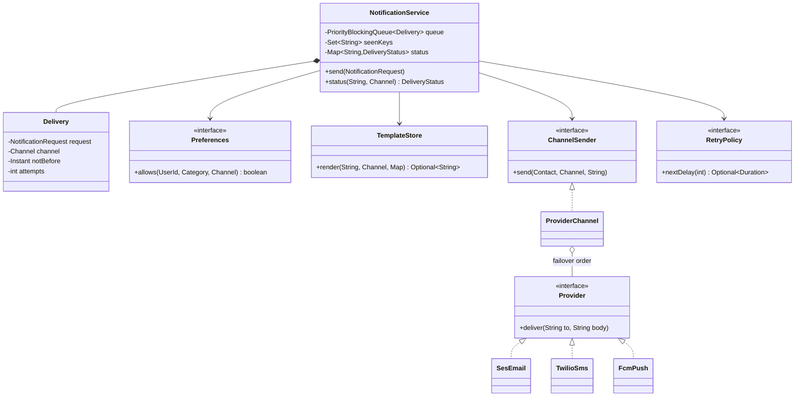

<Related ids={['adapter-pattern', 'chain-of-responsibility-pattern', 'strategy-pattern', 'observer-pattern', 'concurrency-for-lld']} />

"Design a notification service" is asked as LLD at most product companies because every one of them has built one. The object design is simple — request, channels, templates — but the interviewer listens for the **policies**: user preferences, quiet hours, rate limits, deduplication, priority (an OTP must not wait behind a marketing blast), provider failover, retries and dead letters. The distributed version is the HLD case [Design a Notification System](/system-design/hld/design-notification-system); this is the in-process design.

## 1. Requirements

| Question | Assumption |
| --- | --- |
| Channels | Email, SMS, push; more later |
| Request | User, template name, parameters, category, channels, **idempotency key** |
| Categories | `CRITICAL` (OTP), `TRANSACTIONAL` (order shipped), `MARKETING` — also the priority order |
| Preferences | Users can opt out per category and channel; can't opt out of critical messages |
| Quiet hours | No marketing between 22:00 and 08:00 user-local time — **defer**, don't drop |
| Rate limit | At most N marketing messages per user per day |
| Delivery | Asynchronous; providers fail — fail over to a backup provider, retry with backoff, then dead-letter |
| Visibility | Status per (request, channel): sent, skipped (and why), deferred, retrying, failed |

## 2. Design



Two important modelling choices:

- **A request fans out into one `Delivery` per channel.** Each delivery has its own status, retry count and schedule — email can succeed while SMS retries.
- **`send()` only validates and enqueues.** All policy checks happen when a worker processes the delivery, so a quiet-hours message can be deferred and re-checked later.

## 3. Accepting requests: idempotency first

```java
public void send(NotificationRequest r) {
    if (!seenKeys.add(r.idempotencyKey())) return;          // a retried API call doesn't notify twice
    for (Channel ch : r.channels()) {
        var d = new Delivery(r, ch, seq.incrementAndGet(), clock.instant());
        status.put(d.key(), DeliveryStatus.QUEUED);
        queue.add(d);
    }
}
```

`Set.add` on a concurrent set is atomic, so two threads submitting the same key can't both enqueue. In production the seen-keys set needs a TTL (a day is typical) or it grows forever.

## 4. Priority: an OTP never waits behind marketing

The queue is a `PriorityBlockingQueue` ordered by category, then arrival:

```java
public int compareTo(Delivery o) {
    int c = request.category().compareTo(o.request.category());   // CRITICAL < TRANSACTIONAL < MARKETING
    return c != 0 ? c : Long.compare(seq, o.seq);                 // FIFO within a category
}
```

A single priority queue is the simplest correct answer. The usual refinement is **separate queues (and worker pools) per priority**, so a flood of marketing can't even occupy all the workers — with a small reserved pool for critical traffic.

## 5. Processing a delivery: the policy pipeline

```java
private void process(Delivery d) {
    NotificationRequest r = d.request;
    try {
        if (!prefs.allows(r.user(), r.category(), d.channel)) { finish(d, SKIPPED_PREFERENCE); return; }
        if (r.category() == MARKETING && inQuietHours()) {               // defer, don't drop
            d.notBefore = nextMorning();
            status.put(d.key(), DEFERRED);
            queue.add(d);
            return;
        }
        if (r.category() == MARKETING && d.attempts == 0 && !marketingCap.tryAcquire(r.user())) {
            finish(d, SKIPPED_RATE_LIMIT); return;
        }
        String body = templates.render(r.template(), d.channel, r.params())
                .orElseThrow(() -> new IllegalArgumentException("No " + d.channel + " template for " + r.template()));
        senders.get(d.channel).send(contacts.apply(r.user()), d.channel, body);
        finish(d, SENT);
    } catch (IllegalArgumentException permanent) {                        // bad request: retrying won't help
        deadLetters.add(d);
        finish(d, FAILED);
    } catch (DeliveryException transientFailure) {                        // provider trouble: retry with backoff
        Optional<Duration> delay = retry.nextDelay(++d.attempts);
        if (delay.isPresent()) {
            d.notBefore = clock.instant().plus(delay.get());
            status.put(d.key(), RETRY_SCHEDULED);
            queue.add(d);
        } else {
            deadLetters.add(d);
            finish(d, FAILED);
        }
    }
}
```

Points worth saying out loud:

- **Order of checks matters**: preferences, then quiet hours, then the rate limit — so a message that is deferred or opted out doesn't consume the user's daily marketing budget. A retry doesn't consume it again either (`attempts == 0`).
- **Permanent vs transient failures**: a missing template or an invalid phone number won't succeed on retry, so fail fast; a provider timeout will, so back off. Mixing them up either spams retries or drops recoverable messages.
- **Every outcome is recorded** with a reason — "why didn't I get my OTP?" is the most common support question for this system.

This chain of checks could equally be modelled as a list of `DeliveryFilter` objects (Chain of Responsibility) when the number of policies grows.

## 6. Channels and providers: Adapter + failover chain

Each vendor SDK (SES, Twilio, FCM) gets an **adapter** implementing one small `Provider` interface. A channel tries its providers in order:

```java
public final class ProviderChannel implements ChannelSender {
    private final List<Provider> providers;                       // primary first, then backups

    public void send(Contact to, Channel ch, String body) {
        String address = switch (ch) { case EMAIL -> to.email(); case SMS -> to.phone(); case PUSH -> to.deviceToken(); };
        DeliveryException last = null;
        for (Provider p : providers) {
            try { p.deliver(address, body); return; }
            catch (DeliveryException e) { last = e; }             // try the next provider
        }
        throw last != null ? last : new DeliveryException("no provider");
    }
}
```

A refinement: a **circuit breaker** per provider, so after repeated failures the channel skips the dead provider for a while instead of paying its timeout on every message.

## 7. Concurrency

| Shared state | Protection |
| --- | --- |
| Queue | `PriorityBlockingQueue` (thread-safe; workers `poll` with a timeout) |
| Idempotency keys | Concurrent set; `add` is the atomic check-and-insert |
| Status map | `ConcurrentHashMap` |
| Daily caps | `ConcurrentHashMap.computeIfAbsent` + `AtomicInteger` per user-day |
| Providers | Must be thread-safe or pooled — usually HTTP clients that are |

The reference solution submits 2,000 requests from 8 threads (every idempotency key twice) to 4 workers and checks exactly 1,000 unique deliveries.

## 8. Patterns used

| Pattern | Where |
| --- | --- |
| **Adapter** | One `Provider` per vendor SDK |
| **Chain of Responsibility** | Provider failover; optionally the policy filters |
| **Strategy** | `RetryPolicy`, `Preferences` and rate-limit implementations |
| **Producer–consumer** | `send()` enqueues; workers deliver |
| **Observer** (upstream) | Domain events (order shipped) trigger notification requests |

## 9. Extensions

- **Digesting**: batch low-priority messages per user into one daily email (a scheduled job reading a per-user buffer).
- **Delivery receipts**: providers call back with delivered/opened; update status by provider message id.
- **Localisation**: templates keyed by (name, channel, locale); fall back to a default locale.
- **Durability**: replace the in-memory queue with a broker so accepted requests survive a crash (the HLD version).

## Interview questions

<QA q="How do you make sure a user doesn't receive the same notification twice?">
Require an idempotency key on every request and record keys you've accepted in a set with a TTL; a repeated key is acknowledged but not enqueued again. The check-and-insert must be atomic — a concurrent set's add, or a conditional write in a shared store when there are several servers. Deliveries are also tracked per (key, channel), so a retry of one failed channel never resends the others.
</QA>

<QA q="A marketing campaign enqueues 5 million messages. How do OTPs still go out in seconds?">
Prioritise by category: either one priority queue ordered by category then arrival, or — better at scale — separate queues and worker pools per priority, with capacity reserved for critical traffic. Marketing can also be rate-limited at enqueue time so it trickles out instead of flooding.
</QA>

<QA q="What happens when the SMS provider is down?">
The SMS channel fails over to the next configured provider. If all providers fail, the delivery is retried with exponential backoff; after the maximum attempts it goes to a dead-letter queue with its error, and its status is visible. Permanent errors such as an invalid number skip retries. A circuit breaker avoids hammering a provider that is clearly down.
</QA>

<Practice task="Add per-channel provider cost routing: send SMS via the cheapest provider that supports the destination country, falling back to others. What changes?">

Replace the fixed provider order with a `ProviderSelector` strategy: given the destination (country code from the phone number) it returns providers sorted by cost among those that support it. `ProviderChannel` iterates the selector's list instead of a fixed list. Costs and coverage come from configuration, so pricing changes need no code change. Keep the circuit-breaker state per provider so an unhealthy cheap provider is skipped.

</Practice>

<Practice task="Users complain about getting 5 order-update pushes in 2 minutes. Design 'collapse within a window': only the latest update per order is sent if several arrive within 60 seconds.">

Give such requests a collapse key (for example `order:O-9`). On enqueue, instead of adding a new delivery, look up a pending delivery with the same collapse key (a map from key to delivery) and replace its parameters, keeping its original send time; schedule the first one with `notBefore = now + 60s`. When the delivery is processed, remove the collapse-key entry. This needs an atomic replace-or-insert (`ConcurrentHashMap.compute`). Push providers offer a similar feature natively (FCM collapse keys).

</Practice>

<Takeaways>

- One request fans out into one delivery per channel, each with its own status and retries.
- Enforce idempotency at intake; order work by priority so critical messages never wait behind bulk traffic.
- Apply policies in order — preferences, quiet hours (defer), rate limits — and record every outcome with a reason.
- Adapters per vendor with a failover chain; transient failures retry with backoff, permanent ones fail fast; dead-letter what can't be delivered.

</Takeaways>

## Further reading

- HLD view: [Design a Notification System](/system-design/hld/design-notification-system).
- Michael T. Nygard, *Release It!* (2nd ed., 2018) — circuit breakers, timeouts and bulkheads.
