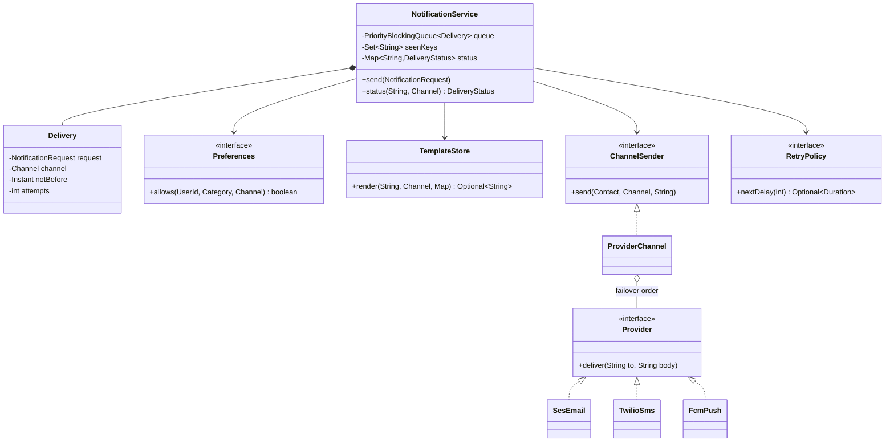

<Related ids={['adapter-pattern', 'chain-of-responsibility-pattern', 'strategy-pattern', 'observer-pattern', 'concurrency-for-lld']} />

Every product company has a notification service: the thing that sends your OTP by SMS, "your order has shipped" by push, and the weekend sale email. The classes are simple (a request, some channels, some templates). What the interviewer is really listening for are the **rules around sending**:

- Don't send the same message twice.
- Respect users who've opted out.
- Don't send marketing at 2 am.
- An OTP must never wait behind a million marketing emails.
- When an SMS provider is down, try another one, then retry later.

(The version spread across many servers is the HLD case [Design a Notification System](/system-design/hld/design-notification-system). This is the in-process design.)

We'll use the same six steps as every case study: requirements, entities, class design, code, a worked example, and follow-ups. (The [parking lot](/system-design/lld/lld-parking-lot) lesson explains the plan in detail.)

## Step 1: Pin down the requirements

<Dialogue>
<Turn who="you">Which channels?</Turn>
<Turn who="them">Email, SMS and push. More later.</Turn>
<Turn who="you">What does a caller send us?</Turn>
<Turn who="them">The user, a template name with values to fill in, which channels, and what kind of message it is.</Turn>
<Turn who="you">What kinds?</Turn>
<Turn who="them">Critical, like OTPs; transactional, like "order shipped"; and marketing.</Turn>
<Turn who="you">Can users opt out?</Turn>
<Turn who="them">Of marketing and transactional, per channel. Never of critical messages.</Turn>
<Turn who="you">Any rules about timing or volume?</Turn>
<Turn who="them">No marketing between 10 pm and 8 am, and at most a few marketing messages per user per day.</Turn>
<Turn who="you">If the caller's request times out and they retry, should the user get it twice?</Turn>
<Turn who="them">Definitely not.</Turn>
<Turn who="you">And when a provider like the SMS gateway is down?</Turn>
<Turn who="them">Try a backup provider. Retry later. Don't lose messages silently.</Turn>
</Dialogue>

**The service must:**

1. Send a message to a user on one or more channels (email, SMS, push).
2. Send each request **once**, even if the caller retries.
3. Respect opt-outs, except for critical messages.
4. **Defer** (not drop) marketing during quiet hours, and cap marketing per user per day.
5. Send critical messages first, ahead of everything else.
6. Fail over to a backup provider, retry with growing delays, and set aside messages that can't be delivered.
7. Record what happened to every message, and why.

**Out of scope for now:** delivery receipts, analytics, provider SDK details.

## Step 2: Find the core entities

| Noun | Make it… | Why |
| --- | --- | --- |
| Notification request | a record | User, template, values, category, channels and an **idempotency key**. |
| Channel | an enum | `EMAIL`, `SMS`, `PUSH`. |
| Category | an enum, in priority order | `CRITICAL`, `TRANSACTIONAL`, `MARKETING`. The order doubles as the priority. |
| Delivery | a class | **One per channel** per request: its own status, retry count and "not before" time. |
| Sender for a channel | an interface `ChannelSender` | How to send on that channel. |
| Provider (SES, Twilio, FCM) | an interface `Provider`, one **adapter** per vendor | Each vendor's SDK looks different; the adapter makes them look the same. |
| Preferences | an interface | Who opted out of what. |
| Retry rule | an interface `RetryPolicy` | How long to wait before trying again, and when to give up. |
| Notification service | a class | Takes requests, queues them, and has workers that process them. |

One modelling choice matters a lot:

<Approach verdict="bad" title="One status per request">

A request for email and SMS gets one status. Email succeeds, SMS fails. Is the request "sent" or "failed"? And if you retry the request, the user gets the email twice.

</Approach>

<Approach verdict="great" title="One delivery per channel">

The request **fans out** into one `Delivery` per channel. Each has its own status and retries: email can be `SENT` while SMS is `RETRY_SCHEDULED`. Retrying SMS never resends the email.

</Approach>

## Step 3: Design each class

The service has two halves:

**Accepting a request** (`send`) does as little as possible: check the idempotency key, create a delivery per channel, put them on a queue, return. The caller isn't kept waiting for providers.

**Processing a delivery** happens on worker threads, which take deliveries off the queue and run them through the rules:

1. Has the user opted out of this category on this channel? → skip, recording why.
2. Is it marketing during quiet hours? → put it back with "not before 8 am".
3. Is it marketing and over today's cap? → skip, recording why.
4. Fill in the template and send through the channel.
5. If sending fails: a **permanent** problem (bad template, invalid number) fails at once; a **temporary** one (provider timeout) is retried later with a growing delay, and after too many attempts goes to a **dead-letter** list.

How do critical messages jump the line?

<Approach verdict="bad" title="One first-in, first-out queue">

A marketing campaign adds 5 million emails. An OTP added a second later waits behind all of them. The user has given up long before it arrives.

</Approach>

<Approach verdict="good" title="One priority queue">

Order the queue by category, then by arrival time. The OTP goes straight to the front. Simple and correct.

</Approach>

<Approach verdict="great" title="Separate queues and workers per priority">

Even with a priority queue, a flood of marketing can keep **every worker busy** with slow sends. Give critical messages their own queue and a small reserved pool of workers, so they're never stuck waiting for a free worker.

</Approach>



## Step 4: Write the code

<InterviewScope minutes="45–60" lines="30" write={["A `Sender` per channel (email, SMS, push)", "Idempotency: the same request id is sent once", "Opt-outs and a few retries"]} say={["Priority queues so an OTP never waits behind marketing", "Templates, quiet hours and daily caps", "Falling back to a second provider"]} skip={["Provider SDK details", "Delivery receipts and analytics"]} />

### The interview-sized version

Channels behind one interface, sent once per request id, with opt-outs and retries. It's about **30 lines**, and it compiles and runs.

```java
enum Channel { EMAIL, SMS, PUSH }
enum Status { SENT, DUPLICATE, SKIPPED, FAILED }

record Notification(String id, String userId, Channel channel, String message) { }

interface Sender { void send(String userId, String message); }    // one per channel; wraps a provider (Adapter)

class NotificationService {
    private final Map<Channel, Sender> senders;
    private final int maxAttempts;
    private final Set<String> seenIds = ConcurrentHashMap.newKeySet();           // idempotency
    private final Map<String, Set<Channel>> optedOut = new ConcurrentHashMap<>();

    NotificationService(Map<Channel, Sender> senders, int maxAttempts) { this.senders = senders; this.maxAttempts = maxAttempts; }

    void optOut(String userId, Channel channel) {
        optedOut.computeIfAbsent(userId, id -> ConcurrentHashMap.newKeySet()).add(channel);
    }

    Status send(Notification n) {
        if (!seenIds.add(n.id())) return Status.DUPLICATE;                       // a retried request is sent once
        if (optedOut.getOrDefault(n.userId(), Set.of()).contains(n.channel())) return Status.SKIPPED;
        Sender sender = senders.get(n.channel());
        for (int attempt = 1; attempt <= maxAttempts; attempt++) {
            try {
                sender.send(n.userId(), n.message());
                return Status.SENT;
            } catch (RuntimeException e) {
                // try again; a real system waits longer each time (back-off)
            }
        }
        return Status.FAILED;                                                    // the full design keeps it in a dead-letter list
    }
}
```

**Reading it top to bottom:**

1. **`Sender`** is one interface for every channel. Each implementation would wrap a vendor's SDK.
2. **`seenIds.add(n.id())`** returns `false` if the id was already there. It's a concurrent set, so "check and record" is one atomic step: two threads with the same id can't both get through.
3. Opted-out users are **skipped**, not failed, and the status says so.
4. The sender is tried up to `maxAttempts` times. A real system would wait longer between each try (back-off).
5. Every path returns a clear `Status`. "Why didn't I get my OTP?" is the most common support question, so the answer must exist.

<Callout type="tip" title="How to practise this">
List the rules out loud in the order you'd check them (duplicate, opt-out, quiet hours, cap, send, retry) before writing anything. The order is half the answer.
</Callout>

### Growing it into the full design

#### Accepting a request: idempotency first

```java
public void send(NotificationRequest r) {
    if (!seenKeys.add(r.idempotencyKey())) return;          // a retried API call doesn't notify twice
    for (Channel ch : r.channels()) {
        var d = new Delivery(r, ch, seq.incrementAndGet(), clock.instant());
        status.put(d.key(), DeliveryStatus.QUEUED);
        queue.add(d);
    }
}
```

In production, the set of seen keys needs an expiry (a day is typical), or it grows forever.

#### Priority: an OTP never waits behind marketing

The queue is a `PriorityBlockingQueue`. Deliveries compare first by category (the enum order: critical, transactional, marketing), then by arrival number, so it's first-come, first-served within a category:

```java
public int compareTo(Delivery o) {
    int c = request.category().compareTo(o.request.category());   // CRITICAL < TRANSACTIONAL < MARKETING
    return c != 0 ? c : Long.compare(seq, o.seq);                 // FIFO within a category
}
```

#### Processing a delivery: the rules, in order

```java
private void process(Delivery d) {
    NotificationRequest r = d.request;
    try {
        if (!prefs.allows(r.user(), r.category(), d.channel)) { finish(d, SKIPPED_PREFERENCE); return; }
        if (r.category() == MARKETING && inQuietHours()) {               // defer, don't drop
            d.notBefore = nextMorning();
            status.put(d.key(), DEFERRED);
            queue.add(d);
            return;
        }
        if (r.category() == MARKETING && d.attempts == 0 && !marketingCap.tryAcquire(r.user())) {
            finish(d, SKIPPED_RATE_LIMIT); return;
        }
        String body = templates.render(r.template(), d.channel, r.params())
                .orElseThrow(() -> new IllegalArgumentException("No " + d.channel + " template for " + r.template()));
        senders.get(d.channel).send(contacts.apply(r.user()), d.channel, body);
        finish(d, SENT);
    } catch (IllegalArgumentException permanent) {                        // bad request: retrying won't help
        deadLetters.add(d);
        finish(d, FAILED);
    } catch (DeliveryException transientFailure) {                        // provider trouble: retry with backoff
        Optional<Duration> delay = retry.nextDelay(++d.attempts);
        if (delay.isPresent()) {
            d.notBefore = clock.instant().plus(delay.get());
            status.put(d.key(), RETRY_SCHEDULED);
            queue.add(d);
        } else {
            deadLetters.add(d);
            finish(d, FAILED);
        }
    }
}
```

Points to say out loud:

- **The order of checks matters.** Preferences, then quiet hours, then the daily cap. A message that's deferred or opted out shouldn't use up the user's marketing allowance. A retry doesn't use it again either (`attempts == 0`).
- **Permanent and temporary failures are handled differently.** A missing template will never succeed, so retrying just wastes time. A provider timeout probably will, so wait and retry. Mixing them up either spams retries or drops messages that could have been delivered.
- **Every outcome is recorded with a reason.**

When there are many rules, this chain of checks can become a list of `DeliveryFilter` objects, each passing the delivery to the next (Chain of Responsibility).

#### Providers: adapters and failover

Each vendor's SDK gets an **adapter** that implements one small `Provider` interface (`deliver(to, body)`). A channel holds its providers in order, primary first, and tries the next one when one fails:

```java
public final class ProviderChannel implements ChannelSender {
    private final List<Provider> providers;                       // primary first, then backups

    public void send(Contact to, Channel ch, String body) {
        String address = switch (ch) { case EMAIL -> to.email(); case SMS -> to.phone(); case PUSH -> to.deviceToken(); };
        DeliveryException last = null;
        for (Provider p : providers) {
            try { p.deliver(address, body); return; }
            catch (DeliveryException e) { last = e; }             // try the next provider
        }
        throw last != null ? last : new DeliveryException("no provider");
    }
}
```

A good refinement is a **circuit breaker** per provider: after several failures in a row, skip that provider for a while instead of waiting for its timeout on every message.

#### Concurrency

| Shared state | Protection |
| --- | --- |
| The queue | `PriorityBlockingQueue` (thread-safe; workers `poll` with a timeout) |
| Idempotency keys | A concurrent set; `add` is the atomic check-and-record |
| The status map | `ConcurrentHashMap` |
| Daily caps | `ConcurrentHashMap.computeIfAbsent` + an `AtomicInteger` per user per day |
| Providers | Must be thread-safe; usually HTTP clients, which are |

The reference solution submits 2,000 requests from 8 threads (every key twice) to 4 workers, and checks that exactly 1,000 unique deliveries go out.

## Step 5: Trace a busy evening

It's 11 pm. A marketing campaign has just queued 50,000 emails.

1. Asha logs in and needs an OTP. Her request (`CRITICAL`, SMS, key `otp-123`) is accepted and goes to the **front** of the queue.
2. Her app times out and retries with the same key `otp-123`. `seenKeys.add` returns false: nothing new is queued.
3. A worker picks up the OTP. Critical messages ignore opt-outs and quiet hours. It's sent through the primary SMS provider, which times out, so the channel fails over to the backup, which succeeds. Status: `SENT`.
4. A worker picks up a marketing email for Ben. It's 11 pm, quiet hours, so it's **deferred** to 8 am and put back in the queue. Ben's daily cap isn't touched.
5. At 8 am the email is processed again: Ben hasn't opted out, he's under his cap, it's sent.
6. A marketing push for Chen uses a template that doesn't exist for push. That's permanent: no retries, straight to the dead-letter list with the reason.

## Step 6: Handle follow-up questions

**"Route SMS through the cheapest provider for the destination country."** Replace the fixed provider order with a `ProviderSelector` strategy that returns providers sorted by cost among those supporting that country.

**"Five order updates in 2 minutes is annoying. Only send the latest."** Give such requests a collapse key (`order:O-9`). When a new one arrives, replace the pending delivery's content instead of adding another, and delay the first by 60 seconds. Use `ConcurrentHashMap.compute` for the atomic replace-or-insert.

**"Send one daily digest instead of many low-priority emails."** Buffer them per user and let a scheduled job send one combined email.

**"Different languages."** Key templates by (name, channel, language), with a default language as fallback.

**"Survive a crash."** Replace the in-memory queue with a message broker so accepted requests aren't lost. That's the HLD version.

## Common mistakes

- **One status per request** instead of one per channel.
- **No idempotency**, so retried API calls send duplicate OTPs.
- **A plain first-in, first-out queue**, so OTPs wait behind campaigns.
- **Dropping marketing during quiet hours** instead of deferring it.
- **Retrying permanent failures**, or not retrying temporary ones.
- **Not recording why a message wasn't sent.**

## Patterns used

| Pattern | Where |
| --- | --- |
| **Adapter** | One `Provider` per vendor SDK |
| **Chain of Responsibility** | Provider failover; optionally the rule checks |
| **Strategy** | `RetryPolicy`, `Preferences` and rate-limit implementations |
| **Producer–consumer** | `send()` queues; workers deliver |
| **Observer** (upstream) | Events like "order shipped" trigger notification requests |

## Interview questions

<QA q="How do you make sure a user doesn't receive the same notification twice?">
Require an idempotency key on every request and record the keys you've accepted in a set with an expiry; a repeated key is acknowledged but not queued again. The check-and-record must be atomic: a concurrent set's add, or a conditional write in a shared store when there are several servers. Deliveries are also tracked per (key, channel), so retrying one failed channel never resends the others.
</QA>

<QA q="A marketing campaign enqueues 5 million messages. How do OTPs still go out in seconds?">
Prioritise by category: either one priority queue ordered by category then arrival, or, better at scale, separate queues and worker pools per priority with workers reserved for critical traffic. Marketing can also be rate-limited when it's queued so it trickles out instead of flooding.
</QA>

<QA q="What happens when the SMS provider is down?">
The SMS channel fails over to the next provider. If all providers fail, the delivery is retried with growing delays; after the maximum attempts it goes to a dead-letter list with its error, and its status is visible. Permanent errors such as an invalid number skip retries. A circuit breaker stops the service hammering a provider that is clearly down.
</QA>

<Practice task="Add per-channel provider cost routing: send SMS via the cheapest provider that supports the destination country, falling back to others. What changes?">

Replace the fixed provider order with a `ProviderSelector` strategy: given the destination (the country code from the phone number) it returns providers sorted by cost among those that support it. `ProviderChannel` goes through the selector's list instead of a fixed list. Costs and coverage come from configuration, so price changes need no code change. Keep the circuit-breaker state per provider so an unhealthy cheap provider is skipped.

</Practice>

<Practice task="Users complain about getting 5 order-update pushes in 2 minutes. Design 'collapse within a window': only the latest update per order is sent if several arrive within 60 seconds.">

Give such requests a collapse key (for example `order:O-9`). When one is queued, instead of adding a new delivery, look up a pending delivery with the same collapse key (a map from key to delivery) and replace its values, keeping its original send time; schedule the first one with `notBefore = now + 60s`. When the delivery is processed, remove the collapse-key entry. This needs an atomic replace-or-insert (`ConcurrentHashMap.compute`). Push providers offer a similar feature (FCM collapse keys).

</Practice>

<Takeaways>

- One request fans out into one delivery per channel, each with its own status and retries.
- Check the idempotency key on the way in, and order work by priority so critical messages never wait.
- Apply rules in order (preferences, quiet hours with deferral, daily caps) and record every outcome with a reason.
- One adapter per vendor, with failover; retry temporary failures with back-off, fail permanent ones fast, and set aside what can't be delivered.

</Takeaways>

## Further reading

- HLD view: [Design a Notification System](/system-design/hld/design-notification-system).
- Michael T. Nygard, *Release It!* (2nd ed., 2018): circuit breakers, timeouts and bulkheads.
