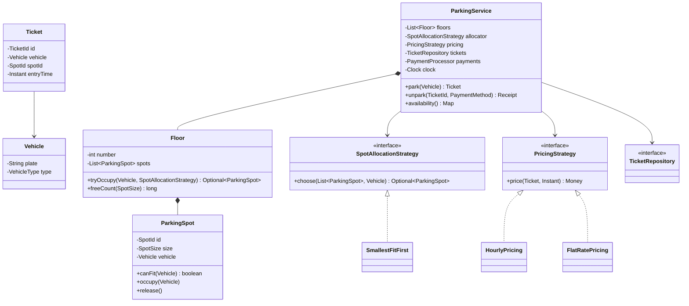

<Related ids={['strategy-pattern', 'factory-patterns', 'singleton-pattern', 'concurrency-for-lld', 'interview-grade-code', 'solid-principles']} title="Concepts used in this design" />

The parking lot is the LLD question you're most likely to get. It looks easy, which is the trap: the interviewer isn't checking whether you can park a car in a list. They're watching **how you get from a vague sentence to a set of classes**, whether those classes are easy to change, and whether you notice that two cars can arrive at the same moment.

This lesson walks through the round the way it actually happens, one step at a time. At every step you'll see what you'd say, what you'd write, and why.

## The plan for the round

Every LLD case study in this course follows the same six steps. Learn the order once and reuse it for every problem.

| Step | What you do | Time |
| --- | --- | --- |
| 1. Requirements | Ask questions until the problem is small and clear. Write the final list down. | ~5 min |
| 2. Entities | Pick out the things in the problem that need to be classes. | ~5 min |
| 3. Class design | For each class: what does it **know** and what can it **do**? | ~10 min |
| 4. Code | Write the core classes and the one or two methods that matter. | ~20 min |
| 5. Worked example | Walk one concrete scenario through your code, out loud. | ~3 min |
| 6. Follow-ups | Show how the design bends when the interviewer adds a rule. | ~5–10 min |

<Callout type="interview">
Say the plan out loud at the start: "I'll clarify requirements, list the main objects, sketch the classes, then code the core flow." It tells the interviewer you have a method, and it gives them a natural point to steer you.
</Callout>

## Step 1: Pin down the requirements

"Design a parking lot" could mean a single-level car park behind a shop or a ten-floor airport garage with valet parking and number-plate cameras. You can't design both in 45 minutes, so the first job is to **shrink the problem** by asking questions.

<Dialogue>
<Turn who="you">Is it one level or several floors?</Turn>
<Turn who="them">Several floors.</Turn>
<Turn who="you">What kinds of vehicles? Do they need different spots?</Turn>
<Turn who="them">Bikes, cars and trucks. Spots come in small, medium and large.</Turn>
<Turn who="you">Can a small vehicle use a bigger spot if the right size is full? A bike in a car spot, say?</Turn>
<Turn who="them">Yes, that's fine.</Turn>
<Turn who="you">How do people get in and out? Is there more than one gate?</Turn>
<Turn who="them">Several entry and exit gates, all working at the same time.</Turn>
<Turn who="you">How does pricing work?</Turn>
<Turn who="them">Hourly, depending on the vehicle type. Round up to the next hour, minimum one hour. We may change the pricing later.</Turn>
<Turn who="you">Should I handle payment in detail, or just "charge the customer"?</Turn>
<Turn who="them">Just assume there's a payment step.</Turn>
<Turn who="you">Anything like reservations, monthly passes or EV charging?</Turn>
<Turn who="them">Not for now. Maybe as a follow-up.</Turn>
</Dialogue>

Notice what each question did. "Several gates at the same time" tells you **concurrency matters**. "We may change the pricing later" tells you **pricing must be swappable**. Those two answers shape the whole design, so it's worth noting them on the whiteboard.

Write the final list where the interviewer can see it:

**The system must:**

1. Have several floors, each with small, medium and large spots.
2. Park a vehicle (bike, car or truck) in a spot that fits it, and give the driver a ticket.
3. Let a smaller vehicle use a bigger spot when needed.
4. On exit, work out the fee from the ticket, take payment and free the spot.
5. Show how many spots are free on each floor.
6. Never give the same spot to two vehicles, even when gates work at the same time.
7. Make it easy to change how the fee is calculated.

**Out of scope for now:** reservations, monthly passes, EV charging, lost tickets.

<Callout type="tip" title="Why bother writing this down?">
The list becomes your checklist. In step 4 you can point at it: "requirement 6 is why this method is synchronized". It also stops scope creep: when the interviewer asks about reservations, you can say "that's out of scope; here's how I'd add it" rather than redesigning.
</Callout>

## Step 2: Find the core entities

Read your requirements and **underline the nouns**. Each noun is a candidate class. Then ask of each one: does it hold its own data or rules, or is it just a value?

> The **parking lot** has several **floors**, each with **spots** of different **sizes**. A **vehicle** parks in a spot and the driver gets a **ticket**. On exit we compute the **fee** using the **pricing** rule and take **payment**.

| Noun | Make it… | Why |
| --- | --- | --- |
| Vehicle | a small class (record) | It has a plate and a type. That's all we need to know about it. |
| Vehicle type | an **enum** | Bike, car and truck differ only in data (which spot size they need), not in behaviour. |
| Spot | a class | It has state that changes: free or occupied. It should protect that state itself. |
| Spot size | an **enum** | Just three fixed values. |
| Floor | a class | It owns a group of spots and is a natural place to lock when choosing one. |
| Ticket | a record | A receipt of entry: who, which spot, what time. It never changes after it's created. |
| Pricing | an **interface** | Requirement 7 says it will change. Things that change get an interface. |
| Parking lot / service | a class | The front door: `park()`, `unpark()` and `availability()` live here. |
| Fee | a number (or a small `Money` class) | A value, not an object with behaviour. |
| Payment | an interface | We were told to treat it as a black box. An interface lets us fake it in the demo. |

<Callout type="note" title="A simple rule that settles most debates">
- Values that **differ only in data** (sizes, types, colours) → an **enum**.
- Things that **differ in behaviour** and might grow (pricing rules, ways of choosing a spot) → an **interface** with one class per behaviour.
- Things with **changing state** (a spot that fills and empties) → a **class** that guards that state.
</Callout>

A common mistake here is to make `Bike`, `Car` and `Truck` subclasses of `Vehicle`. Ask yourself: what would `Car` do differently from `Bike`? Nothing. They need different spot sizes, and that's a piece of data, so an enum is the simpler and better choice.

## Step 3: Design each class

For every class, answer two questions: **what does it need to know** (its fields) and **what does it need to do** (its methods). Tie each answer back to a requirement.

**`ParkingSpot`**: knows its id, its size and which vehicle is in it (or nothing). It can tell you whether a vehicle fits, and it can be occupied and released. It refuses to be occupied twice, so the spot itself enforces "one car per spot".

**`Floor`**: knows its number and its list of spots. It can find and take a spot for a vehicle **in one step** (requirement 6), release a spot, and count free spots (requirement 5).

**`Ticket`**: knows its id, the vehicle, the spot and the entry time. That's everything needed to calculate the fee later. It does nothing else.

**`PricingStrategy`**: one job, "given this ticket and the exit time, what's the fee?" `HourlyPricing` is the first implementation. A flat-rate or weekend version can be added later without touching anything else.

**`SpotAllocationStrategy`**: one job, "from these spots, which one should this vehicle get?" Picking the smallest spot that fits is a sensible default, because it keeps big spots free for trucks.

**`ParkingService`**: the class the gates call. It has `park(vehicle)`, `unpark(ticketId, paymentMethod)` and `availability()`. It doesn't contain the rules itself; it **coordinates** the floors, the pricing, the tickets and the payment.

Here's how they connect. Read the arrows as "uses" or "contains":

```text
ParkingLot ─┬─ Floor ── ParkingSpot
            ├─ EntryGate / ExitGate
            ├─ SpotAllocationStrategy  (nearest, floor-balanced…)
            ├─ PricingStrategy         (hourly, flat…)
            └─ TicketRepository
Vehicle (plate, type) · Ticket (id, vehicle, spot, entry time) · Receipt · Payment
```

The same thing as a class diagram:



<Callout type="interview">
You don't need a perfect UML diagram in the round. A box per class with its key fields and methods, plus arrows, is plenty. Spend the time on the code.
</Callout>

## Step 4: Write the code

Start small. Get a version that parks, unparks and charges correctly, then make it safe for several gates, then grow it.

<InterviewScope minutes="45–60" lines="60" write={["Vehicle, Spot and Ticket as small classes or records", "A `PricingStrategy` interface with an hourly version", "`park()` and `unpark()` in one service, made `synchronized`"]} say={["Floors and spot sizes (\"a bike may use a car spot\")", "Why one lock is fine at first, and a lock per floor scales better", "Payment behind an interface, called outside the lock"]} skip={["Display boards, reservations, EV charging", "Repositories and databases", "Lost tickets and monthly passes"]} />

### The interview-sized version

This is what a strong candidate writes in the round: one lot, one lock, one pricing rule. It's about **60 lines**, and it compiles and runs.

```java
enum VehicleType { BIKE, CAR, TRUCK }

record Vehicle(String plate, VehicleType type) { }

record Ticket(int id, Vehicle vehicle, ParkingSpot spot, long entryMillis) { }

class ParkingSpot {
    final int id;
    final VehicleType type;                    // keep it simple: one vehicle type per spot
    private Vehicle parked;                    // null when free

    ParkingSpot(int id, VehicleType type) { this.id = id; this.type = type; }
    boolean isFree() { return parked == null; }
    void park(Vehicle v) { parked = v; }
    void free() { parked = null; }
}

interface PricingStrategy { int fee(Ticket ticket, long exitMillis); }

class HourlyPricing implements PricingStrategy {
    private final Map<VehicleType, Integer> ratePerHour;
    HourlyPricing(Map<VehicleType, Integer> ratePerHour) { this.ratePerHour = ratePerHour; }

    public int fee(Ticket t, long exitMillis) {
        long hours = Math.max(1, (exitMillis - t.entryMillis() + 3_599_999) / 3_600_000);   // round up, minimum 1
        return (int) hours * ratePerHour.get(t.vehicle().type());
    }
}

class ParkingLot {
    private final List<ParkingSpot> spots;
    private final PricingStrategy pricing;
    private final Map<Integer, Ticket> active = new HashMap<>();
    private int nextTicketId = 1;

    ParkingLot(List<ParkingSpot> spots, PricingStrategy pricing) { this.spots = spots; this.pricing = pricing; }

    // synchronized: two entry gates can never take the same spot
    synchronized Ticket park(Vehicle v, long nowMillis) {
        ParkingSpot spot = spots.stream()
                .filter(s -> s.isFree() && s.type == v.type())
                .findFirst()
                .orElseThrow(() -> new IllegalStateException("No free spot for " + v.type()));
        spot.park(v);
        Ticket ticket = new Ticket(nextTicketId++, v, spot, nowMillis);
        active.put(ticket.id(), ticket);
        return ticket;
    }

    synchronized int unpark(int ticketId, long nowMillis) {
        Ticket ticket = active.remove(ticketId);
        if (ticket == null) throw new IllegalArgumentException("Unknown or used ticket " + ticketId);
        ticket.spot().free();
        return pricing.fee(ticket, nowMillis);
    }
}
```

**Reading it top to bottom:**

1. **`VehicleType`, `Vehicle`, `Ticket`** are plain data. Records give you the constructor, getters and `equals` for free, so they take one line each.
2. **`ParkingSpot`** holds one piece of changing state: `parked`. When it's `null` the spot is free. To keep the first version short, a spot takes one vehicle type; the full version below adds sizes.
3. **`PricingStrategy`** is an interface with a single method. `HourlyPricing` rounds the time **up** to whole hours (that's what `+ 3_599_999` does before dividing by one hour in milliseconds) and charges at least one hour.
4. **`ParkingLot.park()`** finds the first free spot of the right type, marks it taken, creates a ticket and remembers it in `active`.
5. **`ParkingLot.unpark()`** removes the ticket from `active`. If it wasn't there, the ticket is fake or already used, so we refuse. Otherwise it frees the spot and returns the fee.
6. **`synchronized`** on both methods means only one gate can be inside them at a time. That single word is what satisfies requirement 6. The next section explains why.

<Callout type="tip" title="How to practise this">
Close the page and write the version above from memory, in your own words, until it takes you about 30 minutes. Then read on. The rest of the lesson is the thinking you'll need for follow-up questions.
</Callout>

### The hard part: two cars, one spot

Imagine gates A and B each get a car at the same instant, and there's one free spot left. Here are three ways to write `park()`, from weakest to strongest.

<Approach verdict="bad" title="Check, then take, with no lock">

```java
ParkingSpot spot = findFreeSpot(vehicle);   // gate A sees spot 7 free… so does gate B
spot.park(vehicle);                         // both park in spot 7
```

Both gates can run the first line before either runs the second. They both see spot 7 as free and both park there. This bug is called a **check-then-act race**. It won't show up when you test with one gate, which is why interviewers love asking about it.

</Approach>

<Approach verdict="good" title="One lock around the whole lot">

Make `park()` and `unpark()` `synchronized`, as in the interview version. Now "find a free spot" and "take it" happen together: gate B waits until gate A is finished and then sees spot 7 as taken.

It's correct and simple. The cost is that **every** gate in the building waits for every other gate, even if they're filling different floors.

</Approach>

<Approach verdict="great" title="One lock per floor">

Give each `Floor` its own lock and do "choose a spot and occupy it" inside it. Gates parking on different floors no longer wait for each other; only gates competing for the same floor do. You get the same safety with much less waiting.

</Approach>

Start with the "good" version in the round, then say: "If entry gates become a bottleneck, I'd move to a lock per floor." That one sentence shows you know the trade-off without spending ten minutes coding it.

### Growing it into the full design

The rest of this step is the complete design. You won't type all of it in a round, but each piece answers a follow-up you're likely to get. For each piece: first what it does in plain words, then the code.

#### The small data types

Spot sizes and vehicle types are enums. Each vehicle type knows the **smallest spot it can use**, so "does this car fit this spot?" becomes a simple comparison. `Vehicle` checks its own input so a car without a plate can't exist.

```java
public enum SpotSize { SMALL, MEDIUM, LARGE }

public enum VehicleType {
    BIKE(SpotSize.SMALL), CAR(SpotSize.MEDIUM), TRUCK(SpotSize.LARGE);
    private final SpotSize minSpot;
    VehicleType(SpotSize s) { this.minSpot = s; }
    public SpotSize minSpot() { return minSpot; }
}

public record Vehicle(String plate, VehicleType type) {
    public Vehicle {
        if (plate == null || plate.isBlank()) throw new IllegalArgumentException("plate required");
        Objects.requireNonNull(type);
    }
}

public record SpotId(int floor, int number) { }
public record TicketId(String value) { }

public record Ticket(TicketId id, Vehicle vehicle, SpotId spotId, Instant entryTime) { }

public record Receipt(TicketId ticketId, Duration parkedFor, Money amount, String paymentRef) { }
```

#### `ParkingSpot`: guarding its own state

A spot answers "can this vehicle fit?" (free, and big enough) and refuses to be occupied twice or released when it's already empty. Putting these checks inside the spot means no other class can accidentally break them.

```java
public final class ParkingSpot {
    private final SpotId id;
    private final SpotSize size;
    private Vehicle vehicle;                       // null when free; guarded by the floor's lock

    public ParkingSpot(SpotId id, SpotSize size) { this.id = id; this.size = size; }

    public boolean isFree() { return vehicle == null; }

    public boolean canFit(Vehicle v) { return isFree() && size.compareTo(v.type().minSpot()) >= 0; }

    void occupy(Vehicle v) {
        if (!canFit(v)) throw new IllegalStateException("Spot " + id + " cannot take " + v.plate());
        this.vehicle = v;
    }

    void release() {
        if (vehicle == null) throw new IllegalStateException("Spot " + id + " already free");
        vehicle = null;
    }

    public SpotId id() { return id; }
    public SpotSize size() { return size; }
}
```

`occupy` and `release` have no `public` modifier on purpose: only classes in the same package (the floor) can call them, so nobody can skip the floor's lock.

#### Choosing a spot: a strategy

"Which free spot should this car get?" is a rule that's likely to change: nearest the lift, fill the bottom floor first, keep large spots for trucks. So it goes behind an interface. The default picks the **smallest spot that fits**.

```java
public interface SpotAllocationStrategy {
    Optional<ParkingSpot> choose(List<ParkingSpot> candidates, Vehicle v);
}

/** Prefer the smallest spot that fits, to keep large spots for large vehicles. */
public final class SmallestFitFirst implements SpotAllocationStrategy {
    @Override public Optional<ParkingSpot> choose(List<ParkingSpot> spots, Vehicle v) {
        return spots.stream()
                .filter(s -> s.canFit(v))
                .min(Comparator.comparing(ParkingSpot::size).thenComparing(s -> s.id().number()));
    }
}
```

#### `Floor`: choosing and taking a spot in one step

This is the "lock per floor" from above. `tryOccupy` takes the lock, asks the strategy for a spot, occupies it and only then releases the lock. No other gate can slip in between choosing and occupying.

<FullCode title="Show the full code: Floor — atomic allocation (41 lines)">

```java
public final class Floor {
    private final int number;
    private final List<ParkingSpot> spots;
    private final Map<SpotId, ParkingSpot> byId = new HashMap<>();
    private final ReentrantLock lock = new ReentrantLock();

    public Floor(int number, List<ParkingSpot> spots) {
        this.number = number;
        this.spots = List.copyOf(spots);
        spots.forEach(s -> byId.put(s.id(), s));
    }

    /** Check-and-occupy happens atomically, so two gates can't take the same spot. */
    public Optional<ParkingSpot> tryOccupy(Vehicle v, SpotAllocationStrategy strategy) {
        lock.lock();
        try {
            Optional<ParkingSpot> spot = strategy.choose(spots, v);
            spot.ifPresent(s -> s.occupy(v));
            return spot;
        } finally {
            lock.unlock();
        }
    }

    public void release(SpotId id) {
        lock.lock();
        try {
            byId.get(id).release();
        } finally {
            lock.unlock();
        }
    }

    public long freeCount(SpotSize size) {
        lock.lock();
        try { return spots.stream().filter(s -> s.size() == size && s.isFree()).count(); }
        finally { lock.unlock(); }
    }

    public int number() { return number; }
}
```

</FullCode>

The `try { … } finally { lock.unlock(); }` pattern makes sure the lock is released even if something throws. Forgetting `finally` is a classic way to freeze every gate on a floor.

#### Pricing: a strategy too

The same idea as spot choice. `HourlyPricing` rounds minutes up to whole hours with a minimum of one; `FlatRatePricing` shows how easily a new rule slots in.

```java
public interface PricingStrategy {
    Money price(Ticket ticket, Instant exit);
}

public final class HourlyPricing implements PricingStrategy {
    private final Map<VehicleType, Money> hourlyRate;
    public HourlyPricing(Map<VehicleType, Money> hourlyRate) { this.hourlyRate = Map.copyOf(hourlyRate); }

    @Override public Money price(Ticket t, Instant exit) {
        long minutes = Duration.between(t.entryTime(), exit).toMinutes();
        long hours = Math.max(1, (minutes + 59) / 60);                  // round up, minimum 1 hour
        return hourlyRate.get(t.vehicle().type()).times(hours);
    }
}

public final class FlatRatePricing implements PricingStrategy {
    private final Money flat;
    public FlatRatePricing(Money flat) { this.flat = flat; }
    @Override public Money price(Ticket t, Instant exit) { return flat; }
}
```

#### `ParkingService`: the front door

This is the class the gates call. Read `park()` and `unpark()` as numbered steps first, because the order matters.

**`park(vehicle)`**

1. If this plate already has an active ticket, refuse. A car can't be inside twice.
2. Go through floors from the lowest. Ask each one to `tryOccupy` a spot.
3. As soon as a floor returns a spot, create a ticket and save it.
4. If saving fails because another gate just admitted the same plate, give the spot back and refuse.
5. If no floor has room, the lot is full.

**`unpark(ticketId, paymentMethod)`**

1. **Claim** the ticket first: remove it from the active tickets in one atomic step. If two exits present the same ticket, only one of them gets it.
2. Calculate the fee from the entry time to now.
3. Charge the customer, **outside any lock**, because payment is slow.
4. If payment fails, put the ticket back so the driver can try again.
5. If payment succeeds, free the spot and return a receipt.

<FullCode title="Show the full code: The service (façade over the use cases) (63 lines)">

```java
public final class ParkingService {
    private final List<Floor> floors;
    private final SpotAllocationStrategy allocator;
    private final PricingStrategy pricing;
    private final TicketRepository tickets;
    private final PaymentProcessor payments;
    private final Clock clock;
    private final AtomicLong ticketSeq = new AtomicLong();

    public ParkingService(List<Floor> floors, SpotAllocationStrategy allocator, PricingStrategy pricing,
                          TicketRepository tickets, PaymentProcessor payments, Clock clock) {
        this.floors = List.copyOf(floors); this.allocator = allocator; this.pricing = pricing;
        this.tickets = tickets; this.payments = payments; this.clock = clock;
    }

    public Ticket park(Vehicle vehicle) {
        if (tickets.findActiveByPlate(vehicle.plate()).isPresent())
            throw new DuplicateEntryException(vehicle.plate());

        for (Floor floor : floors) {                                   // lowest floor first
            Optional<ParkingSpot> spot = floor.tryOccupy(vehicle, allocator);
            if (spot.isPresent()) {
                var ticket = new Ticket(new TicketId("T" + ticketSeq.incrementAndGet()),
                                        vehicle, spot.get().id(), clock.instant());
                try {
                    tickets.save(ticket);                              // atomic per-plate check
                } catch (DuplicateEntryException e) {
                    floor.release(spot.get().id());                    // lost a race at another gate
                    throw e;
                }
                return ticket;
            }
        }
        throw new ParkingFullException(vehicle.type());
    }

    public Receipt unpark(TicketId id, PaymentMethod method) {
        // Claim first: of two exits presenting the same ticket, exactly one gets past this line
        Ticket ticket = tickets.claim(id).orElseThrow(() -> new InvalidTicketException(id));
        Instant exit = clock.instant();
        Money fee = pricing.price(ticket, exit);

        String paymentRef;
        try {
            paymentRef = payments.charge(fee, method);                 // outside any floor lock
        } catch (RuntimeException e) {
            tickets.restore(ticket);                                  // still parked; the driver can retry
            throw e;
        }
        floors.get(ticket.spotId().floor()).release(ticket.spotId());
        return new Receipt(id, Duration.between(ticket.entryTime(), exit), fee, paymentRef);
    }

    public Map<Integer, Map<SpotSize, Long>> availability() {
        Map<Integer, Map<SpotSize, Long>> view = new TreeMap<>();
        for (Floor f : floors) {
            Map<SpotSize, Long> counts = new EnumMap<>(SpotSize.class);
            for (SpotSize s : SpotSize.values()) counts.put(s, f.freeCount(s));
            view.put(f.number(), counts);
        }
        return view;
    }
}
```

</FullCode>

<Callout type="warning" title="Why claim the ticket before charging?">
A natural first attempt is: charge the card, then close the ticket, and if closing fails it was a duplicate exit. But by then **both** exits have already charged the card. Claim first, then charge, and undo the claim if payment fails.
</Callout>

#### Storing tickets

Tickets live behind a `TicketRepository` interface. In the round it's an in-memory map; in production it would be a database. `ConcurrentHashMap.putIfAbsent` and `remove` are atomic, which is what makes "only one gate admits this plate" and "only one exit claims this ticket" true without extra locks.

```java
public interface TicketRepository {
    void save(Ticket t);                           // throws DuplicateEntryException if the plate is already in
    Optional<Ticket> findActiveByPlate(String plate);
    Optional<Ticket> claim(TicketId id);           // atomically removes the active ticket; only one caller wins
    void restore(Ticket t);                        // undo a claim when payment fails
}

public final class InMemoryTicketRepository implements TicketRepository {
    private final ConcurrentHashMap<TicketId, Ticket> active = new ConcurrentHashMap<>();
    private final ConcurrentHashMap<String, TicketId> byPlate = new ConcurrentHashMap<>();

    public void save(Ticket t) {
        if (byPlate.putIfAbsent(t.vehicle().plate(), t.id()) != null)
            throw new DuplicateEntryException(t.vehicle().plate());
        active.put(t.id(), t);
    }
    public Optional<Ticket> findActiveByPlate(String plate) {
        return Optional.ofNullable(byPlate.get(plate)).map(active::get);
    }
    public Optional<Ticket> claim(TicketId id) {
        Ticket t = active.remove(id);                              // atomic: only one remover gets non-null
        if (t != null) byPlate.remove(t.vehicle().plate());
        return Optional.ofNullable(t);
    }
    public void restore(Ticket t) { save(t); }
}
```

#### Wiring it together

Everything the service needs is passed in through the constructor: floors, strategies, repository, payment and even the clock. That's what makes it easy to test (pass a fake clock and jump two hours ahead) and easy to change (pass a different pricing strategy).

```java
public static void main(String[] args) {
    List<Floor> floors = IntStream.range(0, 3)
            .mapToObj(f -> new Floor(f, buildSpots(f, 10, 20, 5)))   // small, medium, large per floor
            .toList();

    var service = new ParkingService(
            floors,
            new SmallestFitFirst(),
            new HourlyPricing(Map.of(VehicleType.BIKE, Money.inr(20),
                                     VehicleType.CAR,  Money.inr(40),
                                     VehicleType.TRUCK, Money.inr(100))),
            new InMemoryTicketRepository(),
            new FakePaymentProcessor(),
            Clock.systemDefaultZone());

    Ticket t = service.park(new Vehicle("KA-01-AB-1234", VehicleType.CAR));
    System.out.println("Parked at " + t.spotId());
    System.out.println(service.availability());
}
```

## Step 5: Trace one car through the system

Walking through a concrete example is the best way to check your design and to show the interviewer it works. Say it out loud:

1. A car with plate `KA-01-AB-1234` arrives at gate A at 10:00. The gate calls `service.park(car)`.
2. No active ticket exists for that plate, so the service asks floor 0 to `tryOccupy`.
3. Floor 0 takes its lock. `SmallestFitFirst` filters out small spots (too small for a car) and picks the first free **medium** spot, say `(0, 3)`. The spot is marked occupied, then the lock is released.
4. The service creates ticket `T1` with the car, spot `(0, 3)` and 10:00, saves it and hands it to the driver.
5. At 12:30 the driver reaches exit B. The gate calls `service.unpark(T1, card)`.
6. The repository removes `T1` from the active tickets. If someone tries `T1` at another exit now, they get "invalid ticket".
7. `HourlyPricing` sees 150 minutes, rounds up to 3 hours and charges 3 × ₹40 = ₹120.
8. The card is charged. Floor 0 releases spot `(0, 3)` and the driver gets a receipt.

## Step 6: Handle follow-up questions

When the interviewer adds a rule, the best answer names **which classes change and which don't**. If the answer is "only one new class", your design is doing its job.

**"Add weekend pricing."** Write a `WeekendPricing` class that implements `PricingStrategy`, or a `TimeBasedPricing` that picks a different strategy depending on the day. `ParkingService` doesn't change.

**"Add EV charging spots."** Give spots a set of features (such as `EV_CHARGER`) and let a vehicle say it needs charging. The allocation strategy filters by features before picking the smallest fit. For the extra charge, wrap the existing pricing: `new EnergyCharge(new HourlyPricing(…))` adds a per-kWh amount on top (a Decorator).

**"Show free spots on a display board at each floor."** Have `Floor` announce "spot taken" and "spot freed" events and let boards subscribe (the Observer pattern). The floor doesn't need to know what a board is.

**"Add reservations."** A spot now has three states instead of two: free, reserved and occupied. Walk-in cars skip reserved spots; a car with a reservation takes exactly its spot; reservations expire after 15 minutes.

**"Handle a lost ticket."** Look the active ticket up by plate (the repository already supports it) and charge the maximum daily fee.

**"Should `ParkingLot` be a Singleton?"** Usually not. Create one `ParkingService` when the app starts and pass it to whoever needs it. You still have one instance, but tests can create their own.

## Common mistakes

- **Subclassing every vehicle** (`Car extends Vehicle`) when the types only differ in data. Use an enum.
- **One giant class** where `ParkingLot` calculates fees, picks spots and prints receipts. Each changing rule deserves its own small class.
- **Forgetting concurrency entirely.** Requirement 6 is the question behind the question.
- **Holding a lock while charging a card.** Payment can take seconds; every gate on the floor would wait.
- **Jumping into code before agreeing on requirements**, then discovering halfway that there are several floors.

## Patterns used

| Pattern | Where | Why it helps here |
| --- | --- | --- |
| Strategy | `PricingStrategy`, `SpotAllocationStrategy` | Pricing and spot-choice rules can change without touching the service |
| Facade | `ParkingService` | Gates call three simple methods instead of juggling floors, tickets and payments |
| Repository | `TicketRepository` | Storage can move from memory to a database without changing the service |
| Factory (simple) | Building floors and spots, choosing pricing from config | Creation logic lives in one place |
| Observer (follow-up) | Display boards listening to spot events | Floors don't need to know about displays |

## Interview questions

<QA q="How do you prevent two entry gates from assigning the same spot?">
Make choosing a spot and occupying it one step that no other gate can interrupt. In this design each floor has a lock; while holding it, the allocation strategy picks a spot and the spot is marked occupied, so a second gate sees it as taken. A lock per floor means only gates competing for the same floor wait for each other. Another option is to give each spot an atomic reference and claim it with compare-and-set, moving on to the next candidate if the claim fails.
</QA>

<QA q="How would you add a new vehicle type, say an electric scooter?">
Add an enum constant with the smallest spot size it can use. Allocation and pricing keep working because they read that data rather than checking types. If the scooter needs a charging spot, add a feature to spots and filter on it in the allocation strategy. If its price differs, add its rate to the hourly table. No service code changes.
</QA>

<QA q="Why compute the fee before freeing the spot, and what if payment fails?">
The exit first claims the ticket, so a second exit presenting the same ticket is turned away before anyone is charged. Then it calculates the fee and charges outside any lock. The spot is released only after payment succeeds. If payment fails, the ticket is put back, the car still counts as parked and the driver can try again.
</QA>

<Practice task="Add reservations: a driver can reserve a spot for a time window; unclaimed reservations expire 15 minutes after the window starts. What changes in the spot model and in allocation?">

Give spots a small state machine: `FREE → RESERVED → OCCUPIED → FREE`, plus `RESERVED → FREE` when a reservation expires or is cancelled. Store the reservation's id and expiry on the spot. Allocation for walk-in cars skips reserved spots; a car arriving with a reservation id occupies exactly that spot under the floor lock, after checking the id and that it hasn't expired. A scheduled job (or a check whenever the spot is read) frees expired reservations. A reservation fee can be another `PricingStrategy` wrapper.

</Practice>

<Practice task="Add EV charging spots billed per kWh on top of parking time. Which classes change and which stay untouched?">

Spots gain a set of features (`EV_CHARGER`); the entry request says whether the car needs charging; the allocation strategy filters on required features before picking the smallest fit. The ticket records the energy delivered (reported by the charger at exit). Pricing becomes `EnergyCharge(HourlyPricing)`, a wrapper that adds `kWh × rate`. `ParkingService`, the floor locking and the repository don't change.

</Practice>

<Takeaways>

- Follow the same six steps every time: requirements, entities, class design, code, a worked example, follow-ups.
- Use enums for things that differ only in data, interfaces for rules that will change, and classes that guard their own changing state.
- "Find a free spot, then take it" must be one uninterruptible step: one lock to start, a lock per floor to scale.
- Claim the ticket before charging, and never hold a lock during payment.
- Answer follow-ups by naming which classes change. The fewer, the better your design.

</Takeaways>

## Further reading

- [Strategy](/system-design/lld/strategy-pattern), [Concurrency for LLD](/system-design/lld/concurrency-for-lld).
- Gamma et al., *Design Patterns* (1994): Strategy and Facade.
