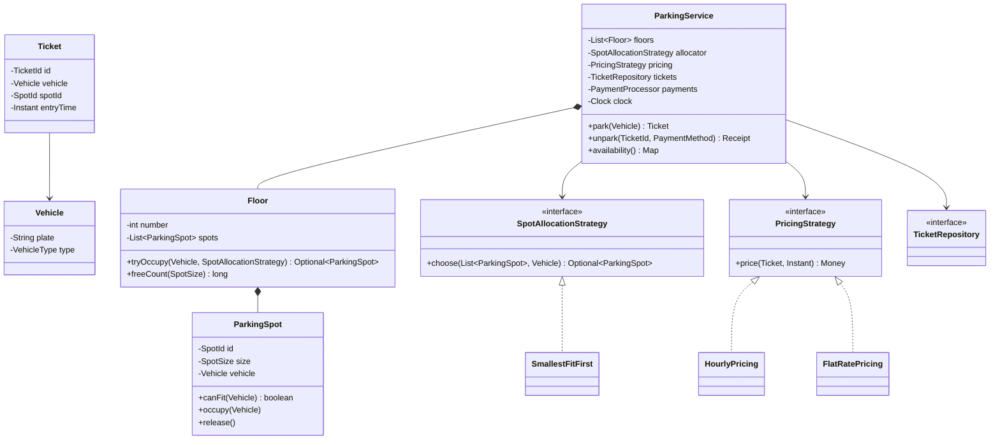

<Related ids={['strategy-pattern', 'factory-patterns', 'singleton-pattern', 'concurrency-for-lld', 'interview-grade-code', 'solid-principles']} title="Concepts used in this design" />

The parking lot is the most frequently asked LLD problem. It's small enough to finish, yet it tests modelling, the Strategy pattern, extensibility (new vehicle types, pricing rules) and — the part most candidates miss — **concurrency at entry gates**.

## What the interviewer expects

The full design in this lesson is longer than anything you'd write in one round. It's there so you understand the edge cases and can answer follow-up questions. In the round itself, aim for this:

<InterviewScope minutes="45–60" lines="60" write={["Vehicle, Spot and Ticket as small classes or records", "A `PricingStrategy` interface with an hourly version", "`park()` and `unpark()` in one service, made `synchronized`"]} say={["Floors and spot sizes (\"a bike may use a car spot\")", "Why one lock is fine at first, and a lock per floor scales better", "Payment behind an interface, called outside the lock"]} skip={["Display boards, reservations, EV charging", "Repositories and databases", "Lost tickets and monthly passes"]} />

### The interview-sized version

One lot, one lock, one pricing strategy. It parks, unparks, charges by the hour and never gives a spot twice. It's about **60 lines**, and it compiles and runs.

```java
enum VehicleType { BIKE, CAR, TRUCK }

record Vehicle(String plate, VehicleType type) { }

record Ticket(int id, Vehicle vehicle, ParkingSpot spot, long entryMillis) { }

class ParkingSpot {
    final int id;
    final VehicleType type;                    // keep it simple: one vehicle type per spot
    private Vehicle parked;                    // null when free

    ParkingSpot(int id, VehicleType type) { this.id = id; this.type = type; }
    boolean isFree() { return parked == null; }
    void park(Vehicle v) { parked = v; }
    void free() { parked = null; }
}

interface PricingStrategy { int fee(Ticket ticket, long exitMillis); }

class HourlyPricing implements PricingStrategy {
    private final Map<VehicleType, Integer> ratePerHour;
    HourlyPricing(Map<VehicleType, Integer> ratePerHour) { this.ratePerHour = ratePerHour; }

    public int fee(Ticket t, long exitMillis) {
        long hours = Math.max(1, (exitMillis - t.entryMillis() + 3_599_999) / 3_600_000);   // round up, minimum 1
        return (int) hours * ratePerHour.get(t.vehicle().type());
    }
}

class ParkingLot {
    private final List<ParkingSpot> spots;
    private final PricingStrategy pricing;
    private final Map<Integer, Ticket> active = new HashMap<>();
    private int nextTicketId = 1;

    ParkingLot(List<ParkingSpot> spots, PricingStrategy pricing) { this.spots = spots; this.pricing = pricing; }

    // synchronized: two entry gates can never take the same spot
    synchronized Ticket park(Vehicle v, long nowMillis) {
        ParkingSpot spot = spots.stream()
                .filter(s -> s.isFree() && s.type == v.type())
                .findFirst()
                .orElseThrow(() -> new IllegalStateException("No free spot for " + v.type()));
        spot.park(v);
        Ticket ticket = new Ticket(nextTicketId++, v, spot, nowMillis);
        active.put(ticket.id(), ticket);
        return ticket;
    }

    synchronized int unpark(int ticketId, long nowMillis) {
        Ticket ticket = active.remove(ticketId);
        if (ticket == null) throw new IllegalArgumentException("Unknown or used ticket " + ticketId);
        ticket.spot().free();
        return pricing.fee(ticket, nowMillis);
    }
}
```

<Callout type="tip" title="How to use the rest of this lesson">
Practise writing the short version above, in your own words, until you can do it in about 30 minutes. Then read the full design below for the edge cases and follow-up answers. Interviewers often ask about those, but they rarely ask you to type them all.
</Callout>

## 1. Clarify requirements

| Question | Assumption |
| --- | --- |
| Floors and spots? | Multiple floors; each floor has spots of sizes SMALL, MEDIUM, LARGE |
| Vehicles? | Bike → SMALL, Car → MEDIUM, Truck → LARGE (a smaller vehicle may use a larger spot if no exact fit) |
| Entry/exit? | Multiple entry and exit gates operating **concurrently** |
| Tickets? | Issued at entry with entry time and spot; required at exit |
| Pricing? | Hourly by vehicle type, rounded up, min 1 hour; must support other schemes later |
| Payment? | Cash/card/UPI at exit — modelled behind an interface |
| Display? | Show free spots per floor and type |
| Out of scope | Reservations, monthly passes, EV charging (discussed as extensions) |

**Functional use cases:** park a vehicle (get a ticket), unpark (compute fee, pay, free the spot), view availability.

**Non-functional:** no spot assigned twice under concurrent entry; extensible pricing and allocation.

## 2. Entities and relationships

```text
ParkingLot ─┬─ Floor ── ParkingSpot
            ├─ EntryGate / ExitGate
            ├─ SpotAllocationStrategy  (nearest, floor-balanced…)
            ├─ PricingStrategy         (hourly, flat…)
            └─ TicketRepository
Vehicle (plate, type) · Ticket (id, vehicle, spot, entry time) · Receipt · Payment
```

- `VehicleType` and `SpotSize` are **enums**: the variants differ in data, not behaviour.
- Pricing and allocation **vary** → interfaces (Strategy).
- `ParkingService` is the façade exposing the use cases.

## 3. Class diagram



## 4. Implementation

### Models

```java
public enum SpotSize { SMALL, MEDIUM, LARGE }

public enum VehicleType {
    BIKE(SpotSize.SMALL), CAR(SpotSize.MEDIUM), TRUCK(SpotSize.LARGE);
    private final SpotSize minSpot;
    VehicleType(SpotSize s) { this.minSpot = s; }
    public SpotSize minSpot() { return minSpot; }
}

public record Vehicle(String plate, VehicleType type) {
    public Vehicle {
        if (plate == null || plate.isBlank()) throw new IllegalArgumentException("plate required");
        Objects.requireNonNull(type);
    }
}

public record SpotId(int floor, int number) { }
public record TicketId(String value) { }

public record Ticket(TicketId id, Vehicle vehicle, SpotId spotId, Instant entryTime) { }

public record Receipt(TicketId ticketId, Duration parkedFor, Money amount, String paymentRef) { }
```

### Spot — guarding its own state

```java
public final class ParkingSpot {
    private final SpotId id;
    private final SpotSize size;
    private Vehicle vehicle;                       // null when free; guarded by the floor's lock

    public ParkingSpot(SpotId id, SpotSize size) { this.id = id; this.size = size; }

    public boolean isFree() { return vehicle == null; }

    public boolean canFit(Vehicle v) { return isFree() && size.compareTo(v.type().minSpot()) >= 0; }

    void occupy(Vehicle v) {
        if (!canFit(v)) throw new IllegalStateException("Spot " + id + " cannot take " + v.plate());
        this.vehicle = v;
    }

    void release() {
        if (vehicle == null) throw new IllegalStateException("Spot " + id + " already free");
        vehicle = null;
    }

    public SpotId id() { return id; }
    public SpotSize size() { return size; }
}
```

### Allocation strategy

```java
public interface SpotAllocationStrategy {
    Optional<ParkingSpot> choose(List<ParkingSpot> candidates, Vehicle v);
}

/** Prefer the smallest spot that fits, to keep large spots for large vehicles. */
public final class SmallestFitFirst implements SpotAllocationStrategy {
    @Override public Optional<ParkingSpot> choose(List<ParkingSpot> spots, Vehicle v) {
        return spots.stream()
                .filter(s -> s.canFit(v))
                .min(Comparator.comparing(ParkingSpot::size).thenComparing(s -> s.id().number()));
    }
}
```

### Floor — atomic allocation

<FullCode title="Show the full code: Floor — atomic allocation (41 lines)">

```java
public final class Floor {
    private final int number;
    private final List<ParkingSpot> spots;
    private final Map<SpotId, ParkingSpot> byId = new HashMap<>();
    private final ReentrantLock lock = new ReentrantLock();

    public Floor(int number, List<ParkingSpot> spots) {
        this.number = number;
        this.spots = List.copyOf(spots);
        spots.forEach(s -> byId.put(s.id(), s));
    }

    /** Check-and-occupy happens atomically, so two gates can't take the same spot. */
    public Optional<ParkingSpot> tryOccupy(Vehicle v, SpotAllocationStrategy strategy) {
        lock.lock();
        try {
            Optional<ParkingSpot> spot = strategy.choose(spots, v);
            spot.ifPresent(s -> s.occupy(v));
            return spot;
        } finally {
            lock.unlock();
        }
    }

    public void release(SpotId id) {
        lock.lock();
        try {
            byId.get(id).release();
        } finally {
            lock.unlock();
        }
    }

    public long freeCount(SpotSize size) {
        lock.lock();
        try { return spots.stream().filter(s -> s.size() == size && s.isFree()).count(); }
        finally { lock.unlock(); }
    }

    public int number() { return number; }
}
```

</FullCode>

A **lock per floor** keeps contention low (gates allocating on different floors don't block each other) while keeping the check-then-act on spots atomic.

### Pricing strategies

```java
public interface PricingStrategy {
    Money price(Ticket ticket, Instant exit);
}

public final class HourlyPricing implements PricingStrategy {
    private final Map<VehicleType, Money> hourlyRate;
    public HourlyPricing(Map<VehicleType, Money> hourlyRate) { this.hourlyRate = Map.copyOf(hourlyRate); }

    @Override public Money price(Ticket t, Instant exit) {
        long minutes = Duration.between(t.entryTime(), exit).toMinutes();
        long hours = Math.max(1, (minutes + 59) / 60);                  // round up, minimum 1 hour
        return hourlyRate.get(t.vehicle().type()).times(hours);
    }
}

public final class FlatRatePricing implements PricingStrategy {
    private final Money flat;
    public FlatRatePricing(Money flat) { this.flat = flat; }
    @Override public Money price(Ticket t, Instant exit) { return flat; }
}
```

### The service (façade over the use cases)

<FullCode title="Show the full code: The service (façade over the use cases) (63 lines)">

```java
public final class ParkingService {
    private final List<Floor> floors;
    private final SpotAllocationStrategy allocator;
    private final PricingStrategy pricing;
    private final TicketRepository tickets;
    private final PaymentProcessor payments;
    private final Clock clock;
    private final AtomicLong ticketSeq = new AtomicLong();

    public ParkingService(List<Floor> floors, SpotAllocationStrategy allocator, PricingStrategy pricing,
                          TicketRepository tickets, PaymentProcessor payments, Clock clock) {
        this.floors = List.copyOf(floors); this.allocator = allocator; this.pricing = pricing;
        this.tickets = tickets; this.payments = payments; this.clock = clock;
    }

    public Ticket park(Vehicle vehicle) {
        if (tickets.findActiveByPlate(vehicle.plate()).isPresent())
            throw new DuplicateEntryException(vehicle.plate());

        for (Floor floor : floors) {                                   // lowest floor first
            Optional<ParkingSpot> spot = floor.tryOccupy(vehicle, allocator);
            if (spot.isPresent()) {
                var ticket = new Ticket(new TicketId("T" + ticketSeq.incrementAndGet()),
                                        vehicle, spot.get().id(), clock.instant());
                try {
                    tickets.save(ticket);                              // atomic per-plate check
                } catch (DuplicateEntryException e) {
                    floor.release(spot.get().id());                    // lost a race at another gate
                    throw e;
                }
                return ticket;
            }
        }
        throw new ParkingFullException(vehicle.type());
    }

    public Receipt unpark(TicketId id, PaymentMethod method) {
        // Claim first: of two exits presenting the same ticket, exactly one gets past this line
        Ticket ticket = tickets.claim(id).orElseThrow(() -> new InvalidTicketException(id));
        Instant exit = clock.instant();
        Money fee = pricing.price(ticket, exit);

        String paymentRef;
        try {
            paymentRef = payments.charge(fee, method);                 // outside any floor lock
        } catch (RuntimeException e) {
            tickets.restore(ticket);                                  // still parked; the driver can retry
            throw e;
        }
        floors.get(ticket.spotId().floor()).release(ticket.spotId());
        return new Receipt(id, Duration.between(ticket.entryTime(), exit), fee, paymentRef);
    }

    public Map<Integer, Map<SpotSize, Long>> availability() {
        Map<Integer, Map<SpotSize, Long>> view = new TreeMap<>();
        for (Floor f : floors) {
            Map<SpotSize, Long> counts = new EnumMap<>(SpotSize.class);
            for (SpotSize s : SpotSize.values()) counts.put(s, f.freeCount(s));
            view.put(f.number(), counts);
        }
        return view;
    }
}
```

</FullCode>

### Repository

```java
public interface TicketRepository {
    void save(Ticket t);                           // throws DuplicateEntryException if the plate is already in
    Optional<Ticket> findActiveByPlate(String plate);
    Optional<Ticket> claim(TicketId id);           // atomically removes the active ticket; only one caller wins
    void restore(Ticket t);                        // undo a claim when payment fails
}

public final class InMemoryTicketRepository implements TicketRepository {
    private final ConcurrentHashMap<TicketId, Ticket> active = new ConcurrentHashMap<>();
    private final ConcurrentHashMap<String, TicketId> byPlate = new ConcurrentHashMap<>();

    public void save(Ticket t) {
        if (byPlate.putIfAbsent(t.vehicle().plate(), t.id()) != null)
            throw new DuplicateEntryException(t.vehicle().plate());
        active.put(t.id(), t);
    }
    public Optional<Ticket> findActiveByPlate(String plate) {
        return Optional.ofNullable(byPlate.get(plate)).map(active::get);
    }
    public Optional<Ticket> claim(TicketId id) {
        Ticket t = active.remove(id);                              // atomic: only one remover gets non-null
        if (t != null) byPlate.remove(t.vehicle().plate());
        return Optional.ofNullable(t);
    }
    public void restore(Ticket t) { save(t); }
}
```

### Demo wiring

```java
public static void main(String[] args) {
    List<Floor> floors = IntStream.range(0, 3)
            .mapToObj(f -> new Floor(f, buildSpots(f, 10, 20, 5)))   // small, medium, large per floor
            .toList();

    var service = new ParkingService(
            floors,
            new SmallestFitFirst(),
            new HourlyPricing(Map.of(VehicleType.BIKE, Money.inr(20),
                                     VehicleType.CAR,  Money.inr(40),
                                     VehicleType.TRUCK, Money.inr(100))),
            new InMemoryTicketRepository(),
            new FakePaymentProcessor(),
            Clock.systemDefaultZone());

    Ticket t = service.park(new Vehicle("KA-01-AB-1234", VehicleType.CAR));
    System.out.println("Parked at " + t.spotId());
    System.out.println(service.availability());
}
```

## 5. Concurrency analysis

| Shared state | Race | Protection |
| --- | --- | --- |
| Spot occupancy | Two gates choose the same free spot (check-then-act) | Choose + occupy under the floor's lock |
| Active tickets | Same ticket presented at two exits — both could charge the card | **Claim before charging**: `ConcurrentHashMap.remove` lets only one exit proceed; a failed payment restores the ticket |
| Ticket IDs | Duplicate IDs | `AtomicLong` sequence (or UUIDs) |
| Duplicate entry by plate | Two gates admit the same plate | `putIfAbsent` on a plate → ticket map; the loser releases the spot it took |

Payment happens **outside locks** — never hold a lock across a slow external call.

<Callout type="warning" title="A subtle ordering bug">
A tempting version charges first and closes the ticket afterwards ("if close fails, it was a double exit"). But by then **both** exits have already charged the customer. Claim the ticket atomically, then charge, and compensate (restore the ticket) if the payment fails.
</Callout>

<Callout type="tip" title="Alternative: lock-free spots">
Give each spot an `AtomicReference<Vehicle>` and claim it with `compareAndSet(null, vehicle)`. The allocator then tries candidates in preference order until a CAS succeeds. It scales better under heavy contention but makes "best spot" strategies slightly racier (the best spot may be taken mid-scan, so you fall back to the next).
</Callout>

## 6. Patterns used

| Pattern | Where | Why |
| --- | --- | --- |
| Strategy | `PricingStrategy`, `SpotAllocationStrategy` | Pricing and allocation rules change independently |
| Facade | `ParkingService` | Simple API over floors, repos, payments |
| Repository | `TicketRepository` | Storage swappable; in-memory for the round |
| Factory (simple) | Building floors/spots, choosing pricing by config | Centralised creation |
| Observer (extension) | Display boards subscribe to spot events | Decouple displays from allocation |

A **Singleton** `ParkingLot` is often suggested; prefer creating one `ParkingService` at startup and injecting it — same single instance, testable.

## 7. Extensions interviewers ask for

- **EV charging spots**: add a capability to spots (`Set<Feature>`), vehicles request features; allocation filters by them; pricing adds a per-kWh component via a decorator over the base strategy.
- **Weekend / peak pricing**: a new `PricingStrategy`, or a `TimeBasedPricing` selecting a delegate by time.
- **Reservations**: a spot state machine `FREE → RESERVED → OCCUPIED`, with reservation expiry.
- **Display boards**: `Floor` publishes `SpotOccupied`/`SpotReleased` events; boards subscribe (Observer).
- **Multiple lots / persistence**: repository implementations backed by a database; floors loaded from config.
- **Lost ticket**: look up by plate, charge a maximum daily fee.

## Interview questions

<QA q="How do you prevent two entry gates from assigning the same spot?">
Make choosing and occupying a spot one atomic operation. Here each floor has a lock; allocation selects a spot via the strategy and marks it occupied while holding the lock, so a second gate sees it as taken. A lock per floor limits contention to gates targeting the same floor. Alternatively, each spot's occupancy can be an atomic reference claimed by compare-and-set, retrying with the next candidate on failure.
</QA>

<QA q="How would you add a new vehicle type, say an electric scooter?">
Add an enum constant with its minimum spot size; allocation and pricing work unchanged because they depend on VehicleType data. If the scooter needs a charging spot, add a feature/capability to spots and filter on it in the allocation strategy. If its pricing differs, add its rate to the hourly table or a new pricing strategy. No existing service code changes.
</QA>

<QA q="Why compute the fee before freeing the spot, and what if payment fails?">
The exit first claims the ticket atomically (so a second exit with the same ticket is rejected before anyone is charged), then computes the fee from the exit time, then charges outside any lock. The spot is released only after the payment succeeds. If the payment fails, the ticket is restored, the vehicle stays recorded as parked and the driver can retry.
</QA>

<Practice task="Add reservations: a driver can reserve a spot for a time window; unclaimed reservations expire 15 minutes after the window starts. What changes in the spot model and in allocation?">

Give spots a small state machine — `FREE → RESERVED → OCCUPIED → FREE` (and `RESERVED → FREE` on expiry or cancellation) — with the reservation's id and expiry stored on the spot. Allocation for walk-in vehicles skips reserved spots; arrival with a reservation id occupies exactly that spot under the floor lock, checking the id and that it hasn't expired. A scheduled sweeper (or lazy check on access) frees expired reservations. Pricing may add a reservation fee — another `PricingStrategy` decorator.

</Practice>

<Practice task="Add EV charging spots billed per kWh on top of parking time. Which classes change and which stay untouched?">

Spots gain capabilities (`Set<SpotFeature>` with `EV_CHARGER`); `Vehicle` (or the entry request) says whether it needs charging; the allocation strategy filters on required features before applying smallest-fit. The ticket records energy delivered (reported by the charger at exit). Pricing becomes `EnergyCharge(HourlyPricing)` — a decorator adding `kWh × rate`. `ParkingService`, `Floor`'s locking and the repository don't change.

</Practice>

<Takeaways>

- Model with enums for data-only variants and interfaces for behaviour that varies (pricing, allocation).
- ParkingService is a thin façade; floors own their spots and allocate atomically.
- Lock per floor (or CAS per spot) prevents double assignment; keep payments outside locks.
- Inject Clock, repositories and strategies for testability and extensibility.

</Takeaways>

## Further reading

- [Strategy](/system-design/lld/strategy-pattern), [Concurrency for LLD](/system-design/lld/concurrency-for-lld).
- Gamma et al., *Design Patterns* (1994) — Strategy and Facade.
