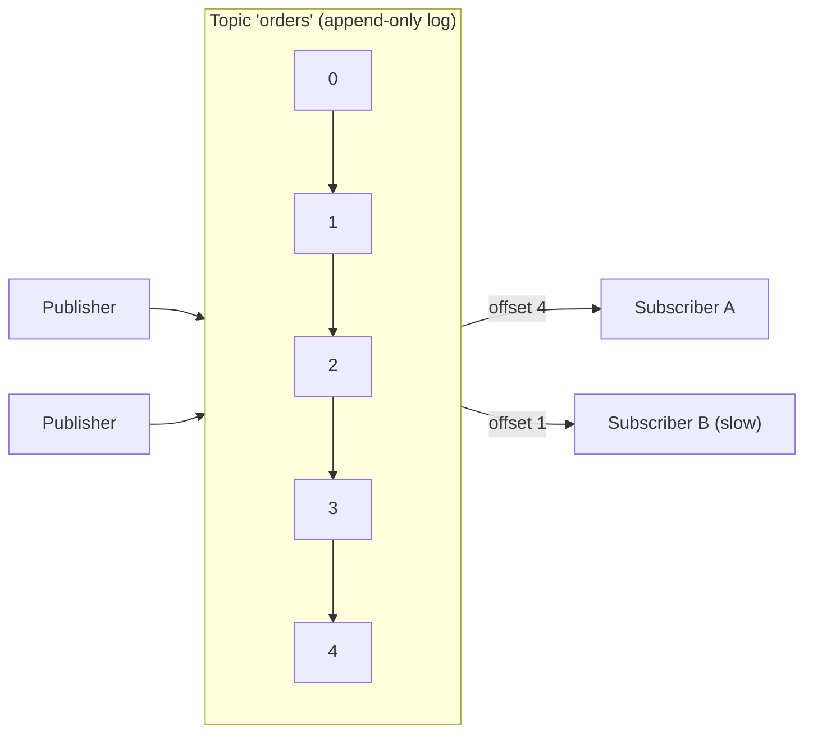
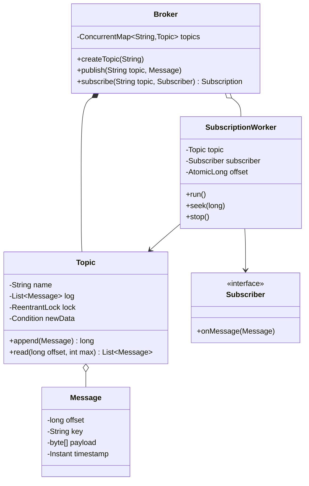

<Related ids={['observer-pattern', 'concurrency-for-lld', 'strategy-pattern', 'iterator-pattern', 'interview-grade-code']} />

In a pub-sub system, **publishers** send messages to a named **topic** ("orders", "payments") without knowing who's listening, and **subscribers** receive every message on the topics they've subscribed to. It's how one service can announce "order placed" and have the email service, the warehouse and analytics all react, without the order service knowing any of them exist.

"Design an in-memory pub-sub (a mini Kafka)" is a hard machine-coding problem because it's mostly about **concurrency**: several publishers and subscribers at once, each subscriber going at its own speed, messages arriving in order, and the ability to replay old messages.

We'll use the same six steps as every case study: requirements, entities, class design, code, a worked example, and follow-ups. (The [parking lot](/system-design/lld/lld-parking-lot) lesson explains the plan in detail.)

## Step 1: Pin down the requirements

<Dialogue>
<Turn who="you">If three subscribers are on a topic, does each one get every message, or is each message handled by just one of them?</Turn>
<Turn who="them">Each gets every message.</Turn>
<Turn who="you">Do messages need to arrive in the order they were published?</Turn>
<Turn who="them">Yes, for each subscriber.</Turn>
<Turn who="you">What if one subscriber is slow, say it writes to a slow database?</Turn>
<Turn who="them">It must not slow down publishers or the other subscribers.</Turn>
<Turn who="you">Can a subscriber go back and re-read old messages?</Turn>
<Turn who="them">Yes, that would be useful.</Turn>
<Turn who="you">What if a subscriber keeps failing on one message?</Turn>
<Turn who="them">Retry a few times, then move on. Don't get stuck.</Turn>
</Dialogue>

**The system must:**

1. Create topics; let publishers publish messages to a topic.
2. Deliver **every** message on a topic to **every** subscriber of that topic.
3. Deliver each subscriber's messages **in order**.
4. Let each subscriber go at its own pace: a slow one mustn't block publishers or others.
5. Let a subscriber rewind and replay messages.
6. Retry failing deliveries a few times, then set the message aside instead of getting stuck.

**Out of scope for now:** consumer groups, saving to disk, partitions.

## Step 2: Find the core entities

| Noun | Make it… | Why |
| --- | --- | --- |
| Message | a record | Offset, key, payload, time. It never changes once published. |
| Topic | a class | Holds its messages and lets readers wait for new ones. |
| Subscriber | an interface | One method, `onMessage`. Whatever the user wants to do with a message. |
| Subscription | a class | Connects one subscriber to one topic, with that subscriber's **position** in the topic. |
| Broker | a class | The front door: create topics, publish, subscribe. |

The key design choice is how a topic stores messages:

<Approach verdict="bad" title="One shared queue per topic">

Publishers add to a queue; subscribers take from it. But taking a message **removes** it, so only one subscriber gets each message, which breaks requirement 2. And there's no way to replay.

</Approach>

<Approach verdict="good" title="A queue per subscriber">

When a message is published, copy it into every subscriber's own queue. Now every subscriber gets every message. But publishing gets slower with every new subscriber, memory is multiplied, and replay is still impossible once a message is taken.

</Approach>

<Approach verdict="great" title="An append-only log, and a position per subscriber">

The topic keeps messages in a list that only ever grows; each message's index in the list is its **offset**. Each subscriber remembers **its own offset**: "the next message I'll read is #4". Publishing is one append. Subscribers read independently. Replay is just "set my offset back to 0". This is exactly how Kafka works.

</Approach>



Subscriber A is up to date; subscriber B is slow and still on message 1. Neither affects the other.

## Step 3: Design each class

**`Topic`**: knows its list of messages. It can:

- `append(message)`: add to the end and **wake up** any subscribers waiting for new messages.
- `read(offset)`: return the message at that offset, or **wait** if it hasn't been published yet.

That waiting matters. Without it, subscribers would loop asking "anything new?" millions of times a second, burning CPU. Instead, a reader that's caught up **sleeps** until `append` wakes it. In Java that's `wait`/`notifyAll`, or a `Condition` on a `ReentrantLock`.

**`Subscription`**: knows its topic, its subscriber and its offset. It runs on **its own thread** in a loop: read the message at my offset (waiting if needed), hand it to the subscriber, move my offset forward. Because each subscription has its own thread, a slow subscriber only slows itself (requirement 4), and delivering one at a time in a loop keeps the order (requirement 3).

**`Broker`**: a map of topic names to topics. `subscribe` starts a new subscription thread.



## Step 4: Write the code

<InterviewScope minutes="45–60" lines="60" write={["Topics that keep messages in an append-only list", "One reader per subscriber with its own offset", "Subscribers on separate threads, so a slow one only slows itself"]} say={["Why a log (keep messages) beats a queue (delete on read)", "Retries and a dead-letter list for failing subscribers", "Starting from the beginning vs only new messages"]} skip={["Partitions, consumer groups and disk storage (that is Kafka, an HLD topic)"]} />

### The interview-sized version

Topics as logs, one offset per subscriber, and delivery that a slow subscriber can't block. It's about **60 lines**, and it compiles and runs.

```java
interface Subscriber { void onMessage(String topic, String message); }

class Topic {
    final String name;
    private final List<String> log = new ArrayList<>();     // messages are kept; each reader tracks its position

    Topic(String name) { this.name = name; }

    synchronized void publish(String message) {
        log.add(message);
        notifyAll();                                         // wake readers waiting for new messages
    }

    synchronized String read(int offset) throws InterruptedException {
        while (offset >= log.size()) wait();                 // nothing new yet: wait
        return log.get(offset);
    }
}

class Subscription implements Runnable {                     // one per subscriber, on its own thread
    private final Topic topic;
    private final Subscriber subscriber;
    private int offset = 0;                                  // the next message this subscriber will read

    Subscription(Topic topic, Subscriber subscriber) { this.topic = topic; this.subscriber = subscriber; }

    public void run() {
        try {
            while (true) {
                String message = topic.read(offset);
                subscriber.onMessage(topic.name, message);   // a slow subscriber only slows itself
                offset++;
            }
        } catch (InterruptedException e) {
            Thread.currentThread().interrupt();              // shutdown
        }
    }
}

class Broker {
    private final Map<String, Topic> topics = new ConcurrentHashMap<>();
    private final List<Thread> workers = new CopyOnWriteArrayList<>();

    void createTopic(String name) { topics.putIfAbsent(name, new Topic(name)); }
    void publish(String topic, String message) { topic(topic).publish(message); }

    void subscribe(String topic, Subscriber s) {
        workers.add(Thread.ofVirtual().start(new Subscription(topic(topic), s)));
    }

    void shutdown() { workers.forEach(Thread::interrupt); }

    private Topic topic(String name) {
        Topic t = topics.get(name);
        if (t == null) throw new IllegalArgumentException("No topic " + name);
        return t;
    }
}
```

**Reading it top to bottom:**

1. **`Topic.publish`** adds the message to the list and calls `notifyAll()` to wake every waiting reader. It's `synchronized`, which is required for `notifyAll`.
2. **`Topic.read(offset)`**: `while (offset >= log.size()) wait();` means "if this message doesn't exist yet, sleep until someone publishes". It's a `while`, not an `if`, because a thread can wake up without a new message (Java allows spurious wake-ups), so it must re-check.
3. **`Subscription.run`** loops forever: read, deliver, `offset++`. Each subscription has its own offset, starting at 0.
4. **`Broker.subscribe`** starts each subscription on its own virtual thread (cheap, Java 21). Thousands of subscribers are fine.
5. **`shutdown`** interrupts every worker; the interrupt wakes them from `wait()` and the loop exits.

<Callout type="tip" title="How to practise this">
Explain out loud why a slow subscriber can't slow down a publisher: the publisher only holds the topic's lock for one `add` and `notifyAll`, and never waits for anyone. Then write the code.
</Callout>

### Growing it into the full design

#### The topic: an append-only log with timed, batched reads

The full topic uses a `ReentrantLock` and a `Condition` called `newData`. Two improvements over the short version: `read` returns a **batch** of up to `max` messages at once (fewer lock round trips), and it waits only up to a **timeout**, so a worker can periodically check whether it has been stopped.

```java
public final class Topic {
    private final String name;
    private final List<Message> log = new ArrayList<>();
    private final ReentrantLock lock = new ReentrantLock();
    private final Condition newData = lock.newCondition();

    public Topic(String name) { this.name = name; }

    public long append(String key, byte[] payload, Instant now) {
        lock.lock();
        try {
            long offset = log.size();
            log.add(new Message(offset, key, payload.clone(), now));
            newData.signalAll();                      // wake waiting subscribers
            return offset;
        } finally {
            lock.unlock();
        }
    }

    /** Returns up to max messages from offset, waiting up to timeout if none are available. */
    public List<Message> read(long offset, int max, Duration timeout) throws InterruptedException {
        lock.lock();
        try {
            long nanos = timeout.toNanos();
            while (offset >= log.size()) {
                if (nanos <= 0) return List.of();
                nanos = newData.awaitNanos(nanos);
            }
            int end = (int) Math.min(log.size(), offset + max);
            return List.copyOf(log.subList((int) offset, end));
        } finally {
            lock.unlock();
        }
    }

    public long endOffset() { lock.lock(); try { return log.size(); } finally { lock.unlock(); } }
}
```

Messages never change once added, so handing out copies of parts of the list is safe outside the lock. One catch: a record holding a `byte[]` isn't truly unchangeable, because someone could modify the array. So `Message` copies the array on the way in and on the way out:

```java
public record Message(long offset, String key, byte[] payload, Instant timestamp) {
    public Message { payload = payload.clone(); }                    // defensive copy in
    @Override public byte[] payload() { return payload.clone(); }   // and out
}
```

(Why not a read-write lock? `read` has to **wait** for new data, and only a plain lock's `Condition` supports that cleanly. Appends are tiny, so readers rarely wait for the lock itself.)

#### The subscription worker: retries, a dead-letter list, and rewinding

In plain steps, each pass of the loop:

1. Read a batch of up to 100 messages from my offset, waiting up to 500 ms.
2. For each message: deliver it, retrying a few times with a growing delay if the subscriber throws.
3. If it keeps failing, put it in a **dead-letter** list for a human to look at, and move on. One bad message (a "poison message") must not stop everything behind it.
4. Move my offset forward by one.

<FullCode title="Show the full code: Subscription worker: one thread (or task) per subscription (41 lines)">

```java
public final class SubscriptionWorker implements Runnable {
    private final Topic topic;
    private final Subscriber subscriber;
    private final AtomicLong offset;
    private final RetryPolicy retryPolicy;
    private volatile boolean running = true;

    public SubscriptionWorker(Topic topic, Subscriber subscriber, long startOffset, RetryPolicy retryPolicy) {
        this.topic = topic; this.subscriber = subscriber;
        this.offset = new AtomicLong(startOffset); this.retryPolicy = retryPolicy;
    }

    @Override public void run() {
        while (running) {
            try {
                List<Message> batch = topic.read(offset.get(), 100, Duration.ofMillis(500));
                for (Message m : batch) {
                    if (!running || offset.get() != m.offset()) break;   // a seek happened: drop the stale batch
                    deliverWithRetry(m);                                  // in order, one at a time
                    offset.compareAndSet(m.offset(), m.offset() + 1);     // don't clobber a concurrent seek
                }
            } catch (InterruptedException e) {
                Thread.currentThread().interrupt();
                return;
            }
        }
    }

    private void deliverWithRetry(Message m) {
        for (int attempt = 1; ; attempt++) {
            try { subscriber.onMessage(m); return; }
            catch (RuntimeException e) {
                if (!retryPolicy.shouldRetry(attempt, e)) { deadLetter(m, e); return; }   // don't block forever
                retryPolicy.backoff(attempt);
            }
        }
    }

    public void seek(long newOffset) { offset.set(newOffset); }   // replay or skip
    public void stop() { running = false; }
}
```

</FullCode>

`seek(offset)` lets a subscriber rewind or skip ahead. That creates a subtle bug, explained here:

<Callout type="warning" title="Seek and the in-flight batch">
The worker reads a batch of up to 100 messages, then delivers them one by one. If the subscriber calls `seek(0)` halfway through, the compare-and-set correctly refuses to move the offset forward. But without the `break`, the loop would carry on delivering the rest of the **old** batch first. The reference solution's test shows the difference: 36 stale messages delivered after a rewind without the check, and at most one (the one already being delivered) with it.
</Callout>

#### The broker

`subscribe` takes a `StartFrom` option: `EARLIEST` reads the whole history from offset 0; `LATEST` starts at the end and sees only new messages.

```java
public final class Broker implements AutoCloseable {
    private final ConcurrentMap<String, Topic> topics = new ConcurrentHashMap<>();
    private final ExecutorService workers = Executors.newVirtualThreadPerTaskExecutor();   // Java 21; or a cached pool
    private final Clock clock;

    public Broker(Clock clock) { this.clock = clock; }

    public void createTopic(String name) {
        if (topics.putIfAbsent(name, new Topic(name)) != null) throw new TopicExistsException(name);
    }

    public long publish(String topicName, String key, byte[] payload) {
        return topic(topicName).append(key, payload, clock.instant());
    }

    public Subscription subscribe(String topicName, Subscriber s, StartFrom from) {
        Topic t = topic(topicName);
        long start = from == StartFrom.EARLIEST ? 0 : t.endOffset();
        var worker = new SubscriptionWorker(t, s, start, RetryPolicy.exponential(3));
        workers.submit(worker);
        return new Subscription(worker);              // seek(), cancel()
    }

    private Topic topic(String name) {
        Topic t = topics.get(name);
        if (t == null) throw new UnknownTopicException(name);
        return t;
    }

    @Override public void close() { workers.shutdownNow(); }
}
```

#### How each requirement is met

| Requirement | How |
| --- | --- |
| Every subscriber gets every message | Messages stay in the log; each subscriber has its own offset |
| In order | One worker per subscription delivers one message at a time from an ordered log |
| A slow subscriber doesn't block others | Its own thread and its own offset; it just falls behind |
| Publishers never wait for subscribers | Publishing is one append under a very short lock |
| Replay | `seek(offset)` |
| No busy waiting | Readers sleep on a condition until new data arrives |
| A failing message doesn't block everything | Limited retries, then the dead-letter list |

## Step 5: Trace a slow subscriber

Topic `orders`. Subscriber A is fast; subscriber B takes 1 second per message.

1. Both subscribe from `EARLIEST`. Both workers call `read(0)` and sleep: the log is empty.
2. A publisher publishes three orders. Each append wakes both workers.
3. A's worker delivers 0, 1 and 2 in milliseconds and goes back to sleep at offset 3.
4. B's worker delivers 0, then spends a second, then 1, and so on. B's offset lags behind A's, but the messages wait in the log for it.
5. Meanwhile the publisher publishes 100 more orders. Each publish is instant: it never waits for B.
6. B's code throws on message 7 every time. After 3 tries it goes to the dead-letter list, and B continues with message 8.

## Step 6: Handle follow-up questions

**"Add consumer groups, where each message goes to just one member of a group."** Split each topic into several logs (**partitions**), choosing one by `hash(key) % N`, so all messages with the same key stay in order in one partition. A group keeps one offset per partition and gives each partition to exactly one member. When members join or leave, reassign partitions and continue from the group's saved offsets.

**"Only keep the last 24 hours."** Store the log in segments and delete whole old segments. Offsets stay the same; the topic tracks its earliest available offset. A subscriber whose offset was deleted gets told to restart from the earliest or latest.

**"Survive a restart."** Write the log and each subscriber's committed offset to disk. Move the committed offset only after a message is successfully handled; on restart, resume from there. Messages may then be delivered twice (at-least-once), so subscribers should handle duplicates safely.

**"Push to remote subscribers."** This design is pull-based (workers read). Pushing over a network needs a queue per subscriber and flow control so a slow client can't flood memory.

## Common mistakes

- **One shared queue**, so each message reaches only one subscriber.
- **Delivering on the publisher's thread**, so a slow subscriber slows publishing.
- **Busy-waiting** (`while (true) { if (hasNew) ... }`) instead of sleeping on a condition.
- **`if` instead of `while` around `wait()`.**
- **Retrying a poison message forever**, blocking every message behind it.

## Patterns used

| Pattern | Where |
| --- | --- |
| **Observer / pub-sub** | Subscribers receive messages from topics they subscribe to |
| **Producer–consumer** | Publishers append; workers consume |
| **Iterator** | Offsets as cursors over the log |
| **Strategy** | `RetryPolicy`, partition assignment |
| **Facade** | `Broker` |

## Interview questions

<QA q="How do you prevent a slow subscriber from slowing down publishers and other subscribers?">
Separate them with an append-only log per topic and a separate worker per subscription. Publishers only append under a short lock; each worker reads from its own offset at its own pace and delivers one message at a time. A slow subscriber simply falls further behind; nobody waits for it. Retention keeps memory bounded, and alerting on how far behind a subscriber is tells operators it's lagging.
</QA>

<QA q="How would you add consumer groups where each message is processed by only one member?">
Keep one offset per group rather than per subscriber, and split the topic into partitions, assigning each partition to exactly one group member at a time. Route messages to partitions by key hash so messages with the same key stay in order within a partition. When members join or leave, reassign partitions and resume each from the group's committed offset.
</QA>

<QA q="What delivery guarantee does your design provide?">
In memory, with offsets advanced after successful delivery, it's at-least-once while the process is running: a message whose delivery throws is retried, so a subscriber may see it again. If the process crashes, in-memory messages and offsets are lost. For durability, save the log and committed offsets to disk; for exactly-once effects, make subscribers ignore messages they've already handled (by offset or message id).
</QA>

<Practice task="Implement consumer groups: within a group, each message goes to exactly one member; different groups each get every message. What's the minimal change to this design?">

Partition topics: a topic becomes N append-only logs, and `publish` picks a partition by `hash(key) % N` so messages with the same key stay in order. A group keeps one committed offset per partition and assigns each partition to exactly one member (round-robin over members). Each member runs a worker per assigned partition. When members join or leave, the group rebalances: stop workers, reassign partitions, and resume each from the group's committed offset, giving at-least-once delivery across the handover.

</Practice>

<Practice task="Add retention: keep only the last 24 hours (or 1 GB) of messages per topic, without breaking offsets held by subscribers.">

Store the log in segments (for example 10,000 messages each) and remember each segment's first offset. A cleaner deletes whole segments that are entirely older than the limit. Offsets stay absolute; the topic tracks its earliest available offset. A subscriber whose offset is before that gets an "offset out of range" signal and must reset, to the earliest available offset or to the latest, by policy (Kafka's `auto.offset.reset`).

</Practice>

<Takeaways>

- Store each topic as an append-only log, and give each subscriber its own offset.
- Publishing is one quick append; readers sleep until new data arrives instead of busy-waiting.
- One worker per subscription keeps order and stops a slow subscriber affecting anyone else.
- Retry a failing message a few times, then set it aside.
- Offsets make replay possible, and lead naturally to consumer groups and partitions.

</Takeaways>

## Further reading

- Jay Kreps, "The Log: What every software engineer should know about real-time data's unifying abstraction" (2013).
- HLD context: [Message Queues & Event Streaming](/system-design/hld/message-queues).
- Brian Goetz et al., *Java Concurrency in Practice*: chapter 14, "Building Custom Synchronizers" (condition queues).
