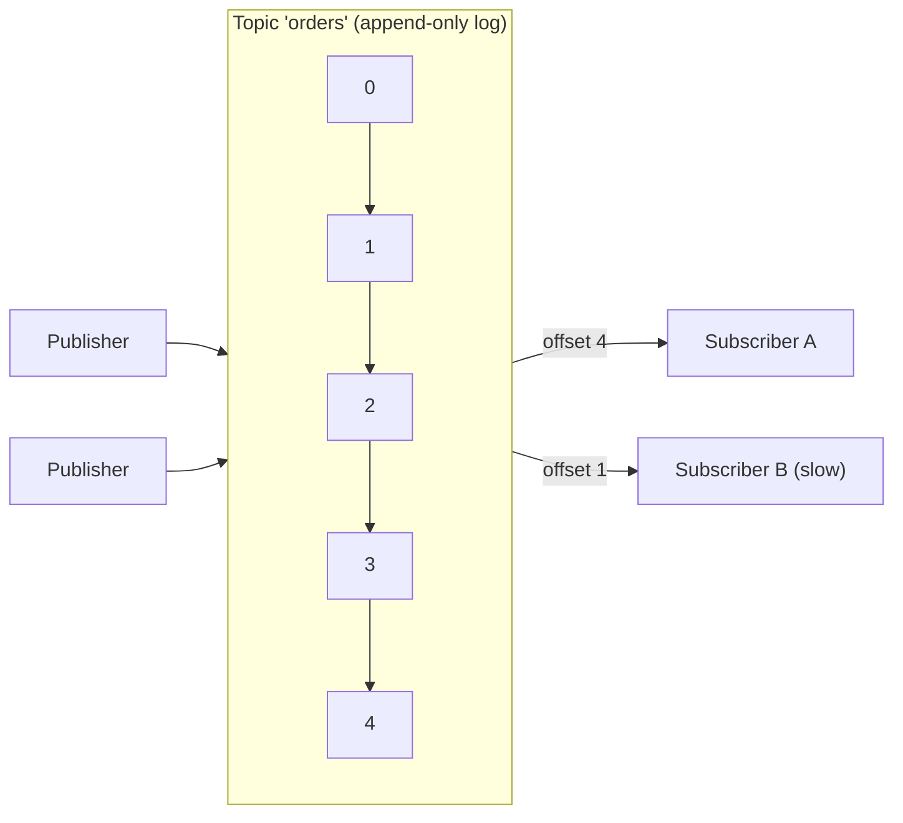
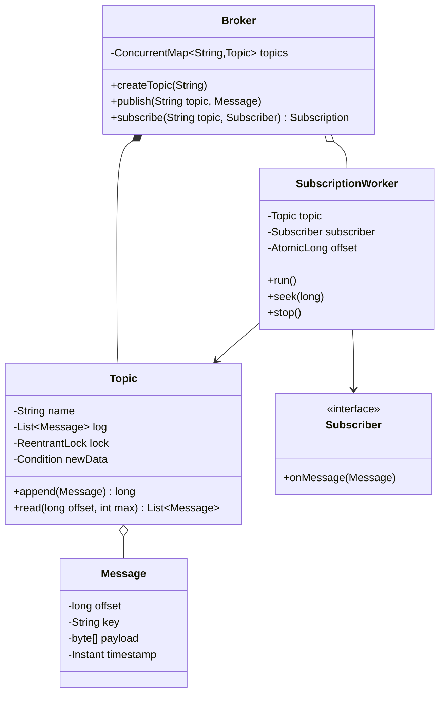

<Related ids={['observer-pattern', 'concurrency-for-lld', 'strategy-pattern', 'iterator-pattern', 'interview-grade-code']} />

"Design an in-memory pub-sub / message queue (like a mini Kafka)" is a hard machine-coding problem because it's mostly about **concurrency**: multiple publishers, multiple subscribers consuming at their own pace, ordering guarantees, offsets and replay. A clean answer shows producer–consumer done right.

## 1. Requirements

- Create topics; publishers publish messages to a topic.
- Subscribers subscribe to a topic and receive **every** message published after (or from a chosen offset) — each subscriber independently.
- Messages within a topic are delivered to each subscriber **in order**.
- Subscribers consume at their own speed; a slow subscriber must not block publishers or other subscribers.
- Subscribers can **reset their offset** to replay.
- Extensions: consumer groups (messages shared among group members), retention, acknowledgements and retries, partitions.

## 2. Design choice: log, not queue

Store each topic as an **append-only log** (a list of messages with increasing offsets). Each subscriber keeps its **own offset**. Benefits: publishers just append; subscribers are independent; replay is "move your offset back". This mirrors Kafka.



## 3. Class design



## 4. Implementation

### Topic: append-only log with blocking reads

```java
public final class Topic {
    private final String name;
    private final List<Message> log = new ArrayList<>();
    private final ReentrantLock lock = new ReentrantLock();
    private final Condition newData = lock.newCondition();

    public Topic(String name) { this.name = name; }

    public long append(String key, byte[] payload, Instant now) {
        lock.lock();
        try {
            long offset = log.size();
            log.add(new Message(offset, key, payload.clone(), now));
            newData.signalAll();                      // wake waiting subscribers
            return offset;
        } finally {
            lock.unlock();
        }
    }

    /** Returns up to max messages from offset, waiting up to timeout if none are available. */
    public List<Message> read(long offset, int max, Duration timeout) throws InterruptedException {
        lock.lock();
        try {
            long nanos = timeout.toNanos();
            while (offset >= log.size()) {
                if (nanos <= 0) return List.of();
                nanos = newData.awaitNanos(nanos);
            }
            int end = (int) Math.min(log.size(), offset + max);
            return List.copyOf(log.subList((int) offset, end));
        } finally {
            lock.unlock();
        }
    }

    public long endOffset() { lock.lock(); try { return log.size(); } finally { lock.unlock(); } }
}
```

Messages are immutable once appended, so returning copies of sub-lists is safe outside the lock. A record holding a `byte[]` isn't immutable by itself — the array can be changed through the accessor — so copy it on the way in and out:

```java
public record Message(long offset, String key, byte[] payload, Instant timestamp) {
    public Message { payload = payload.clone(); }                    // defensive copy in
    @Override public byte[] payload() { return payload.clone(); }   // and out
}
```

(Why a plain `ReentrantLock` and not a read-write lock? `read` must be able to *wait* for new data, and only the plain lock's `Condition` supports that cleanly; appends are short, so readers rarely wait for the lock itself.)

### Subscription worker: one thread (or task) per subscription

```java
public final class SubscriptionWorker implements Runnable {
    private final Topic topic;
    private final Subscriber subscriber;
    private final AtomicLong offset;
    private final RetryPolicy retryPolicy;
    private volatile boolean running = true;

    public SubscriptionWorker(Topic topic, Subscriber subscriber, long startOffset, RetryPolicy retryPolicy) {
        this.topic = topic; this.subscriber = subscriber;
        this.offset = new AtomicLong(startOffset); this.retryPolicy = retryPolicy;
    }

    @Override public void run() {
        while (running) {
            try {
                List<Message> batch = topic.read(offset.get(), 100, Duration.ofMillis(500));
                for (Message m : batch) {
                    if (!running || offset.get() != m.offset()) break;   // a seek happened: drop the stale batch
                    deliverWithRetry(m);                                  // in order, one at a time
                    offset.compareAndSet(m.offset(), m.offset() + 1);     // don't clobber a concurrent seek
                }
            } catch (InterruptedException e) {
                Thread.currentThread().interrupt();
                return;
            }
        }
    }

    private void deliverWithRetry(Message m) {
        for (int attempt = 1; ; attempt++) {
            try { subscriber.onMessage(m); return; }
            catch (RuntimeException e) {
                if (!retryPolicy.shouldRetry(attempt, e)) { deadLetter(m, e); return; }   // don't block forever
                retryPolicy.backoff(attempt);
            }
        }
    }

    public void seek(long newOffset) { offset.set(newOffset); }   // replay or skip
    public void stop() { running = false; }
}
```

<Callout type="warning" title="Seek and the in-flight batch">
The worker reads a batch of up to 100 messages and then delivers them one by one. If the subscriber calls `seek(0)` halfway through, the compare-and-set correctly refuses to move the offset forward — but without the `break`, the loop would keep delivering the rest of the **old** batch first. The reference solution's test shows the difference: 36 stale messages delivered after a rewind without the check, at most one (the one already in flight) with it.
</Callout>

### Broker

```java
public final class Broker implements AutoCloseable {
    private final ConcurrentMap<String, Topic> topics = new ConcurrentHashMap<>();
    private final ExecutorService workers = Executors.newVirtualThreadPerTaskExecutor();   // Java 21; or a cached pool
    private final Clock clock;

    public Broker(Clock clock) { this.clock = clock; }

    public void createTopic(String name) {
        if (topics.putIfAbsent(name, new Topic(name)) != null) throw new TopicExistsException(name);
    }

    public long publish(String topicName, String key, byte[] payload) {
        return topic(topicName).append(key, payload, clock.instant());
    }

    public Subscription subscribe(String topicName, Subscriber s, StartFrom from) {
        Topic t = topic(topicName);
        long start = from == StartFrom.EARLIEST ? 0 : t.endOffset();
        var worker = new SubscriptionWorker(t, s, start, RetryPolicy.exponential(3));
        workers.submit(worker);
        return new Subscription(worker);              // seek(), cancel()
    }

    private Topic topic(String name) {
        Topic t = topics.get(name);
        if (t == null) throw new UnknownTopicException(name);
        return t;
    }

    @Override public void close() { workers.shutdownNow(); }
}
```

## 5. Why this design satisfies the requirements

| Requirement | How |
| --- | --- |
| Independent subscribers | Each has its own worker and offset; a slow one only lags itself |
| Ordering per subscriber | One worker delivers sequentially from an ordered log |
| Publishers never blocked by consumers | Publishing is an O(1) append under a short lock |
| Replay | `seek(offset)` |
| No busy waiting | `Condition.awaitNanos` until new data arrives |
| Poison messages | Bounded retries, then dead-letter |

## 6. Extensions

- **Consumer groups**: members share one offset per group; a message is delivered to exactly one member. With a single log, assign messages by `key` hash to members, or split topics into **partitions** (each partition owned by one member) — exactly Kafka's model and what preserves per-key ordering.
- **Acknowledgements**: advance a *committed* offset only after `onMessage` succeeds; on restart, resume from the committed offset (at-least-once delivery).
- **Retention**: drop log segments older than a time/size limit; keep a base offset so offsets stay stable.
- **Back-pressure**: bounded in-memory log, or block/reject publishers when memory is full.
- **Push vs pull**: this design is pull-based (workers read); push-based delivery to remote subscribers needs per-subscriber queues and flow control.

## 7. Patterns used

| Pattern | Where |
| --- | --- |
| **Observer / pub-sub** | Subscribers receive messages from topics they subscribe to |
| **Producer–consumer** | Publishers append; workers consume |
| **Iterator** | Offsets as cursors over the log |
| **Strategy** | `RetryPolicy`, partition assignment |
| **Facade** | `Broker` |

## Interview questions

<QA q="How do you prevent a slow subscriber from slowing down publishers and other subscribers?">
Decouple them with an append-only log per topic and a separate worker per subscription. Publishers only append under a short lock; each worker reads from its own offset at its own pace and delivers sequentially. A slow subscriber simply lags further behind; nobody waits for it. Memory is bounded with retention, and alerting on lag tells operators it's falling behind.
</QA>

<QA q="How would you add consumer groups where each message is processed by only one member?">
Track one offset per group rather than per subscriber, and split the topic into partitions, assigning each partition to exactly one group member at a time. Messages are routed to partitions by key hash, so per-key ordering is preserved within a partition. When members join or leave, rebalance partition assignments, resuming each partition from the group's committed offset.
</QA>

<QA q="What delivery guarantee does your design provide?">
In-memory with offsets advanced after successful delivery, it's at-least-once within the process lifetime: a message whose delivery throws is retried, and a subscriber may see a message again after a retry. If the process crashes, in-memory messages and offsets are lost. For durability, persist the log and committed offsets to disk; for exactly-once effects, make subscribers idempotent by message offset or ID.
</QA>

<Practice task="Implement consumer groups: within a group, each message goes to exactly one member; different groups each get every message. What's the minimal change to this design?">

Partition topics: a topic becomes N append-only logs, and `publish` picks a partition by `hash(key) % N` so per-key order is preserved. A group keeps one committed offset per partition and assigns each partition to exactly one member (round-robin over members). Each member runs a worker per assigned partition. When members join or leave, the group rebalances: stop workers, reassign partitions, and resume each from the group's committed offset — at-least-once delivery across the handover.

</Practice>

<Practice task="Add retention: keep only the last 24 hours (or 1 GB) of messages per topic, without breaking offsets held by subscribers.">

Store the log in segments (for example 10,000 messages each) and remember each segment's base offset. A cleaner deletes whole segments that are entirely older than the retention limit. Offsets stay absolute; the topic tracks its earliest available offset. A subscriber whose offset falls before it gets an "offset out of range" signal and must reset — to the earliest available offset or to the latest, by policy (Kafka's `auto.offset.reset`).

</Practice>

<Takeaways>

- Model topics as append-only logs; give each subscriber its own offset.
- Use condition variables (or blocking queues) for efficient waiting; keep publish locks short.
- One worker per subscription preserves order and isolates slow consumers.
- Offsets enable replay, acknowledgements and consumer groups via partitions.

</Takeaways>

## Further reading

- Jay Kreps, "The Log: What every software engineer should know about real-time data's unifying abstraction" (2013).
- HLD context: [Message Queues & Event Streaming](/system-design/hld/message-queues).
- Brian Goetz et al., *Java Concurrency in Practice* — chapter 14, "Building Custom Synchronizers" (condition queues).
