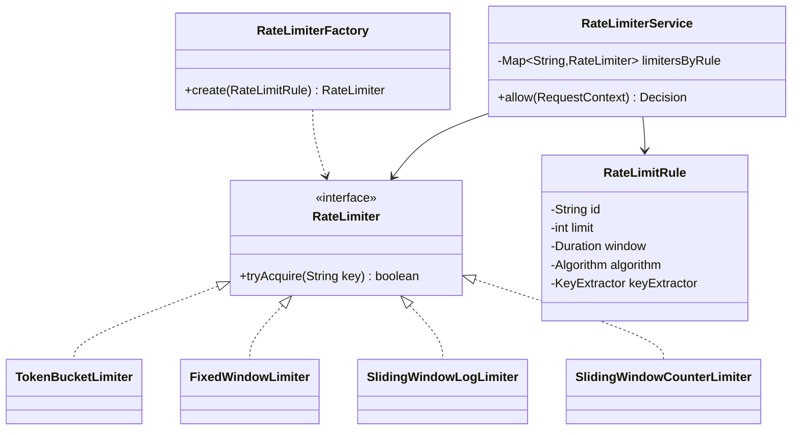

<Related ids={['strategy-pattern', 'factory-patterns', 'decorator-pattern', 'concurrency-for-lld', 'interview-grade-code']} />

A rate limiter answers one question for every incoming request: **"is this user allowed another request right now?"** For example, "at most 100 requests per minute per user". Beyond that, the request is rejected (an HTTP 429 "Too Many Requests"). It protects a service from being flooded, whether by a buggy client in a retry loop or by an attacker.

The LLD version asks you to build it **inside one program**: thread-safe, with **swappable algorithms** and **different limits for different users or APIs**. (The algorithms are explained in depth in [Rate Limiting](/system-design/hld/rate-limiting); the version shared across many servers is [Design a Distributed Rate Limiter](/system-design/hld/design-rate-limiter).)

We'll use the same six steps as every case study: requirements, entities, class design, code, a worked example, and follow-ups. (The [parking lot](/system-design/lld/lld-parking-lot) lesson explains the plan in detail.)

## Step 1: Pin down the requirements

<Dialogue>
<Turn who="you">What do we limit by? User id, API key, IP address?</Turn>
<Turn who="them">Make it configurable. Usually user id.</Turn>
<Turn who="you">Do different APIs or plans get different limits?</Turn>
<Turn who="them">Yes. Free users get 100 a minute; paid users get more. Some endpoints have their own limits.</Turn>
<Turn who="you">Is a short burst OK, as long as the average stays under the limit?</Turn>
<Turn who="them">Small bursts are fine.</Turn>
<Turn who="you">Which algorithm should I use?</Turn>
<Turn who="them">Your choice, but I'd like to be able to switch.</Turn>
<Turn who="you">Many threads calling it at once?</Turn>
<Turn who="them">Yes, it sits in front of every request.</Turn>
</Dialogue>

"Small bursts are fine" points to the **token bucket**. "I'd like to be able to switch" says the algorithm must sit behind an interface.

**The limiter must:**

1. Answer `allow(key)` with true or false, where the key is a user id, API key or IP.
2. Support different limits per rule (for example, per plan or per endpoint).
3. Support several algorithms and make switching easy.
4. Be thread-safe and fast, since every request goes through it.
5. Not leak memory for users who appear once and never return.

**Out of scope for now:** sharing limits across several servers.

## Step 2: Understand the algorithms first

You can't design the classes until you know what each algorithm needs to remember. Here are the four you should be able to name, using "5 requests per second" as the example:

| Algorithm | How it works | Remembers per key | Weakness |
| --- | --- | --- | --- |
| **Fixed window** | Count requests in each clock second (12:00:00–12:00:01, and so on). Reject past 5. | Window start, count | Burst at the edge: 5 at 12:00:00.9 and 5 at 12:00:01.0 gives 10 in 0.1 s. |
| **Sliding window log** | Keep the time of every allowed request. Drop those older than 1 s. Reject if 5 remain. | A list of timestamps | Exact, but memory grows with the limit. |
| **Sliding window counter** | Blend this second's count with last second's, weighted by how far into this second we are. | Two counts | An approximation, but cheap and close. |
| **Token bucket** | A bucket holds up to 5 tokens and refills at 5 per second. Each request takes one; no token, rejected. | Token count, last refill time | Allows bursts up to the bucket size (often what you want). |

The token bucket is the usual first choice: tiny state, smooth average rate, and controlled bursts.

<Callout type="note" title="Refilling a token bucket without a timer">
You don't need a background thread adding tokens. When a request arrives, work out how much time has passed since the last refill and add that many tokens (capped at the maximum). Then try to take one. All the refilling happens **lazily**, at the moment it's needed.
</Callout>

## Step 3: Design the classes

| Piece | Make it… | Why |
| --- | --- | --- |
| The algorithm | an interface `RateLimiter` with one implementation per algorithm | Requirement 3: switchable. That's the Strategy pattern. |
| One user's state (a bucket or a window) | a small private class | Each key needs its own counter or bucket. |
| All the keys' state | a `ConcurrentHashMap<String, Bucket>` | Thread-safe lookup, and new buckets created atomically. |
| A limit setting | a record `RateLimitRule` | Limit, window, algorithm, and how to get the key from a request. |
| Building a limiter from a rule | a `RateLimiterFactory` | One place that maps "TOKEN_BUCKET" to the right class. |
| Checking all rules for a request | a `RateLimiterService` | A request may be limited per user **and** per IP. |
| Time | an injected clock (a `LongSupplier`) | So tests can move time forward instead of sleeping. |

The interesting decision is **how to make it thread-safe**:

<Approach verdict="bad" title="One lock around everything">

`synchronized` on `allow`. Correct, but now every request in the whole service waits in one line, even for unrelated users. A rate limiter that becomes the bottleneck defeats its own purpose.

</Approach>

<Approach verdict="good" title="ConcurrentHashMap and no other locking">

The map is thread-safe, but the bucket inside it isn't. "Refill, check, take a token" is three steps, and two threads can interleave between them, both taking the last token.

</Approach>

<Approach verdict="great" title="Lock each user's bucket separately">

`computeIfAbsent` creates each user's bucket exactly once. Then `synchronized (bucket)` locks **only that user's bucket** during refill-check-take. Requests from different users never wait for each other; requests from the same user wait for a few nanoseconds.

</Approach>



## Step 4: Write the code

<InterviewScope minutes="30–45" lines="50" write={["A `RateLimiter` interface", "Token bucket per user, with an injected clock", "One more algorithm (fixed window) to show it is pluggable"]} say={["Sliding window log and counter, and their trade-offs", "Different limits per API or per plan", "Removing buckets for idle users"]} skip={["A distributed limiter with Redis (that is an HLD question)"]} />

### The interview-sized version

Two algorithms behind one interface, one bucket per user, locked per user rather than globally. It's about **50 lines**, and it compiles and runs.

```java
interface RateLimiter { boolean allow(String userId); }

class TokenBucketLimiter implements RateLimiter {
    private final int capacity;
    private final double tokensPerMilli;
    private final LongSupplier clock;                              // injected, so tests control time
    private final Map<String, Bucket> buckets = new ConcurrentHashMap<>();

    TokenBucketLimiter(int capacity, int tokensPerSecond, LongSupplier clock) {
        this.capacity = capacity;
        this.tokensPerMilli = tokensPerSecond / 1000.0;
        this.clock = clock;
    }

    public boolean allow(String userId) {
        Bucket b = buckets.computeIfAbsent(userId, id -> new Bucket(capacity, clock.getAsLong()));
        synchronized (b) {                                         // lock one user's bucket, not everyone's
            long now = clock.getAsLong();
            b.tokens = Math.min(capacity, b.tokens + (now - b.lastRefill) * tokensPerMilli);
            b.lastRefill = now;
            if (b.tokens < 1) return false;
            b.tokens -= 1;
            return true;
        }
    }

    private static final class Bucket {
        double tokens;
        long lastRefill;
        Bucket(double tokens, long lastRefill) { this.tokens = tokens; this.lastRefill = lastRefill; }
    }
}

class FixedWindowLimiter implements RateLimiter {
    private final int limit;
    private final long windowMillis;
    private final LongSupplier clock;
    private final Map<String, Window> windows = new ConcurrentHashMap<>();

    FixedWindowLimiter(int limit, long windowMillis, LongSupplier clock) { this.limit = limit; this.windowMillis = windowMillis; this.clock = clock; }

    public boolean allow(String userId) {
        Window w = windows.computeIfAbsent(userId, id -> new Window());
        synchronized (w) {
            long now = clock.getAsLong(), start = now - now % windowMillis;
            if (w.start != start) { w.start = start; w.count = 0; }     // a new window has begun
            if (w.count >= limit) return false;
            w.count++;
            return true;
        }
    }

    private static final class Window { long start = -1; int count; }
}
```

**Reading it top to bottom:**

1. **`RateLimiter`** has one method. Everything else is an implementation detail.
2. **`TokenBucketLimiter.allow`**: `computeIfAbsent` gets or creates this user's bucket, starting full.
3. Inside `synchronized (b)`: work out the elapsed time, add `elapsed × rate` tokens (but never above `capacity`), and move `lastRefill` to now.
4. If there's at least one token, take it and allow the request; otherwise reject.
5. **`FixedWindowLimiter`**: `now - now % windowMillis` rounds the time down to the start of the current window. If that's different from the stored start, a new window has begun, so reset the count. Then allow up to `limit` requests.
6. The clock is a `LongSupplier` passed in. Production passes `System::currentTimeMillis`; a test passes a variable it can move forward.

<Callout type="tip" title="How to practise this">
Trace the token bucket with capacity 2 and a rate of 1 token per second: requests at 0.0 s, 0.1 s, 0.2 s and 1.5 s. Which are allowed? (The first two, then reject, then allow, because 1.3 s of refill brings the bucket back above 1 token.)
</Callout>

### Growing it into the full design

#### The interface

```java
public interface RateLimiter {
    boolean tryAcquire(String key);
}
```

#### Token bucket, done carefully

The full version uses `System.nanoTime` and reads the clock **inside** the lock:

```java
public final class TokenBucketLimiter implements RateLimiter {
    private final long capacity;
    private final double refillPerNano;
    private final LongSupplier nanoClock;
    private final ConcurrentHashMap<String, Bucket> buckets = new ConcurrentHashMap<>();

    private static final class Bucket {
        double tokens;
        long lastRefillNanos;
        Bucket(double tokens, long now) { this.tokens = tokens; this.lastRefillNanos = now; }
    }

    public TokenBucketLimiter(long capacity, long refillTokens, Duration refillPeriod, LongSupplier nanoClock) {
        this.capacity = capacity;
        this.refillPerNano = (double) refillTokens / refillPeriod.toNanos();
        this.nanoClock = nanoClock;
    }

    @Override public boolean tryAcquire(String key) {
        Bucket b = buckets.computeIfAbsent(key, k -> new Bucket(capacity, nanoClock.getAsLong()));
        synchronized (b) {                                      // per-key lock: keys don't contend
            long now = nanoClock.getAsLong();                   // read time INSIDE the lock
            double refill = Math.max(0, now - b.lastRefillNanos) * refillPerNano;
            b.tokens = Math.min(capacity, b.tokens + refill);
            b.lastRefillNanos = Math.max(b.lastRefillNanos, now);
            if (b.tokens >= 1) { b.tokens -= 1; return true; }
            return false;
        }
    }
}
```

Why `nanoTime`? It's a **monotonic** clock: it only moves forward. `currentTimeMillis` is the wall clock, which can jump backwards when the system syncs its time, and that could suddenly hand out a burst of tokens or none at all.

<Callout type="warning" title="Read the clock inside the lock">
If `now` is read *before* `synchronized (b)`, two threads can enter the lock in the opposite order to the order they read the clock. The second one then sees `now` as older than `lastRefillNanos`: the refill comes out negative (tokens vanish) and `lastRefillNanos` moves backwards (they reappear later). Reading the time inside the lock keeps each bucket's timeline in order. The `Math.max` guards are a cheap second line of defence.
</Callout>

#### Fixed window, without a lock

`compute` replaces the window atomically when a new one starts, and the counter is an `AtomicInteger`, so no `synchronized` is needed.

```java
public final class FixedWindowLimiter implements RateLimiter {
    private final int limit;
    private final long windowMillis;
    private final LongSupplier millisClock;
    private final ConcurrentHashMap<String, Window> windows = new ConcurrentHashMap<>();

    private record Window(long start, AtomicInteger count) { }

    public FixedWindowLimiter(int limit, long windowMillis, LongSupplier millisClock) {
        this.limit = limit; this.windowMillis = windowMillis; this.millisClock = millisClock;
    }

    @Override public boolean tryAcquire(String key) {
        long now = millisClock.getAsLong();
        long start = now - (now % windowMillis);
        Window w = windows.compute(key, (k, old) ->
                old == null || old.start() < start ? new Window(start, new AtomicInteger()) : old);   // never roll back
        return w.count().incrementAndGet() <= limit;
    }
}
```

Remember its weakness: up to twice the limit can get through across a window boundary.

#### Sliding window log

Keep the timestamp of each allowed request. On each new request, drop timestamps older than the window, then allow if fewer than `limit` remain. Rejected requests are **not** recorded, or a client hammering the limiter would lock itself out forever.

```java
public final class SlidingWindowLogLimiter implements RateLimiter {
    private final int limit;
    private final long windowNanos;
    private final LongSupplier nanoClock;
    private final ConcurrentHashMap<String, Deque<Long>> logs = new ConcurrentHashMap<>();

    public SlidingWindowLogLimiter(int limit, long windowNanos, LongSupplier nanoClock) {
        this.limit = limit; this.windowNanos = windowNanos; this.nanoClock = nanoClock;
    }

    @Override public boolean tryAcquire(String key) {
        Deque<Long> log = logs.computeIfAbsent(key, k -> new ArrayDeque<>());
        synchronized (log) {
            long now = nanoClock.getAsLong();                // inside the lock: entries stay in time order
            while (!log.isEmpty() && now - log.peekFirst() >= windowNanos) log.pollFirst();   // drop old entries
            if (log.size() >= limit) return false;           // rejected requests are NOT recorded
            log.addLast(now);
            return true;
        }
    }
}
```

#### Sliding window counter

Estimate the requests in the last full window as "this window's count + last window's count × the fraction of last window still inside the sliding range". At 25% into the current window, 75% of the previous window still counts.

```java
public final class SlidingWindowCounterLimiter implements RateLimiter {
    private final int limit; private final long windowMillis; private final LongSupplier millisClock;
    private final ConcurrentHashMap<String, Counters> state = new ConcurrentHashMap<>();

    private static final class Counters { long windowStart; int current; int previous; }

    public SlidingWindowCounterLimiter(int limit, long windowMillis, LongSupplier millisClock) {
        this.limit = limit; this.windowMillis = windowMillis; this.millisClock = millisClock;
    }

    @Override public boolean tryAcquire(String key) {
        Counters c = state.computeIfAbsent(key, k -> new Counters());
        synchronized (c) {
            long now = millisClock.getAsLong();
            long start = now - (now % windowMillis);
            if (c.windowStart != start) {                    // roll windows forward
                c.previous = (start - c.windowStart == windowMillis) ? c.current : 0;
                c.current = 0;
                c.windowStart = start;
            }
            double elapsed = (double) (now - start) / windowMillis;
            double estimated = c.current + c.previous * (1 - elapsed);
            if (estimated + 1 > limit) return false;         // admitting this request must stay within the limit
            c.current++;
            return true;
        }
    }
}
```

#### A factory to build limiters from rules

```java
public enum Algorithm { TOKEN_BUCKET, FIXED_WINDOW, SLIDING_LOG, SLIDING_COUNTER }

public record RateLimitRule(String id, int limit, Duration window, Algorithm algorithm,
                            Function<RequestContext, String> keyExtractor) { }

public final class RateLimiterFactory {
    public RateLimiter create(RateLimitRule r) {
        return switch (r.algorithm()) {
            case TOKEN_BUCKET    -> new TokenBucketLimiter(r.limit(), r.limit(), r.window(), System::nanoTime);
            case FIXED_WINDOW    -> new FixedWindowLimiter(r.limit(), r.window().toMillis(), System::currentTimeMillis);
            case SLIDING_LOG     -> new SlidingWindowLogLimiter(r.limit(), r.window().toNanos(), System::nanoTime);
            case SLIDING_COUNTER -> new SlidingWindowCounterLimiter(r.limit(), r.window().toMillis(), System::currentTimeMillis);
        };
    }
}
```

#### A service that checks every rule

A request might need to pass "100 per minute per user" **and** "1,000 per minute per IP". The service checks each rule that applies, and rejects at the first one that says no.

```java
public final class RateLimiterService {
    private final List<RateLimitRule> rules;
    private final Map<String, RateLimiter> limiters;

    public RateLimiterService(List<RateLimitRule> rules, RateLimiterFactory factory) {
        this.rules = List.copyOf(rules);
        this.limiters = rules.stream().collect(Collectors.toMap(RateLimitRule::id, factory::create));
    }

    public Decision allow(RequestContext ctx) {
        for (RateLimitRule rule : rules) {
            String key = rule.keyExtractor().apply(ctx);
            if (key == null) continue;                        // rule doesn't apply
            if (!limiters.get(rule.id()).tryAcquire(key))
                return Decision.rejected(rule.id());
        }
        return Decision.allowed();
    }
}
```

<Callout type="note">
Checking rules one by one means a request rejected by rule 2 has already used a token from rule 1. For strict accounting, check all rules first without consuming ("peek"), then consume from all. Most real systems accept the small over-count instead.
</Callout>

#### Memory: removing idle users

A million users who visit once would leave a million buckets in the map forever. A scheduled cleanup removes buckets that haven't been touched for longer than the window. A bucket idle that long would be full anyway, which is exactly what a new bucket looks like, so removing it changes nothing.

```java
int evictIdle(Duration maxIdle) {
    long cutoff = nanoClock.getAsLong() - maxIdle.toNanos();
    int[] removed = {0};
    buckets.forEach((key, b) -> {
        boolean idle;
        synchronized (b) { idle = b.lastRefillNanos < cutoff; }
        if (idle && buckets.remove(key, b)) removed[0]++;   // two-argument remove: only if it's still this bucket
    });
    return removed[0];
}
```

The two-argument `buckets.remove(key, b)` only removes the entry if it's still this exact bucket, so it never deletes a bucket that was just replaced. (Or use a cache library such as Caffeine with "expire after access" and let it do this for you.)

## Step 5: Trace a burst

Token bucket: capacity 3, refill 1 token per second. User U1 sends requests at these times:

| Time | Tokens before | Refill | Decision | Tokens after |
| --- | --- | --- | --- | --- |
| 0.0 s | 3 (new bucket) | 0 | allow | 2 |
| 0.1 s | 2 | +0.1 | allow | 1.1 |
| 0.2 s | 1.1 | +0.1 | allow | 0.2 |
| 0.3 s | 0.2 | +0.1 | **reject** (below 1) | 0.3 |
| 1.0 s | 0.3 | +0.7 | allow | 0.0 |
| 5.0 s | 0.0 | +4, capped at 3 | allow | 2 |

A burst of 3 gets through instantly, then U1 is held to about one request per second. Meanwhile user U2 has their own bucket and is never affected.

## Step 6: Handle follow-up questions

**"Run on 10 servers with a shared limit."** Write a `RedisRateLimiter` implementing the same interface: a Lua script refills and takes a token atomically on the Redis server, using Redis's clock rather than each server's. The service and rules don't change. Discuss what happens when Redis is down: let requests through (fail open) or reject them (fail closed)?

**"Different limits for free and paid users."** Two rules whose key extractor returns `null` when the rule doesn't apply to this user's plan.

**"Tell clients when to retry."** Return the time until the next token as a `Retry-After` header.

**"Log and measure rejections."** Wrap any limiter in a `MetricsRateLimiter` decorator.

## Common mistakes

- **One global lock** around all users.
- **Making the map thread-safe but not the bucket's refill-check-take steps.**
- **Using the wall clock** for elapsed time.
- **A background thread per user** to add tokens, instead of refilling lazily.
- **Recording rejected requests** in the sliding log.
- **Never removing idle keys.**

## Patterns used

| Pattern | Where |
| --- | --- |
| **Strategy** | Each algorithm implements `RateLimiter` |
| **Factory** | `RateLimiterFactory` builds limiters from rule settings |
| **Decorator** | `MetricsRateLimiter`, `LoggingRateLimiter` wrapping any limiter |
| **Chain / composite** | Several rules checked per request |
| **Strategy** (follow-up) | A `RedisRateLimiter` is just another implementation of the same interface |

## Interview questions

<QA q="How do you make a token bucket thread-safe without a global lock?">
Keep one bucket per key in a ConcurrentHashMap (created atomically with computeIfAbsent) and synchronise only on that bucket while refilling and taking a token. Requests for different keys never wait for each other; requests for the same key take turns briefly. A lock-free alternative stores the bucket's state in an AtomicReference to an immutable record and updates it with a compare-and-set retry loop.
</QA>

<QA q="Why use System.nanoTime rather than System.currentTimeMillis for refill calculations?">
nanoTime is a monotonic clock meant for measuring elapsed time: it never goes backwards. currentTimeMillis is the wall clock and can jump forwards or backwards when the system time is adjusted, which could suddenly grant a burst of tokens or none. Use wall-clock time only where windows must line up with real clock boundaries, and inject the time source for tests.
</QA>

<Practice task="Make multi-rule evaluation strict: a request rejected by rule 2 must not consume a token from rule 1. How?">

Split each limiter's operation into `tryReserve(key)` and `commit`/`cancel`. Check rules in a fixed order, reserving from each; if any rejects, cancel the reservations already made. To stop two requests interleaving between reserve and commit, either make reserve itself take the token (and cancel give it back), which is simple and correct for token buckets and counters, or lock the involved keys in a fixed order. Most production systems accept the small over-count instead.

</Practice>

<Practice task="The service now runs on 10 servers. Replace the in-memory limiter with Redis while keeping RateLimiterService unchanged.">

Implement `RateLimiter` with a Redis-backed class: a Lua script per algorithm that reads, refills and takes a token atomically on the Redis server (keys like `rl:{rule}:{key}` with an expiry so idle keys disappear). Use the Redis server's time inside the script rather than each app server's clock. The factory creates `RedisTokenBucketLimiter` when configured; the service and rules don't change. Discuss what happens when Redis is unavailable (fail open or fail closed).

</Practice>

<Takeaways>

- Know the four algorithms and their trade-offs; the token bucket is the usual default.
- One interface, one class per algorithm (Strategy), built from rule settings (Factory).
- Keep state per key in a ConcurrentHashMap and lock per key, never globally.
- Refill lazily from elapsed time, using a monotonic, injected clock read inside the lock.
- Remove idle keys so memory stays bounded.

</Takeaways>

## Further reading

- [Rate Limiting](/system-design/hld/rate-limiting) (algorithms) and [Design a Distributed Rate Limiter](/system-design/hld/design-rate-limiter).
- [Bucket4j](https://github.com/bucket4j/bucket4j) and Guava's `RateLimiter`: production Java implementations worth reading.
