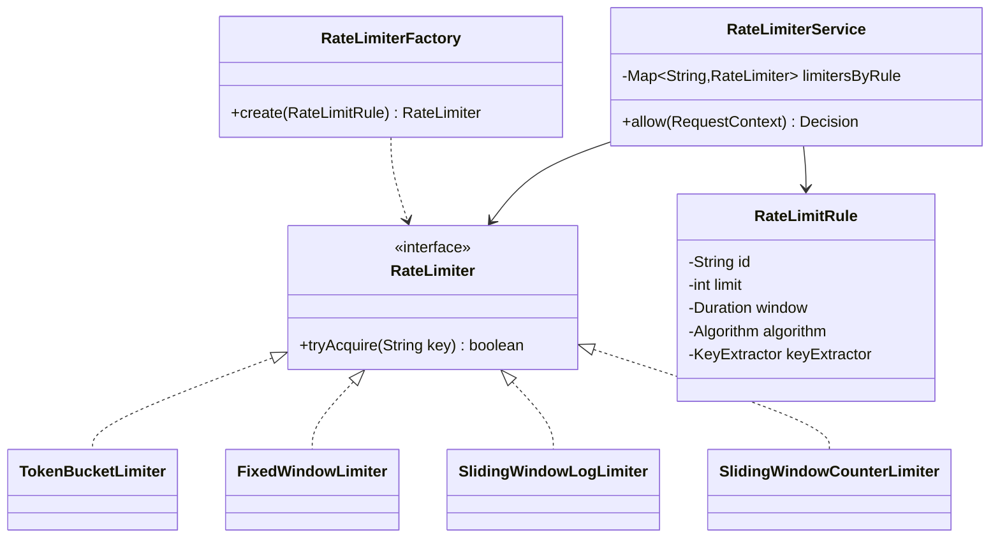

<Related ids={['strategy-pattern', 'factory-patterns', 'decorator-pattern', 'concurrency-for-lld', 'interview-grade-code']} />

The LLD version of the rate limiter is a favourite machine-coding problem: implement a **thread-safe, in-process** limiter with **pluggable algorithms** and **per-key, per-rule configuration**. (The algorithms are explained in depth in [Rate Limiting](/system-design/hld/rate-limiting); the distributed service in [Design a Distributed Rate Limiter](/system-design/hld/design-rate-limiter).)

## What the interviewer expects

The full design in this lesson is longer than anything you'd write in one round. It's there so you understand the edge cases and can answer follow-up questions. In the round itself, aim for this:

<InterviewScope minutes="30–45" lines="50" write={["A `RateLimiter` interface", "Token bucket per user, with an injected clock", "One more algorithm (fixed window) to show it is pluggable"]} say={["Sliding window log and counter, and their trade-offs", "Different limits per API or per plan", "Removing buckets for idle users"]} skip={["A distributed limiter with Redis (that is an HLD question)"]} />

### The interview-sized version

Two algorithms behind one interface, one bucket per user, locked per user rather than globally. It's about **50 lines**, and it compiles and runs.

```java
interface RateLimiter { boolean allow(String userId); }

class TokenBucketLimiter implements RateLimiter {
    private final int capacity;
    private final double tokensPerMilli;
    private final LongSupplier clock;                              // injected, so tests control time
    private final Map<String, Bucket> buckets = new ConcurrentHashMap<>();

    TokenBucketLimiter(int capacity, int tokensPerSecond, LongSupplier clock) {
        this.capacity = capacity;
        this.tokensPerMilli = tokensPerSecond / 1000.0;
        this.clock = clock;
    }

    public boolean allow(String userId) {
        Bucket b = buckets.computeIfAbsent(userId, id -> new Bucket(capacity, clock.getAsLong()));
        synchronized (b) {                                         // lock one user's bucket, not everyone's
            long now = clock.getAsLong();
            b.tokens = Math.min(capacity, b.tokens + (now - b.lastRefill) * tokensPerMilli);
            b.lastRefill = now;
            if (b.tokens < 1) return false;
            b.tokens -= 1;
            return true;
        }
    }

    private static final class Bucket {
        double tokens;
        long lastRefill;
        Bucket(double tokens, long lastRefill) { this.tokens = tokens; this.lastRefill = lastRefill; }
    }
}

class FixedWindowLimiter implements RateLimiter {
    private final int limit;
    private final long windowMillis;
    private final LongSupplier clock;
    private final Map<String, Window> windows = new ConcurrentHashMap<>();

    FixedWindowLimiter(int limit, long windowMillis, LongSupplier clock) { this.limit = limit; this.windowMillis = windowMillis; this.clock = clock; }

    public boolean allow(String userId) {
        Window w = windows.computeIfAbsent(userId, id -> new Window());
        synchronized (w) {
            long now = clock.getAsLong(), start = now - now % windowMillis;
            if (w.start != start) { w.start = start; w.count = 0; }     // a new window has begun
            if (w.count >= limit) return false;
            w.count++;
            return true;
        }
    }

    private static final class Window { long start = -1; int count; }
}
```

<Callout type="tip" title="How to use the rest of this lesson">
Practise writing the short version above, in your own words, until you can do it in about 30 minutes. Then read the full design below for the edge cases and follow-up answers. Interviewers often ask about those, but they rarely ask you to type them all.
</Callout>

## 1. Requirements

- `boolean allow(String key)` — e.g., key = user ID or API key; true if the request may proceed.
- Rules configurable per client type/endpoint: limit and window (e.g., 100 requests per minute).
- Algorithms: **token bucket**, **fixed window**, **sliding window log**, **sliding window counter** — selectable per rule.
- Thread-safe under high concurrency; low latency.
- Memory bounded: idle keys must not accumulate forever.
- Extensions: multiple rules per request (per-user AND per-IP), distributed backend, metrics.

## 2. Class design



- Each **algorithm** is a `RateLimiter` implementation managing state **per key** (Strategy).
- A **factory** builds the right limiter from a rule.
- The **service** evaluates all rules applicable to a request.
- Time comes from an injected **Clock** (or a nano-time supplier) for testability.

## 3. Implementation

### Interface

```java
public interface RateLimiter {
    boolean tryAcquire(String key);
}
```

### Token bucket (per key)

```java
public final class TokenBucketLimiter implements RateLimiter {
    private final long capacity;
    private final double refillPerNano;
    private final LongSupplier nanoClock;
    private final ConcurrentHashMap<String, Bucket> buckets = new ConcurrentHashMap<>();

    private static final class Bucket {
        double tokens;
        long lastRefillNanos;
        Bucket(double tokens, long now) { this.tokens = tokens; this.lastRefillNanos = now; }
    }

    public TokenBucketLimiter(long capacity, long refillTokens, Duration refillPeriod, LongSupplier nanoClock) {
        this.capacity = capacity;
        this.refillPerNano = (double) refillTokens / refillPeriod.toNanos();
        this.nanoClock = nanoClock;
    }

    @Override public boolean tryAcquire(String key) {
        Bucket b = buckets.computeIfAbsent(key, k -> new Bucket(capacity, nanoClock.getAsLong()));
        synchronized (b) {                                      // per-key lock: keys don't contend
            long now = nanoClock.getAsLong();                   // read time INSIDE the lock
            double refill = Math.max(0, now - b.lastRefillNanos) * refillPerNano;
            b.tokens = Math.min(capacity, b.tokens + refill);
            b.lastRefillNanos = Math.max(b.lastRefillNanos, now);
            if (b.tokens >= 1) { b.tokens -= 1; return true; }
            return false;
        }
    }
}
```

Use a **monotonic** time source (`System::nanoTime`) for durations — wall-clock time can jump backwards.

<Callout type="warning" title="Read the clock inside the lock">
If `now` is read *before* `synchronized (b)`, two threads can enter in the opposite order to the one they read the clock in. The second one then sees `now` older than `lastRefillNanos`: the refill comes out negative (tokens disappear) and `lastRefillNanos` moves backwards (they reappear later). Reading the time inside the lock keeps each bucket's timeline monotonic; the `Math.max` guards are a cheap second line of defence.
</Callout>

### Fixed window (lock-free)

```java
public final class FixedWindowLimiter implements RateLimiter {
    private final int limit;
    private final long windowMillis;
    private final LongSupplier millisClock;
    private final ConcurrentHashMap<String, Window> windows = new ConcurrentHashMap<>();

    private record Window(long start, AtomicInteger count) { }

    public FixedWindowLimiter(int limit, long windowMillis, LongSupplier millisClock) {
        this.limit = limit; this.windowMillis = windowMillis; this.millisClock = millisClock;
    }

    @Override public boolean tryAcquire(String key) {
        long now = millisClock.getAsLong();
        long start = now - (now % windowMillis);
        Window w = windows.compute(key, (k, old) ->
                old == null || old.start() < start ? new Window(start, new AtomicInteger()) : old);   // never roll back
        return w.count().incrementAndGet() <= limit;
    }
}
```

`compute` atomically replaces the window when a new one begins; the counter increment is atomic. Remember the boundary-burst weakness (up to 2× the limit across a window edge).

### Sliding window log

```java
public final class SlidingWindowLogLimiter implements RateLimiter {
    private final int limit;
    private final long windowNanos;
    private final LongSupplier nanoClock;
    private final ConcurrentHashMap<String, Deque<Long>> logs = new ConcurrentHashMap<>();

    public SlidingWindowLogLimiter(int limit, long windowNanos, LongSupplier nanoClock) {
        this.limit = limit; this.windowNanos = windowNanos; this.nanoClock = nanoClock;
    }

    @Override public boolean tryAcquire(String key) {
        Deque<Long> log = logs.computeIfAbsent(key, k -> new ArrayDeque<>());
        synchronized (log) {
            long now = nanoClock.getAsLong();                // inside the lock: entries stay in time order
            while (!log.isEmpty() && now - log.peekFirst() >= windowNanos) log.pollFirst();   // drop old entries
            if (log.size() >= limit) return false;           // rejected requests are NOT recorded
            log.addLast(now);
            return true;
        }
    }
}
```

Exact, but memory grows with the limit (one timestamp per allowed request in the window).

### Sliding window counter

```java
public final class SlidingWindowCounterLimiter implements RateLimiter {
    private final int limit; private final long windowMillis; private final LongSupplier millisClock;
    private final ConcurrentHashMap<String, Counters> state = new ConcurrentHashMap<>();

    private static final class Counters { long windowStart; int current; int previous; }

    public SlidingWindowCounterLimiter(int limit, long windowMillis, LongSupplier millisClock) {
        this.limit = limit; this.windowMillis = windowMillis; this.millisClock = millisClock;
    }

    @Override public boolean tryAcquire(String key) {
        Counters c = state.computeIfAbsent(key, k -> new Counters());
        synchronized (c) {
            long now = millisClock.getAsLong();
            long start = now - (now % windowMillis);
            if (c.windowStart != start) {                    // roll windows forward
                c.previous = (start - c.windowStart == windowMillis) ? c.current : 0;
                c.current = 0;
                c.windowStart = start;
            }
            double elapsed = (double) (now - start) / windowMillis;
            double estimated = c.current + c.previous * (1 - elapsed);
            if (estimated + 1 > limit) return false;         // admitting this request must stay within the limit
            c.current++;
            return true;
        }
    }
}
```

### Factory and rules

```java
public enum Algorithm { TOKEN_BUCKET, FIXED_WINDOW, SLIDING_LOG, SLIDING_COUNTER }

public record RateLimitRule(String id, int limit, Duration window, Algorithm algorithm,
                            Function<RequestContext, String> keyExtractor) { }

public final class RateLimiterFactory {
    public RateLimiter create(RateLimitRule r) {
        return switch (r.algorithm()) {
            case TOKEN_BUCKET    -> new TokenBucketLimiter(r.limit(), r.limit(), r.window(), System::nanoTime);
            case FIXED_WINDOW    -> new FixedWindowLimiter(r.limit(), r.window().toMillis(), System::currentTimeMillis);
            case SLIDING_LOG     -> new SlidingWindowLogLimiter(r.limit(), r.window().toNanos(), System::nanoTime);
            case SLIDING_COUNTER -> new SlidingWindowCounterLimiter(r.limit(), r.window().toMillis(), System::currentTimeMillis);
        };
    }
}
```

### Service: multiple rules per request

```java
public final class RateLimiterService {
    private final List<RateLimitRule> rules;
    private final Map<String, RateLimiter> limiters;

    public RateLimiterService(List<RateLimitRule> rules, RateLimiterFactory factory) {
        this.rules = List.copyOf(rules);
        this.limiters = rules.stream().collect(Collectors.toMap(RateLimitRule::id, factory::create));
    }

    public Decision allow(RequestContext ctx) {
        for (RateLimitRule rule : rules) {
            String key = rule.keyExtractor().apply(ctx);
            if (key == null) continue;                        // rule doesn't apply
            if (!limiters.get(rule.id()).tryAcquire(key))
                return Decision.rejected(rule.id());
        }
        return Decision.allowed();
    }
}
```

<Callout type="note">
Evaluating rules one by one means a request rejected by rule 2 has already consumed a token from rule 1. For strict accounting, first check all rules without consuming ("peek"), then consume from all, under a combined lock — or accept the small over-count, which most systems do.
</Callout>

## 4. Memory: evicting idle keys

Per-key state for millions of users who appear once would leak memory. Options:

- A scheduled cleanup removing keys idle longer than the window (a token bucket idle that long is full, which is the same as absent).
- Use a bounded cache with expire-after-access for the per-key map (e.g., Caffeine), so idle keys disappear automatically.

```java
int evictIdle(Duration maxIdle) {
    long cutoff = nanoClock.getAsLong() - maxIdle.toNanos();
    int[] removed = {0};
    buckets.forEach((key, b) -> {
        boolean idle;
        synchronized (b) { idle = b.lastRefillNanos < cutoff; }
        if (idle && buckets.remove(key, b)) removed[0]++;   // two-argument remove: only if it's still this bucket
    });
    return removed[0];
}
```

A request can still grab a bucket a moment before it is evicted and update it after; the next request simply creates a fresh, full bucket — at worst one extra request is admitted, which is acceptable for an idle key.

## 5. Patterns used

| Pattern | Where |
| --- | --- |
| **Strategy** | Each algorithm implements `RateLimiter` |
| **Factory** | `RateLimiterFactory` builds limiters from rule config |
| **Decorator** | `MetricsRateLimiter`, `LoggingRateLimiter` wrapping any limiter |
| **Chain / composite** | Multiple rules evaluated per request |
| **Strategy** (extension) | A `RedisRateLimiter` is just another implementation of the same interface for distributed use |

## Interview questions

<QA q="How do you make a token bucket thread-safe without a global lock?">
Keep one bucket object per key in a ConcurrentHashMap (created atomically with computeIfAbsent) and synchronise only on that bucket while refilling and taking a token. Requests for different keys never contend; requests for the same key serialise briefly. A lock-free alternative stores the bucket state in an AtomicReference to an immutable record and updates it with a compare-and-set retry loop.
</QA>

<QA q="Why use System.nanoTime rather than System.currentTimeMillis for refill calculations?">
nanoTime is a monotonic clock intended for measuring elapsed time: it never goes backwards. currentTimeMillis is wall-clock time and can jump forwards or backwards when the system clock is adjusted (NTP), which could suddenly grant a burst of tokens or none. Use wall-clock time only where windows must align to real calendar boundaries, and inject the time source for tests.
</QA>

<Practice task="Make multi-rule evaluation strict: a request rejected by rule 2 must not consume a token from rule 1. How?">

Split each limiter's operation into `tryReserve(key)` and `commit`/`cancel`. Evaluate rules in a fixed order, reserving from each; if any rejects, cancel the reservations already made. To avoid two requests interleaving between reserve and commit, either make reserve itself decrement (and cancel re-increment) — simple and correct for token buckets and counters — or lock the involved keys in a global order. Most production systems accept the small over-count instead.

</Practice>

<Practice task="The service now runs on 10 servers. Replace the in-memory limiter with Redis while keeping RateLimiterService unchanged.">

Implement `RateLimiter` with a Redis-backed class: a Lua script per algorithm that reads, refills and decrements the bucket atomically on the Redis server (keys like `rl:{rule}:{key}` with an expiry so idle keys disappear). Use Redis server time inside the script rather than each app server's clock. The factory creates `RedisTokenBucketLimiter` when configured; the service and rules don't change. Discuss what happens when Redis is unavailable (fail open vs fail closed).

</Practice>

<Takeaways>

- One interface, several algorithm implementations (Strategy), built from rule config (Factory).
- State is per key in a ConcurrentHashMap; lock per key (or CAS) for low contention.
- Use a monotonic, injected time source; evict idle keys to bound memory.
- Evaluate multiple rules per request; be explicit about consumption semantics.

</Takeaways>

## Further reading

- [Rate Limiting](/system-design/hld/rate-limiting) (algorithms) and [Design a Distributed Rate Limiter](/system-design/hld/design-rate-limiter).
- [Bucket4j](https://github.com/bucket4j/bucket4j) and Guava's `RateLimiter` — production Java implementations worth reading.
