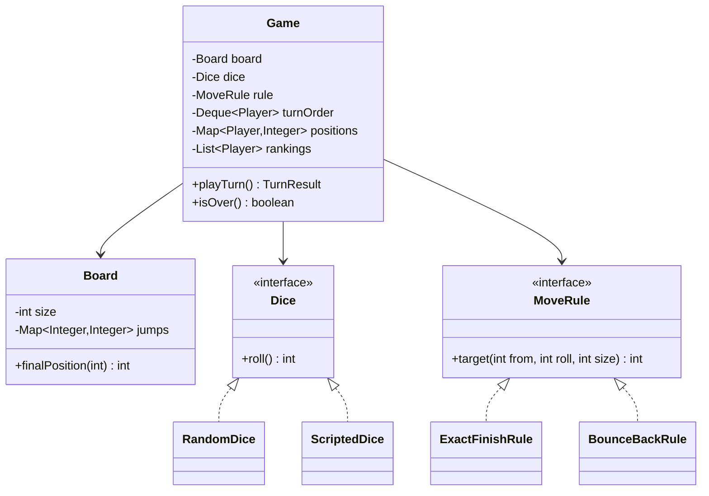

<Related ids={['lld-interview-framework', 'interview-grade-code', 'strategy-pattern', 'code-smells-refactoring']} />

Snake & Ladder is the classic **90-minute machine-coding round**: small enough to finish, open enough to show judgment. This lesson is a minute-by-minute walkthrough of one strong attempt — what to say, what to type, and what to leave out — ending in a complete, tested solution.

Use it as a rehearsal script. The timings matter as much as the code.

## The prompt

> "Design and implement Snake & Ladder. Multiple players take turns rolling a die and moving on a 100-cell board with snakes and ladders. The first player to reach 100 wins. You have 90 minutes; we want running code."

## Minutes 0–10: clarify, then commit

Ask a few questions, state assumptions for the rest, and write them down where the interviewer can see them.

| Question | Assumption written down |
| --- | --- |
| Board size? | 100 cells by default; configurable |
| How are snakes and ladders given? | As input: a list of (start, end) pairs, validated |
| Dice? | One six-sided die; number of dice configurable |
| Overshooting 100? | Must land exactly; otherwise stay (other rule as an extension) |
| Game end? | Keep playing until one player is left, so we produce a full ranking |
| Rolling a 6? | No extra turn for now — mention as an extension |
| Input/output? | Driven from `main` with a demo; no UI |

<Callout type="interview">
Say out loud which features you are **not** building yet ("extra turn on a six, three sixes forfeit, bounce-back rule") and that the design will make them easy to add. That converts "missing features" into "planned extension points".
</Callout>

## Minutes 10–20: entities and variation points

Nouns from the prompt: board, cell, snake, ladder, player, die, turn, game. Then trim:

- **Cell** doesn't need a class — a cell is an `int`. Snakes and ladders are both "jump from A to B", so one `Map<Integer, Integer>` covers them; the direction tells you which is which.
- **Board** owns the jumps and validates them.
- **Dice** is an interface — random in production, **scripted in tests**. This is the single most important design decision for testability.
- **MoveRule** is an interface — exact finish vs bounce-back is a real variation point the interviewer is likely to ask about.
- **Game** owns turn order, positions and rankings.



Note what is **not** here: no `Snake` and `Ladder` classes with identical fields, no `Cell` objects, no `GameManager`. Over-modelling is as visible to the interviewer as under-modelling.

## Minutes 20–60: code the core, run it early

Write in this order, and run something by minute 40.

### Board — with validation

```java
public final class Board {
    private final int size;
    private final Map<Integer, Integer> jumps;          // start → end (snake if end is lower, ladder if higher)

    public Board(int size, Map<Integer, Integer> jumps) {
        this.size = size;
        this.jumps = Map.copyOf(jumps);
        validate();
    }

    private void validate() {
        for (var e : jumps.entrySet()) {
            int from = e.getKey(), to = e.getValue();
            if (from <= 0 || from >= size) throw new InvalidBoardException("jump must start inside the board: " + from);
            if (to < 0 || to > size) throw new InvalidBoardException("jump must end on the board: " + to);
            if (from == to) throw new InvalidBoardException("a jump must move: " + from);
        }
        for (int start : jumps.keySet()) {                 // following jumps must never revisit a cell
            Set<Integer> seen = new HashSet<>();
            for (int at = start; jumps.containsKey(at); at = jumps.get(at))
                if (!seen.add(at)) throw new InvalidBoardException("jumps form a loop through " + at);
        }
    }

    /** Where a token ends up after landing on cell p (follows chained jumps). */
    public int finalPosition(int p) {
        while (jumps.containsKey(p)) p = jumps.get(p);
        return p;
    }

    public int size() { return size; }
}
```

Validation is where many candidates lose easy points. A ladder whose top is a snake's head is legal (a chain), but a ladder to 30 plus a snake from 30 back to 10 is an **infinite loop** — the cycle check catches it.

### Dice and rules — the two strategies

```java
public interface Dice { int roll(); }

public final class RandomDice implements Dice {
    private final Random random; private final int count;
    public RandomDice(Random random, int count) { this.random = random; this.count = count; }
    public int roll() { int sum = 0; for (int i = 0; i < count; i++) sum += 1 + random.nextInt(6); return sum; }
}

public final class ScriptedDice implements Dice {            // for tests: "roll 4, then 1, then 2"
    private final Deque<Integer> rolls;
    public ScriptedDice(Integer... rolls) { this.rolls = new ArrayDeque<>(List.of(rolls)); }
    public int roll() { return rolls.removeFirst(); }
}

public interface MoveRule { int target(int from, int roll, int size); }

public final class ExactFinishRule implements MoveRule {
    public int target(int from, int roll, int size) { return from + roll > size ? from : from + roll; }
}

public final class BounceBackRule implements MoveRule {
    public int target(int from, int roll, int size) { int t = from + roll; return t > size ? size - (t - size) : t; }
}
```

### Game — turn order with a deque

```java
public record Player(String name) { }
public enum JumpType { NONE, SNAKE, LADDER }
public record TurnResult(Player player, int roll, int from, int to, JumpType jump, boolean won) { }

public final class Game {
    private final Board board;
    private final Dice dice;
    private final MoveRule rule;
    private final Map<Player, Integer> positions = new HashMap<>();
    private final Deque<Player> turnOrder;
    private final List<Player> rankings = new ArrayList<>();

    public Game(Board board, List<Player> players, Dice dice, MoveRule rule) {
        if (players.size() < 2) throw new IllegalArgumentException("need at least 2 players");
        if (new HashSet<>(players).size() != players.size()) throw new IllegalArgumentException("player names must be unique");
        this.board = board; this.dice = dice; this.rule = rule;
        this.turnOrder = new ArrayDeque<>(players);
        players.forEach(p -> positions.put(p, 0));
    }

    public TurnResult playTurn() {
        if (isOver()) throw new IllegalStateException("Game is over");
        Player p = turnOrder.pollFirst();
        int from = positions.get(p);
        int roll = dice.roll();
        int landed = rule.target(from, roll, board.size());
        int to = board.finalPosition(landed);
        JumpType jump = to == landed ? JumpType.NONE : to > landed ? JumpType.LADDER : JumpType.SNAKE;
        positions.put(p, to);

        boolean won = to == board.size();
        if (won) rankings.add(p); else turnOrder.addLast(p);           // finished players leave the rotation
        if (turnOrder.size() == 1) rankings.add(turnOrder.pollFirst()); // last player standing
        return new TurnResult(p, roll, from, to, jump, won);
    }

    public boolean isOver() { return turnOrder.isEmpty(); }
    public List<Player> rankings() { return List.copyOf(rankings); }
}
```

A **deque as the turn order** is the small idea that keeps this clean: take the player from the front, put them at the back unless they finished. No index arithmetic, and finished players drop out naturally.

### The demo (minute 40: it runs)

```java
public static void main(String[] args) {
    Board board = new Board(100, Map.of(4, 25, 21, 39, 27, 5, 40, 3, 99, 7));
    Game game = new Game(board, List.of(new Player("Asha"), new Player("Ravi")),
                         new RandomDice(new Random(), 1), new ExactFinishRule());
    while (!game.isOver()) {
        TurnResult t = game.playTurn();
        System.out.printf("%s rolled %d: %d → %d %s%n", t.player().name(), t.roll(), t.from(), t.to(),
                          t.jump() == JumpType.NONE ? "" : "(" + t.jump() + ")");
    }
    System.out.println("Ranking: " + game.rankings());
}
```

## Minutes 60–75: tests and edge cases

With scripted dice, every rule becomes a one-line assertion:

```java
var game = new Game(board, List.of(new Player("Asha"), new Player("Ravi")),
                    new ScriptedDice(4, 1, 2), new ExactFinishRule());
assertEquals(25, game.playTurn().to());          // Asha: 4 is a ladder to 25
assertEquals(1,  game.playTurn().to());          // Ravi: plain move
assertEquals(5,  game.playTurn().to());          // Asha: 25 + 2 = 27, a snake to 5
```

Edge cases worth a test each: overshooting 100 (stay put), exact landing wins, a chain of jumps, an invalid board (loop, jump off the board, jump from 100), and a three-player game where turn order skips the finished players. The reference solution also plays 300 random games on random boards and checks each one terminates with a full ranking — a cheap, convincing robustness test.

## Minutes 75–90: extensions the interviewer will ask for

| Twist | Change |
| --- | --- |
| Extra turn on a six; three sixes forfeit | A `TurnPolicy` strategy asked "does this player go again?"; track consecutive sixes per player |
| Bounce-back from 100 | Already a `MoveRule` — swap `BounceBackRule` in |
| Two dice, or a crooked die that only rolls even numbers | New `Dice` implementations; the game doesn't change |
| Special cells (skip a turn, teleport) | Generalise jumps into a `CellEffect` interface; snake and ladder become two effects |
| Save and resume | Positions and turn order are plain data — serialise them; `place(player, cell)` restores |
| Online multiplayer | One game per room, moves validated server-side, one lock (or one thread) per game |

## What made this attempt strong

- **Scoped early** and wrote assumptions down.
- **Two interfaces, both justified**: dice (testability) and move rule (a likely twist). Nothing speculative.
- **Ran by minute 40**, then hardened.
- **Validation** of the input board, with clear exceptions.
- **Tests with injected randomness** — the biggest separator between "it seems to work" and "I can show it works".

## Interview questions

<QA q="Why make the dice an interface when there's only one real die?">
Because randomness makes the game untestable: you can't assert what happens on a ladder if you can't control the roll. Injecting a Dice lets tests script exact rolls, and the same seam supports real variations interviewers ask for (two dice, loaded dice). It's the same reasoning as injecting a Clock.
</QA>

<QA q="How do you detect an invalid board where snakes and ladders form a loop?">
Treat the jumps as edges in a graph where each cell has at most one outgoing jump. From every jump start, follow jumps while recording visited cells; seeing a cell twice means a cycle, which would trap a player forever. Also reject jumps that start on cell 0 or the last cell, end off the board, or don't move. Validate once in the Board constructor so a game can never start on an invalid board.
</QA>

<QA q="The interviewer adds: rolling a six gives another turn, but three sixes in a row sends you back to start. Where does that go?">
Into a turn policy rather than the core loop: after each roll, ask a TurnPolicy whether the same player goes again and whether a penalty applies, keeping a consecutive-six count per player. Game.playTurn then puts the player back at the front of the deque instead of the back when they earn another turn. Board, Dice and MoveRule don't change.
</QA>

<Practice task="Add 'special cells': landing on certain cells makes you skip your next turn. How do you fit this in without special-casing it inside Game.playTurn?">

Generalise jumps into cell effects: a `CellEffect` interface with `apply(GameContext, Player, int cell)` that returns the new position and may set state (such as "skip next turn"). Snakes and ladders become `JumpEffect`s; the new rule is a `SkipTurnEffect` that records the player in a skip set. `playTurn` checks the skip set when taking a player from the deque (and puts them straight to the back if they must skip). Board stores `Map<Integer, CellEffect>` and still validates jump cycles.

</Practice>

<Practice task="The product team wants a 'best of three' tournament between the same players. What do you add, and what stays untouched?">

Add a `Tournament` that creates a fresh `Game` per round (same players, new board or the same one), records each round's ranking, and decides the winner by a `ScoringRule` (for example 3 points for first, 1 for second). `Game`, `Board`, `Dice` and `MoveRule` don't change — a tournament composes games rather than extending them.

</Practice>

<Takeaways>

- In a machine-coding round, scope in 10 minutes, design in 10, and have code running by minute 40.
- Model only what varies or carries rules: jumps as a map, dice and move rules as interfaces.
- A deque makes turn order and dropping finished players trivial.
- Inject randomness so every rule is testable; add a randomised robustness test if time allows.
- Validate inputs (loops, out-of-range jumps) in constructors.

</Takeaways>

## Further reading

- [The LLD Interview Framework](/system-design/lld/lld-interview-framework) and [Writing Interview-Grade Code](/system-design/lld/interview-grade-code).
- [Strategy](/system-design/lld/strategy-pattern) — dice and move rules.
