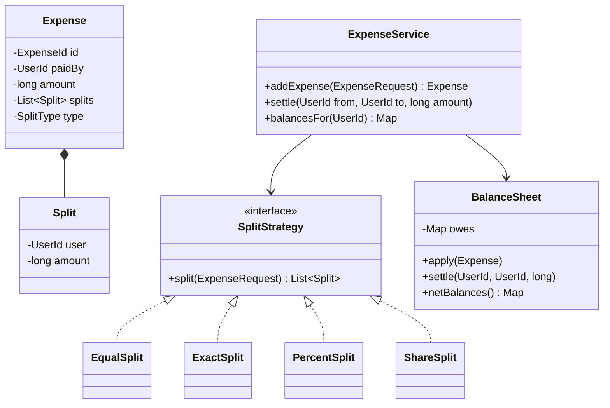

<Related ids={['strategy-pattern', 'factory-patterns', 'observer-pattern', 'interview-grade-code', 'concurrency-for-lld']} />

Splitwise is an app for sharing expenses: you pay for dinner, mark who was there, and it keeps track of who owes whom. It's one of the most common machine-coding problems at Indian product companies. It looks simple, but it tests four things: **handling money without losing a paisa**, the **Strategy pattern** for different ways of splitting, a **clean way to store balances**, and, as a classic follow-up, **settling a group in as few payments as possible**.

We'll use the same six steps as every case study: requirements, entities, class design, code, a worked example, and follow-ups. (The [parking lot](/system-design/lld/lld-parking-lot) lesson explains the plan in detail.)

## Step 1: Pin down the requirements

<Dialogue>
<Turn who="you">When someone adds an expense, what do they enter?</Turn>
<Turn who="them">Who paid, the total, who it's shared between, and how it's split.</Turn>
<Turn who="you">What kinds of split?</Turn>
<Turn who="them">Equal; exact amounts per person; and percentages.</Turn>
<Turn who="you">What should happen if the exact amounts don't add up to the total, or the percentages to 100?</Turn>
<Turn who="them">Reject the expense.</Turn>
<Turn who="you">₹100 split three ways is ₹33.33 each, which loses a paisa. Is it OK if one person pays a paisa more?</Turn>
<Turn who="them">Yes, as long as the parts add up exactly to the total.</Turn>
<Turn who="you">What does a user need to see?</Turn>
<Turn who="them">Who they owe and who owes them. And they should be able to record a payment to settle up.</Turn>
<Turn who="you">Groups? Simplifying debts?</Turn>
<Turn who="them">Groups are nice to have. Simplifying debts is a good follow-up.</Turn>
</Dialogue>

The rounding question is the one that impresses. It shows you've thought about money before writing code.

**The system must:**

1. Add an expense: who paid, the total, the participants and a split type.
2. Support **equal**, **exact** and **percent** splits, rejecting exact amounts or percentages that don't add up.
3. Make every split add up **exactly** to the total, to the paisa.
4. Show balances: who owes whom, and how much.
5. Record a settlement payment between two people.

**Out of scope for now:** currencies, notifications, editing expenses.

## Step 2: Find the core entities

| Noun | Make it… | Why |
| --- | --- | --- |
| User | an id (`UserId`) | For this round, a name or id is enough. |
| Expense | a class/record | Who paid, how much, the split type, and each person's share. |
| Split (one person's share) | a record `Split(user, amount)` | A pair of values. |
| Split type | an enum, **and** a strategy per type | Each type calculates and validates differently. |
| Money amount | a `long` in **paise** | Never `double`. More below. |
| Balances | a class `BalanceSheet` | Who owes whom. It changes with every expense and payment. |
| Expense service | a class | The front door: add expense, settle, show balances. |

### Money: why paise, and why remainders matter

Store every amount as a whole number of **paise** in a `long`. ₹100 is `10000`. Floating point can't represent most decimal amounts exactly, so `double` slowly drifts.

Even with integers, ₹100 doesn't divide evenly by 3. The rule: give everyone the rounded-down amount, then hand out the leftover paise one at a time:

```java
static long[] splitEqually(long totalPaise, int n) {
    long base = totalPaise / n, remainder = totalPaise % n;
    long[] parts = new long[n];
    for (int i = 0; i < n; i++) parts[i] = base + (i < remainder ? 1 : 0);
    return parts;                                   // ₹100.00 / 3 → 3334, 3333, 3333 paise
}
```

## Step 3: Design each class

**`SplitStrategy`**: one job, "given the expense details, return each person's share, or reject it if invalid". One class per split type:

- **`EqualSplit`**: the remainder trick above.
- **`ExactSplit`**: check the amounts add up to the total, then use them.
- **`PercentSplit`**: check the percentages add up to 100, then convert to amounts, making sure the rounding still adds up exactly.

Why a strategy? Compare:

<Approach verdict="bad" title="A switch on split type inside addExpense">

```java
switch (type) { case EQUAL -> …; case EXACT -> …; case PERCENT -> …; }
```

Each case has its own validation and maths, so this method grows with every new split type and is hard to test piece by piece.

</Approach>

<Approach verdict="great" title="One strategy class per split type">

Each type's rules live in their own small class, testable on its own. Adding "split by shares (2:1:1)" means adding one class and one line in a registry. `addExpense` never changes.

</Approach>

**`BalanceSheet`**: stores who owes whom. The key idea is **netting**: if A owes B ₹300 and B owes A ₹100, store only "A owes B ₹200". That keeps the numbers people see small and meaningful.

**`ExpenseService`**: validates the request, picks the strategy, records the expense and updates the balances.



## Step 4: Write the code

<InterviewScope minutes="45–60" lines="60" write={["A `SplitStrategy` interface with equal, exact and percent splits", "Amounts in paise, so no rupee is lost to rounding", "A balance sheet: who owes whom"]} say={["Debt simplification (fewest payments to settle a group)", "Groups, and recording a settlement payment", "Validating that exact amounts and percentages add up"]} skip={["Currencies and exchange rates", "Notifications and reminders"]} />

### The interview-sized version

Three split strategies and a balance sheet that nets debts in both directions. It's about **60 lines**, and it compiles and runs.

```java
// Amounts are in paise (long), so ₹100 split three ways never loses a paisa to rounding.
interface SplitStrategy { Map<String, Long> split(long total, List<String> people, List<Long> values); }

class EqualSplit implements SplitStrategy {
    public Map<String, Long> split(long total, List<String> people, List<Long> ignored) {
        Map<String, Long> shares = new LinkedHashMap<>();
        long base = total / people.size(), leftover = total % people.size();
        for (int i = 0; i < people.size(); i++) shares.put(people.get(i), base + (i < leftover ? 1 : 0));
        return shares;
    }
}

class ExactSplit implements SplitStrategy {
    public Map<String, Long> split(long total, List<String> people, List<Long> amounts) {
        if (amounts.stream().mapToLong(Long::longValue).sum() != total) throw new IllegalArgumentException("Amounts must add up to the total");
        Map<String, Long> shares = new LinkedHashMap<>();
        for (int i = 0; i < people.size(); i++) shares.put(people.get(i), amounts.get(i));
        return shares;
    }
}

class PercentSplit implements SplitStrategy {
    public Map<String, Long> split(long total, List<String> people, List<Long> percents) {
        if (percents.stream().mapToLong(Long::longValue).sum() != 100) throw new IllegalArgumentException("Percentages must add up to 100");
        Map<String, Long> shares = new LinkedHashMap<>();
        long given = 0;
        for (int i = 0; i < people.size(); i++) {
            long share = i == people.size() - 1 ? total - given : total * percents.get(i) / 100;   // last person takes the rounding
            shares.put(people.get(i), share);
            given += share;
        }
        return shares;
    }
}

class ExpenseService {
    // balance.get(a).get(b) = how much b owes a (negative means a owes b)
    private final Map<String, Map<String, Long>> balance = new HashMap<>();

    synchronized void addExpense(String paidBy, long total, List<String> people, List<Long> values, SplitStrategy strategy) {
        strategy.split(total, people, values).forEach((person, share) -> {
            if (person.equals(paidBy)) return;
            add(paidBy, person, share);
            add(person, paidBy, -share);
        });
    }

    synchronized long owes(String debtor, String creditor) {
        long amount = balance.getOrDefault(creditor, Map.of()).getOrDefault(debtor, 0L);
        return Math.max(0, amount);
    }

    private void add(String a, String b, long amount) {
        balance.computeIfAbsent(a, k -> new HashMap<>()).merge(b, amount, Long::sum);
    }
}
```

**Reading it top to bottom:**

1. **`SplitStrategy`** takes the total, the people and a list of values (ignored for equal, amounts for exact, percentages for percent) and returns each person's share.
2. **`EqualSplit`** gives everyone `total / n`, and the first `total % n` people one extra paisa.
3. **`ExactSplit`** rejects the expense unless the amounts add up to the total.
4. **`PercentSplit`** rejects unless the percentages add up to 100. Each share is rounded down, and the **last person gets whatever is left**, so the total is always exact.
5. **`ExpenseService.addExpense`**: for every share that isn't the payer's own, the person owes the payer that amount. It records this in **both** directions: +share for "the payer is owed by this person" and −share the other way. That's how debts in opposite directions cancel out automatically.
6. **`owes(debtor, creditor)`** reads the balance and never returns a negative number.

<Callout type="tip" title="How to practise this">
Write `EqualSplit` first and test it on ₹100 among 3 people (10,000 paise → 3,334, 3,333, 3,333). Then add the other two strategies and the balance map.
</Callout>

### Growing it into the full design

#### The request and the strategies

The full version bundles the expense details into an `ExpenseRequest` and adds a **shares** split (2:1:1). Percentages are stored as basis points (percent × 100) so 33.33% is possible.

<FullCode title="Show the full code: Request and split strategies (46 lines)">

```java
public enum SplitType { EQUAL, EXACT, PERCENT, SHARES }

public record ExpenseRequest(UserId paidBy, long amountPaise, List<UserId> participants,
                             SplitType type, Map<UserId, Long> values,   // exact paise, percent×100, or shares
                             String description) { }

public record Split(UserId user, long amountPaise) { }

public interface SplitStrategy {
    List<Split> split(ExpenseRequest req);           // validates and computes; parts sum to the total
}

public final class EqualSplit implements SplitStrategy {
    public List<Split> split(ExpenseRequest r) {
        long[] parts = splitEqually(r.amountPaise(), r.participants().size());
        List<Split> out = new ArrayList<>();
        for (int i = 0; i < parts.length; i++) out.add(new Split(r.participants().get(i), parts[i]));
        return out;
    }
}

public final class ExactSplit implements SplitStrategy {
    public List<Split> split(ExpenseRequest r) {
        long sum = r.participants().stream().mapToLong(u -> r.values().getOrDefault(u, 0L)).sum();
        if (sum != r.amountPaise())
            throw new InvalidSplitException("Exact amounts sum to " + sum + ", expected " + r.amountPaise());
        return r.participants().stream().map(u -> new Split(u, r.values().get(u))).toList();
    }
}

public final class PercentSplit implements SplitStrategy {
    public List<Split> split(ExpenseRequest r) {
        // values are basis points (percent × 100) to allow 33.33%
        long totalBp = r.participants().stream().mapToLong(u -> r.values().getOrDefault(u, 0L)).sum();
        if (totalBp != 10_000) throw new InvalidSplitException("Percentages must total 100");
        return largestRemainder(r, r.values(), 10_000);
    }
}

public final class ShareSplit implements SplitStrategy {
    public List<Split> split(ExpenseRequest r) {
        long totalShares = r.participants().stream().mapToLong(u -> r.values().getOrDefault(u, 0L)).sum();
        if (totalShares <= 0) throw new InvalidSplitException("Shares must be positive");
        return largestRemainder(r, r.values(), totalShares);
    }
}
```

</FullCode>

Percent and share splits both use a fair rounding method called **largest remainder** (also known as Hamilton's method):

1. Give everyone their exact share, rounded down.
2. Count how many paise are left over.
3. Give those leftover paise, one each, to the people whose shares were rounded down the most.

```java
/** Hamilton's method: floor each share, then give leftover paise to the largest fractional remainders. */
static List<Split> largestRemainder(ExpenseRequest r, Map<UserId, Long> weights, long totalWeight) {
    List<UserId> people = r.participants();
    long[] parts = new long[people.size()];
    long[] remainders = new long[people.size()];
    long allocated = 0;
    for (int i = 0; i < people.size(); i++) {
        long numerator = Math.multiplyExact(r.amountPaise(), weights.getOrDefault(people.get(i), 0L));
        parts[i] = numerator / totalWeight;
        remainders[i] = numerator % totalWeight;           // the fractional part, scaled by totalWeight
        allocated += parts[i];
    }
    Integer[] order = new Integer[people.size()];
    for (int i = 0; i < order.length; i++) order[i] = i;
    Arrays.sort(order, (x, y) -> remainders[y] != remainders[x]
            ? Long.compare(remainders[y], remainders[x]) : Integer.compare(x, y));   // deterministic ties
    for (int k = 0; k < r.amountPaise() - allocated; k++) parts[order[k]]++;
    List<Split> out = new ArrayList<>();
    for (int i = 0; i < people.size(); i++) out.add(new Split(people.get(i), parts[i]));
    return out;
}
```

Example: shares of 2:1:1 on ₹10.01 (1,001 paise) are exactly 500.5, 250.25 and 250.25. Rounded down: 500, 250, 250 = 1,000. One paisa is left, and the first person has the largest fraction (0.5), so they get it: **501, 250, 250**.

A small registry maps each split type to its strategy:

```java
public final class SplitStrategies {
    private final Map<SplitType, SplitStrategy> byType = new EnumMap<>(Map.of(
            SplitType.EQUAL, new EqualSplit(), SplitType.EXACT, new ExactSplit(),
            SplitType.PERCENT, new PercentSplit(), SplitType.SHARES, new ShareSplit()));
    public SplitStrategy forType(SplitType t) { return byType.get(t); }
}
```

#### The balance sheet

**Adding a debt** "debtor owes creditor X", in plain steps:

1. Look up whether the creditor already owes the debtor something (the reverse debt).
2. If the reverse debt is at least X, just reduce it by X. They're cancelling out.
3. Otherwise, clear the reverse debt and record the rest as debtor → creditor.

A settlement is just a debt in the opposite direction: if Ravi pays Asha ₹200, that's like Asha "owing" Ravi ₹200, which cancels Ravi's debt.

<FullCode title="Show the full code: Balance sheet (40 lines)">

```java
public final class BalanceSheet {
    // owes.get(a).get(b) = amount a owes b (always positive; only one direction stored per pair)
    private final Map<UserId, Map<UserId, Long>> owes = new HashMap<>();

    public synchronized void apply(Expense e) {
        for (Split s : e.splits()) {
            if (!s.user().equals(e.paidBy())) addDebt(s.user(), e.paidBy(), s.amountPaise());
        }
    }

    public synchronized void settle(UserId from, UserId to, long amount) {
        addDebt(to, from, amount);                    // paying reduces from's debt (or creates the reverse)
    }

    private void addDebt(UserId debtor, UserId creditor, long amount) {
        long reverse = get(creditor, debtor);
        if (reverse >= amount) {                       // net against the opposite debt
            put(creditor, debtor, reverse - amount);
        } else {
            put(creditor, debtor, 0);
            put(debtor, creditor, get(debtor, creditor) + amount - reverse);
        }
    }

    /** Positive = others owe this user; negative = this user owes others. */
    public synchronized Map<UserId, Long> netBalances() {
        Map<UserId, Long> net = new HashMap<>();
        owes.forEach((debtor, m) -> m.forEach((creditor, amt) -> {
            net.merge(debtor, -amt, Long::sum);
            net.merge(creditor, amt, Long::sum);
        }));
        return net;
    }

    private long get(UserId a, UserId b) { return owes.getOrDefault(a, Map.of()).getOrDefault(b, 0L); }
    private void put(UserId a, UserId b, long v) {
        if (v == 0) { Map<UserId, Long> m = owes.get(a); if (m != null) m.remove(b); }
        else owes.computeIfAbsent(a, k -> new HashMap<>()).put(b, v);
    }
}
```

</FullCode>

`netBalances()` sums everything per person: positive means others owe them, negative means they owe others. The debt simplification below starts from these numbers.

#### The service

```java
public final class ExpenseService {
    private final SplitStrategies strategies;
    private final ExpenseRepository expenses;
    private final BalanceSheet balances;

    public Expense addExpense(ExpenseRequest req) {
        validate(req);                                       // amount > 0, at least one participant, no duplicates
        List<Split> splits = strategies.forType(req.type()).split(req);
        Expense expense = Expense.create(req, splits);
        expenses.save(expense);
        balances.apply(expense);
        return expense;
    }

    public void settle(UserId from, UserId to, long amount) {
        if (amount <= 0) throw new IllegalArgumentException("amount must be positive");
        balances.settle(from, to, amount);
    }
}
```

#### Follow-up: settle a group in as few payments as possible

Say A owes B ₹100 and B owes C ₹100. That's two payments, but if A pays C ₹100 directly, everyone is settled with **one**. How do you do this in general?

1. Work out each person's **net** balance (what they're owed minus what they owe). Only the net matters.
2. Put the people who are owed money (creditors) in one max-heap, and those who owe (debtors) in another, both ordered by size.
3. Repeatedly take the biggest debtor and the biggest creditor. The debtor pays the smaller of the two amounts. Whoever still has a balance goes back into their heap.

```java
public List<Payment> simplify(Map<UserId, Long> net) {
    PriorityQueue<Map.Entry<UserId, Long>> creditors = new PriorityQueue<>((a, b) -> Long.compare(b.getValue(), a.getValue()));
    PriorityQueue<Map.Entry<UserId, Long>> debtors   = new PriorityQueue<>((a, b) -> Long.compare(a.getValue(), b.getValue()));
    net.forEach((u, v) -> {
        if (v > 0) creditors.add(Map.entry(u, v));
        else if (v < 0) debtors.add(Map.entry(u, v));
    });

    List<Payment> payments = new ArrayList<>();
    while (!creditors.isEmpty() && !debtors.isEmpty()) {
        var c = creditors.poll(); var d = debtors.poll();
        long amount = Math.min(c.getValue(), -d.getValue());
        payments.add(new Payment(d.getKey(), c.getKey(), amount));
        if (c.getValue() - amount > 0) creditors.add(Map.entry(c.getKey(), c.getValue() - amount));
        if (d.getValue() + amount < 0) debtors.add(Map.entry(d.getKey(), d.getValue() + amount));
    }
    return payments;
}
```

Each step settles at least one person fully, so this uses **at most N − 1 payments** for N people. Is it the true minimum? Not always. Finding the absolute minimum is NP-hard (it's about splitting people into as many groups as possible whose balances sum to zero). Saying that, and that greedy is the practical answer, is exactly what interviewers want to hear.

## Step 5: Trace an example

Asha, Ravi and Meera.

1. Asha pays ₹300 for dinner, split **equally**. Each share is 10,000 paise. Ravi owes Asha ₹100; Meera owes Asha ₹100.
2. Ravi pays ₹90 for a cab, split **exactly**: Asha ₹60, Meera ₹30. Asha now owes Ravi ₹60, but Ravi already owes Asha ₹100, so the two cancel down to **Ravi owes Asha ₹40**. Meera owes Ravi ₹30.
3. Net balances: Asha +₹140, Ravi −₹40 + ₹30 = −₹10, Meera −₹130.
4. Simplify: the biggest debtor is Meera (−130), the biggest creditor Asha (+140). Meera pays Asha ₹130. Then Ravi (−10) pays Asha (+10) ₹10. **Two payments** settle everything.

## Step 6: Handle follow-up questions

**"Add split by shares (2:1:1)."** One new strategy class using largest remainder, and one line in the registry.

**"Let people edit or delete an expense."** Apply the **reverse** of the old expense to the balances, then apply the new one, inside the same lock. Better still, treat expenses as the source of truth and rebuild balances from them when needed.

**"Two people paid for one bill."** Record each payer's contribution. For each person, net = what they paid − their share. Then settle from net balances.

**"Groups."** A balance sheet per group, plus an overall view that adds up the groups.

**"Notify people when an expense involving them is added."** Observers on the expense service.

## Common mistakes

- **Using `double` for money.**
- **Splits that don't add up to the total** because of rounding.
- **A switch on split type** instead of strategies.
- **Storing debts in both directions without netting**, so the app shows "A owes B ₹300" and "B owes A ₹100" at the same time.
- **Claiming greedy simplification is always optimal.**

## Patterns used

| Pattern | Where |
| --- | --- |
| **Strategy** | `SplitStrategy`, one per split type |
| **Factory / registry** | `SplitStrategies` maps type → strategy |
| **Observer** (follow-up) | Notify participants when an expense is added |
| **Repository** | Expenses, users, groups |

## Interview questions

<QA q="How do you split ₹100 among three people without losing a paisa?">
Store amounts as integer paise. Give everyone 10,000 / 3 = 3,333 paise, rounded down, then hand out the leftover paisa one at a time to a fixed set of participants (the first ones, or those with the largest fractions for percentage splits). The parts are 3,334 + 3,333 + 3,333 = 10,000, so they always add up exactly to the total.
</QA>

<QA q="How would you minimise the number of transactions needed to settle a group?">
Compute each person's net balance, then repeatedly match the largest debtor with the largest creditor, transferring the smaller amount and putting back whoever still has a balance. This needs at most N − 1 payments. Finding the absolute minimum is NP-hard (it's about splitting people into as many zero-sum groups as possible), so exact methods use backtracking or bitmask DP for small groups; greedy is the practical answer.
</QA>

<QA q="Why use the Strategy pattern for split types?">
Each split type has its own validation and maths, and new types (shares, adjustments) get added over time. With a SplitStrategy interface, each rule set is a small, testable class and the expense service doesn't change when a new type is added, instead of a switch statement that keeps growing.
</QA>

<Practice task="Allow editing or deleting an expense after balances were updated. How do you keep balances correct?">

Treat the edit as two operations on the ledger: apply the **reverse** of the old expense (each participant's debt to the payer reduced by their old share), then apply the new one, inside the same lock so nobody sees the half-way state. Even better, store expenses as the source of truth and keep balances as a derived cache, or record every change as an event (added, edited, deleted) so balances can be rebuilt and audited.

</Practice>

<Practice task="Support multiple payers: Asha paid ₹600 and Ravi ₹400 of a ₹1,000 dinner split equally among 4 people. Compute who owes whom.">

Model payments as a list of contributions. For each participant, net = paid − share (Asha 600 − 250 = +350, Ravi 400 − 250 = +150, the other two −250 each). Record the expense as net positions rather than "everyone owes the payer", then either keep pairwise debts by assigning debtors to creditors in proportion, or rely on net balances plus the simplification algorithm to produce the settlements. The split strategies don't change, only how the balance sheet applies an expense.

</Practice>

<Takeaways>

- Store money as integer paise, and hand out remainders so splits add up exactly.
- Each split type is a strategy with its own validation.
- Keep a netted ledger: one direction per pair of people.
- Greedy simplification needs at most N − 1 payments; the true minimum is NP-hard.

</Takeaways>

## Further reading

- [Strategy](/system-design/lld/strategy-pattern), [Writing Interview-Grade Code](/system-design/lld/interview-grade-code).
- The largest remainder method (Hamilton's method) for sharing out whole units fairly.
