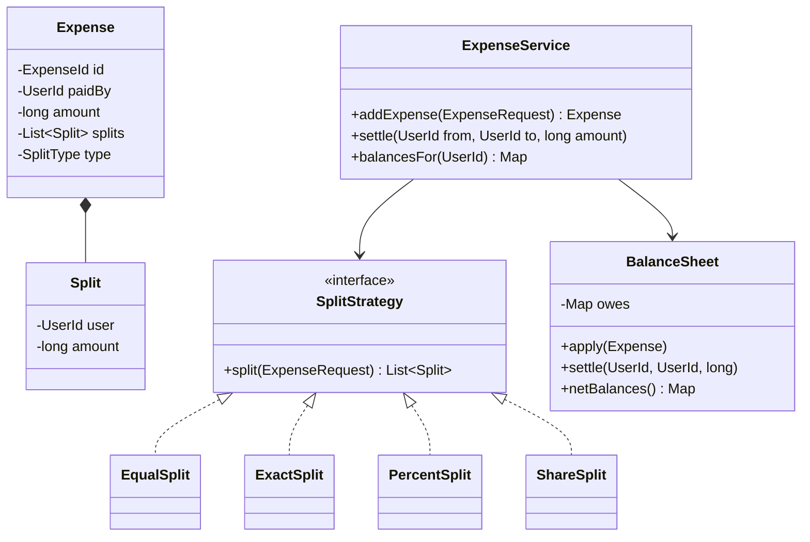

<Related ids={['strategy-pattern', 'factory-patterns', 'observer-pattern', 'interview-grade-code', 'concurrency-for-lld']} />

Splitwise is one of the most common machine-coding problems in Indian product-company interviews. It looks simple, but tests money handling (rounding!), the Strategy pattern for split types, a clean balance model, and — as a classic follow-up — **debt simplification**.

## What the interviewer expects

The full design in this lesson is longer than anything you'd write in one round. It's there so you understand the edge cases and can answer follow-up questions. In the round itself, aim for this:

<InterviewScope minutes="45–60" lines="60" write={["A `SplitStrategy` interface with equal, exact and percent splits", "Amounts in paise, so no rupee is lost to rounding", "A balance sheet: who owes whom"]} say={["Debt simplification (fewest payments to settle a group)", "Groups, and recording a settlement payment", "Validating that exact amounts and percentages add up"]} skip={["Currencies and exchange rates", "Notifications and reminders"]} />

### The interview-sized version

Three split strategies and a balance sheet that nets debts in both directions. It's about **60 lines**, and it compiles and runs.

```java
// Amounts are in paise (long), so ₹100 split three ways never loses a paisa to rounding.
interface SplitStrategy { Map<String, Long> split(long total, List<String> people, List<Long> values); }

class EqualSplit implements SplitStrategy {
    public Map<String, Long> split(long total, List<String> people, List<Long> ignored) {
        Map<String, Long> shares = new LinkedHashMap<>();
        long base = total / people.size(), leftover = total % people.size();
        for (int i = 0; i < people.size(); i++) shares.put(people.get(i), base + (i < leftover ? 1 : 0));
        return shares;
    }
}

class ExactSplit implements SplitStrategy {
    public Map<String, Long> split(long total, List<String> people, List<Long> amounts) {
        if (amounts.stream().mapToLong(Long::longValue).sum() != total) throw new IllegalArgumentException("Amounts must add up to the total");
        Map<String, Long> shares = new LinkedHashMap<>();
        for (int i = 0; i < people.size(); i++) shares.put(people.get(i), amounts.get(i));
        return shares;
    }
}

class PercentSplit implements SplitStrategy {
    public Map<String, Long> split(long total, List<String> people, List<Long> percents) {
        if (percents.stream().mapToLong(Long::longValue).sum() != 100) throw new IllegalArgumentException("Percentages must add up to 100");
        Map<String, Long> shares = new LinkedHashMap<>();
        long given = 0;
        for (int i = 0; i < people.size(); i++) {
            long share = i == people.size() - 1 ? total - given : total * percents.get(i) / 100;   // last person takes the rounding
            shares.put(people.get(i), share);
            given += share;
        }
        return shares;
    }
}

class ExpenseService {
    // balance.get(a).get(b) = how much b owes a (negative means a owes b)
    private final Map<String, Map<String, Long>> balance = new HashMap<>();

    synchronized void addExpense(String paidBy, long total, List<String> people, List<Long> values, SplitStrategy strategy) {
        strategy.split(total, people, values).forEach((person, share) -> {
            if (person.equals(paidBy)) return;
            add(paidBy, person, share);
            add(person, paidBy, -share);
        });
    }

    synchronized long owes(String debtor, String creditor) {
        long amount = balance.getOrDefault(creditor, Map.of()).getOrDefault(debtor, 0L);
        return Math.max(0, amount);
    }

    private void add(String a, String b, long amount) {
        balance.computeIfAbsent(a, k -> new HashMap<>()).merge(b, amount, Long::sum);
    }
}
```

<Callout type="tip" title="How to use the rest of this lesson">
Practise writing the short version above, in your own words, until you can do it in about 30 minutes. Then read the full design below for the edge cases and follow-up answers. Interviewers often ask about those, but they rarely ask you to type them all.
</Callout>

## 1. Requirements

- Users; groups of users.
- Add an expense: who paid, total amount, participants, and a split type:
  - **EQUAL** — divided equally.
  - **EXACT** — explicit amounts per participant (must sum to the total).
  - **PERCENT** — percentages per participant (must sum to 100).
  - (Extension: **SHARES**, e.g., 2:1:1.)
- Show balances: what each user owes / is owed, overall and per group.
- Settle up: record a payment between two users.
- Extensions: simplify debts (minimise transactions), expense history, multiple payers, currencies.

## 2. Money and rounding

Splitting ₹100 three ways gives ₹33.33… per person. Rules:

- Store money as **integer paise** (`long`), never `double`.
- When an amount doesn't divide evenly, **distribute the remainder** deterministically (e.g., first participants get +1 paisa) so the parts **sum exactly** to the total.

```java
static long[] splitEqually(long totalPaise, int n) {
    long base = totalPaise / n, remainder = totalPaise % n;
    long[] parts = new long[n];
    for (int i = 0; i < n; i++) parts[i] = base + (i < remainder ? 1 : 0);
    return parts;                                   // ₹100.00 / 3 → 3334, 3333, 3333 paise
}
```

## 3. Class design



## 4. Implementation

### Request and split strategies

<FullCode title="Show the full code: Request and split strategies (46 lines)">

```java
public enum SplitType { EQUAL, EXACT, PERCENT, SHARES }

public record ExpenseRequest(UserId paidBy, long amountPaise, List<UserId> participants,
                             SplitType type, Map<UserId, Long> values,   // exact paise, percent×100, or shares
                             String description) { }

public record Split(UserId user, long amountPaise) { }

public interface SplitStrategy {
    List<Split> split(ExpenseRequest req);           // validates and computes; parts sum to the total
}

public final class EqualSplit implements SplitStrategy {
    public List<Split> split(ExpenseRequest r) {
        long[] parts = splitEqually(r.amountPaise(), r.participants().size());
        List<Split> out = new ArrayList<>();
        for (int i = 0; i < parts.length; i++) out.add(new Split(r.participants().get(i), parts[i]));
        return out;
    }
}

public final class ExactSplit implements SplitStrategy {
    public List<Split> split(ExpenseRequest r) {
        long sum = r.participants().stream().mapToLong(u -> r.values().getOrDefault(u, 0L)).sum();
        if (sum != r.amountPaise())
            throw new InvalidSplitException("Exact amounts sum to " + sum + ", expected " + r.amountPaise());
        return r.participants().stream().map(u -> new Split(u, r.values().get(u))).toList();
    }
}

public final class PercentSplit implements SplitStrategy {
    public List<Split> split(ExpenseRequest r) {
        // values are basis points (percent × 100) to allow 33.33%
        long totalBp = r.participants().stream().mapToLong(u -> r.values().getOrDefault(u, 0L)).sum();
        if (totalBp != 10_000) throw new InvalidSplitException("Percentages must total 100");
        return largestRemainder(r, r.values(), 10_000);
    }
}

public final class ShareSplit implements SplitStrategy {
    public List<Split> split(ExpenseRequest r) {
        long totalShares = r.participants().stream().mapToLong(u -> r.values().getOrDefault(u, 0L)).sum();
        if (totalShares <= 0) throw new InvalidSplitException("Shares must be positive");
        return largestRemainder(r, r.values(), totalShares);
    }
}
```

</FullCode>

`largestRemainder` allocates `amount × weight / totalWeight` (floored) to each participant, then hands out the leftover paise to those with the largest fractional remainders — so parts always sum exactly to the total:

```java
/** Hamilton's method: floor each share, then give leftover paise to the largest fractional remainders. */
static List<Split> largestRemainder(ExpenseRequest r, Map<UserId, Long> weights, long totalWeight) {
    List<UserId> people = r.participants();
    long[] parts = new long[people.size()];
    long[] remainders = new long[people.size()];
    long allocated = 0;
    for (int i = 0; i < people.size(); i++) {
        long numerator = Math.multiplyExact(r.amountPaise(), weights.getOrDefault(people.get(i), 0L));
        parts[i] = numerator / totalWeight;
        remainders[i] = numerator % totalWeight;           // the fractional part, scaled by totalWeight
        allocated += parts[i];
    }
    Integer[] order = new Integer[people.size()];
    for (int i = 0; i < order.length; i++) order[i] = i;
    Arrays.sort(order, (x, y) -> remainders[y] != remainders[x]
            ? Long.compare(remainders[y], remainders[x]) : Integer.compare(x, y));   // deterministic ties
    for (int k = 0; k < r.amountPaise() - allocated; k++) parts[order[k]]++;
    List<Split> out = new ArrayList<>();
    for (int i = 0; i < people.size(); i++) out.add(new Split(people.get(i), parts[i]));
    return out;
}
```

Shares of 2:1:1 on ₹10.01 give 500.5, 250.25 and 250.25 paise; flooring hands out 1,000, and the one leftover paisa goes to the largest remainder — 501, 250, 250.

A small registry picks the strategy:

```java
public final class SplitStrategies {
    private final Map<SplitType, SplitStrategy> byType = new EnumMap<>(Map.of(
            SplitType.EQUAL, new EqualSplit(), SplitType.EXACT, new ExactSplit(),
            SplitType.PERCENT, new PercentSplit(), SplitType.SHARES, new ShareSplit()));
    public SplitStrategy forType(SplitType t) { return byType.get(t); }
}
```

### Balance sheet

Represent "A owes B ₹X" as a directed, **netted** ledger: if A owes B 300 and B owes A 100, store only A → B 200.

<FullCode title="Show the full code: Balance sheet (40 lines)">

```java
public final class BalanceSheet {
    // owes.get(a).get(b) = amount a owes b (always positive; only one direction stored per pair)
    private final Map<UserId, Map<UserId, Long>> owes = new HashMap<>();

    public synchronized void apply(Expense e) {
        for (Split s : e.splits()) {
            if (!s.user().equals(e.paidBy())) addDebt(s.user(), e.paidBy(), s.amountPaise());
        }
    }

    public synchronized void settle(UserId from, UserId to, long amount) {
        addDebt(to, from, amount);                    // paying reduces from's debt (or creates the reverse)
    }

    private void addDebt(UserId debtor, UserId creditor, long amount) {
        long reverse = get(creditor, debtor);
        if (reverse >= amount) {                       // net against the opposite debt
            put(creditor, debtor, reverse - amount);
        } else {
            put(creditor, debtor, 0);
            put(debtor, creditor, get(debtor, creditor) + amount - reverse);
        }
    }

    /** Positive = others owe this user; negative = this user owes others. */
    public synchronized Map<UserId, Long> netBalances() {
        Map<UserId, Long> net = new HashMap<>();
        owes.forEach((debtor, m) -> m.forEach((creditor, amt) -> {
            net.merge(debtor, -amt, Long::sum);
            net.merge(creditor, amt, Long::sum);
        }));
        return net;
    }

    private long get(UserId a, UserId b) { return owes.getOrDefault(a, Map.of()).getOrDefault(b, 0L); }
    private void put(UserId a, UserId b, long v) {
        if (v == 0) { Map<UserId, Long> m = owes.get(a); if (m != null) m.remove(b); }
        else owes.computeIfAbsent(a, k -> new HashMap<>()).put(b, v);
    }
}
```

</FullCode>

### Service

```java
public final class ExpenseService {
    private final SplitStrategies strategies;
    private final ExpenseRepository expenses;
    private final BalanceSheet balances;

    public Expense addExpense(ExpenseRequest req) {
        validate(req);                                       // amount > 0, at least one participant, no duplicates
        List<Split> splits = strategies.forType(req.type()).split(req);
        Expense expense = Expense.create(req, splits);
        expenses.save(expense);
        balances.apply(expense);
        return expense;
    }

    public void settle(UserId from, UserId to, long amount) {
        if (amount <= 0) throw new IllegalArgumentException("amount must be positive");
        balances.settle(from, to, amount);
    }
}
```

## 5. Debt simplification

Given net balances, minimise the number of payments. Example: A owes B ₹100, B owes C ₹100 → simplified: A pays C ₹100 (one transaction instead of two).

**Greedy algorithm** (standard interview answer):

1. Compute each person's **net** balance (sum of what they're owed minus what they owe).
2. Put creditors (positive) in a max-heap and debtors (negative) in a max-heap by absolute value.
3. Repeatedly match the largest debtor with the largest creditor; transfer `min(|debt|, credit)`; push back any remainder.

```java
public List<Payment> simplify(Map<UserId, Long> net) {
    PriorityQueue<Map.Entry<UserId, Long>> creditors = new PriorityQueue<>((a, b) -> Long.compare(b.getValue(), a.getValue()));
    PriorityQueue<Map.Entry<UserId, Long>> debtors   = new PriorityQueue<>((a, b) -> Long.compare(a.getValue(), b.getValue()));
    net.forEach((u, v) -> {
        if (v > 0) creditors.add(Map.entry(u, v));
        else if (v < 0) debtors.add(Map.entry(u, v));
    });

    List<Payment> payments = new ArrayList<>();
    while (!creditors.isEmpty() && !debtors.isEmpty()) {
        var c = creditors.poll(); var d = debtors.poll();
        long amount = Math.min(c.getValue(), -d.getValue());
        payments.add(new Payment(d.getKey(), c.getKey(), amount));
        if (c.getValue() - amount > 0) creditors.add(Map.entry(c.getKey(), c.getValue() - amount));
        if (d.getValue() + amount < 0) debtors.add(Map.entry(d.getKey(), d.getValue() + amount));
    }
    return payments;
}
```

Greedy produces **at most N − 1** payments for N people with non-zero balances. Finding the true **minimum** number of transactions is NP-hard (it relates to partitioning people into zero-sum groups) — a good point to mention; exact solutions use backtracking/bitmask DP for small groups.

## 6. Patterns used

| Pattern | Where |
| --- | --- |
| **Strategy** | `SplitStrategy` per split type |
| **Factory / registry** | `SplitStrategies` maps type → strategy |
| **Observer** (extension) | Notify participants when an expense is added |
| **Repository** | Expenses, users, groups |

## 7. Extensions

- **Multiple payers**: model payers as a list of contributions; net each user's paid minus owed share.
- **Groups**: a balance sheet per group, plus an overall view aggregating groups.
- **Edit/delete expense**: apply the reverse of the old expense, then the new one (or event-source the ledger).
- **Currencies**: store currency on expenses; balances per currency, conversion only at display.

## Interview questions

<QA q="How do you split ₹100 among three people without losing a paisa?">
Store amounts as integer paise. Give everyone the floor of 10,000 / 3 = 3,333 paise, then distribute the remainder (1 paisa) one by one to a deterministic subset of participants (for example, the first ones, or those with the largest fractional parts for percentage splits). The parts are 3,334 + 3,333 + 3,333 = 10,000, so they always sum exactly to the total.
</QA>

<QA q="How would you minimise the number of transactions needed to settle a group?">
Compute each person's net balance, then greedily match the largest debtor with the largest creditor, transferring the smaller of the two amounts and re-queuing any remainder. This needs at most N − 1 payments. Finding the absolute minimum is NP-hard (it's about splitting people into as many zero-sum subgroups as possible), so exact methods use backtracking or bitmask DP for small groups; greedy is the practical answer.
</QA>

<QA q="Why use the Strategy pattern for split types?">
Each split type has its own validation and calculation rules, and new types (shares, adjustments) get added over time. With a SplitStrategy interface, each rule set is an isolated, testable class and the expense service doesn't change when a new type is added — instead of a growing switch statement on split type.
</QA>

<Practice task="Allow editing or deleting an expense after balances were updated. How do you keep balances correct?">

Treat the edit as two operations on the ledger: apply the **reverse** of the old expense (each participant's debt to the payer reduced by their old split), then apply the new one — inside the same lock so nobody sees the half-way state. Even better, store expenses as the source of truth and keep balances as a derived cache, or event-source the ledger (expense added / edited / deleted events) so balances can be rebuilt and audited.

</Practice>

<Practice task="Support multiple payers: Asha paid ₹600 and Ravi ₹400 of a ₹1,000 dinner split equally among 4 people. Compute who owes whom.">

Model payments as a list of contributions. For each participant, net = paid − owed share (Asha 600 − 250 = +350, Ravi 400 − 250 = +150, the other two −250 each). Record the expense as net positions rather than "everyone owes the payer", and either keep pairwise debts by allocating debtors to creditors proportionally, or rely on net balances plus the simplification algorithm to produce the settlements. The split strategies don't change — only how the balance sheet applies an expense.

</Practice>

<Takeaways>

- Use integer paise and distribute remainders so splits sum exactly.
- Each split type is a strategy with its own validation.
- Keep a netted pairwise ledger; derive net balances from it.
- Greedy simplification uses at most N − 1 payments; the true minimum is NP-hard.

</Takeaways>

## Further reading

- [Strategy](/system-design/lld/strategy-pattern), [Writing Interview-Grade Code](/system-design/lld/interview-grade-code).
- Largest remainder method (Hamilton's method) for apportionment.
