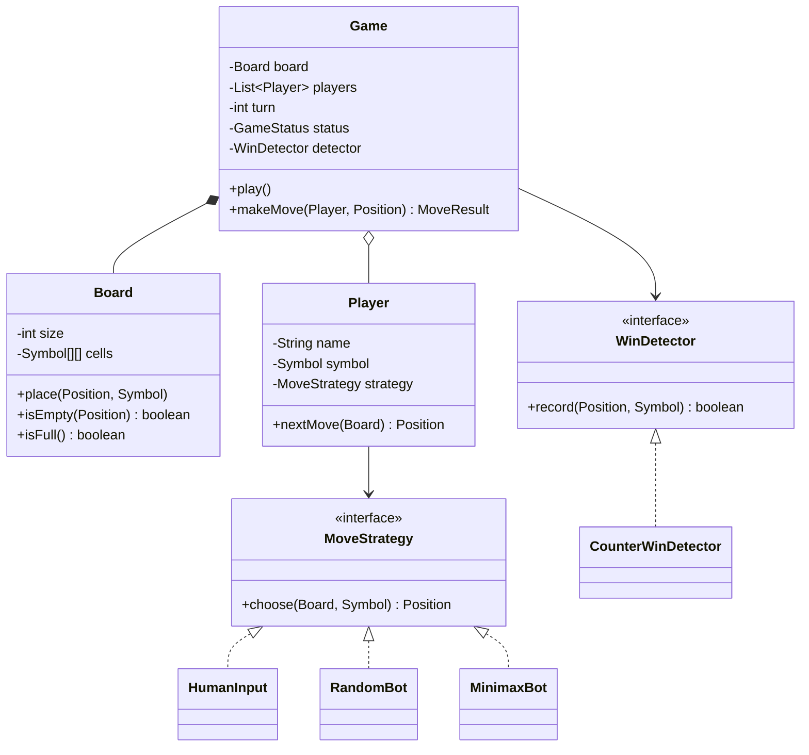

<Related ids={['strategy-pattern', 'state-pattern', 'observer-pattern', 'interview-grade-code']} />

Tic-tac-toe looks trivial, which is exactly why it's asked: the interviewer is grading **structure and extensibility**, not the game. Can your design handle an N×N board, K-in-a-row, more than two players, and bots — without rewriting? And can you detect a win in **O(1)** per move instead of scanning the board?

## What the interviewer expects

The full design in this lesson is longer than anything you'd write in one round. It's there so you understand the edge cases and can answer follow-up questions. In the round itself, aim for this:

<InterviewScope minutes="30–45" lines="50" write={["A `Board` with O(1) win detection using row and column counters", "A `Game` that takes turns and reports win or draw", "Clear errors for bad moves"]} say={["Making the board N×N (this code already is)", "Bots behind a `MoveStrategy` interface", "K-in-a-row variants"]} skip={["Undo, replays and a UI", "Minimax unless they ask for an AI"]} />

### The interview-sized version

An N×N board that detects a win in O(1) per move, and a game loop that rejects bad moves without losing the turn. It's about **50 lines**, and it compiles and runs.

```java
enum Status { IN_PROGRESS, WON, DRAW }

record Player(String name, char mark) { }

class Board {
    private final int n;
    private final char[][] cells;
    private final int[] rows, cols;            // +1 for each X, -1 for each O
    private int diagonal, antiDiagonal, moves;

    Board(int n) { this.n = n; cells = new char[n][n]; rows = new int[n]; cols = new int[n]; }

    /** Places a mark and says whether it wins. O(1): only counters change, no scanning. */
    boolean place(int r, int c, char mark) {
        if (r < 0 || r >= n || c < 0 || c >= n) throw new IllegalArgumentException("Off the board");
        if (cells[r][c] != 0) throw new IllegalArgumentException("Cell already taken");
        cells[r][c] = mark;
        moves++;
        int d = mark == 'X' ? 1 : -1;
        rows[r] += d;
        cols[c] += d;
        if (r == c) diagonal += d;
        if (r + c == n - 1) antiDiagonal += d;
        return Math.abs(rows[r]) == n || Math.abs(cols[c]) == n || Math.abs(diagonal) == n || Math.abs(antiDiagonal) == n;
    }

    boolean isFull() { return moves == n * n; }
}

class Game {
    private final Board board;
    private final Deque<Player> turns;          // the player at the front moves next
    private Status status = Status.IN_PROGRESS;
    private Player winner;

    Game(int n, Player first, Player second) { board = new Board(n); turns = new ArrayDeque<>(List.of(first, second)); }

    Status move(int r, int c) {
        if (status != Status.IN_PROGRESS) throw new IllegalStateException("Game is over");
        Player p = turns.peekFirst();
        if (board.place(r, c, p.mark())) { status = Status.WON; winner = p; }
        else if (board.isFull()) status = Status.DRAW;
        else turns.addLast(turns.pollFirst());  // next player's turn
        return status;
    }

    Player winner() { return winner; }
}
```

<Callout type="tip" title="How to use the rest of this lesson">
Practise writing the short version above, in your own words, until you can do it in about 30 minutes. Then read the full design below for the edge cases and follow-up answers. Interviewers often ask about those, but they rarely ask you to type them all.
</Callout>

## 1. Requirements

- Board of size N×N (default 3); a player wins with N in a row (row, column or diagonal). Extension: K-in-a-row on larger boards.
- Two players (extension: more), each with a symbol; human or bot.
- Players alternate; invalid moves (occupied cell, out of bounds, game over) are rejected.
- Detect win and draw; support undo (extension).

## 2. Class design



Key choices:

- **Player behaviour is a strategy** — humans and bots differ only in how they choose a move.
- **Win detection is separate** from the board (SRP) and pluggable (N-in-a-row vs K-in-a-row).
- `GameStatus` (IN_PROGRESS, WON, DRAW) is a tiny state machine.

## 3. Implementation

### Models

```java
public enum Symbol { X, O, TRIANGLE }                           // more symbols → more players

public record Position(int row, int col) { }

public enum GameStatus { IN_PROGRESS, WON, DRAW }

public record MoveResult(GameStatus status, Player winner) { }
```

### Board

```java
public final class Board {
    private final int size;
    private final Symbol[][] cells;
    private int filled;

    public Board(int size) {
        if (size < 3) throw new IllegalArgumentException("size must be >= 3");
        this.size = size;
        this.cells = new Symbol[size][size];
    }

    public void place(Position p, Symbol s) {
        if (!inBounds(p)) throw new InvalidMoveException("Out of bounds: " + p);
        if (cells[p.row()][p.col()] != null) throw new InvalidMoveException("Occupied: " + p);
        cells[p.row()][p.col()] = s;
        filled++;
    }

    public boolean inBounds(Position p) { return p.row() >= 0 && p.row() < size && p.col() >= 0 && p.col() < size; }
    public boolean isEmpty(Position p)  { return inBounds(p) && cells[p.row()][p.col()] == null; }
    public boolean isFull()             { return filled == size * size; }
    public Symbol symbolAt(Position p)  { return cells[p.row()][p.col()]; }
    public int size()                   { return size; }

    public List<Position> emptyCells() {
        List<Position> out = new ArrayList<>();
        for (int r = 0; r < size; r++) for (int c = 0; c < size; c++) if (cells[r][c] == null) out.add(new Position(r, c));
        return out;
    }
}
```

### O(1) win detection with counters

Scanning the whole board after each move is O(N²). Instead, keep per-player counters for every row, column and the two diagonals; a move increments four counters at most, and a counter reaching N is a win.

```java
public interface WinDetector {
    /** Records a move and returns true if it wins the game. */
    boolean record(Position p, Symbol s);
}

public final class CounterWinDetector implements WinDetector {
    private final int n;
    private final Map<Symbol, int[]> rows = new EnumMap<>(Symbol.class);
    private final Map<Symbol, int[]> cols = new EnumMap<>(Symbol.class);
    private final Map<Symbol, int[]> diags = new EnumMap<>(Symbol.class);   // [0] main, [1] anti

    public CounterWinDetector(int n) { this.n = n; }

    @Override public boolean record(Position p, Symbol s) {
        int[] r = rows.computeIfAbsent(s, k -> new int[n]);
        int[] c = cols.computeIfAbsent(s, k -> new int[n]);
        int[] d = diags.computeIfAbsent(s, k -> new int[2]);

        boolean win = ++r[p.row()] == n | ++c[p.col()] == n;      // non-short-circuit: update both
        if (p.row() == p.col())          win |= ++d[0] == n;
        if (p.row() + p.col() == n - 1)  win |= ++d[1] == n;
        return win;
    }
}
```

For **K-in-a-row on a larger board** (Gomoku-style), counters don't work; instead check the four directions through the last move — O(K) per move:

```java
public final class KInARowDetector implements WinDetector {
    private static final int[][] DIRS = {{0, 1}, {1, 0}, {1, 1}, {1, -1}};   // row, column, two diagonals
    private final Board board;          // called after board.place(...), so p already holds s
    private final int k;

    public KInARowDetector(Board board, int k) { this.board = board; this.k = k; }

    @Override public boolean record(Position p, Symbol s) {
        for (int[] d : DIRS) {
            int count = 1 + countDir(p, d[0], d[1], s) + countDir(p, -d[0], -d[1], s);
            if (count >= k) return true;
        }
        return false;
    }

    private int countDir(Position p, int dr, int dc, Symbol s) {
        int count = 0;
        for (Position q = new Position(p.row() + dr, p.col() + dc);
             board.inBounds(q) && board.symbolAt(q) == s;
             q = new Position(q.row() + dr, q.col() + dc)) count++;
        return count;
    }
}
```

### Players and strategies

```java
public interface MoveStrategy { Position choose(Board board, Symbol me); }

public final class RandomBot implements MoveStrategy {
    private final Random random;
    public RandomBot(Random random) { this.random = random; }        // injected → deterministic tests
    public Position choose(Board b, Symbol me) {
        List<Position> empty = b.emptyCells();
        return empty.get(random.nextInt(empty.size()));
    }
}

public record Player(String name, Symbol symbol, MoveStrategy strategy) {
    public Position nextMove(Board b) { return strategy.choose(b, symbol); }
}
```

A `MinimaxBot` implementing perfect play is a natural extension (and an algorithm question in itself).

### The game

<FullCode title="Show the full code: The game (41 lines)">

```java
public final class Game {
    private final Board board;
    private final List<Player> players;
    private final WinDetector detector;
    private final Deque<Position> history = new ArrayDeque<>();
    private int turn;
    private GameStatus status = GameStatus.IN_PROGRESS;
    private Player winner;

    public Game(Board board, List<Player> players, WinDetector detector) {
        if (players.size() < 2) throw new IllegalArgumentException("need at least 2 players");
        if (players.stream().map(Player::symbol).distinct().count() != players.size())
            throw new IllegalArgumentException("symbols must be unique");
        this.board = board; this.players = List.copyOf(players); this.detector = detector;
    }

    public MoveResult makeMove(Player player, Position p) {
        if (status != GameStatus.IN_PROGRESS) throw new InvalidMoveException("Game is over");
        if (!player.equals(currentPlayer())) throw new InvalidMoveException("Not " + player.name() + "'s turn");

        board.place(p, player.symbol());              // validates bounds and occupancy
        history.push(p);

        if (detector.record(p, player.symbol())) { status = GameStatus.WON; winner = player; }
        else if (board.isFull())                  { status = GameStatus.DRAW; }
        else                                      { turn = (turn + 1) % players.size(); }

        return new MoveResult(status, winner);
    }

    public MoveResult play() {                          // drives bots/humans until the game ends
        MoveResult result;
        do {
            Player p = currentPlayer();
            result = makeMove(p, p.nextMove(board));
        } while (result.status() == GameStatus.IN_PROGRESS);
        return result;
    }

    public Player currentPlayer() { return players.get(turn); }
}
```

</FullCode>

## 4. Patterns used

| Pattern | Where |
| --- | --- |
| **Strategy** | `MoveStrategy` (human, random, minimax), `WinDetector` |
| **State** | `GameStatus` (simple enum; grows if you add pause/resume) |
| **Command / Memento** (extension) | Undo: moves pushed to history; undo pops and reverses the counters |
| **Observer** (extension) | UI or spectators subscribe to move events |

## 5. Extensions

- **Undo**: store moves; undo clears the cell and decrements the counters (counters make this easy), and moves the turn back.
- **More players**: unique symbols and the modulo turn order already handle it.
- **Networked play**: moves arrive from clients — validate on the server; serialise moves per game (one lock per game).
- **Timer per move**: a strategy wrapper that falls back to a random move on timeout.

## Interview questions

<QA q="How do you detect a win in O(1) per move?">
Maintain counters per player for each row, each column and the two diagonals. When a player marks (r, c), increment that player's row r and column c counters, and the diagonal counters if r equals c or r + c equals n − 1. If any of these reaches n, the player has won. This costs constant time per move instead of rescanning the board, and undo is just decrementing.
</QA>

<QA q="How would your design change for Connect Four or Gomoku?">
The board and placement rules change (Connect Four drops a piece into the lowest empty row of a column — a different move-validation rule), and the win condition becomes K in a row, best checked by counting in four directions from the last move. With win detection and move validation behind interfaces, Game, Player and the strategies stay the same.
</QA>

<Practice task="Add undo: the current player can take back the last move. What must the win detector support, and what about the turn?">

Keep the move history (already a stack). Undo pops the last position, clears the cell (`Board.clear` decrements `filled`), tells the detector to remove it — `CounterWinDetector.unrecord(p, symbol)` decrements the same counters `record` incremented — moves the turn back to the previous player, and resets the status to `IN_PROGRESS` (undoing a winning move must reopen the game). `KInARowDetector` needs nothing, because it reads the board.

</Practice>

<Practice task="Turn the design into Connect Four (7 columns, pieces drop to the lowest free row, 4 in a row wins). What do you change?">

The move input becomes a column, not a cell: a `DropRule` (or a `ConnectFourBoard` subclass) computes the landing row and rejects full columns. Win detection is `KInARowDetector` with k = 4 on a 6 × 7 board. `Game`, `Player` and the strategies stay the same — the bot strategies just choose columns. Board size validation ("at least 3") moves into the rule set.

</Practice>

<Takeaways>

- Keep Board, WinDetector, Player strategy and Game orchestration as separate responsibilities.
- Players differ only in how they choose moves — a strategy.
- Counters give O(1) win detection for N-in-a-row; directional checks handle K-in-a-row.
- Validate turn order, bounds, occupancy and game-over state explicitly.

</Takeaways>

## Further reading

- [Strategy](/system-design/lld/strategy-pattern), [Command](/system-design/lld/command-pattern) (for undo).
- Russell and Norvig, *Artificial Intelligence: A Modern Approach* — minimax and alpha–beta pruning.
