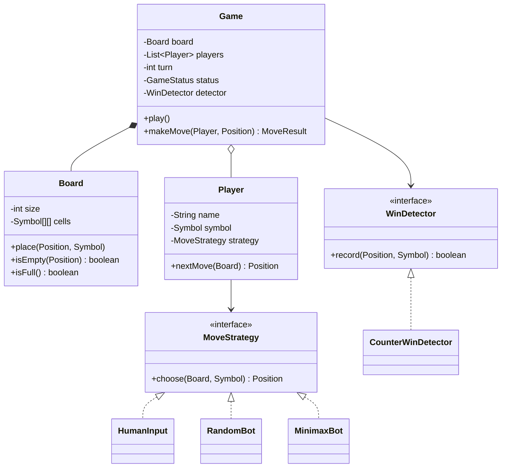

<Related ids={['strategy-pattern', 'state-pattern', 'observer-pattern', 'interview-grade-code']} />

Everyone knows how to play tic-tac-toe, and that's the point: the interviewer doesn't need to explain the rules, so the whole round is about **how you structure the code**. Can it grow to a bigger board, more players or a computer opponent without a rewrite? And can you tell that someone has won without scanning the whole board after every move?

We'll use the same six steps as every case study: requirements, entities, class design, code, a worked example, and follow-ups. (The [parking lot](/system-design/lld/lld-parking-lot) lesson explains the plan in detail.)

## Step 1: Pin down the requirements

<Dialogue>
<Turn who="you">Just the classic 3×3 board, or should the size be configurable?</Turn>
<Turn who="them">Let's say N×N, with 3 as the default.</Turn>
<Turn who="you">To win, you need a full row, column or diagonal, so N in a row?</Turn>
<Turn who="them">Yes.</Turn>
<Turn who="you">Two players only? Humans, or can one be the computer?</Turn>
<Turn who="them">Two players for now. A computer player would be nice to support later.</Turn>
<Turn who="you">What should happen on a bad move, like a taken cell or a move after the game ends?</Turn>
<Turn who="them">Reject it with a clear error. The same player should try again.</Turn>
<Turn who="you">Do I need a user interface, or is a class you can call enough?</Turn>
<Turn who="them">No UI. Just the game logic.</Turn>
</Dialogue>

**The game must:**

1. Use an N×N board (default 3).
2. Let two players, X and O, take turns placing their mark.
3. Reject moves that are off the board, on a taken cell, or made after the game has ended.
4. Detect a win (N in a row, column or diagonal) and a draw (board full, no winner).
5. Be easy to extend with computer players and more players.

**Out of scope for now:** undo, a UI, networked play.

## Step 2: Find the core entities

Underline the nouns: a **game** is played on a **board** made of **cells** by **players**, each with a **mark**. A **move** places a mark; the game ends in a **win** or a **draw**.

| Noun | Make it… | Why |
| --- | --- | --- |
| Board | a class | It holds the grid and changes with every move. It should check its own rules (in bounds, not taken). |
| Cell / position | a record `Position(row, col)` | Just two numbers. A record is clearer than passing `int r, int c` everywhere. |
| Mark / symbol | an enum (or a `char`) | A fixed set of values. |
| Player | a record | A name and a mark. Later, also "how it picks a move". |
| Game | a class | Whose turn it is, whether it's over, who won. It coordinates the board and players. |
| Status | an enum | `IN_PROGRESS`, `WON`, `DRAW`. A tiny state machine. |
| Win / draw | **not** separate classes | They're outcomes, so they become the status. |

## Step 3: Design each class

**`Board`**: knows its size and the grid of cells. It can place a mark (and refuse bad placements), and say whether it's full.

**`Game`**: knows the board, the players, whose turn it is, the status and the winner. It can make a move: check the game isn't over, place the current player's mark, then decide whether that move won, drew or simply passes the turn.

**`Player`**: knows its name and mark. To support computer players, it will also know **how it chooses a move**. That's the one thing that differs between a human and a bot, so it goes behind an interface, `MoveStrategy`.

**Win detection**: this deserves a moment of thought before coding, because it's the part interviewers dig into.

<Approach verdict="bad" title="Scan the whole board after every move">

After each move, check all N rows, all N columns and both diagonals. That's O(N²) work per move. It's fine for 3×3, but it's the answer interviewers expect you to improve.

</Approach>

<Approach verdict="good" title="Check only the lines through the last move">

A move at (r, c) can only complete row r, column c, and possibly the two diagonals. Check just those: O(N) per move. Much better, and it works for any "K in a row" rule.

</Approach>

<Approach verdict="great" title="Keep running counters: O(1) per move">

Keep a counter for each row, each column and the two diagonals. Add **+1 for X and −1 for O**. When a counter reaches **+N or −N**, every cell in that line has the same mark, so someone has won. Each move updates at most four counters. No scanning at all.

Why does that work? A row only reaches +N if all N cells are X (any O would subtract 1). The same goes for −N and O.

</Approach>

The class diagram for the full design, with strategies for players and for win detection:



## Step 4: Write the code

<InterviewScope minutes="30–45" lines="50" write={["A `Board` with O(1) win detection using row and column counters", "A `Game` that takes turns and reports win or draw", "Clear errors for bad moves"]} say={["Making the board N×N (this code already is)", "Bots behind a `MoveStrategy` interface", "K-in-a-row variants"]} skip={["Undo, replays and a UI", "Minimax unless they ask for an AI"]} />

### The interview-sized version

An N×N board that detects a win in O(1) per move, and a game loop that rejects bad moves without losing the turn. It's about **50 lines**, and it compiles and runs.

```java
enum Status { IN_PROGRESS, WON, DRAW }

record Player(String name, char mark) { }

class Board {
    private final int n;
    private final char[][] cells;
    private final int[] rows, cols;            // +1 for each X, -1 for each O
    private int diagonal, antiDiagonal, moves;

    Board(int n) { this.n = n; cells = new char[n][n]; rows = new int[n]; cols = new int[n]; }

    /** Places a mark and says whether it wins. O(1): only counters change, no scanning. */
    boolean place(int r, int c, char mark) {
        if (r < 0 || r >= n || c < 0 || c >= n) throw new IllegalArgumentException("Off the board");
        if (cells[r][c] != 0) throw new IllegalArgumentException("Cell already taken");
        cells[r][c] = mark;
        moves++;
        int d = mark == 'X' ? 1 : -1;
        rows[r] += d;
        cols[c] += d;
        if (r == c) diagonal += d;
        if (r + c == n - 1) antiDiagonal += d;
        return Math.abs(rows[r]) == n || Math.abs(cols[c]) == n || Math.abs(diagonal) == n || Math.abs(antiDiagonal) == n;
    }

    boolean isFull() { return moves == n * n; }
}

class Game {
    private final Board board;
    private final Deque<Player> turns;          // the player at the front moves next
    private Status status = Status.IN_PROGRESS;
    private Player winner;

    Game(int n, Player first, Player second) { board = new Board(n); turns = new ArrayDeque<>(List.of(first, second)); }

    Status move(int r, int c) {
        if (status != Status.IN_PROGRESS) throw new IllegalStateException("Game is over");
        Player p = turns.peekFirst();
        if (board.place(r, c, p.mark())) { status = Status.WON; winner = p; }
        else if (board.isFull()) status = Status.DRAW;
        else turns.addLast(turns.pollFirst());  // next player's turn
        return status;
    }

    Player winner() { return winner; }
}
```

**Reading it top to bottom:**

1. **`Board.place`** first rejects bad moves: off the board, or a taken cell. Because it throws **before** changing anything, the player simply tries again (requirement 3).
2. It then writes the mark and updates the counters: `d` is +1 for X and −1 for O. Row `r` and column `c` always change; the main diagonal only when `r == c`; the other diagonal only when `r + c == n - 1`.
3. It returns `true` if any of those four counters hit ±n. That's the O(1) win check.
4. **`Game`** keeps the players in a queue. The player at the front moves; after a normal move they go to the back. That's a turn order that also works for three or more players.
5. **`Game.move`** refuses moves after the game ends, then sets `WON`, `DRAW` or passes the turn. Note the order: check for a win **before** a draw, because the last move on a full board can also be a winning move.

<Callout type="tip" title="How to practise this">
Write this from memory until it takes you under 25 minutes. The counter trick is the part to really understand. Try it on paper with a 3×3 board and a few moves.
</Callout>

### Growing it into the full design

The full version splits the counting into its own class, lets players be humans or bots, and adds more marks for more players.

#### The small data types

```java
public enum Symbol { X, O, TRIANGLE }                           // more symbols → more players

public record Position(int row, int col) { }

public enum GameStatus { IN_PROGRESS, WON, DRAW }

public record MoveResult(GameStatus status, Player winner) { }
```

`Position` replaces the `int r, int c` pairs. `MoveResult` bundles the status and winner so a caller gets everything from one move in one value.

#### `Board`: only the grid and its rules

The board checks bounds and occupancy and counts filled cells. It no longer decides who won. That job moves to a separate class, so each class has one reason to change.

```java
public final class Board {
    private final int size;
    private final Symbol[][] cells;
    private int filled;

    public Board(int size) {
        if (size < 3) throw new IllegalArgumentException("size must be >= 3");
        this.size = size;
        this.cells = new Symbol[size][size];
    }

    public void place(Position p, Symbol s) {
        if (!inBounds(p)) throw new InvalidMoveException("Out of bounds: " + p);
        if (cells[p.row()][p.col()] != null) throw new InvalidMoveException("Occupied: " + p);
        cells[p.row()][p.col()] = s;
        filled++;
    }

    public boolean inBounds(Position p) { return p.row() >= 0 && p.row() < size && p.col() >= 0 && p.col() < size; }
    public boolean isEmpty(Position p)  { return inBounds(p) && cells[p.row()][p.col()] == null; }
    public boolean isFull()             { return filled == size * size; }
    public Symbol symbolAt(Position p)  { return cells[p.row()][p.col()]; }
    public int size()                   { return size; }

    public List<Position> emptyCells() {
        List<Position> out = new ArrayList<>();
        for (int r = 0; r < size; r++) for (int c = 0; c < size; c++) if (cells[r][c] == null) out.add(new Position(r, c));
        return out;
    }
}
```

#### Win detection: counters, behind an interface

With more than two players, +1/−1 no longer works, so this version keeps **separate counters for each mark**. A mark wins when one of its counters for a row, column or diagonal reaches N.

```java
public interface WinDetector {
    /** Records a move and returns true if it wins the game. */
    boolean record(Position p, Symbol s);
}

public final class CounterWinDetector implements WinDetector {
    private final int n;
    private final Map<Symbol, int[]> rows = new EnumMap<>(Symbol.class);
    private final Map<Symbol, int[]> cols = new EnumMap<>(Symbol.class);
    private final Map<Symbol, int[]> diags = new EnumMap<>(Symbol.class);   // [0] main, [1] anti

    public CounterWinDetector(int n) { this.n = n; }

    @Override public boolean record(Position p, Symbol s) {
        int[] r = rows.computeIfAbsent(s, k -> new int[n]);
        int[] c = cols.computeIfAbsent(s, k -> new int[n]);
        int[] d = diags.computeIfAbsent(s, k -> new int[2]);

        boolean win = ++r[p.row()] == n | ++c[p.col()] == n;      // non-short-circuit: update both
        if (p.row() == p.col())          win |= ++d[0] == n;
        if (p.row() + p.col() == n - 1)  win |= ++d[1] == n;
        return win;
    }
}
```

Look at the single `|` in `++r[...] == n | ++c[...] == n`. A double `||` would stop after the first `true` and skip updating the column counter, quietly corrupting the counts for later moves. With a single `|`, both sides always run.

If the interviewer changes the rule to "**K in a row on a big board**" (like Gomoku), counters stop working, because a line can contain K matching marks without being full. Instead, count matching marks outward from the last move in four directions:

```java
public final class KInARowDetector implements WinDetector {
    private static final int[][] DIRS = {{0, 1}, {1, 0}, {1, 1}, {1, -1}};   // row, column, two diagonals
    private final Board board;          // called after board.place(...), so p already holds s
    private final int k;

    public KInARowDetector(Board board, int k) { this.board = board; this.k = k; }

    @Override public boolean record(Position p, Symbol s) {
        for (int[] d : DIRS) {
            int count = 1 + countDir(p, d[0], d[1], s) + countDir(p, -d[0], -d[1], s);
            if (count >= k) return true;
        }
        return false;
    }

    private int countDir(Position p, int dr, int dc, Symbol s) {
        int count = 0;
        for (Position q = new Position(p.row() + dr, p.col() + dc);
             board.inBounds(q) && board.symbolAt(q) == s;
             q = new Position(q.row() + dr, q.col() + dc)) count++;
        return count;
    }
}
```

Because both detectors implement `WinDetector`, `Game` doesn't care which one it has.

#### Players: humans and bots differ only in how they choose

```java
public interface MoveStrategy { Position choose(Board board, Symbol me); }

public final class RandomBot implements MoveStrategy {
    private final Random random;
    public RandomBot(Random random) { this.random = random; }        // injected → deterministic tests
    public Position choose(Board b, Symbol me) {
        List<Position> empty = b.emptyCells();
        return empty.get(random.nextInt(empty.size()));
    }
}

public record Player(String name, Symbol symbol, MoveStrategy strategy) {
    public Position nextMove(Board b) { return strategy.choose(b, symbol); }
}
```

`RandomBot` takes its `Random` from outside, so a test can pass a seeded one and get the same moves every run. A human player would have a `HumanInput` strategy that reads from the console. A `MinimaxBot` that never loses is a natural extension.

#### `Game`: turns, rules and the result

`makeMove` is the heart of it. In plain steps:

1. Refuse if the game is over or it isn't this player's turn.
2. Place the mark (the board refuses bad cells).
3. Tell the win detector about the move. If it wins, record the winner.
4. Otherwise, if the board is full, it's a draw.
5. Otherwise, pass the turn to the next player.

`play()` just loops: ask the current player for a move, make it, repeat until the game ends.

<FullCode title="Show the full code: The game (41 lines)">

```java
public final class Game {
    private final Board board;
    private final List<Player> players;
    private final WinDetector detector;
    private final Deque<Position> history = new ArrayDeque<>();
    private int turn;
    private GameStatus status = GameStatus.IN_PROGRESS;
    private Player winner;

    public Game(Board board, List<Player> players, WinDetector detector) {
        if (players.size() < 2) throw new IllegalArgumentException("need at least 2 players");
        if (players.stream().map(Player::symbol).distinct().count() != players.size())
            throw new IllegalArgumentException("symbols must be unique");
        this.board = board; this.players = List.copyOf(players); this.detector = detector;
    }

    public MoveResult makeMove(Player player, Position p) {
        if (status != GameStatus.IN_PROGRESS) throw new InvalidMoveException("Game is over");
        if (!player.equals(currentPlayer())) throw new InvalidMoveException("Not " + player.name() + "'s turn");

        board.place(p, player.symbol());              // validates bounds and occupancy
        history.push(p);

        if (detector.record(p, player.symbol())) { status = GameStatus.WON; winner = player; }
        else if (board.isFull())                  { status = GameStatus.DRAW; }
        else                                      { turn = (turn + 1) % players.size(); }

        return new MoveResult(status, winner);
    }

    public MoveResult play() {                          // drives bots/humans until the game ends
        MoveResult result;
        do {
            Player p = currentPlayer();
            result = makeMove(p, p.nextMove(board));
        } while (result.status() == GameStatus.IN_PROGRESS);
        return result;
    }

    public Player currentPlayer() { return players.get(turn); }
}
```

</FullCode>

## Step 5: Trace a game

On a 3×3 board, X plays (0,0), O plays (1,1), X plays (0,1), O plays (2,2), X plays (0,2):

1. X at (0,0): row 0 = +1, column 0 = +1, main diagonal = +1. No counter at ±3.
2. O at (1,1): row 1 = −1, column 1 = −1, main diagonal = 0, anti-diagonal = −1.
3. X at (0,1): row 0 = +2, column 1 = 0.
4. O at (2,2): row 2 = −1, column 2 = −1, main diagonal = −1.
5. X at (0,2): row 0 = **+3**. That's N, so X wins. Status becomes `WON`, and any further move throws "Game is over".

## Step 6: Handle follow-up questions

**"Add a computer player."** Write a class implementing `MoveStrategy` and give it to a `Player`. `Game` doesn't change.

**"Support three players."** Add a symbol per player. The turn order already cycles through any number of players, and the per-mark counters handle the win check.

**"Add undo."** Keep a stack of moves. Undo pops the last one, clears the cell, decrements the same counters `record` incremented, moves the turn back and sets the status to `IN_PROGRESS` (undoing a winning move reopens the game).

**"Make it Connect Four."** The move becomes a column, and the piece drops to the lowest free row. Put that rule in the board (or a `DropRule`), and use `KInARowDetector` with K = 4. `Game`, `Player` and the strategies stay as they are.

**"Make it online."** Moves arrive from clients, so the server validates every one. Use one lock per game so two moves for the same game can't interleave.

## Common mistakes

- **Scanning the whole board after every move** and not mentioning the O(1) improvement.
- **Using `||` when updating several counters**, which skips some updates.
- **Checking for a draw before a win.** The last move can fill the board *and* win.
- **Putting everything in one `TicTacToe` class** with `main`, input reading, drawing and rules mixed together.
- **Not rejecting moves after the game has ended.**

## Patterns used

| Pattern | Where |
| --- | --- |
| **Strategy** | `MoveStrategy` (human, random, minimax), `WinDetector` (counters, K-in-a-row) |
| **State** | `GameStatus` (a simple enum; it grows if you add pause or resume) |
| **Command / Memento** (follow-up) | Undo: moves pushed to a history stack and reversed |
| **Observer** (follow-up) | A UI or spectators subscribe to move events |

## Interview questions

<QA q="How do you detect a win in O(1) per move?">
Keep counters for each row, each column and the two diagonals. When a player marks (r, c), update row r and column c, and the diagonal counters if r equals c or r + c equals n − 1. If any of these reaches n (for that player), the player has won. That's constant work per move instead of rescanning the board, and undo is just reversing the update.
</QA>

<QA q="How would your design change for Connect Four or Gomoku?">
The board's placement rule changes (in Connect Four a piece drops to the lowest empty row of a column), and the win condition becomes K in a row, best checked by counting outward in four directions from the last move. With win detection and move validation behind interfaces, Game, Player and the strategies stay the same.
</QA>

<Practice task="Add undo: the current player can take back the last move. What must the win detector support, and what about the turn?">

Keep the move history (already a stack). Undo pops the last position, clears the cell (`Board.clear` decrements `filled`), tells the detector to remove it (`CounterWinDetector.unrecord(p, symbol)` decrements the same counters `record` incremented), moves the turn back to the previous player, and resets the status to `IN_PROGRESS`, because undoing a winning move must reopen the game. `KInARowDetector` needs nothing, because it reads the board.

</Practice>

<Practice task="Turn the design into Connect Four (7 columns, pieces drop to the lowest free row, 4 in a row wins). What do you change?">

The move input becomes a column, not a cell: a `DropRule` (or a `ConnectFourBoard`) computes the landing row and rejects full columns. Win detection is `KInARowDetector` with k = 4 on a 6 × 7 board. `Game`, `Player` and the strategies stay the same; bot strategies just choose columns. The "size at least 3" check moves into the rule set.

</Practice>

<Takeaways>

- Separate the board (grid and placement rules), win detection, player strategy and the game (turns and result).
- Humans and bots differ only in how they choose a move, so that's a strategy.
- Counters (+1 for X, −1 for O) give O(1) win detection; for K-in-a-row, count outward from the last move.
- Reject bad moves before changing any state, and check for a win before a draw.

</Takeaways>

## Further reading

- [Strategy](/system-design/lld/strategy-pattern), [Command](/system-design/lld/command-pattern) (for undo).
- Russell and Norvig, *Artificial Intelligence: A Modern Approach*: minimax and alpha–beta pruning.
