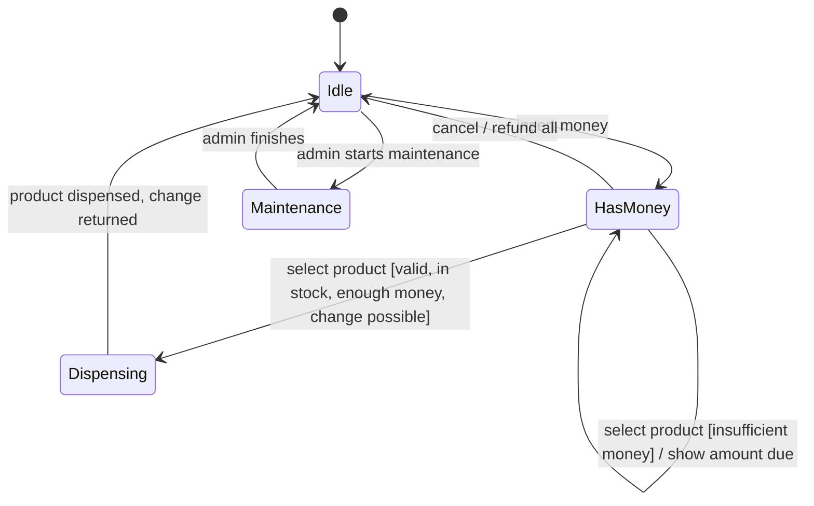
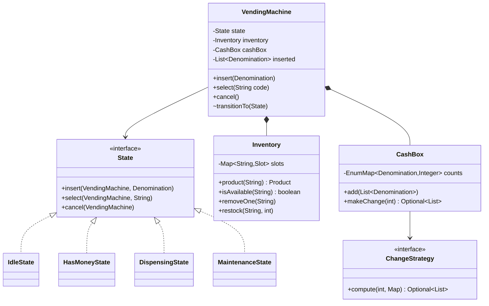

<Related ids={['state-pattern', 'strategy-pattern', 'chain-of-responsibility-pattern', 'concurrency-for-lld', 'interview-grade-code']} />

A vending machine does something different for the same button depending on what's already happened. Press "select" before inserting money and nothing should come out; press it after and you get a snack. That makes it **the** classic State-pattern question. The interviewer is looking for three things: a clear picture of the machine's states, a sensible answer for every button in every state, and money handled correctly, including change.

We'll use the same six steps as every case study: requirements, entities, class design, code, a worked example, and follow-ups. (The [parking lot](/system-design/lld/lld-parking-lot) lesson explains the plan in detail.)

## Step 1: Pin down the requirements

<Dialogue>
<Turn who="you">How do people pay? Coins, notes, cards?</Turn>
<Turn who="them">Coins and notes: ₹1, 2, 5, 10, 20, 50 and 100. Cards can be a follow-up.</Turn>
<Turn who="you">How do they choose a product?</Turn>
<Turn who="them">Each slot has a code like A1 or B3. One product per purchase.</Turn>
<Turn who="you">Does the machine give change? What if it doesn't have the right coins?</Turn>
<Turn who="them">It gives change from the coins it has. If it can't make exact change, it should refuse the sale and give the money back.</Turn>
<Turn who="you">Can the customer cancel?</Turn>
<Turn who="them">Yes, any time before the product drops, with a full refund.</Turn>
<Turn who="you">Is there an operator side, like restocking?</Turn>
<Turn who="them">Yes. An operator can restock and put the machine into maintenance mode.</Turn>
</Dialogue>

The answer that matters most: "**any time before the product drops**". It tells you the machine has a moment, while dispensing, when cancel is no longer allowed. That's a state.

**The machine must:**

1. Accept coins and notes, adding them to the customer's balance.
2. Sell a product by code if it's in stock and the balance covers the price.
3. Return correct change using only the coins it has, or refuse the sale if it can't.
4. Refund everything on cancel, unless the product is already dropping.
5. Reject actions that make no sense right now (select with no money, for example) with a clear message.
6. Let an operator restock and enter maintenance mode, but never in the middle of a sale.

**Out of scope for now:** card payments, buying several items at once.

## Step 2: Find the core entities

| Noun | Make it… | Why |
| --- | --- | --- |
| Vending machine | a class | The thing the buttons talk to. It holds the current state. |
| State (idle, has money, dispensing, maintenance) | **one class per state**, sharing an interface | Each button behaves differently in each state. That's what the State pattern is for. |
| Product | a record | Code, name, price. It doesn't change. |
| Inventory | a class | Which products exist and how many are left. |
| Coin / note | an enum `Denomination` | A fixed set of values. |
| Cash box | a class | How many of each coin the machine holds, and working out change. |
| Change rule | an interface `ChangeStrategy` | There's a simple way and a correct way to make change (more below). |
| Hardware | an interface | The motor and coin return. In the interview it just prints, which keeps the logic testable. |

## Step 3: Design the states

This is the step that makes or breaks the round. **Draw the states before writing any classes.**



Then write down what every button does in every state. This table *is* the specification of each state class, and drawing it is the single most useful thing you can do in this interview:

| Button ↓ / State → | Idle | HasMoney | Dispensing | Maintenance |
| --- | --- | --- | --- | --- |
| insert money | accept → HasMoney | accept | reject (busy) | reject → refund |
| select product | error "insert money" | check → Dispensing | reject | reject |
| cancel | nothing to do | refund → Idle | reject (too late) | nothing to do |
| maintenance | → Maintenance | reject (sale in progress) | reject | — |

Why one class per state? Compare the options:

<Approach verdict="bad" title="Boolean flags">

```java
boolean hasMoney, isDispensing, inMaintenance;
```

Three booleans allow eight combinations, and most are nonsense (dispensing *and* in maintenance?). Every method needs a pile of `if`s, and it's easy to forget one.

</Approach>

<Approach verdict="good" title="An enum and a switch in every method">

```java
enum Mode { IDLE, HAS_MONEY, DISPENSING, MAINTENANCE }
void select(String code) { switch (mode) { case IDLE -> …; case HAS_MONEY -> …; … } }
```

Only valid states exist, which is a big step up. But one state's rules are spread across every method, and adding a state means editing every switch. For two or three states it's perfectly fine.

</Approach>

<Approach verdict="great" title="A class per state (State pattern)">

Each state is a class with a method per button. The machine just forwards: `select(code)` becomes `state.select(this, code)`. All of "what happens when there's money in the machine" lives in one class, buttons a state doesn't support fail by default, and a new state (say, `Error`) is a new class that touches nothing else.

</Approach>

The other classes are simpler:

**`VendingMachine`**: knows the current state, the inventory, the cash box and the coins inserted so far. Its public methods (insert, select, cancel, maintenance) just pass the call to the current state.

**`Inventory`**: knows the products and their stock. It can look up a product, say whether it's available and remove one.

**`CashBox`**: knows how many of each coin the machine holds. It can add coins, **plan** change without giving it yet, and then give out the planned coins.



## Step 4: Write the code

<InterviewScope minutes="45–60" lines="50" write={["A `State` interface with Idle and HasMoney states", "The machine forwarding each button to its current state", "Insert coin, select, cancel and refund"]} say={["How you would give change with a limited set of coins", "A Dispensing state for when the motor can fail", "Why the State pattern beats a big `switch`"]} skip={["Maintenance mode and restocking screens", "Card payments", "Hardware drivers"]} />

### The interview-sized version

Two states, three buttons. Wrong actions fail with a clear message, and the machine never loses your money. It's about **50 lines**, and it compiles and runs.

```java
class Product {
    final String name;
    final int price;
    int stock;
    Product(String name, int price, int stock) { this.name = name; this.price = price; this.stock = stock; }
}

interface State {                                  // each action is "not allowed" unless a state allows it
    default void insertCoin(VendingMachine m, int amount) { throw new IllegalStateException("Can't insert coins now"); }
    default int select(VendingMachine m, String code)      { throw new IllegalStateException("Insert money first"); }
    default int cancel(VendingMachine m)                   { throw new IllegalStateException("Nothing to cancel"); }
}

class Idle implements State {
    public void insertCoin(VendingMachine m, int amount) { m.balance += amount; m.state = new HasMoney(); }
}

class HasMoney implements State {
    public void insertCoin(VendingMachine m, int amount) { m.balance += amount; }

    public int select(VendingMachine m, String code) {
        Product p = m.products.get(code);
        if (p == null) throw new IllegalArgumentException("No product " + code);
        if (p.stock == 0) throw new IllegalStateException(p.name + " is sold out");
        if (m.balance < p.price) throw new IllegalStateException("Insert ₹" + (p.price - m.balance) + " more");
        p.stock--;
        int change = m.balance - p.price;
        m.balance = 0;
        m.state = new Idle();
        return change;
    }

    public int cancel(VendingMachine m) {
        int refund = m.balance;
        m.balance = 0;
        m.state = new Idle();
        return refund;
    }
}

class VendingMachine {                             // the context: it just forwards to the current state
    final Map<String, Product> products = new HashMap<>();
    State state = new Idle();
    int balance;

    void addProduct(String code, Product p) { products.put(code, p); }
    synchronized void insertCoin(int amount) { state.insertCoin(this, amount); }
    synchronized int select(String code)    { return state.select(this, code); }
    synchronized int cancel()               { return state.cancel(this); }
}
```

**Reading it top to bottom:**

1. **`State`** declares the three buttons. Each one has a **default** that throws. A state only overrides the buttons it allows, so "select with no money" fails without anyone writing that check.
2. **`Idle`** allows only `insertCoin`: it adds to the balance and switches to `HasMoney`.
3. **`HasMoney`** allows more coins, `select` and `cancel`. `select` checks in a careful order: the product exists, it's in stock, the balance is enough. Only when **all** checks pass does it change anything: take one from stock, work out change, reset the balance and go back to `Idle`.
4. If a check fails, `select` throws and nothing has changed. The machine stays in `HasMoney`, so the customer can add money, pick something else or cancel. Their money is never lost.
5. **`VendingMachine`** has no rules of its own. Each public method forwards to the current state. `synchronized` makes sure an operator and a customer can't press buttons at exactly the same moment.

<Callout type="tip" title="How to practise this">
Draw the state diagram and the button × state table first, then write the code from them. Once you can produce all three in about 30 minutes, the interview version is under control.
</Callout>

### Growing it into the full design

The full version adds real coins, limited change and a maintenance mode.

#### Money: coins as an enum, amounts as integers

```java
public enum Denomination {
    ONE(1), TWO(2), FIVE(5), TEN(10), TWENTY(20), FIFTY(50), HUNDRED(100);
    private final int value;
    Denomination(int v) { this.value = v; }
    public int value() { return value; }
}
```

Always store money as whole rupees (or paise) in an `int` or `long`. Never use `double`: `0.1 + 0.2` isn't exactly `0.3` in floating point, and a machine that's out by a paisa every thousand sales is a bug report.

#### Inventory

The inventory keeps products and their stock in two maps. Asking for an unknown code throws a clear error instead of returning `null`.

```java
public record Product(String code, String name, int price) { }

public final class Inventory {
    private final Map<String, Product> products = new HashMap<>();
    private final Map<String, Integer> stock = new HashMap<>();

    public void addProduct(Product p, int qty) { products.put(p.code(), p); stock.merge(p.code(), qty, Integer::sum); }
    public Product product(String code) {
        Product p = products.get(code);
        if (p == null) throw new UnknownProductException(code);
        return p;
    }
    public boolean isAvailable(String code) { return stock.getOrDefault(code, 0) > 0; }
    public void removeOne(String code) {
        stock.computeIfPresent(code, (k, n) -> {
            if (n <= 0) throw new SoldOutException(code);
            return n - 1;
        });
    }
}
```

#### Making change: the part people get wrong

Say the customer is owed ₹6. The obvious approach is **greedy**: hand out the biggest coin that fits, then repeat.

```java
public interface ChangeStrategy {
    Optional<Map<Denomination, Integer>> compute(int amount, Map<Denomination, Integer> available);
}

/** Greedy with availability limits — fine for canonical systems; documents its limitation. */
public final class GreedyChange implements ChangeStrategy {
    public Optional<Map<Denomination, Integer>> compute(int amount, Map<Denomination, Integer> available) {
        Map<Denomination, Integer> result = new EnumMap<>(Denomination.class);
        List<Denomination> desc = new ArrayList<>(List.of(Denomination.values()));
        Collections.reverse(desc);
        for (Denomination d : desc) {
            int use = Math.min(amount / d.value(), available.getOrDefault(d, 0));
            if (use > 0) { result.put(d, use); amount -= use * d.value(); }
        }
        return amount == 0 ? Optional.of(result) : Optional.empty();
    }
}
```

Greedy works for normal coin sets *when you have plenty of every coin*. But a vending machine often runs low on some coins. Suppose it owes ₹6 and holds one ₹5 and three ₹2 coins:

- Greedy takes the ₹5, leaving ₹1 to pay. There's no ₹1 coin, so greedy says "can't make change".
- But 2 + 2 + 2 = 6 works.

So greedy can refuse a sale that was possible. The fix is a small dynamic-programming search over the coins actually in the box (the bounded coin-change problem). Because change is rarely more than ₹100, it runs in microseconds:

```java
/** Bounded coin change: fewest coins using only what is in the box. O(amount × coins in box). */
public final class BoundedChange implements ChangeStrategy {
    public Optional<Map<Denomination, Integer>> compute(int amount, Map<Denomination, Integer> available) {
        int[] best = new int[amount + 1];                  // fewest coins to make each sum
        Denomination[] lastCoin = new Denomination[amount + 1];
        int[] prev = new int[amount + 1];
        Arrays.fill(best, Integer.MAX_VALUE);
        best[0] = 0;
        for (Denomination d : Denomination.values()) {
            for (int k = 0; k < available.getOrDefault(d, 0); k++) {   // each physical coin used at most once
                for (int s = amount; s >= d.value(); s--) {            // descending: 0/1 knapsack order
                    int from = s - d.value();
                    if (best[from] != Integer.MAX_VALUE && best[from] + 1 < best[s]) {
                        best[s] = best[from] + 1; lastCoin[s] = d; prev[s] = from;
                    }
                }
            }
        }
        if (best[amount] == Integer.MAX_VALUE) return Optional.empty();
        Map<Denomination, Integer> plan = new EnumMap<>(Denomination.class);
        for (int s = amount; s > 0; s = prev[s]) plan.merge(lastCoin[s], 1, Integer::sum);
        return Optional.of(plan);
    }
}
```

Both classes implement `ChangeStrategy`. Start with greedy in the round, mention the counter-example, and offer to swap in the DP version. That's the ideal answer.

#### `CashBox`: plan first, then pay out

The cash box separates **planning** change (no coins move) from **dispensing** it (coins leave the box). That split lets the machine check "can I make change?" before committing to a sale.

```java
public final class CashBox {
    private final EnumMap<Denomination, Integer> counts = new EnumMap<>(Denomination.class);
    private final ChangeStrategy changeStrategy;

    public CashBox(ChangeStrategy s) { this.changeStrategy = s; }

    public void add(Collection<Denomination> money) { money.forEach(d -> counts.merge(d, 1, Integer::sum)); }

    /** Plans change without committing; returns empty if impossible. */
    public Optional<Map<Denomination, Integer>> planChange(int amount) {
        if (amount == 0) return Optional.of(Map.of());
        return changeStrategy.compute(amount, Collections.unmodifiableMap(counts));
    }

    public void dispense(Map<Denomination, Integer> plan) {
        plan.forEach((d, n) -> {
            int have = counts.getOrDefault(d, 0);
            if (have < n) throw new IllegalStateException("Not enough " + d);   // never go negative
            counts.put(d, have - n);
        });
    }
}
```

#### The states

The full `HasMoneyState.select` follows these steps:

1. Look up the product and check it's in stock.
2. Check the customer has paid enough. If not, throw and stay in `HasMoney`.
3. Put the customer's coins into the cash box **first**, because they can be part of the change.
4. Plan the change. If it's impossible, take the customer's coins back out and throw "exact change required". They can cancel or insert the exact amount.
5. Only now commit: switch to `Dispensing`, take one from stock, pay out the change, drop the product, return to `Idle`.

`DispensingState` overrides nothing, so every customer button is rejected while the motor runs. `MaintenanceState` hands any inserted coin straight back.

<FullCode title="Show the full code: States (72 lines)">

```java
public interface State {
    default void insert(VendingMachine m, Denomination d) { throw new IllegalOperationException("insert", name()); }
    default void select(VendingMachine m, String code)    { throw new IllegalOperationException("select", name()); }
    default void cancel(VendingMachine m)                 { throw new IllegalOperationException("cancel", name()); }
    default void startMaintenance(VendingMachine m)       { throw new IllegalOperationException("maintenance", name()); }
    default void finishMaintenance(VendingMachine m)      { throw new IllegalOperationException("finish maintenance", name()); }
    String name();

    static Map<Denomination, Integer> toCounts(List<Denomination> coins) {
        Map<Denomination, Integer> counts = new EnumMap<>(Denomination.class);
        coins.forEach(d -> counts.merge(d, 1, Integer::sum));
        return counts;
    }
}

final class IdleState implements State {
    public void insert(VendingMachine m, Denomination d) { m.addInserted(d); m.transitionTo(m.hasMoney()); }
    public void select(VendingMachine m, String code)    { throw new IllegalOperationException("Insert money first"); }
    public void cancel(VendingMachine m)                 { /* nothing to refund */ }
    public void startMaintenance(VendingMachine m)       { m.transitionTo(m.maintenance()); }
    public String name() { return "IDLE"; }
}

final class HasMoneyState implements State {
    public void insert(VendingMachine m, Denomination d) { m.addInserted(d); }

    public void select(VendingMachine m, String code) {
        Product p = m.inventory().product(code);
        if (!m.inventory().isAvailable(code)) throw new SoldOutException(code);

        int paid = m.insertedTotal();
        if (paid < p.price()) throw new InsufficientFundsException(p.price() - paid);   // stay in HasMoney

        // Plan change against the cash box *including* the coins just inserted
        m.cashBox().add(m.inserted());
        Optional<Map<Denomination, Integer>> change = m.cashBox().planChange(paid - p.price());
        if (change.isEmpty()) {
            m.cashBox().dispense(State.toCounts(m.inserted()));        // take the inserted coins back out
            throw new ExactChangeRequiredException();             // user can cancel or add exact amount
        }

        m.transitionTo(m.dispensing());
        m.inventory().removeOne(code);
        m.cashBox().dispense(change.get());
        m.hardware().dropProduct(code);
        m.hardware().returnMoney(change.get());
        m.clearInserted();
        m.transitionTo(m.idle());
    }

    public void cancel(VendingMachine m) {
        m.hardware().returnMoney(State.toCounts(m.inserted()));
        m.clearInserted();
        m.transitionTo(m.idle());
    }
    public String name() { return "HAS_MONEY"; }
}

/** Transient while the motor runs: every customer action falls through to the defaults and is rejected. */
final class DispensingState implements State {
    public String name() { return "DISPENSING"; }
}

final class MaintenanceState implements State {
    public void insert(VendingMachine m, Denomination d) {
        m.hardware().returnMoney(State.toCounts(List.of(d)));   // give the coin straight back
        throw new IllegalOperationException("insert", name());
    }
    public void cancel(VendingMachine m)            { }
    public void finishMaintenance(VendingMachine m) { m.transitionTo(m.idle()); }
    public String name() { return "MAINTENANCE"; }
}
```

</FullCode>

#### `VendingMachine`: the context

The machine creates each state once and keeps them as fields, so switching state is just changing a reference. The package-private helper methods give the states what they need without making them public.

```java
public final class VendingMachine {
    private final State idle = new IdleState(), hasMoney = new HasMoneyState(),
                        dispensing = new DispensingState(), maintenance = new MaintenanceState();
    private final Inventory inventory;
    private final CashBox cashBox;
    private final Hardware hardware;
    private final List<Denomination> inserted = new ArrayList<>();
    private State state = idle;

    public VendingMachine(Inventory inventory, CashBox cashBox, Hardware hardware) {
        this.inventory = inventory; this.cashBox = cashBox; this.hardware = hardware;
    }

    // Public API: one lock serialises user and admin operations
    public synchronized void insert(Denomination d) { state.insert(this, d); }
    public synchronized void select(String code)    { state.select(this, code); }
    public synchronized void cancel()               { state.cancel(this); }
    public synchronized void startMaintenance()     { state.startMaintenance(this); }
    public synchronized void finishMaintenance()    { state.finishMaintenance(this); }

    // Hooks for states (package-private)
    void transitionTo(State s) { state = s; }
    void addInserted(Denomination d) { inserted.add(d); }
    int insertedTotal() { return inserted.stream().mapToInt(Denomination::value).sum(); }
    List<Denomination> inserted() { return List.copyOf(inserted); }
    void clearInserted() { inserted.clear(); }
    State idle() { return idle; }
    State hasMoney() { return hasMoney; }
    State dispensing() { return dispensing; }
    State maintenance() { return maintenance; }
    Inventory inventory() { return inventory; }
    CashBox cashBox() { return cashBox; }
    Hardware hardware() { return hardware; }
}
```

`Hardware` is an interface (`dropProduct`, `returnMoney`). In the interview it prints; in a real machine it drives motors. Keeping it behind an interface means you can test the whole flow without a motor.

## Step 5: Trace a purchase

A crisp packet `A1` costs ₹15. The machine holds one ₹5 and three ₹2 coins.

1. **Idle.** The customer inserts ₹20. `IdleState.insert` records it and switches to **HasMoney**.
2. They press `B9`, which doesn't exist: "unknown product". Still **HasMoney**, still ₹20 credit.
3. They press `A1`. It's in stock, and ₹20 ≥ ₹15.
4. The ₹20 note goes into the cash box. Change needed: ₹5. The strategy finds the ₹5 coin.
5. Switch to **Dispensing**. If the customer presses cancel now, it's rejected.
6. Stock of `A1` drops by one, the ₹5 coin is paid out, the crisps drop, and the machine returns to **Idle**.

Now the next customer pays ₹20 for a ₹14 item, so they're owed ₹6. The ₹5 coin has gone, so even greedy finds 2 + 2 + 2. But if the ₹5 had still been in the box, greedy would have grabbed it first, been left owing ₹1 with no ₹1 coin, and refused a sale it could have made. The DP strategy never makes that mistake.

## Step 6: Handle follow-up questions

**"The motor sometimes jams. What happens to the money?"** Add an `Error` state. The hardware reports whether the product actually dropped. On failure: don't reduce stock, refund the customer, and move to `Error`, where every button is rejected until an operator resets the machine. The principle interviewers want to hear: **never keep money for a product that wasn't delivered.**

**"Add card and UPI."** With a card you choose first and pay second, so add an `AwaitingPayment` state entered after selection, with a timeout back to `Idle`. Change only applies to cash.

**"Alert the operator when stock is low."** Publish events like `ProductSold` and `LowStock`, and let an alerting service subscribe (Observer).

**"Add a discount on Fridays."** A pricing strategy applied when the product is selected.

## Common mistakes

- **Writing code before drawing the states.** The diagram and table do most of the work.
- **Changing anything before all checks pass.** If stock goes down and *then* the balance check fails, the machine has lost a product.
- **Assuming greedy change always works.** Mention the limited-coins counter-example.
- **Using `double` for money.**
- **Forgetting that the customer's own coins can be used for their change.**
- **Letting maintenance start in the middle of a sale.**

## Patterns used

| Pattern | Where |
| --- | --- |
| **State** | `IdleState`, `HasMoneyState`, `DispensingState`, `MaintenanceState` |
| **Strategy** | `ChangeStrategy` (greedy or DP) |
| **Chain of Responsibility** (alternative) | Paying out change one denomination at a time |
| **Facade** | `VendingMachine`'s public methods |

## Interview questions

<QA q="Why use the State pattern instead of an enum and switch statements?">
The machine has several states, and every button behaves differently in each, so a switch-based design spreads each state's rules across all buttons and grows with every new state. State classes keep each state's behaviour together, make unsupported buttons fail by default, and let you add a state such as Maintenance or Error without editing the others. For a two-state toy, an enum would be fine.
</QA>

<QA q="When is greedy change-making wrong, and how do you fix it?">
Greedy is only guaranteed to work for standard coin sets with unlimited coins. With limited stock it can fail to find change that exists: owing 6 with one 5 and three 2s, greedy takes the 5 and gets stuck, while 2 + 2 + 2 works. Use a bounded dynamic-programming coin-change search over the coins actually in the box (amounts are small, so it's cheap), behind the same ChangeStrategy interface.
</QA>

<QA q="How do you keep an admin restock from interfering with a customer purchase?">
Every public method on the machine is synchronized, so operations run one at a time. Maintenance can only start from Idle; if a sale is in progress the request is rejected. During Maintenance, customer buttons are rejected and inserted money is returned.
</QA>

<Practice task="Add card and UPI payments alongside coins. How does the state machine change?">

Generalise "inserted money" to a `Payment` abstraction: coins build up credit as now; a card or UPI payment is authorised for the product price after selection (select first, then pay). That suggests a new state, `AwaitingPayment`, entered from `Idle` on selection when the customer chooses card, with a timeout back to `Idle`. Change only applies to cash. Dispensing still requires the payment to be captured; if the motor fails after capture, refund through the payment provider.

</Practice>

<Practice task="The motor sometimes jams while dispensing. Design what happens to the customer's money and the machine.">

Add an `Error` (or `OutOfOrder`) state. `Hardware.dropProduct` reports success or failure (a sensor confirms the drop). On failure: don't reduce stock, refund the customer (return the inserted coins, or cancel the card authorisation), record the fault and move to `Error`, where every customer button is rejected and inserted coins are returned immediately. Only an operator `reset()` returns to `Idle`. The point interviewers look for: never keep money for a product that wasn't delivered.

</Practice>

<Takeaways>

- Draw the state diagram and the button × state table before writing code. They are the spec.
- Each state class handles the buttons it allows; everything else fails by default.
- Check everything first, then change state. A failed check must leave the machine exactly as it was.
- Store money as integers, plan change before committing, and refund on any failure.
- Greedy change can fail with limited coins; a bounded DP behind `ChangeStrategy` fixes it.

</Takeaways>

## Further reading

- [State](/system-design/lld/state-pattern) and [Strategy](/system-design/lld/strategy-pattern).
- Freeman and Robson, *Head First Design Patterns*: the gumball machine chapter.
