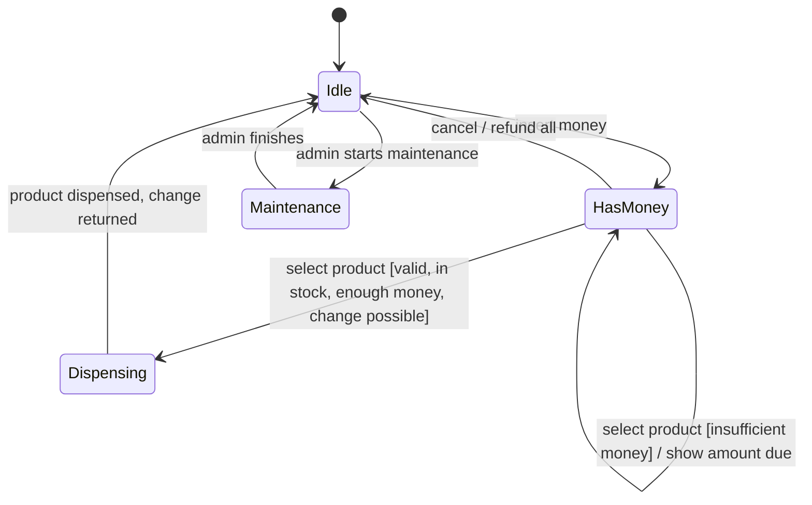
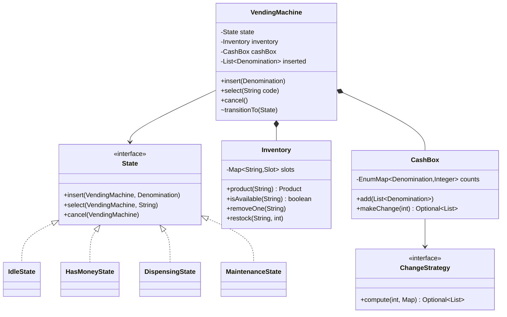

<Related ids={['state-pattern', 'strategy-pattern', 'chain-of-responsibility-pattern', 'concurrency-for-lld', 'interview-grade-code']} />

The vending machine is **the** State-pattern problem. Interviewers watch for three things: a clear state diagram, invalid operations handled explicitly in every state, and correct money handling (including change).

## What the interviewer expects

The full design in this lesson is longer than anything you'd write in one round. It's there so you understand the edge cases and can answer follow-up questions. In the round itself, aim for this:

<InterviewScope minutes="45–60" lines="50" write={["A `State` interface with Idle and HasMoney states", "The machine forwarding each button to its current state", "Insert coin, select, cancel and refund"]} say={["How you would give change with a limited set of coins", "A Dispensing state for when the motor can fail", "Why the State pattern beats a big `switch`"]} skip={["Maintenance mode and restocking screens", "Card payments", "Hardware drivers"]} />

### The interview-sized version

Two states, three buttons. Wrong actions fail with a clear message, and the machine never loses your money. It's about **50 lines**, and it compiles and runs.

```java
class Product {
    final String name;
    final int price;
    int stock;
    Product(String name, int price, int stock) { this.name = name; this.price = price; this.stock = stock; }
}

interface State {                                  // each action is "not allowed" unless a state allows it
    default void insertCoin(VendingMachine m, int amount) { throw new IllegalStateException("Can't insert coins now"); }
    default int select(VendingMachine m, String code)      { throw new IllegalStateException("Insert money first"); }
    default int cancel(VendingMachine m)                   { throw new IllegalStateException("Nothing to cancel"); }
}

class Idle implements State {
    public void insertCoin(VendingMachine m, int amount) { m.balance += amount; m.state = new HasMoney(); }
}

class HasMoney implements State {
    public void insertCoin(VendingMachine m, int amount) { m.balance += amount; }

    public int select(VendingMachine m, String code) {
        Product p = m.products.get(code);
        if (p == null) throw new IllegalArgumentException("No product " + code);
        if (p.stock == 0) throw new IllegalStateException(p.name + " is sold out");
        if (m.balance < p.price) throw new IllegalStateException("Insert ₹" + (p.price - m.balance) + " more");
        p.stock--;
        int change = m.balance - p.price;
        m.balance = 0;
        m.state = new Idle();
        return change;
    }

    public int cancel(VendingMachine m) {
        int refund = m.balance;
        m.balance = 0;
        m.state = new Idle();
        return refund;
    }
}

class VendingMachine {                             // the context: it just forwards to the current state
    final Map<String, Product> products = new HashMap<>();
    State state = new Idle();
    int balance;

    void addProduct(String code, Product p) { products.put(code, p); }
    synchronized void insertCoin(int amount) { state.insertCoin(this, amount); }
    synchronized int select(String code)    { return state.select(this, code); }
    synchronized int cancel()               { return state.cancel(this); }
}
```

<Callout type="tip" title="How to use the rest of this lesson">
Practise writing the short version above, in your own words, until you can do it in about 30 minutes. Then read the full design below for the edge cases and follow-up answers. Interviewers often ask about those, but they rarely ask you to type them all.
</Callout>

## 1. Requirements

| Question | Assumption |
| --- | --- |
| Payment | Coins and notes (₹1, 2, 5, 10, 20, 50, 100); card is an extension |
| Selection | Product codes like `A1`, `B3`; one product per transaction |
| Change | Return change using available coins/notes; if exact change is impossible, refuse the sale and refund |
| Cancel | User can cancel any time before dispensing → full refund |
| Admin | Restock products, refill/collect cash, put machine in maintenance |
| Concurrency | One user at a time at the panel; admin operations must not interleave with a sale |

## 2. States



| Operation ↓ / State → | Idle | HasMoney | Dispensing | Maintenance |
| --- | --- | --- | --- | --- |
| insert money | accept → HasMoney | accept | reject (busy) | reject → refund |
| select product | error "insert money" | validate → Dispensing | reject | reject |
| cancel | no-op | refund → Idle | reject (too late) | no-op |
| maintenance | → Maintenance | reject (sale in progress) | reject | — |

Writing this table first is the single best thing you can do in the interview — it *is* the specification of every state class.

## 3. Class design



## 4. Implementation

### Money

```java
public enum Denomination {
    ONE(1), TWO(2), FIVE(5), TEN(10), TWENTY(20), FIFTY(50), HUNDRED(100);
    private final int value;
    Denomination(int v) { this.value = v; }
    public int value() { return value; }
}
```

Use **integer rupees (or paise)** — never `double` for money.

### Inventory

```java
public record Product(String code, String name, int price) { }

public final class Inventory {
    private final Map<String, Product> products = new HashMap<>();
    private final Map<String, Integer> stock = new HashMap<>();

    public void addProduct(Product p, int qty) { products.put(p.code(), p); stock.merge(p.code(), qty, Integer::sum); }
    public Product product(String code) {
        Product p = products.get(code);
        if (p == null) throw new UnknownProductException(code);
        return p;
    }
    public boolean isAvailable(String code) { return stock.getOrDefault(code, 0) > 0; }
    public void removeOne(String code) {
        stock.computeIfPresent(code, (k, n) -> {
            if (n <= 0) throw new SoldOutException(code);
            return n - 1;
        });
    }
}
```

### Making change

Greedy (largest denomination first) is optimal for canonical coin systems like ₹1/2/5/10, but **not** in general — and the machine may be **out of some coins**. A bounded search over available counts is safer:

```java
public interface ChangeStrategy {
    Optional<Map<Denomination, Integer>> compute(int amount, Map<Denomination, Integer> available);
}

/** Greedy with availability limits — fine for canonical systems; documents its limitation. */
public final class GreedyChange implements ChangeStrategy {
    public Optional<Map<Denomination, Integer>> compute(int amount, Map<Denomination, Integer> available) {
        Map<Denomination, Integer> result = new EnumMap<>(Denomination.class);
        List<Denomination> desc = new ArrayList<>(List.of(Denomination.values()));
        Collections.reverse(desc);
        for (Denomination d : desc) {
            int use = Math.min(amount / d.value(), available.getOrDefault(d, 0));
            if (use > 0) { result.put(d, use); amount -= use * d.value(); }
        }
        return amount == 0 ? Optional.of(result) : Optional.empty();
    }
}
```

<Callout type="note">
Greedy can fail even when change is possible: owing 6 with only one ₹5 and three ₹2 coins available, greedy takes the 5 and can't make 1 — but 2+2+2 works. A dynamic-programming `ChangeStrategy` (bounded coin change) solves this. Making change a **strategy** lets you start with greedy and swap in DP if the interviewer pushes.
</Callout>

```java
/** Bounded coin change: fewest coins using only what is in the box. O(amount × coins in box). */
public final class BoundedChange implements ChangeStrategy {
    public Optional<Map<Denomination, Integer>> compute(int amount, Map<Denomination, Integer> available) {
        int[] best = new int[amount + 1];                  // fewest coins to make each sum
        Denomination[] lastCoin = new Denomination[amount + 1];
        int[] prev = new int[amount + 1];
        Arrays.fill(best, Integer.MAX_VALUE);
        best[0] = 0;
        for (Denomination d : Denomination.values()) {
            for (int k = 0; k < available.getOrDefault(d, 0); k++) {   // each physical coin used at most once
                for (int s = amount; s >= d.value(); s--) {            // descending: 0/1 knapsack order
                    int from = s - d.value();
                    if (best[from] != Integer.MAX_VALUE && best[from] + 1 < best[s]) {
                        best[s] = best[from] + 1; lastCoin[s] = d; prev[s] = from;
                    }
                }
            }
        }
        if (best[amount] == Integer.MAX_VALUE) return Optional.empty();
        Map<Denomination, Integer> plan = new EnumMap<>(Denomination.class);
        for (int s = amount; s > 0; s = prev[s]) plan.merge(lastCoin[s], 1, Integer::sum);
        return Optional.of(plan);
    }
}
```

Amounts in a vending machine are small (change is rarely above ₹100), so this runs in microseconds.

```java
public final class CashBox {
    private final EnumMap<Denomination, Integer> counts = new EnumMap<>(Denomination.class);
    private final ChangeStrategy changeStrategy;

    public CashBox(ChangeStrategy s) { this.changeStrategy = s; }

    public void add(Collection<Denomination> money) { money.forEach(d -> counts.merge(d, 1, Integer::sum)); }

    /** Plans change without committing; returns empty if impossible. */
    public Optional<Map<Denomination, Integer>> planChange(int amount) {
        if (amount == 0) return Optional.of(Map.of());
        return changeStrategy.compute(amount, Collections.unmodifiableMap(counts));
    }

    public void dispense(Map<Denomination, Integer> plan) {
        plan.forEach((d, n) -> {
            int have = counts.getOrDefault(d, 0);
            if (have < n) throw new IllegalStateException("Not enough " + d);   // never go negative
            counts.put(d, have - n);
        });
    }
}
```

### States

<FullCode title="Show the full code: States (72 lines)">

```java
public interface State {
    default void insert(VendingMachine m, Denomination d) { throw new IllegalOperationException("insert", name()); }
    default void select(VendingMachine m, String code)    { throw new IllegalOperationException("select", name()); }
    default void cancel(VendingMachine m)                 { throw new IllegalOperationException("cancel", name()); }
    default void startMaintenance(VendingMachine m)       { throw new IllegalOperationException("maintenance", name()); }
    default void finishMaintenance(VendingMachine m)      { throw new IllegalOperationException("finish maintenance", name()); }
    String name();

    static Map<Denomination, Integer> toCounts(List<Denomination> coins) {
        Map<Denomination, Integer> counts = new EnumMap<>(Denomination.class);
        coins.forEach(d -> counts.merge(d, 1, Integer::sum));
        return counts;
    }
}

final class IdleState implements State {
    public void insert(VendingMachine m, Denomination d) { m.addInserted(d); m.transitionTo(m.hasMoney()); }
    public void select(VendingMachine m, String code)    { throw new IllegalOperationException("Insert money first"); }
    public void cancel(VendingMachine m)                 { /* nothing to refund */ }
    public void startMaintenance(VendingMachine m)       { m.transitionTo(m.maintenance()); }
    public String name() { return "IDLE"; }
}

final class HasMoneyState implements State {
    public void insert(VendingMachine m, Denomination d) { m.addInserted(d); }

    public void select(VendingMachine m, String code) {
        Product p = m.inventory().product(code);
        if (!m.inventory().isAvailable(code)) throw new SoldOutException(code);

        int paid = m.insertedTotal();
        if (paid < p.price()) throw new InsufficientFundsException(p.price() - paid);   // stay in HasMoney

        // Plan change against the cash box *including* the coins just inserted
        m.cashBox().add(m.inserted());
        Optional<Map<Denomination, Integer>> change = m.cashBox().planChange(paid - p.price());
        if (change.isEmpty()) {
            m.cashBox().dispense(State.toCounts(m.inserted()));        // take the inserted coins back out
            throw new ExactChangeRequiredException();             // user can cancel or add exact amount
        }

        m.transitionTo(m.dispensing());
        m.inventory().removeOne(code);
        m.cashBox().dispense(change.get());
        m.hardware().dropProduct(code);
        m.hardware().returnMoney(change.get());
        m.clearInserted();
        m.transitionTo(m.idle());
    }

    public void cancel(VendingMachine m) {
        m.hardware().returnMoney(State.toCounts(m.inserted()));
        m.clearInserted();
        m.transitionTo(m.idle());
    }
    public String name() { return "HAS_MONEY"; }
}

/** Transient while the motor runs: every customer action falls through to the defaults and is rejected. */
final class DispensingState implements State {
    public String name() { return "DISPENSING"; }
}

final class MaintenanceState implements State {
    public void insert(VendingMachine m, Denomination d) {
        m.hardware().returnMoney(State.toCounts(List.of(d)));   // give the coin straight back
        throw new IllegalOperationException("insert", name());
    }
    public void cancel(VendingMachine m)            { }
    public void finishMaintenance(VendingMachine m) { m.transitionTo(m.idle()); }
    public String name() { return "MAINTENANCE"; }
}
```

</FullCode>

### The machine (context)

```java
public final class VendingMachine {
    private final State idle = new IdleState(), hasMoney = new HasMoneyState(),
                        dispensing = new DispensingState(), maintenance = new MaintenanceState();
    private final Inventory inventory;
    private final CashBox cashBox;
    private final Hardware hardware;
    private final List<Denomination> inserted = new ArrayList<>();
    private State state = idle;

    public VendingMachine(Inventory inventory, CashBox cashBox, Hardware hardware) {
        this.inventory = inventory; this.cashBox = cashBox; this.hardware = hardware;
    }

    // Public API: one lock serialises user and admin operations
    public synchronized void insert(Denomination d) { state.insert(this, d); }
    public synchronized void select(String code)    { state.select(this, code); }
    public synchronized void cancel()               { state.cancel(this); }
    public synchronized void startMaintenance()     { state.startMaintenance(this); }
    public synchronized void finishMaintenance()    { state.finishMaintenance(this); }

    // Hooks for states (package-private)
    void transitionTo(State s) { state = s; }
    void addInserted(Denomination d) { inserted.add(d); }
    int insertedTotal() { return inserted.stream().mapToInt(Denomination::value).sum(); }
    List<Denomination> inserted() { return List.copyOf(inserted); }
    void clearInserted() { inserted.clear(); }
    State idle() { return idle; }
    State hasMoney() { return hasMoney; }
    State dispensing() { return dispensing; }
    State maintenance() { return maintenance; }
    Inventory inventory() { return inventory; }
    CashBox cashBox() { return cashBox; }
    Hardware hardware() { return hardware; }
}
```

`Hardware` is an interface (`dropProduct`, `returnMoney`) — in the interview it prints; in reality it drives motors. This keeps business logic testable.

## 5. Edge cases to call out

- **Exact change unavailable** — refuse before dispensing, keep the user's money in a refundable state.
- **Sold out after money inserted** — error, stay in `HasMoney`; user picks another or cancels.
- **Hardware failure while dispensing** (product stuck) — transition to an error/maintenance state and refund, rather than silently keeping money.
- **Cancel during dispensing** — not allowed; the operation is already committed.
- **Money as integers**, and the inserted coins must be accounted for in the cash box before computing change (they can be part of the change).

## 6. Patterns used

| Pattern | Where |
| --- | --- |
| **State** | `IdleState`, `HasMoneyState`, `DispensingState`, `MaintenanceState` |
| **Strategy** | `ChangeStrategy` (greedy vs DP) |
| **Chain of Responsibility** (alternative) | Dispensing change denomination by denomination |
| **Facade** | `VendingMachine` public API |

## 7. Extensions

- **Card/UPI payments**: a `PaymentMethod` abstraction; `HasMoneyState` generalises to "has credit".
- **Multiple quantities / cart**: a selection state collecting items before payment.
- **Telemetry**: publish events (`ProductSold`, `LowStock`) to an observer that alerts operators.
- **Promotions**: a pricing strategy applied at selection.

## Interview questions

<QA q="Why use the State pattern instead of an enum and switch statements?">
The machine has several states and every operation behaves differently in each, so a switch-based design spreads each state's rules across all operations and grows with every new state. State classes group the behaviour per state, make invalid operations explicit (defaults throw), and let you add a state such as Maintenance or Error without editing the others. For a two-state toy, an enum would be fine.
</QA>

<QA q="When is greedy change-making wrong, and how do you fix it?">
Greedy is optimal only for canonical coin systems with unlimited coins. With limited stock or non-canonical denominations it can fail to find change that exists — for example owing 6 with one 5 and three 2s. Use a bounded dynamic-programming coin-change algorithm over the available counts (amounts are small, so it's cheap), behind the same ChangeStrategy interface.
</QA>

<QA q="How do you keep an admin restock from interfering with a customer purchase?">
Serialise operations on the machine with a single lock (synchronized public methods), and only allow maintenance to start from the Idle state — if a sale is in progress the request is rejected. During Maintenance, customer operations are rejected and inserted money is refunded.
</QA>

<Practice task="Add card and UPI payments alongside coins. How does the state machine change?">

Generalise "inserted money" to a `Payment` abstraction: coins accumulate credit as now; a card/UPI payment is authorised for the product price after selection (select first, then pay). That suggests a new state, `AwaitingPayment`, entered from `Idle` on selection when the user chooses card, with a timeout back to `Idle`. Change-making only applies to cash. Dispensing still requires the payment to be captured; if the motor fails after capture, refund through the payment provider.

</Practice>

<Practice task="The motor sometimes jams while dispensing. Design what happens to the customer's money and the machine.">

Add an `Error` (or `OutOfOrder`) state. `Hardware.dropProduct` reports success or failure (sensor confirms the drop). On failure: don't decrement stock, refund the customer (return the inserted coins, or void the card authorisation), record the fault and move to `Error`, where every customer operation is rejected and inserted coins are returned immediately. Only an admin `reset()` returns to `Idle`. The point interviewers look for: never keep money for a product that wasn't delivered.

</Practice>

<Takeaways>

- Start with the state diagram and an operation × state table — it is the spec.
- Each state class implements valid operations and rejects invalid ones explicitly.
- Handle money in integers; plan change before committing; refund on any failure.
- Make change-making a strategy (greedy vs DP) and hardware an interface.

</Takeaways>

## Further reading

- [State](/system-design/lld/state-pattern) and [Strategy](/system-design/lld/strategy-pattern).
- Freeman and Robson, *Head First Design Patterns* — the gumball machine chapter.
