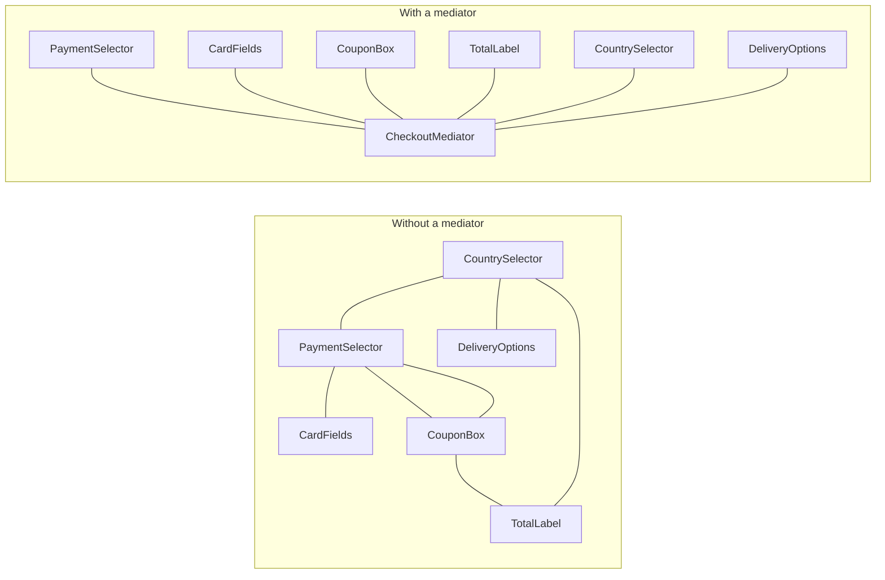

## The idea in plain words

When many objects all talk to each other directly, you get a tangled web where every change touches everything. A **Mediator** is one object in the middle: the others only talk to it, and it decides who needs to know what.

**Picture it:** air traffic control. Planes don't radio each other to agree on who lands first. Every plane talks only to the tower, and the tower coordinates.

### The smallest example

```java
class ControlTower {
    private String onRunway;                             // the shared thing being coordinated

    boolean requestLanding(String flight) {
        if (onRunway != null) { System.out.println(flight + ": hold, " + onRunway + " is landing"); return false; }
        onRunway = flight;
        System.out.println(flight + ": cleared to land");
        return true;
    }
    void runwayClear(String flight) { if (flight.equals(onRunway)) onRunway = null; }
}

class Plane {
    private final String flight;
    private final ControlTower tower;                    // a plane knows the tower, never other planes
    Plane(String flight, ControlTower tower) { this.flight = flight; this.tower = tower; }

    boolean approach() { return tower.requestLanding(flight); }
    void vacate() { tower.runwayClear(flight); }
}

class Demo {
    public static void main(String[] args) {
        ControlTower tower = new ControlTower();
        Plane a = new Plane("AI101", tower), b = new Plane("6E202", tower);
        a.approach();   // AI101: cleared to land
        b.approach();   // 6E202: hold, AI101 is landing
        a.vacate();
        b.approach();   // 6E202: cleared to land
    }
}
```

With 10 planes talking directly you'd have up to 45 links between them. With a tower, each plane has one.

| Use it when | Skip it when |
| --- | --- |
| Many objects react to each other (form fields, chat room members, game pieces) | Two objects talk: a direct call is simpler |

The rest of this lesson shows a realistic mediator and how to stop it becoming a "god object".

**The textbook definition:** reduce chaotic dependencies between objects by making them communicate **only through a mediator object**, instead of referring to each other directly.

## The problem

Consider an air-traffic scenario — or, closer to LLD interviews, a **chat room** or a **checkout form**. In a checkout form:

- Selecting "Cash on delivery" hides the card fields and disables the "Save card" checkbox.
- Entering a coupon recalculates the total and may change available payment methods.
- Changing the shipping country updates tax, currency and delivery options.

If each UI component calls the others directly, every component knows about many others: N components → up to N² dependencies. Components can't be reused elsewhere, and changing one breaks several.



## The solution

Components notify the **mediator** about events; the mediator decides what other components should do. Each component depends only on the mediator interface.

```java
public interface CheckoutMediator {
    void notify(Component sender, String event);
}

public abstract class Component {
    protected CheckoutMediator mediator;
    void setMediator(CheckoutMediator m) { this.mediator = m; }
}

public final class PaymentSelector extends Component {
    private PaymentMethod selected;
    public void select(PaymentMethod m) { selected = m; mediator.notify(this, "paymentChanged"); }
    public PaymentMethod selected() { return selected; }
}

public final class CheckoutForm implements CheckoutMediator {
    private final PaymentSelector payment;
    private final CardFields card;
    private final CouponBox coupon;
    private final TotalLabel total;
    private final PricingService pricing;

    public CheckoutForm(PaymentSelector payment, CardFields card, CouponBox coupon,
                        TotalLabel total, PricingService pricing) {
        this.payment = payment; this.card = card; this.coupon = coupon;
        this.total = total; this.pricing = pricing;
        List.of(payment, card, coupon, total).forEach(c -> c.setMediator(this));
    }

    @Override public void notify(Component sender, String event) {
        switch (event) {
            case "paymentChanged" -> card.setVisible(payment.selected() == PaymentMethod.CARD);
            case "couponApplied"  -> total.show(pricing.total(coupon.code()));
            default -> { }
        }
    }
}
```

All the coordination rules live in one class; components become simple and reusable.

## Classic LLD example: chat room

```java
public interface ChatRoom {
    void join(User u);
    void send(User from, String text);
    void sendPrivate(User from, String toUserId, String text);
}

public final class GroupChatRoom implements ChatRoom {
    private final Map<String, User> members = new ConcurrentHashMap<>();

    public void join(User u) { members.put(u.id(), u); u.joined(this); }

    public void send(User from, String text) {
        members.values().stream()
               .filter(u -> !u.equals(from))
               .forEach(u -> u.receive(from.name(), text));
    }

    public void sendPrivate(User from, String toUserId, String text) {
        User to = members.get(toUserId);
        if (to == null) throw new IllegalArgumentException("No such member: " + toUserId);
        to.receive(from.name() + " (private)", text);
    }
}

// Users never hold references to each other — only to the room
```

The room can add muting, moderation, message history or rate limits without touching `User`.

## Where you've seen it

- `java.util.concurrent.Executor` decoupling task submitters from worker threads (loosely), `java.util.Timer`.
- MVC **controllers** mediating between views and models.
- **Air-traffic control** (the textbook analogy): planes talk to the tower, not to each other.
- Message brokers and event buses are distributed mediators.
- Libraries like MediatR (.NET) and Spring's application event infrastructure.

## Pitfalls

- **God mediator**: all logic migrates into the mediator, which becomes huge and fragile. Split by use case (one mediator per dialog or room), and keep domain logic in domain objects.
- **Hidden flow**: interactions are indirect; name events clearly and keep the mediator readable.

## Pros and cons

| Pros | Cons |
| --- | --- |
| Components decoupled and reusable | The mediator can grow into a god object |
| Interaction rules centralised in one place (SRP) | Indirection makes flow harder to trace |
| New interaction rules without changing components (OCP) | Single point that many components depend on |

## Comparisons

- **Mediator vs Facade**: a facade simplifies access *into* a subsystem whose parts still talk to each other and don't know the facade. A mediator sits *between* peers who only talk through it.
- **Mediator vs Observer**: Observer creates dynamic one-way subscriptions; Mediator removes mutual dependencies among a set of components. They combine well — the mediator can be an event publisher components subscribe to.
- **Chain of Responsibility, Command, Mediator, Observer** all connect senders and receivers in different ways; Mediator's distinctive feature is that **no component talks to another directly**.

## Keeping the mediator small: one handler per message

The classic form puts every rule in one `notify(sender, event)` switch, which is exactly how god mediators grow. A common fix is to make the mediator a small router: each message type is a class, and each rule is a separate handler registered for that type. This is how libraries such as MediatR work, and it is close to Spring's application events.

<FullCode title="The full message router (44 lines)" note="one handler class per message type">

```java
// A mediator that routes each message type to its own handler class,
// so coordination rules stay small instead of piling up in one switch.
public interface Handler<M> { void handle(M message); }

public final class Mediator {
    private final Map<Class<?>, List<Handler<?>>> handlers = new ConcurrentHashMap<>();

    public <M> void register(Class<M> type, Handler<M> handler) {
        handlers.computeIfAbsent(type, t -> new CopyOnWriteArrayList<>()).add(handler);
    }

    @SuppressWarnings("unchecked")
    public <M> void send(M message) {
        for (Handler<?> h : handlers.getOrDefault(message.getClass(), List.of())) {
            ((Handler<M>) h).handle(message);
        }
    }
}

// Messages are plain records; participants only know the mediator
public record AlarmArmed(String by) { }
public record DoorOpened(String door) { }

public final class Lights { boolean on = true; void allOff() { on = false; System.out.println("lights off"); } }
public final class Locks  { void lockAll() { System.out.println("doors locked"); } }
public final class Siren  { void sound(String why) { System.out.println("SIREN: " + why); } }

public final class MediatorDemo {
    public static void main(String[] args) {
        Mediator hub = new Mediator();
        Lights lights = new Lights();
        Locks locks = new Locks();
        Siren siren = new Siren();
        boolean[] armed = { false };

        // Each rule is a separate, testable handler
        hub.register(AlarmArmed.class, m -> { armed[0] = true; locks.lockAll(); lights.allOff(); });
        hub.register(DoorOpened.class, m -> { if (armed[0]) siren.sound(m.door() + " opened while armed"); });

        hub.send(new DoorOpened("back door"));       // not armed: nothing happens
        hub.send(new AlarmArmed("keypad"));
        hub.send(new DoorOpened("front door"));
    }
}
```

</FullCode>

Output:

```text
doors locked
lights off
SIREN: front door opened while armed
```

Devices still never reference each other. Adding a "vacation mode" means registering new handlers, without editing a growing switch statement, and each handler can be unit-tested on its own.

## Mediator vs event bus

An event bus (or message broker) also decouples senders from receivers, but it only routes messages by topic: it contains no rules about *what should happen*. A mediator owns the coordination logic for one context ("when the alarm is armed, lock the doors and switch off the lights"). In practice a mediator is often built on top of a bus — as in the example above — with the rules living in handlers that belong to the mediator's context.

## Testing

- Test each **component** with a fake mediator and assert which messages it sends.
- Test the **mediator's rules** with fake components and assert which commands they receive.
- Keep the mediator free of I/O so these tests are fast and deterministic.

<Callout type="interview">
Typical LLD prompts with a natural mediator: **chat rooms** (users talk through the room), **air-traffic control** (planes ask the tower for runways), **auction houses** (bids go to the auction, which notifies other bidders), **elevator systems** (a dispatcher coordinates hall buttons and cars) and **smart homes**. Interviewers then ask how you keep the mediator from becoming a god object and whether it is thread-safe when many participants send at once.
</Callout>

## Interview questions

<QA q="When would you use a Mediator instead of letting objects call each other?">
When a group of objects interact in complex, many-to-many ways — UI components on a form, participants in a chat room, devices in a smart home — so direct references create a tangled dependency graph that makes components hard to reuse and change. Centralising the interaction rules in a mediator lets each component depend only on the mediator. For one or two simple interactions, direct calls are simpler.
</QA>

<QA q="How do you prevent the mediator from becoming a god object?">
Scope each mediator to one cohesive interaction context (a single dialog or room), keep business rules in domain services or objects with the mediator only routing and coordinating, split it when unrelated concerns accumulate, and consider event-based mediation where handlers for each interaction are separate classes registered with the mediator.
</QA>

<QA q="Two users send messages to the same chat room at the same moment. How do you keep the mediator thread-safe and the message order consistent?">
Protect the room's shared state: use a concurrent map for members, and give each room a single ordering point, either a lock around "assign sequence number and fan out" or, better at scale, a single-threaded executor (an actor) per room that processes messages one at a time. Every member then sees messages in the same order, and slow receivers should get messages through their own queues so one slow client cannot block the room.
</QA>

<Practice task="In a smart home, the alarm, lights, thermostat and door lock call each other directly (arming the alarm locks the doors, switches off the lights and sets the thermostat to eco). Redesign it with a mediator.">

Introduce a `HomeHub` mediator. Devices only report events to it (for example `hub.notify(this, "ALARM_ARMED")`) and expose simple commands. The hub holds the rules: on ALARM_ARMED, lock the doors, switch off the lights and set the thermostat to eco. New scenes (vacation mode) change only the hub — or, to avoid a god mediator, register one rule object per scene with the hub. Devices become reusable and testable on their own.

</Practice>

<Practice task="Design an online auction with a mediator. Bidders place bids, everyone sees the current highest bid, and the auction closes at a deadline. What does the mediator own, and what do bidders know?">

The `Auction` is the mediator. It owns the item, the current highest bid, the bid history, the deadline and the participant list. Bidders know only the auction: they call `auction.placeBid(this, amount)` and receive `onNewHighestBid(...)` and `onClosed(winner)` callbacks.

Rules in the mediator: reject bids after the deadline or not above the current highest bid plus the minimum increment; record valid bids; notify all other bidders of a new highest bid; at the deadline, close and notify the winner and the others.

Thread safety: process bids for one auction sequentially (a lock or a per-auction executor), so two simultaneous bids cannot both win. Bidders never reference each other.

</Practice>

<Takeaways>

- Mediator replaces many-to-many object references with many-to-one references to a hub.
- Components notify the mediator; it coordinates the reactions.
- Great for forms, chat rooms, workflows and device coordination.
- Watch for god mediators; Facade simplifies access, Mediator decouples peers.
- Keep the mediator a small router with one handler per message type, and test components and rules separately.

</Takeaways>

## Further reading

- Gamma et al., *Design Patterns* (1994) — Mediator.
- Alexander Shvets, *Dive Into Design Patterns* — "Mediator".
