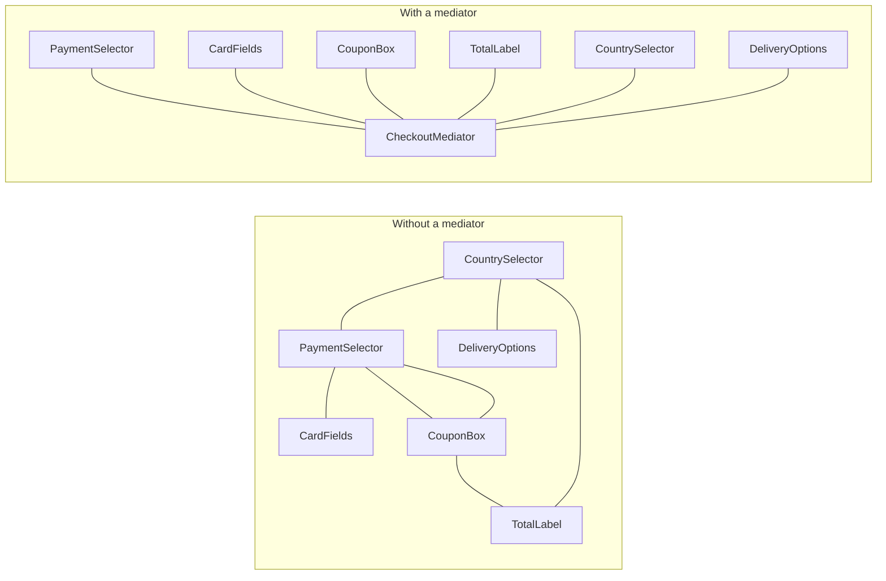

**Intent:** reduce chaotic dependencies between objects by making them communicate **only through a mediator object**, instead of referring to each other directly.

## The problem

Consider an air-traffic scenario — or, closer to LLD interviews, a **chat room** or a **checkout form**. In a checkout form:

- Selecting "Cash on delivery" hides the card fields and disables the "Save card" checkbox.
- Entering a coupon recalculates the total and may change available payment methods.
- Changing the shipping country updates tax, currency and delivery options.

If each UI component calls the others directly, every component knows about many others: N components → up to N² dependencies. Components can't be reused elsewhere, and changing one breaks several.



## The solution

Components notify the **mediator** about events; the mediator decides what other components should do. Each component depends only on the mediator interface.

```java
public interface CheckoutMediator {
    void notify(Component sender, String event);
}

public abstract class Component {
    protected CheckoutMediator mediator;
    void setMediator(CheckoutMediator m) { this.mediator = m; }
}

public final class PaymentSelector extends Component {
    private PaymentMethod selected;
    public void select(PaymentMethod m) { selected = m; mediator.notify(this, "paymentChanged"); }
    public PaymentMethod selected() { return selected; }
}

public final class CheckoutForm implements CheckoutMediator {
    private final PaymentSelector payment;
    private final CardFields card;
    private final CouponBox coupon;
    private final TotalLabel total;
    private final PricingService pricing;

    public CheckoutForm(PaymentSelector payment, CardFields card, CouponBox coupon,
                        TotalLabel total, PricingService pricing) {
        this.payment = payment; this.card = card; this.coupon = coupon;
        this.total = total; this.pricing = pricing;
        List.of(payment, card, coupon, total).forEach(c -> c.setMediator(this));
    }

    @Override public void notify(Component sender, String event) {
        switch (event) {
            case "paymentChanged" -> card.setVisible(payment.selected() == PaymentMethod.CARD);
            case "couponApplied"  -> total.show(pricing.total(coupon.code()));
            default -> { }
        }
    }
}
```

All the coordination rules live in one class; components become simple and reusable.

## Classic LLD example: chat room

```java
public interface ChatRoom {
    void join(User u);
    void send(User from, String text);
    void sendPrivate(User from, String toUserId, String text);
}

public final class GroupChatRoom implements ChatRoom {
    private final Map<String, User> members = new ConcurrentHashMap<>();

    public void join(User u) { members.put(u.id(), u); u.joined(this); }

    public void send(User from, String text) {
        members.values().stream()
               .filter(u -> !u.equals(from))
               .forEach(u -> u.receive(from.name(), text));
    }

    public void sendPrivate(User from, String toUserId, String text) {
        User to = members.get(toUserId);
        if (to == null) throw new IllegalArgumentException("No such member: " + toUserId);
        to.receive(from.name() + " (private)", text);
    }
}

// Users never hold references to each other — only to the room
```

The room can add muting, moderation, message history or rate limits without touching `User`.

## Where you've seen it

- `java.util.concurrent.Executor` decoupling task submitters from worker threads (loosely), `java.util.Timer`.
- MVC **controllers** mediating between views and models.
- **Air-traffic control** (the textbook analogy): planes talk to the tower, not to each other.
- Message brokers and event buses are distributed mediators.
- Libraries like MediatR (.NET) and Spring's application event infrastructure.

## Pitfalls

- **God mediator**: all logic migrates into the mediator, which becomes huge and fragile. Split by use case (one mediator per dialog or room), and keep domain logic in domain objects.
- **Hidden flow**: interactions are indirect; name events clearly and keep the mediator readable.

## Pros and cons

| Pros | Cons |
| --- | --- |
| Components decoupled and reusable | The mediator can grow into a god object |
| Interaction rules centralised in one place (SRP) | Indirection makes flow harder to trace |
| New interaction rules without changing components (OCP) | Single point that many components depend on |

## Comparisons

- **Mediator vs Facade**: a facade simplifies access *into* a subsystem whose parts still talk to each other and don't know the facade. A mediator sits *between* peers who only talk through it.
- **Mediator vs Observer**: Observer creates dynamic one-way subscriptions; Mediator removes mutual dependencies among a set of components. They combine well — the mediator can be an event publisher components subscribe to.
- **Chain of Responsibility, Command, Mediator, Observer** all connect senders and receivers in different ways; Mediator's distinctive feature is that **no component talks to another directly**.

## Interview questions

<QA q="When would you use a Mediator instead of letting objects call each other?">
When a group of objects interact in complex, many-to-many ways — UI components on a form, participants in a chat room, devices in a smart home — so direct references create a tangled dependency graph that makes components hard to reuse and change. Centralising the interaction rules in a mediator lets each component depend only on the mediator. For one or two simple interactions, direct calls are simpler.
</QA>

<QA q="How do you prevent the mediator from becoming a god object?">
Scope each mediator to one cohesive interaction context (a single dialog or room), keep business rules in domain services or objects with the mediator only routing and coordinating, split it when unrelated concerns accumulate, and consider event-based mediation where handlers for each interaction are separate classes registered with the mediator.
</QA>

<Practice task="In a smart home, the alarm, lights, thermostat and door lock call each other directly (arming the alarm locks the doors, switches off the lights and sets the thermostat to eco). Redesign it with a mediator.">

Introduce a `HomeHub` mediator. Devices only report events to it (for example `hub.notify(this, "ALARM_ARMED")`) and expose simple commands. The hub holds the rules: on ALARM_ARMED, lock the doors, switch off the lights and set the thermostat to eco. New scenes (vacation mode) change only the hub — or, to avoid a god mediator, register one rule object per scene with the hub. Devices become reusable and testable on their own.

</Practice>

<Takeaways>

- Mediator replaces many-to-many object references with many-to-one references to a hub.
- Components notify the mediator; it coordinates the reactions.
- Great for forms, chat rooms, workflows and device coordination.
- Watch for god mediators; Facade simplifies access, Mediator decouples peers.

</Takeaways>

## Further reading

- Gamma et al., *Design Patterns* (1994) — Mediator.
- Alexander Shvets, *Dive Into Design Patterns* — "Mediator".
