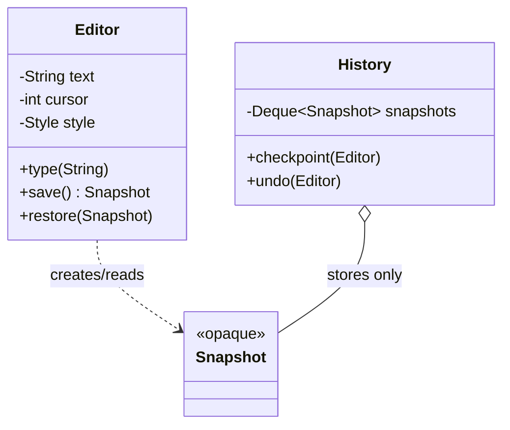

## The idea in plain words

A **Memento** is a saved snapshot of an object's state, so you can put the object back the way it was later. The object makes the snapshot itself, so nobody else has to poke at its private fields.

**Picture it:** saving a video game before a hard level. If things go badly, you load the save and you're back exactly where you were.

### The smallest example

```java
class Game {
    private int level;
    private int health;

    void play(int newLevel, int newHealth) { level = newLevel; health = newHealth; }

    Save save() { return new Save(level, health); }                // take a snapshot
    void load(Save s) { level = s.level(); health = s.health(); }  // go back to it
    public String toString() { return "level " + level + ", health " + health; }

    record Save(int level, int health) { }                        // a record can't be changed after creation
}

class Demo {
    public static void main(String[] args) {
        Game game = new Game();
        game.play(5, 80);
        Game.Save beforeBoss = game.save();     // the caller only holds the save; it never edits it
        game.play(6, 0);                        // lost the fight
        game.load(beforeBoss);
        System.out.println(game);               // level 5, health 80
    }
}
```

Undo in editors, "discard changes" in forms and rollback in a key-value store all work this way.

| Use it when | Skip it when |
| --- | --- |
| You need undo, rollback or checkpoints, and the state is reasonably small to copy | The state is huge: store the changes (commands) instead of full copies |

The rest of this lesson builds a proper undo history and covers keeping snapshots private and cheap.

**The textbook definition:** capture and externalise an object's internal state as a **snapshot** so it can be **restored later** — without violating encapsulation.

## The problem

You want undo in an editor, "revert to last saved" in a form, rollback of a game to a checkpoint, or restoring an object after a failed multi-step operation. To restore state you must save it somewhere. But:

- If another object reads all the fields to copy them, those fields must be public — breaking encapsulation.
- If the object's structure changes, every class that copies its state breaks.

## The solution

Let the object **create its own snapshot** (the memento) and **restore itself** from one. Other objects (the caretaker) store mementos but can't look inside them.

Three roles:

- **Originator** — the object whose state is saved; creates and restores mementos.
- **Memento** — an immutable snapshot; opaque to everyone except the originator.
- **Caretaker** — keeps mementos (e.g., a history stack) and decides *when* to save/restore, but never reads or modifies their contents.



<FullCode title="The full Editor and History code (47 lines)" note="snapshots the caretaker cannot read">

```java
public final class Editor {
    private String text = "";
    private int cursor;
    private Style style = Style.DEFAULT;

    public void type(String s) {
        text = text.substring(0, cursor) + s + text.substring(cursor);
        cursor += s.length();
    }

    // Memento: nested class, private constructor and private accessors → opaque to outsiders
    public static final class Snapshot {
        private final String text;
        private final int cursor;
        private final Style style;
        private final Instant takenAt = Instant.now();

        private Snapshot(String text, int cursor, Style style) {
            this.text = text; this.cursor = cursor; this.style = style;
        }
        public Instant takenAt() { return takenAt; }          // safe metadata only
    }

    public Snapshot save() { return new Snapshot(text, cursor, style); }

    public void restore(Snapshot s) {
        this.text = s.text;                                    // the outer class can read private fields
        this.cursor = s.cursor;
        this.style = s.style;
    }
}

public final class History {
    private final Deque<Editor.Snapshot> snapshots = new ArrayDeque<>();
    private final int limit;
    public History(int limit) { this.limit = limit; }

    public void checkpoint(Editor e) {
        snapshots.push(e.save());
        if (snapshots.size() > limit) snapshots.removeLast();
    }

    public void undo(Editor e) {
        Editor.Snapshot s = snapshots.poll();
        if (s != null) e.restore(s);
    }
}
```

</FullCode>

In Java, a **static nested class with private members** is the idiomatic way to make the memento readable by the originator but opaque to the caretaker. An alternative is a narrow public interface (e.g., only `takenAt()`) with the real class package-private.

## Design concerns

- **Immutability**: mementos must not change after creation; copy mutable fields (deep copy where needed).
- **Memory**: full snapshots of large objects are expensive. Bound the history, snapshot only changed parts, or store **diffs** (incremental mementos).
- **External resources**: open files, sockets or references to other objects can't simply be snapshotted — decide what "restore" means for them.
- **Serialization**: mementos can be persisted (save game, draft autosave) — then you need versioning of the snapshot format.

## Memento + Command for undo

[Command](/system-design/lld/command-pattern) and Memento combine naturally: before a command executes, it asks the receiver for a memento; `undo()` restores it. This avoids writing an inverse operation for every command — at the cost of memory.

```java
public final class FormatSelectionCommand implements Command {
    private final Editor editor;
    private final Style newStyle;
    private Editor.Snapshot before;

    public void execute() { before = editor.save(); editor.applyStyle(newStyle); }
    public void undo()    { editor.restore(before); }
}
```

## Where you've seen it

- Undo in editors and IDEs; "checkpoints" in games.
- Transaction rollback (conceptually: a database's undo log restores prior state).
- `java.io.Serializable` used to persist object state snapshots.
- Form state preservation: Android's `onSaveInstanceState(Bundle)` saves UI state to restore after recreation.

## Pros and cons

| Pros | Cons |
| --- | --- |
| Snapshots without exposing internals | High memory use with frequent or large snapshots |
| Simplifies the originator — history is managed by the caretaker | Caretakers must manage lifecycle (discard old mementos) |
| Works for complex state where inverse operations are hard | Some languages can't enforce opacity well |

## Related patterns

- **Command** + Memento → undo with snapshots.
- **Iterator** + Memento → save and resume an iteration position.
- **Prototype** can be a simpler alternative when the object is straightforward and has no external resources: just store a copy.

## Undo and redo together

Real editors need both directions. The caretaker keeps two stacks: an undo stack of states to go back to, and a redo stack of states you undid. Two rules make it correct:

1. Undoing pushes the *current* state onto the redo stack before restoring, so the undo can itself be undone.
2. Any new edit clears the redo stack, because the "future" it described no longer follows from the present.

<FullCode title="The full undo/redo code (66 lines)" note="two stacks, and new edits clear redo">

```java
// Originator: owns its state, creates and restores opaque snapshots
public final class TextBox {
    private String text = "";

    public void type(String s) { text += s; }
    public String text() { return text; }

    public static final class Snapshot {                 // opaque to everyone but TextBox
        private final String text;
        private Snapshot(String text) { this.text = text; }
    }

    public Snapshot save() { return new Snapshot(text); }
    public void restore(Snapshot s) { text = s.text; }
}

// Caretaker with undo AND redo, bounded to `limit` steps
public final class UndoHistory {
    private final Deque<TextBox.Snapshot> undo = new ArrayDeque<>();
    private final Deque<TextBox.Snapshot> redo = new ArrayDeque<>();
    private final int limit;

    public UndoHistory(int limit) { this.limit = limit; }

    /** Call before every change. A new change makes the old "future" meaningless, so redo is cleared. */
    public void beforeChange(TextBox box) {
        undo.push(box.save());
        if (undo.size() > limit) undo.removeLast();       // forget the oldest step
        redo.clear();
    }

    public boolean undo(TextBox box) {
        if (undo.isEmpty()) return false;
        redo.push(box.save());                             // so this undo can itself be undone
        box.restore(undo.pop());
        return true;
    }

    public boolean redo(TextBox box) {
        if (redo.isEmpty()) return false;
        undo.push(box.save());
        box.restore(redo.pop());
        return true;
    }
}

public final class MementoDemo {
    public static void main(String[] args) {
        TextBox box = new TextBox();
        UndoHistory history = new UndoHistory(100);

        for (String word : new String[] { "Hello", " brave", " new", " world" }) {
            history.beforeChange(box);
            box.type(word);
        }
        history.undo(box);
        history.undo(box);
        System.out.println(box.text());                    // Hello brave
        history.redo(box);
        System.out.println(box.text());                    // Hello brave new

        history.beforeChange(box);
        box.type("!");                                     // a new edit clears redo
        System.out.println(box.text() + " | redo possible: " + history.redo(box));
    }
}
```

</FullCode>

Output:

```text
Hello brave
Hello brave new
Hello brave new! | redo possible: false
```

The history is bounded (`limit`), so memory stays predictable. Note that `UndoHistory` never looks inside a `Snapshot`; it only stores and returns them.

## Persistent mementos: save games and drafts

When mementos are written to disk or sent over the network, new concerns appear:

- **Versioning.** The originator's fields will change between releases. Store a format version in every saved memento and keep code that upgrades old versions on load.
- **Validation.** A loaded memento is untrusted input. Validate it before restoring, so a corrupted or edited file cannot put the object into an impossible state.
- **Tampering.** For games, players may edit save files to cheat; sign the saved data (an HMAC) if that matters, or keep authoritative state on the server.
- **Size.** Compress large snapshots, and for frequent autosaves store a full snapshot occasionally plus small diffs in between.

<Callout type="interview">
Memento appears in LLD rounds as **undo/redo in a text editor or drawing app**, **checkpoints in a game**, **configuration rollback** (keep previous config versions and restore one) and **restoring a shopping cart** after a failed checkout. Follow-up questions are almost always about memory: how many snapshots, full or incremental, and when to discard them.
</Callout>

## Interview questions

<QA q="How does Memento preserve encapsulation?">
Only the originator creates mementos and reads their contents; the memento's state is private (in Java, a nested class whose private members the outer class can access) and immutable. Caretakers such as a history stack store and hand back mementos but have no API to inspect or modify them, so the originator's internal representation is never exposed.
</QA>

<QA q="Memento or inverse operations for undo — how do you choose?">
Inverse operations (each command knows how to reverse itself) are memory-efficient but require careful logic for every command and are hard for complex or non-invertible changes. Mementos are generic and simple — snapshot before, restore after — but cost memory proportional to state size and history length. Many editors combine them: inverse operations for small edits, snapshots for complex ones, with bounded history.
</QA>

<QA q="Why does making a new edit clear the redo stack?">
The redo stack holds states that followed the current one before you undid them. Once you make a different edit, the document has branched away from that history: those redo states would restore a version that no longer follows from what is on screen, silently throwing away the new edit. Clearing redo keeps history linear. Tools that keep the abandoned branch (an undo tree, as in some editors) must show the branches explicitly.
</QA>

<Practice task="A form-builder app wants unlimited undo, but snapshots of large forms are 2 MB each. How do you keep memory under control?">

Combine several techniques: bound the history (say, the last 100 steps); store **incremental** mementos (only the changed field's previous state) instead of whole-form snapshots; use inverse-operation commands for small edits and full snapshots only for large structural changes; and make the form model immutable so each edit creates a new version that shares all untouched parts with the previous one (a persistent data structure).

</Practice>

<Practice task="A drawing app has documents with 10,000 shapes, and users expect 200 steps of undo. A full snapshot per step would use gigabytes. Design undo so it stays fast and small.">

Use commands for most steps and snapshots only as checkpoints:
1. Each action (move shape, change colour, delete) is a command that records just enough to reverse itself: the shape ID and its old position or colour. That is a few bytes, not a copy of 10,000 shapes.
2. For actions that are hard to invert (a complex filter applied to many shapes), store a memento of only the affected shapes.
3. Every 50 steps, store a full checkpoint snapshot in the background; undoing far back restores the nearest checkpoint and replays commands forward, which bounds the worst case.
4. Bound history to 200 steps and drop the oldest checkpoints and commands together.

Making shapes immutable, with a persistent (structure-sharing) document model, is another option: each step keeps the old document version, which shares nearly all shapes with the new one.

</Practice>

<Takeaways>

- Memento lets an object save and restore its own state without exposing it.
- Originator creates/restores; memento is immutable and opaque; caretaker only stores.
- Bound history and consider diffs to control memory.
- Combine with Command for undo/redo.
- Undo plus redo needs two stacks; a new edit clears redo. Persisted mementos need versioning and validation.

</Takeaways>

## Further reading

- Gamma et al., *Design Patterns* (1994) — Memento.
- Alexander Shvets, *Dive Into Design Patterns* — "Memento".
