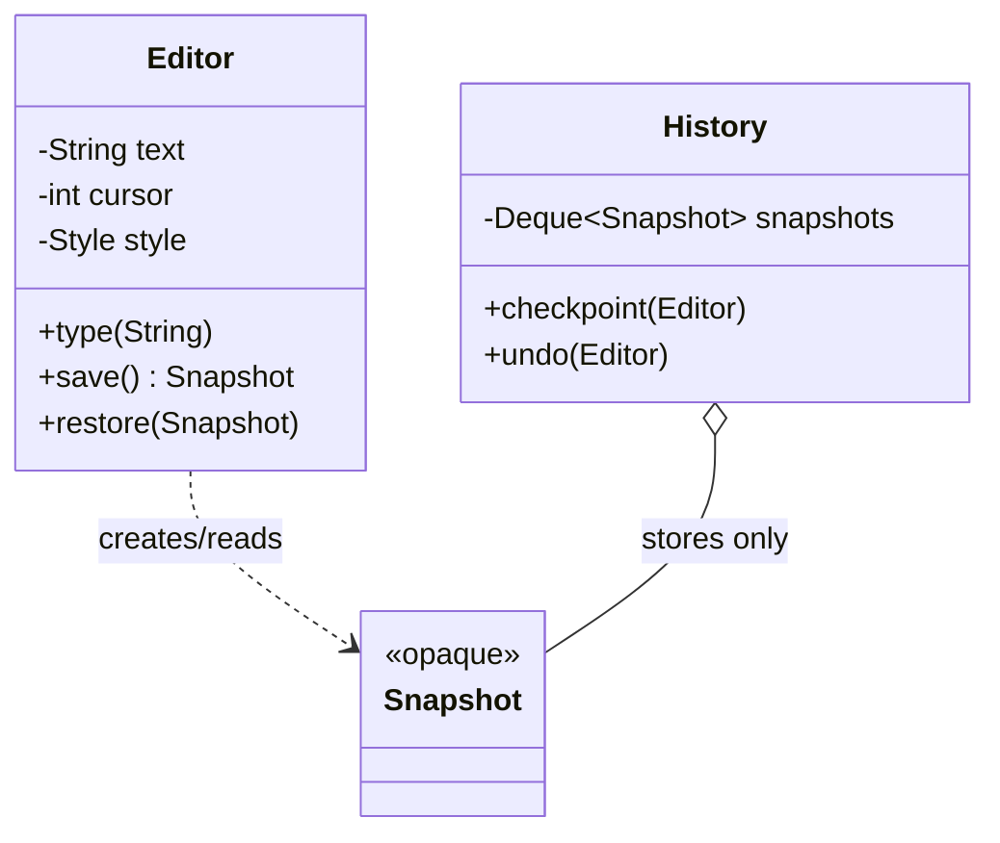

**Intent:** capture and externalise an object's internal state as a **snapshot** so it can be **restored later** — without violating encapsulation.

## The problem

You want undo in an editor, "revert to last saved" in a form, rollback of a game to a checkpoint, or restoring an object after a failed multi-step operation. To restore state you must save it somewhere. But:

- If another object reads all the fields to copy them, those fields must be public — breaking encapsulation.
- If the object's structure changes, every class that copies its state breaks.

## The solution

Let the object **create its own snapshot** (the memento) and **restore itself** from one. Other objects (the caretaker) store mementos but can't look inside them.

Three roles:

- **Originator** — the object whose state is saved; creates and restores mementos.
- **Memento** — an immutable snapshot; opaque to everyone except the originator.
- **Caretaker** — keeps mementos (e.g., a history stack) and decides *when* to save/restore, but never reads or modifies their contents.



```java
public final class Editor {
    private String text = "";
    private int cursor;
    private Style style = Style.DEFAULT;

    public void type(String s) {
        text = text.substring(0, cursor) + s + text.substring(cursor);
        cursor += s.length();
    }

    // Memento: nested class, private constructor and private accessors → opaque to outsiders
    public static final class Snapshot {
        private final String text;
        private final int cursor;
        private final Style style;
        private final Instant takenAt = Instant.now();

        private Snapshot(String text, int cursor, Style style) {
            this.text = text; this.cursor = cursor; this.style = style;
        }
        public Instant takenAt() { return takenAt; }          // safe metadata only
    }

    public Snapshot save() { return new Snapshot(text, cursor, style); }

    public void restore(Snapshot s) {
        this.text = s.text;                                    // the outer class can read private fields
        this.cursor = s.cursor;
        this.style = s.style;
    }
}

public final class History {
    private final Deque<Editor.Snapshot> snapshots = new ArrayDeque<>();
    private final int limit;
    public History(int limit) { this.limit = limit; }

    public void checkpoint(Editor e) {
        snapshots.push(e.save());
        if (snapshots.size() > limit) snapshots.removeLast();
    }

    public void undo(Editor e) {
        Editor.Snapshot s = snapshots.poll();
        if (s != null) e.restore(s);
    }
}
```

In Java, a **static nested class with private members** is the idiomatic way to make the memento readable by the originator but opaque to the caretaker. An alternative is a narrow public interface (e.g., only `takenAt()`) with the real class package-private.

## Design concerns

- **Immutability**: mementos must not change after creation; copy mutable fields (deep copy where needed).
- **Memory**: full snapshots of large objects are expensive. Bound the history, snapshot only changed parts, or store **diffs** (incremental mementos).
- **External resources**: open files, sockets or references to other objects can't simply be snapshotted — decide what "restore" means for them.
- **Serialization**: mementos can be persisted (save game, draft autosave) — then you need versioning of the snapshot format.

## Memento + Command for undo

[Command](/system-design/lld/command-pattern) and Memento combine naturally: before a command executes, it asks the receiver for a memento; `undo()` restores it. This avoids writing an inverse operation for every command — at the cost of memory.

```java
public final class FormatSelectionCommand implements Command {
    private final Editor editor;
    private final Style newStyle;
    private Editor.Snapshot before;

    public void execute() { before = editor.save(); editor.applyStyle(newStyle); }
    public void undo()    { editor.restore(before); }
}
```

## Where you've seen it

- Undo in editors and IDEs; "checkpoints" in games.
- Transaction rollback (conceptually: a database's undo log restores prior state).
- `java.io.Serializable` used to persist object state snapshots.
- Form state preservation: Android's `onSaveInstanceState(Bundle)` saves UI state to restore after recreation.

## Pros and cons

| Pros | Cons |
| --- | --- |
| Snapshots without exposing internals | High memory use with frequent or large snapshots |
| Simplifies the originator — history is managed by the caretaker | Caretakers must manage lifecycle (discard old mementos) |
| Works for complex state where inverse operations are hard | Some languages can't enforce opacity well |

## Related patterns

- **Command** + Memento → undo with snapshots.
- **Iterator** + Memento → save and resume an iteration position.
- **Prototype** can be a simpler alternative when the object is straightforward and has no external resources: just store a copy.

## Interview questions

<QA q="How does Memento preserve encapsulation?">
Only the originator creates mementos and reads their contents; the memento's state is private (in Java, a nested class whose private members the outer class can access) and immutable. Caretakers such as a history stack store and hand back mementos but have no API to inspect or modify them, so the originator's internal representation is never exposed.
</QA>

<QA q="Memento or inverse operations for undo — how do you choose?">
Inverse operations (each command knows how to reverse itself) are memory-efficient but require careful logic for every command and are hard for complex or non-invertible changes. Mementos are generic and simple — snapshot before, restore after — but cost memory proportional to state size and history length. Many editors combine them: inverse operations for small edits, snapshots for complex ones, with bounded history.
</QA>

<Practice task="A form-builder app wants unlimited undo, but snapshots of large forms are 2 MB each. How do you keep memory under control?">

Combine several techniques: bound the history (say, the last 100 steps); store **incremental** mementos (only the changed field's previous state) instead of whole-form snapshots; use inverse-operation commands for small edits and full snapshots only for large structural changes; and make the form model immutable so each edit creates a new version that shares all untouched parts with the previous one (a persistent data structure).

</Practice>

<Takeaways>

- Memento lets an object save and restore its own state without exposing it.
- Originator creates/restores; memento is immutable and opaque; caretaker only stores.
- Bound history and consider diffs to control memory.
- Combine with Command for undo/redo.

</Takeaways>

## Further reading

- Gamma et al., *Design Patterns* (1994) — Memento.
- Alexander Shvets, *Dive Into Design Patterns* — "Memento".
