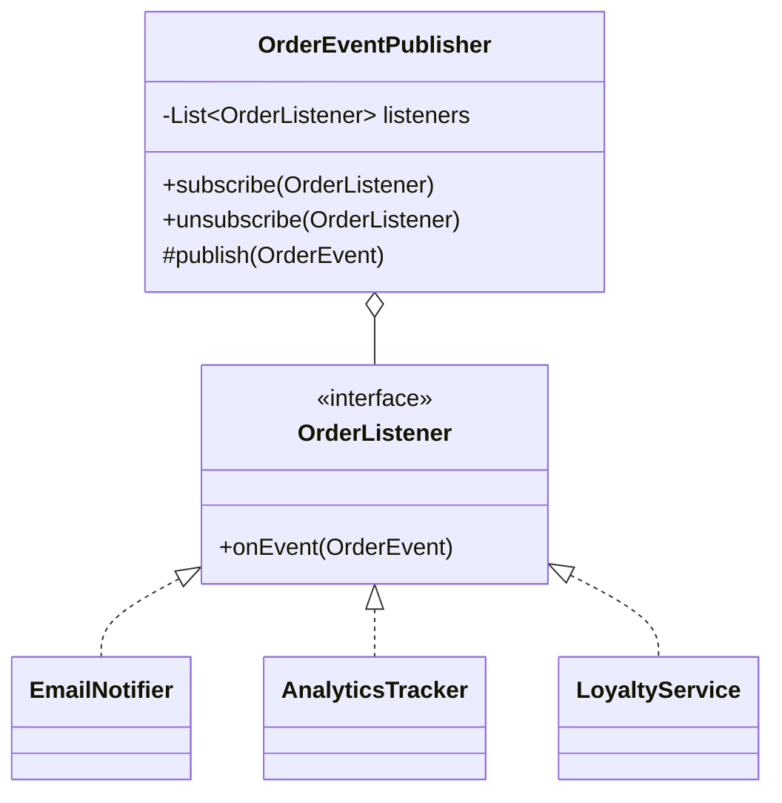

## The idea in plain words

When something happens to one object, several other objects want to know. With **Observer**, they **subscribe** to that object, and it notifies all of them without knowing who they are or what they'll do.

**Picture it:** pressing the bell icon on a YouTube channel. When a new video goes up, every subscriber is told. The channel doesn't call people one by one; it just announces.

### The smallest example

```java
interface Subscriber { void onNewVideo(String title); }

class Channel {
    private final List<Subscriber> subscribers = new ArrayList<>();
    void subscribe(Subscriber s) { subscribers.add(s); }

    void upload(String title) {
        System.out.println("Uploaded: " + title);
        for (Subscriber s : subscribers) s.onNewVideo(title);    // tell everyone
    }
}

class Demo {
    public static void main(String[] args) {
        Channel channel = new Channel();
        channel.subscribe(title -> System.out.println("Asha gets a push notification: " + title));
        channel.subscribe(title -> System.out.println("Ravi's home feed shows: " + title));
        channel.upload("LLD in 10 minutes");
    }
}
```

The channel never changes when a new kind of subscriber (an email digest, analytics) is added.

**The textbook definition:** define a **one-to-many** relationship so that when one object (the **subject**, or publisher) changes, all the objects that depend on it (**observers**, or subscribers) are told automatically.

Observer is the in-process ancestor of event-driven systems: listeners, event buses, reactive streams and pub-sub all build on it.

## How to spot it in an interview

Listen for **"when X happens, also do Y, Z and maybe more later"**:

| You hear | Observer |
| --- | --- |
| "When a spot is taken, update the display boards" | Boards subscribe to the floor |
| "Notify the customer, restaurant and rider on every status change" | Listeners on the order |
| "When a reserved book comes back, tell the member" | The library publishes "copy returned" |
| "Log every change for audit" | An audit listener |

## The problem it solves

When an order ships, the app must email the customer, update analytics, refresh the warehouse dashboard and award loyalty points.

<Approach verdict="bad" title="The service calls everyone directly">

```java
// ❌ OrderService knows every interested party; adding one means editing it
void markShipped(Order o) {
    o.setStatus(SHIPPED);
    emailService.sendShippedEmail(o);
    analytics.trackShipment(o);
    dashboard.refresh(o.warehouseId());
    loyalty.addPoints(o.customerId(), o.total());
}
```

`OrderService` now knows about email, analytics, dashboards and loyalty: four things that have nothing to do with shipping. Adding SMS means editing and retesting it. And if the email call throws, the loyalty points are never awarded.

</Approach>

<Approach verdict="great" title="Publish an event; let listeners subscribe">

`OrderService` announces "order shipped" and is done. Email, analytics and loyalty each **subscribe** to that event. Adding SMS is a new listener; `OrderService` never changes.

</Approach>

## Building it step by step

**Step 1: Describe what happened as an event object.** A small, unchangeable record: `OrderShipped(orderId, trackingId, at)`. Listeners get everything they need from it.

**Step 2: Define the listener interface.** One method, `onEvent(event)`.

**Step 3: Give the publisher a list of listeners**, with `subscribe`, `unsubscribe` and `publish`. `publish` loops over the listeners and calls each one, catching errors **per listener** so one broken listener can't stop the rest.

**Step 4: Publish after the change.** The service updates the order, then publishes. It doesn't know who's listening.

**Step 5: Wire listeners at startup.** `events.subscribe(new EmailNotifier(mailer))`.



```java
public sealed interface OrderEvent permits OrderPlaced, OrderShipped, OrderCancelled {
    OrderId orderId();
}
public record OrderShipped(OrderId orderId, String trackingId, Instant at) implements OrderEvent { }

@FunctionalInterface
public interface OrderListener {
    void onEvent(OrderEvent event);
}

public final class OrderEventPublisher {
    private final List<OrderListener> listeners = new CopyOnWriteArrayList<>();

    public void subscribe(OrderListener l)   { listeners.add(l); }
    public void unsubscribe(OrderListener l) { listeners.remove(l); }

    public void publish(OrderEvent event) {
        for (OrderListener l : listeners) {
            try {
                l.onEvent(event);
            } catch (RuntimeException e) {
                // One faulty listener must not stop the others (or the publisher)
                log.warn("Listener {} failed for {}", l, event, e);
            }
        }
    }
}

public final class OrderService {
    private final OrderEventPublisher events;
    public void markShipped(Order o, String trackingId) {
        o.ship(trackingId);
        events.publish(new OrderShipped(o.id(), trackingId, clock.instant()));
    }
}

// Wiring
events.subscribe(new EmailNotifier(mailer));
events.subscribe(loyaltyService::onOrderEvent);
```

## Walk through it

1. At startup, `EmailNotifier` and `loyaltyService::onOrderEvent` subscribe.
2. `markShipped` updates the order and publishes `OrderShipped`.
3. `publish` loops over a **snapshot** of the listeners (`CopyOnWriteArrayList`), so a listener that unsubscribes mid-loop can't break the loop.
4. `EmailNotifier` throws because the mail server is down. The `try/catch` logs it, and the loop carries on to the loyalty listener. The order is still shipped.

## Push vs pull

| | Push | Pull |
| --- | --- | --- |
| What's sent | The event carries the data observers need | Observers get a notification and query the subject |
| Pros | Observers don't depend on the subject's API | Small notifications; observers fetch only what they need |
| Cons | Subject must guess what data observers need | Extra calls; data may change between notification and query |

Modern code usually pushes **immutable event objects** (records), as above.

## Going deeper: what interviewers ask about

### 1. Should listeners run on the publisher's thread?

The simple version calls listeners **on the publisher's thread**. A slow listener (sending email) slows the publisher; a stuck one freezes it. Handing each event to a thread pool fixes that:

```java
// Asynchronous: hand events to an executor
public void publish(OrderEvent e) {
    for (OrderListener l : listeners) executor.execute(() -> safely(l, e));
}
```

The trade-off: events may now be handled out of order, errors are harder to report, and events can be lost if the process crashes before they're handled. For delivery that survives crashes, use a message broker (see [Message Queues](/system-design/hld/message-queues)).

### 2. Exceptions in listeners

Catch and log per listener, so one failure doesn't break the others or undo the publisher's work. Only listeners that are truly part of the business rule should be able to make the whole operation fail.

### 3. Subscribing while publishing

Listeners may subscribe or unsubscribe while a notification is in progress, even from inside their own callback. `CopyOnWriteArrayList` loops over a snapshot, which is ideal for lists that are read far more often than changed.

### 4. Memory leaks from forgotten listeners

The publisher keeps a reference to every listener. If a listener (say, a screen that was closed) never unsubscribes, it can never be garbage-collected. Always pair `subscribe` with `unsubscribe`, for example by returning a `Subscription` handle with `close()`.

### 5. Order and chain reactions

Don't rely on the order listeners run in unless you document it. Watch out for listeners that publish more events while handling one: chain reactions and even infinite loops are possible.

### 6. Too many events

Many tiny changes mean many notifications. Batch or debounce them if needed.

## Where you've seen it

- Button click listeners in Swing and Android; JavaFX properties.
- `java.beans.PropertyChangeListener`.
- Spring's `ApplicationEventPublisher` with `@EventListener` (and `@TransactionalEventListener` to fire only after the database commit).
- Reactive streams (`Flow.Publisher`/`Subscriber`, RxJava, Reactor): Observer plus a way for slow subscribers to say "slow down".
- (`java.util.Observable` has been deprecated since Java 9. Don't use it.)

## Pros and cons

| Pros | Cons |
| --- | --- |
| Loose coupling: publishers don't know concrete subscribers | Notification order not guaranteed |
| New subscribers without changing the publisher (OCP) | Hidden control flow; harder to debug |
| Runtime subscription/unsubscription | Memory leaks from forgotten subscriptions |
| Foundation for event-driven design | Synchronous listeners can slow or break the publisher |

## Don't confuse it with

- **Pub-sub with a broker**: in Observer, the publisher holds direct references to its listeners, in the same process. In pub-sub, a **broker** sits in the middle, publishers and subscribers don't know each other, and messages can be stored and replayed. See [Design a Pub-Sub System](/system-design/lld/lld-pub-sub).
- **Mediator**: Observer sets up one-way subscriptions; a [Mediator](/system-design/lld/mediator-pattern) is a central object that coordinates several peers. Mediators often use Observer inside.

## Common mistakes

- **Not catching exceptions per listener**, so one broken listener stops the rest.
- **Never unsubscribing**, leaking memory.
- **Slow listeners on the publisher's thread.**
- **Mutable event objects** that one listener changes before the next one reads them.
- **Listeners that depend on running in a particular order.**

## Interview questions

<QA q="What problems can arise with the Observer pattern in a multi-threaded system?">
Concurrent subscribe/unsubscribe while iterating the listener list (use a copy-on-write list or snapshot), listeners executing on the publisher's thread and blocking it (use an executor), listeners that aren't thread-safe receiving events from multiple threads, lost ordering with asynchronous delivery, and exceptions in one listener disrupting others. Also lapsed listeners causing memory leaks if they never unsubscribe.
</QA>

<QA q="How is Observer different from pub-sub with a message broker?">
In Observer, the subject directly holds references to observers and calls them in-process, so they share lifecycle and failure domain. In broker-based pub-sub, publishers send to topics on an intermediary that delivers to subscribers; they're fully decoupled (don't know each other), can run in different processes, and the broker can persist, retry and replay messages.
</QA>

<QA q="An email listener throws an exception. Should the order's status update be rolled back?">
Usually not — sending email is a side effect that shouldn't decide whether the order shipped. Catch exceptions per listener and log or retry them, and ideally deliver after the state change commits (e.g., Spring's @TransactionalEventListener with AFTER_COMMIT, or an outbox for durable delivery). Only listeners that are part of the business invariant should run inside the transaction and be able to abort it.
</QA>

<Practice task="When a payment succeeds, the app must update the order, send a receipt email, award points and notify analytics. The email provider is slow and sometimes down. Design the notification part.">

`PaymentService` publishes a `PaymentSucceeded` event; listeners subscribe. The order update is part of the business invariant, so it happens in the same transaction (or synchronously before publishing). Email, points and analytics are side effects: deliver them asynchronously — an executor, or better an outbox plus a queue for durability — catch failures per listener and retry with backoff, so a slow email provider never slows or fails the payment. Listeners must be idempotent, because retries can deliver twice.

</Practice>

<Takeaways>

- Observer lets a subject notify many subscribers without knowing them.
- Push immutable event objects; isolate listener failures; use copy-on-write lists for listeners.
- Decide sync vs async delivery deliberately; async needs executors and loses ordering.
- Always provide unsubscription to avoid leaks; for durable cross-service events, use a broker.

</Takeaways>

## Further reading

- Gamma et al., *Design Patterns* (1994) — Observer.
- Spring Framework reference — "Standard and Custom Events" and transaction-bound events.
- Alexander Shvets, *Dive Into Design Patterns* — "Observer".
