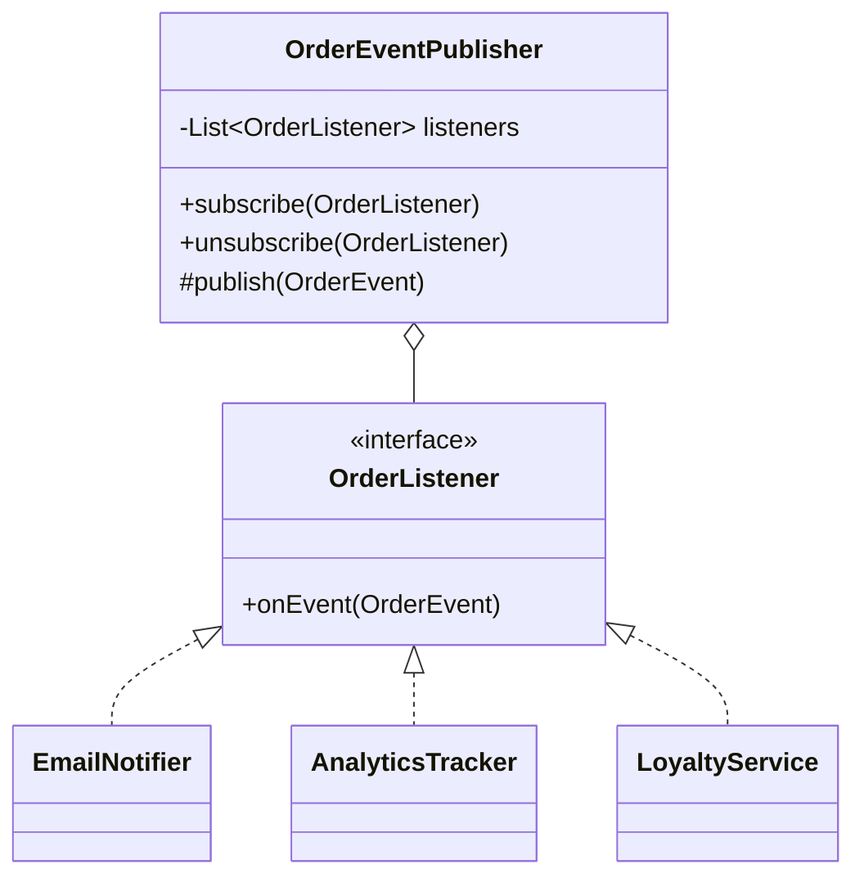

## The idea in plain words

When something happens to one object, several other objects want to know. With **Observer**, they **subscribe** to that object, and it notifies all of them, without knowing who they are or what they'll do.

**Picture it:** pressing the bell icon on a YouTube channel. When a new video goes up, every subscriber gets told. The channel doesn't call people one by one; it just announces.

### The smallest example

```java
interface Subscriber { void onNewVideo(String title); }

class Channel {
    private final List<Subscriber> subscribers = new ArrayList<>();
    void subscribe(Subscriber s) { subscribers.add(s); }

    void upload(String title) {
        System.out.println("Uploaded: " + title);
        for (Subscriber s : subscribers) s.onNewVideo(title);    // tell everyone
    }
}

class Demo {
    public static void main(String[] args) {
        Channel channel = new Channel();
        channel.subscribe(title -> System.out.println("Asha gets a push notification: " + title));
        channel.subscribe(title -> System.out.println("Ravi's home feed shows: " + title));
        channel.upload("LLD in 10 minutes");
    }
}
```

The channel never changes when a new kind of subscriber (email digest, analytics) is added.

| Use it when | Skip it when |
| --- | --- |
| One change should trigger several independent reactions (display boards, notifications, audit logs) | Exactly one thing reacts, always: call it directly |

The rest of this lesson covers what goes in an event, unsubscribing, slow subscribers and thread safety.

**The textbook definition:** define a **one-to-many** dependency so that when one object (the **subject** or publisher) changes state, all its dependents (**observers** or subscribers) are notified automatically.

Observer is the in-process ancestor of event-driven architecture: listeners, event buses, reactive streams and pub-sub all build on it.

## The problem

When an order ships, several things must happen: email the customer, update analytics, notify the warehouse dashboard, award loyalty points. If `OrderService` calls each of them directly:

```java
// ❌ OrderService knows every interested party; adding one means editing it
void markShipped(Order o) {
    o.setStatus(SHIPPED);
    emailService.sendShippedEmail(o);
    analytics.trackShipment(o);
    dashboard.refresh(o.warehouseId());
    loyalty.addPoints(o.customerId(), o.total());
}
```

The publisher is coupled to all consumers, and every new consumer requires changing and retesting it.

## The solution

The subject keeps a list of observers behind a common interface and notifies them; it knows nothing else about them.



```java
public sealed interface OrderEvent permits OrderPlaced, OrderShipped, OrderCancelled {
    OrderId orderId();
}
public record OrderShipped(OrderId orderId, String trackingId, Instant at) implements OrderEvent { }

@FunctionalInterface
public interface OrderListener {
    void onEvent(OrderEvent event);
}

public final class OrderEventPublisher {
    private final List<OrderListener> listeners = new CopyOnWriteArrayList<>();

    public void subscribe(OrderListener l)   { listeners.add(l); }
    public void unsubscribe(OrderListener l) { listeners.remove(l); }

    public void publish(OrderEvent event) {
        for (OrderListener l : listeners) {
            try {
                l.onEvent(event);
            } catch (RuntimeException e) {
                // One faulty listener must not stop the others (or the publisher)
                log.warn("Listener {} failed for {}", l, event, e);
            }
        }
    }
}

public final class OrderService {
    private final OrderEventPublisher events;
    public void markShipped(Order o, String trackingId) {
        o.ship(trackingId);
        events.publish(new OrderShipped(o.id(), trackingId, clock.instant()));
    }
}

// Wiring
events.subscribe(new EmailNotifier(mailer));
events.subscribe(loyaltyService::onOrderEvent);
```

## Push vs pull

| | Push | Pull |
| --- | --- | --- |
| What's sent | The event carries the data observers need | Observers get a notification and query the subject |
| Pros | Observers don't depend on the subject's API | Small notifications; observers fetch only what they need |
| Cons | Subject must guess what data observers need | Extra calls; data may change between notification and query |

Modern code usually pushes **immutable event objects** (records), as above.

## Implementation concerns — where interview depth lies

### 1. Synchronous vs asynchronous delivery

The simple version calls listeners **on the publisher's thread**. A slow listener (sending email) slows the publisher; a blocking one stalls it.

```java
// Asynchronous: hand events to an executor
public void publish(OrderEvent e) {
    for (OrderListener l : listeners) executor.execute(() -> safely(l, e));
}
```

Async gives isolation and throughput but loses ordering guarantees, makes error handling harder, and events may be lost if the process crashes before they're handled (for durable delivery, use a message broker — see [Message Queues](/system-design/hld/message-queues)).

### 2. Exceptions in listeners

Catch and log per listener so one failure doesn't break others or roll back the publisher's work — unless you deliberately want listeners to participate in the publisher's transaction.

### 3. Concurrent modification

Listeners may subscribe/unsubscribe while notifications are in progress (even from inside a callback). `CopyOnWriteArrayList` iterates over a snapshot — ideal for listener lists that are read far more than modified.

### 4. Memory leaks (lapsed listener problem)

The subject holds strong references to observers. If an observer (say, a UI screen) is discarded but never unsubscribes, it can't be garbage-collected. Always pair `subscribe` with `unsubscribe` (return a `Subscription` handle with `close()`), or use weak references carefully.

### 5. Ordering and re-entrancy

Don't rely on listener order unless documented. Beware listeners that publish further events synchronously — cascades and infinite loops are possible.

### 6. Update storms

Many small state changes → many notifications. Batch or debounce if needed.

## Where you've seen it

- Swing/AWT listeners (`ActionListener`), JavaFX properties, Android `LiveData`.
- `java.beans.PropertyChangeListener` / `PropertyChangeSupport`.
- Spring `ApplicationEventPublisher` + `@EventListener` (and `@TransactionalEventListener` to fire after commit).
- Reactive streams (`Flow.Publisher`/`Subscriber`, RxJava, Project Reactor) — Observer with back-pressure.
- (`java.util.Observable` is deprecated since Java 9 — don't use it.)

## Pros and cons

| Pros | Cons |
| --- | --- |
| Loose coupling: publishers don't know concrete subscribers | Notification order not guaranteed |
| New subscribers without changing the publisher (OCP) | Hidden control flow; harder to debug |
| Runtime subscription/unsubscription | Memory leaks from forgotten subscriptions |
| Foundation for event-driven design | Synchronous listeners can slow or break the publisher |

## Comparisons

- **Observer vs Pub-Sub (broker)**: in Observer, the subject holds observer references directly, in the same process. In pub-sub, a **broker/event bus** sits between publishers and subscribers, who don't know each other — and it can be distributed and durable.
- **Observer vs Mediator**: Observer sets up dynamic one-way subscriptions; [Mediator](/system-design/lld/mediator-pattern) centralises communication among peers. A common mediator implementation uses Observer internally (components subscribe to the mediator's events).
- **Chain of Responsibility, Command, Mediator and Observer** are four ways to connect senders and receivers: a chain passes a request along until handled; a command links sender to one receiver via an object; a mediator removes direct links; observer lets receivers subscribe dynamically.

## Interview questions

<QA q="What problems can arise with the Observer pattern in a multi-threaded system?">
Concurrent subscribe/unsubscribe while iterating the listener list (use a copy-on-write list or snapshot), listeners executing on the publisher's thread and blocking it (use an executor), listeners that aren't thread-safe receiving events from multiple threads, lost ordering with asynchronous delivery, and exceptions in one listener disrupting others. Also lapsed listeners causing memory leaks if they never unsubscribe.
</QA>

<QA q="How is Observer different from pub-sub with a message broker?">
In Observer, the subject directly holds references to observers and calls them in-process, so they share lifecycle and failure domain. In broker-based pub-sub, publishers send to topics on an intermediary that delivers to subscribers; they're fully decoupled (don't know each other), can run in different processes, and the broker can persist, retry and replay messages.
</QA>

<QA q="An email listener throws an exception. Should the order's status update be rolled back?">
Usually not — sending email is a side effect that shouldn't decide whether the order shipped. Catch exceptions per listener and log or retry them, and ideally deliver after the state change commits (e.g., Spring's @TransactionalEventListener with AFTER_COMMIT, or an outbox for durable delivery). Only listeners that are part of the business invariant should run inside the transaction and be able to abort it.
</QA>

<Practice task="When a payment succeeds, the app must update the order, send a receipt email, award points and notify analytics. The email provider is slow and sometimes down. Design the notification part.">

`PaymentService` publishes a `PaymentSucceeded` event; listeners subscribe. The order update is part of the business invariant, so it happens in the same transaction (or synchronously before publishing). Email, points and analytics are side effects: deliver them asynchronously — an executor, or better an outbox plus a queue for durability — catch failures per listener and retry with backoff, so a slow email provider never slows or fails the payment. Listeners must be idempotent, because retries can deliver twice.

</Practice>

<Takeaways>

- Observer lets a subject notify many subscribers without knowing them.
- Push immutable event objects; isolate listener failures; use copy-on-write lists for listeners.
- Decide sync vs async delivery deliberately; async needs executors and loses ordering.
- Always provide unsubscription to avoid leaks; for durable cross-service events, use a broker.

</Takeaways>

## Further reading

- Gamma et al., *Design Patterns* (1994) — Observer.
- Spring Framework reference — "Standard and Custom Events" and transaction-bound events.
- Alexander Shvets, *Dive Into Design Patterns* — "Observer".
