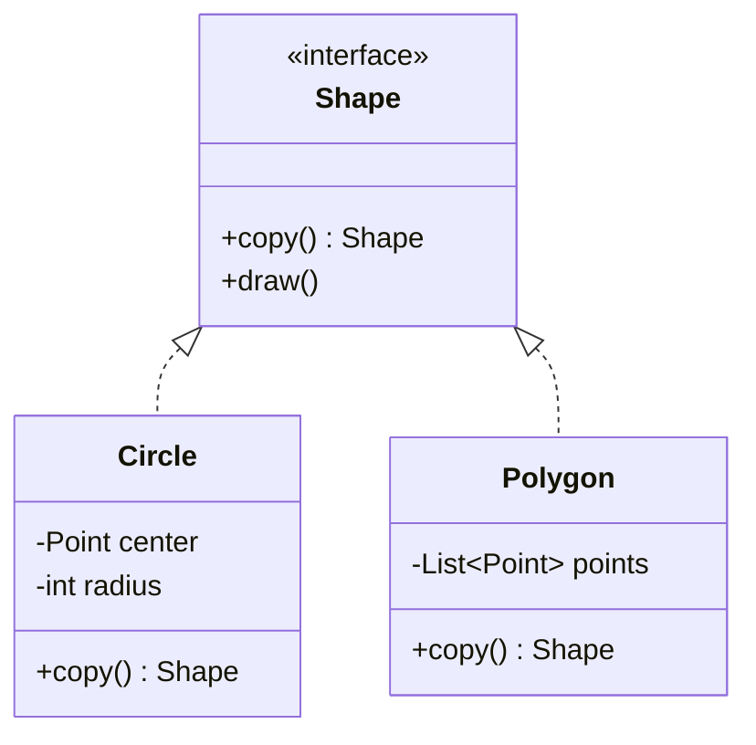

## The idea in plain words

Sometimes the easiest way to make a new object is to **copy one you already have**, then change a little. Prototype gives objects a `copy()` method, so you can duplicate them even when you only know their interface, not their exact class.

**Picture it:** a teacher fills in one permission slip, photocopies it for the whole class, and each student only writes their own name.

### The smallest example

```java
interface Shape { Shape copy(); }

class Circle implements Shape {
    int x, y, radius;
    String color;

    Circle(int x, int y, int radius, String color) { this.x = x; this.y = y; this.radius = radius; this.color = color; }
    public Shape copy() { return new Circle(x, y, radius, color); }   // the object copies itself
}

class Demo {
    public static void main(String[] args) {
        Shape original = new Circle(0, 0, 10, "red");
        Circle twin = (Circle) original.copy();     // we only held a Shape, and still got a Circle
        twin.x = 50;                                 // changing the copy...
        System.out.println(((Circle) original).x);   // ...leaves the original alone: 0
    }
}
```

The object knows its own class and fields, so it is the best one to copy itself.

| Use it when | Skip it when |
| --- | --- |
| Objects are costly to set up, or you hold many pre-configured "templates" to stamp out | A constructor call is cheap and you know the class |

The tricky part is **shallow vs deep copy**: what happens to lists and other objects inside. That is what the rest of this lesson, and interviewers, focus on.

**The textbook definition:** create new objects by **copying an existing object** (the prototype), without making your code depend on the object's concrete class.

## The problem

You want an exact copy of an object. The naive approach — create a new instance of the same class and copy every field — has three issues:

1. **You must know the concrete class.** If you only hold a `Shape` reference, you don't know whether to `new Circle()` or `new Polygon()`.
2. **Private fields aren't accessible** from outside the object.
3. **Expensive initialisation** (parsing a template, loading configuration, computing a layout) is repeated for every new object even when the result would be nearly identical.

## The solution

Let the object copy itself. Declare a copy operation in a common interface; each class implements it, with full access to its own private state.



```java
public interface Shape {
    Shape copy();
    void moveBy(int dx, int dy);
}

public final class Polygon implements Shape {
    private final List<Point> points;
    private Style style;

    public Polygon(List<Point> points, Style style) {
        this.points = new ArrayList<>(points);
        this.style = style;
    }

    private Polygon(Polygon source) {                     // copy constructor
        this.points = new ArrayList<>(source.points);      // new list: the copy can change independently
        this.style = source.style;                         // Point and Style are immutable → safe to share
    }

    @Override public Polygon copy() { return new Polygon(this); }   // covariant return

    @Override public void moveBy(int dx, int dy) { points.replaceAll(p -> p.translate(dx, dy)); }
}

// Client code copies without knowing concrete types
List<Shape> duplicates = selection.stream().map(Shape::copy).toList();
```

## Shallow vs deep copy — the crux of the pattern

| | Shallow copy | Deep copy |
| --- | --- | --- |
| Primitive fields | Copied | Copied |
| Reference fields | **Reference copied** — both objects share the same nested object | Nested objects copied recursively |
| Risk | Mutating a nested object through the copy changes the original | Cost of copying large graphs; cycles must be handled |

```java
Polygon a = new Polygon(points, style);
Polygon b = a.copy();
b.moveBy(10, 0);         // with a shallow copy of `points`, `a` would move too!
```

Rule of thumb: **share immutable parts, copy mutable parts.** In `Polygon`, the list is mutable (so it is copied) but each `Point` is an immutable record (so the points themselves are shared). If `Point` were mutable, the copy constructor would have to copy each point too — that is the deep copy. Strings, records, `LocalDate`, enum values and other immutable objects can be shared safely.

## Java's `Cloneable` — and why to avoid it

Java offers `Object.clone()` with the `Cloneable` marker interface. *Effective Java* (Item 13) explains why it's a poor mechanism:

- `Cloneable` has no `clone()` method; it changes the behaviour of a protected method in `Object` — a strange contract.
- `clone()` creates objects **without calling a constructor**, bypassing invariants.
- It's **shallow** by default; deep copying needs careful manual work.
- It conflicts with `final` fields (you can't reassign them in `clone()`).
- It throws a checked `CloneNotSupportedException`.

Prefer **copy constructors** or **copy factory methods** (`Polygon.copyOf(other)`), as in the example above. (Arrays are the exception — `array.clone()` is fine and idiomatic.)

## Prototype registry

Keep a set of preconfigured prototypes and clone them on demand — useful when objects are built from expensive configuration.

```java
public final class EnemyRegistry {
    private final Map<String, Enemy> prototypes = new HashMap<>();

    public void register(String key, Enemy prototype) { prototypes.put(key, prototype); }

    public Enemy spawn(String key) {
        Enemy p = prototypes.get(key);
        if (p == null) throw new IllegalArgumentException("Unknown enemy: " + key);
        return p.copy();                     // cheap copy of a fully configured object
    }
}

registry.register("orc-archer", loadFromAssetFile("orc-archer.json"));   // parse once
Enemy e1 = registry.spawn("orc-archer");                                  // copy many times
```

## When to use

- Code must copy objects whose **concrete classes it doesn't know** (it only holds an interface).
- Object creation is **expensive** and new objects differ little from an existing configured one (game entities, document templates, preconfigured requests).
- You'd otherwise create many subclasses that differ only in how they're initialised — instead, keep prototypes configured differently.

## Pros and cons

| Pros | Cons |
| --- | --- |
| Copy objects without coupling to concrete classes | Deep copying complex graphs with cycles is tricky |
| Avoid repeated expensive initialisation | Every class in the hierarchy must implement copying correctly |
| Alternative to subclassing for preset configurations | Shared references after a shallow copy cause subtle bugs |

## Related patterns

- **Factory Method** relies on inheritance and needs no copying; Prototype avoids inheritance but requires a correct copy implementation.
- **Command** histories can store copies (prototypes) of commands.
- Designs heavy on **Composite** and **Decorator** benefit from Prototype: clone a complex structure instead of rebuilding it.
- **Memento**: for simple objects without external resources, storing a copy can be a simpler alternative to a memento.

## Interview questions

<QA q="What's the difference between a shallow and a deep copy, and how do you choose?">
A shallow copy duplicates the object's fields, so reference fields still point to the same nested objects as the original; a deep copy recursively copies nested mutable objects so the two are fully independent. Choose based on mutability: immutable nested objects can be shared (shallow is fine for them), while mutable nested state must be deep-copied if either copy might change it.
</QA>

<QA q="Why does Effective Java advise against Cloneable?">
Cloneable is a marker interface that alters the behaviour of Object's protected clone method rather than declaring a public method; clone creates objects without running constructors (bypassing invariants), is shallow by default, conflicts with final fields, and throws a checked exception. Copy constructors or static copy factories are clearer, type-safe, and work with final fields.
</QA>

<QA q="Give a practical use of Prototype in backend code.">
Preconfigured templates: for example, a notification or HTTP request template with headers, retry policy and auth already set up is copied and then customised per call; or a pricing rule set parsed once from configuration and cloned per tenant before tenant-specific overrides are applied. It avoids repeated parsing and keeps per-use modifications isolated.
</QA>

<Practice task="A Document has a title (String), a list of Paragraphs (mutable objects) and a Theme (immutable, shared). Write the copy rules for a 'duplicate document' feature.">

Title: share it — strings are immutable. Theme: share it — it's immutable and meant to be shared. Paragraph list: a new list **and** a copy of each paragraph, because paragraphs are mutable and editing the duplicate must not change the original (a deep copy). Also reset identity fields: a new id, a fresh created-at time, perhaps "Copy of …" as the title. Implement it as a copy constructor or a `copy()` method, not `Cloneable`.

</Practice>

<Takeaways>

- Prototype creates objects by copying an existing instance through a copy method on a shared interface.
- The real design decision is shallow vs deep copy: share immutable parts, copy mutable ones.
- Prefer copy constructors/factories over Cloneable in Java.
- A prototype registry gives cheap creation of preconfigured objects.

</Takeaways>

## Further reading

- Joshua Bloch, *Effective Java* (3rd ed.) — Item 13: "Override clone judiciously".
- Gamma et al., *Design Patterns* (1994) — Prototype.
- Alexander Shvets, *Dive Into Design Patterns* — "Prototype".
