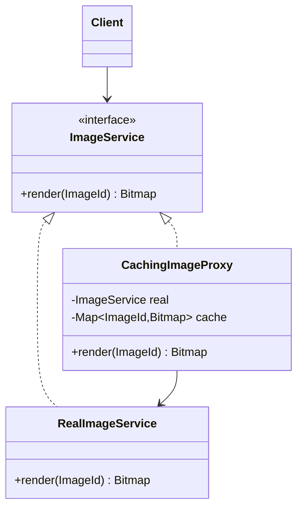

## The idea in plain words

A **Proxy** is a stand-in object with the **same interface** as the real one. Callers talk to the proxy, and the proxy decides when, or whether, to call the real object. It can load things lazily, check permissions, cache results or log calls.

**Picture it:** a receptionist at an office. Visitors speak to the receptionist first. The receptionist checks the appointment, and only then lets you meet the manager. To the visitor it's still "a meeting".

### The smallest example

```java
interface Report { String content(); }

class RealReport implements Report {                     // expensive to create
    RealReport() { System.out.println("Loading 50 MB report..."); }
    public String content() { return "Q3 sales numbers"; }
}

class LazyReport implements Report {                     // the proxy: same interface
    private RealReport real;
    public String content() {
        if (real == null) real = new RealReport();        // load only when first needed
        return real.content();
    }
}

class Demo {
    public static void main(String[] args) {
        Report report = new LazyReport();                 // nothing loaded yet
        System.out.println("Report object ready");
        System.out.println(report.content());             // loads now, once
        System.out.println(report.content());             // already loaded
    }
}
```

The caller can't tell it's holding a proxy. That's the point.

| Use it when | Skip it when |
| --- | --- |
| You need to control access to an object: lazy loading, access checks, caching, remote calls | You're adding unrelated features in layers: that's Decorator |

The rest of this lesson covers the kinds of proxy and Java's built-in dynamic proxies.

**The textbook definition:** provide a **substitute or placeholder** for another object to **control access** to it. The proxy implements the same interface as the real object, so clients can't tell the difference.

## The problem

Some objects need a gatekeeper:

- A large report or image that's expensive to load — but many code paths hold a reference and never use it.
- A service that only admins may call.
- An object that actually lives on another machine.
- A slow lookup whose results could be reused.

Adding that logic to every client duplicates it; adding it to the real class mixes concerns (and you may not own the class).

## The solution



The proxy implements the same interface, holds (or lazily creates) the real subject, and does something **before or after** forwarding — or decides not to forward at all.

## Kinds of proxy

### Virtual proxy (lazy initialisation)

```java
public final class LazyReport implements Report {
    private final ReportId id;
    private final ReportLoader loader;
    private Report real;                         // created on first use

    public LazyReport(ReportId id, ReportLoader loader) { this.id = id; this.loader = loader; }

    @Override public List<Row> rows() {
        if (real == null) real = loader.load(id);    // expensive work deferred
        return real.rows();
    }
}
```

(Make it thread-safe if shared — see the [Singleton](/system-design/lld/singleton-pattern) lesson's lazy-initialisation idioms.) Hibernate's lazy-loaded entities are virtual proxies.

### Protection proxy (access control)

```java
public final class SecuredAccountService implements AccountService {
    private final AccountService real;
    private final CurrentUser user;

    public SecuredAccountService(AccountService real, CurrentUser user) { this.real = real; this.user = user; }

    @Override public void closeAccount(AccountId id) {
        if (!user.hasRole(Role.ADMIN)) throw new AccessDeniedException("closeAccount requires ADMIN");
        real.closeAccount(id);
    }

    @Override public Balance balance(AccountId id) {
        if (!user.owns(id) && !user.hasRole(Role.SUPPORT)) throw new AccessDeniedException("not your account");
        return real.balance(id);
    }
}
```

### Caching proxy

```java
public final class CachingPriceService implements PriceService {
    private final PriceService real;
    private final Map<Sku, CachedPrice> cache = new ConcurrentHashMap<>();
    private final Duration ttl;
    private final Clock clock;

    @Override public Money priceOf(Sku sku) {
        CachedPrice c = cache.get(sku);
        if (c != null && !c.isExpired(clock.instant(), ttl)) return c.price();
        Money fresh = real.priceOf(sku);
        cache.put(sku, new CachedPrice(fresh, clock.instant()));
        return fresh;
    }
}
```

### Remote proxy

A local object that represents something in another process — it serialises calls and sends them over the network. gRPC/Feign client stubs, Java RMI stubs and EJB remote interfaces are remote proxies. They make remote calls *look* local, which is convenient but dangerous: network calls can fail and are orders of magnitude slower, so callers need timeouts and error handling.

### Logging / monitoring proxy

Record calls, arguments and timing without touching the real class — the basis of APM agents and metrics wrappers.

### Smart reference

Track references, release resources when no longer used, or lock the object during access.

## Dynamic proxies in Java

Writing a proxy class per interface is tedious. Java can generate them at runtime:

```java
@SuppressWarnings("unchecked")
public static <T> T timed(T target, Class<T> iface, MeterRegistry metrics) {
    return (T) Proxy.newProxyInstance(
        iface.getClassLoader(),
        new Class<?>[] { iface },
        (proxy, method, args) -> {
            long start = System.nanoTime();
            try {
                return method.invoke(target, args);
            } catch (InvocationTargetException e) {
                throw e.getCause();                       // rethrow the real exception
            } finally {
                metrics.timer(iface.getSimpleName() + "." + method.getName())
                       .record(System.nanoTime() - start, TimeUnit.NANOSECONDS);
            }
        });
}

PriceService monitored = timed(new RealPriceService(), PriceService.class, metrics);
```

`java.lang.reflect.Proxy` works for **interfaces**; libraries like ByteBuddy/CGLIB generate subclasses to proxy **classes**.

<Callout type="example" title="Spring is built on proxies">
`@Transactional`, `@Cacheable`, `@Async` and Spring Security's method annotations all work by wrapping your bean in a proxy that starts/commits transactions, checks caches or verifies permissions around the real call. That's also why **self-invocation** (`this.otherTransactionalMethod()`) bypasses them — the call never goes through the proxy. This is a very common interview follow-up.
</Callout>

## Pros and cons

| Pros | Cons |
| --- | --- |
| Control access, lifecycle, caching or remoting transparently | Adds latency and indirection |
| Client code unchanged; real subject unchanged (OCP) | Hidden behaviour can surprise (e.g., remote calls that look local) |
| Can work even when the real object isn't ready or available | More classes (unless dynamic) |

## Comparisons

| | Proxy | Decorator | Adapter | Facade |
| --- | --- | --- | --- | --- |
| Interface | Same as subject | Same as component | Different | New, simplified |
| Intent | Control access | Add behaviour | Convert interface | Simplify a subsystem |
| Composition controlled by | Usually the proxy (often creates/owns subject) | The client (stacks decorators) | Wiring code | — |

Facade and Proxy both stand in front of something complex and may initialise it themselves, but a proxy is **interchangeable** with its subject (same interface), while a facade offers a different, simpler one.

## Interview questions

<QA q="Why doesn't @Transactional work when a method calls another @Transactional method in the same class?">
Spring applies @Transactional by wrapping the bean in a proxy; transactional behaviour runs only when a call passes through that proxy. A call from inside the bean to another of its own methods uses the this reference, which points to the target object, not the proxy, so the annotation on the inner method is ignored. Fixes include moving the method to another bean, injecting the bean's own proxy, or using AspectJ weaving.
</QA>

<QA q="What kinds of proxies are there?">
Virtual proxies defer expensive creation until first use; protection proxies enforce access control; remote proxies represent objects in another process and handle communication; caching proxies reuse results; logging/monitoring proxies record calls; smart references add bookkeeping such as reference counting or locking. All share the same interface as the subject.
</QA>

<QA q="When is a remote proxy dangerous?">
When it hides that a call crosses the network. Remote calls are slower, can time out, fail partially or be retried, and may need idempotency — yet the proxy makes them look like cheap local method calls, encouraging chatty interfaces and missing error handling. Remote proxies should expose timeouts and failures explicitly and favour coarse-grained operations.
</QA>

<Practice task="Large customer reports are loaded eagerly whenever a Customer is fetched, though they're rarely viewed. Fix it with a proxy, and say what changes for thread safety.">

Give `Customer` a `Report` field holding a `LazyReport` — a virtual proxy implementing the same `Report` interface. It stores the report id and a loader, and loads the real report on the first method call; callers don't change. If customer objects are shared between threads, make the first load thread-safe: double-checked locking with a `volatile` field, or `synchronized` around the load. This is what Hibernate's lazy associations do.

</Practice>

<Takeaways>

- A proxy has the same interface as its subject and controls access to it.
- Common kinds: virtual (lazy), protection, remote, caching, logging, smart reference.
- Java dynamic proxies and bytecode libraries power frameworks like Spring and Hibernate.
- Proxy controls access; Decorator adds behaviour; Adapter converts interfaces; Facade simplifies.

</Takeaways>

## Further reading

- Gamma et al., *Design Patterns* (1994) — Proxy.
- Spring Framework reference — "Understanding AOP Proxies".
- Alexander Shvets, *Dive Into Design Patterns* — "Proxy".
