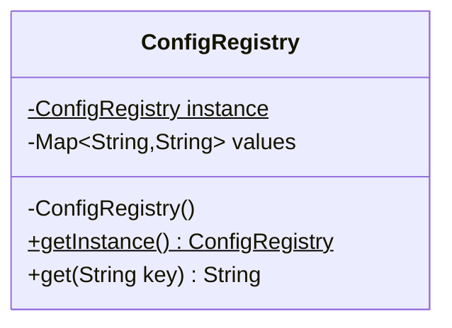

## The idea in plain words

Some things should exist only **once** in a running program, such as the settings everyone reads or one shared connection pool. A Singleton is a class that makes sure only one object of it is ever created, and hands that same object to everyone who asks.

**Picture it:** a school has one principal's office. Anyone who needs a signature goes to that same office. Nobody opens a second one down the corridor.

### The smallest example

```java
final class AppConfig {
    private static final AppConfig INSTANCE = new AppConfig();   // made once, when the class loads
    private final Map<String, String> values = Map.of("currency", "INR");

    private AppConfig() { }                                      // nobody outside can call new
    static AppConfig get() { return INSTANCE; }
    String value(String key) { return values.get(key); }
}

class Demo {
    public static void main(String[] args) {
        System.out.println(AppConfig.get() == AppConfig.get());   // true: the same object
        System.out.println(AppConfig.get().value("currency"));    // INR
    }
}
```

That is the whole pattern: a **private constructor** plus **one static field**. Everything else in this lesson is about doing it safely with threads, and about why many teams avoid it.

| Use it when | Skip it when |
| --- | --- |
| There must truly be one of something per program, and it holds no per-user data | You just want "one instance": create one at startup and pass it in instead (easier to test) |

The rest of this lesson goes deeper, at the level interviewers probe.

**The textbook definition:** ensure a class has exactly one instance and provide a global point of access to it.

Singleton is the pattern everyone knows and interviewers love to probe — not because it's hard, but because a correct, thread-safe implementation in Java has real subtleties, and because knowing *why it's often a bad idea* is a strong senior signal.

## The problem

Some resources should exist once per process: a configuration registry loaded at startup, a connection pool, an in-memory cache shared by all requests, a metrics registry. Creating several would waste resources or cause inconsistency (two caches holding different data).

You want two guarantees:

1. **Single instance** — nobody can create another.
2. **Global access** — any code can reach that instance.

## The structure



- A **private constructor** prevents `new` from outside.
- A **static field** holds the sole instance.
- A **static accessor** returns it, creating it if necessary.

## Implementations in Java

### 1. Eager initialisation

```java
public final class ConfigRegistry {
    private static final ConfigRegistry INSTANCE = new ConfigRegistry();

    private ConfigRegistry() { /* load config */ }

    public static ConfigRegistry getInstance() { return INSTANCE; }
}
```

Thread-safe for free — the JVM initialises static fields during class initialisation, which is guaranteed to happen once. Downside: created even if never used (rarely matters).

### 2. Lazy, not thread-safe ❌

```java
public static ConfigRegistry getInstance() {
    if (instance == null) {              // two threads can both see null...
        instance = new ConfigRegistry(); // ...and both create an instance
    }
    return instance;
}
```

Broken under concurrency. Know why: it's a check-then-act race.

### 3. Synchronized accessor

```java
public static synchronized ConfigRegistry getInstance() {
    if (instance == null) instance = new ConfigRegistry();
    return instance;
}
```

Correct, but every call acquires a lock — unnecessary contention after initialisation.

### 4. Double-checked locking (DCL)

```java
public final class ConfigRegistry {
    private static volatile ConfigRegistry instance;   // volatile is essential

    private ConfigRegistry() { }

    public static ConfigRegistry getInstance() {
        ConfigRegistry local = instance;               // one volatile read on the fast path
        if (local == null) {
            synchronized (ConfigRegistry.class) {
                local = instance;
                if (local == null) {
                    instance = local = new ConfigRegistry();
                }
            }
        }
        return local;
    }
}
```

<Callout type="warning" title="Why volatile matters">
`instance = new ConfigRegistry()` is not atomic: allocate memory, run the constructor, assign the reference. Without `volatile`, the JIT/CPU may reorder these so another thread sees a **non-null reference to a partially constructed object**. `volatile` (Java 5+ memory model) establishes a happens-before edge that forbids this. DCL without `volatile` is a classic interview trap.
</Callout>

### 5. Initialization-on-demand holder (recommended lazy approach)

```java
public final class ConfigRegistry {
    private ConfigRegistry() { }

    private static final class Holder {
        static final ConfigRegistry INSTANCE = new ConfigRegistry();
    }

    public static ConfigRegistry getInstance() { return Holder.INSTANCE; }
}
```

The nested `Holder` class isn't initialised until `getInstance()` first touches it, and class initialisation is thread-safe by the JVM spec. **Lazy, thread-safe, lock-free, simple.**

### 6. Enum singleton (most robust)

```java
public enum ConfigRegistry {
    INSTANCE;

    private final Map<String, String> values = loadFromFile();

    public String get(String key) { return values.get(key); }
}
```

Recommended by *Effective Java*: the JVM guarantees a single instance, and it's automatically safe against **serialization** and **reflection** attacks. Limitation: can't extend another class (enums implicitly extend `Enum`), and initialisation is eager on first use of the enum.

### Comparison

| Approach | Lazy | Thread-safe | Fast after init | Reflection/serialization safe |
| --- | --- | --- | --- | --- |
| Eager static field | No | Yes | Yes | No (needs extra work) |
| Synchronized method | Yes | Yes | No | No |
| Double-checked locking + volatile | Yes | Yes | Yes | No |
| Holder idiom | Yes | Yes | Yes | No |
| Enum | On first use | Yes | Yes | **Yes** |

## Breaking a singleton (and defending it)

| Attack | How | Defence |
| --- | --- | --- |
| **Reflection** | `ctor.setAccessible(true); ctor.newInstance()` | Throw from the constructor if an instance exists; or use an enum |
| **Serialization** | Deserialising creates a new object | Implement `readResolve()` returning the instance; or use an enum |
| **Cloning** | `clone()` if `Cloneable` | Don't implement `Cloneable`; or throw `CloneNotSupportedException` |
| **Multiple class loaders** | Each loader has its own static state | Usually acceptable; be aware in app servers/plugins |

```java
private Object readResolve() { return getInstance(); }   // keep one instance after deserialization
```

## Why Singleton is often an anti-pattern

1. **Hidden global state.** Any code can reach it, so dependencies are invisible in constructors and APIs.
2. **Hard to test.** You can't easily substitute a fake; tests share state and leak into each other.
3. **Violates SRP.** The class manages its business logic *and* its own lifecycle.
4. **Tight coupling.** `ConfigRegistry.getInstance()` sprinkled everywhere couples code to a concrete class (DIP violation).
5. **Concurrency hazards.** A mutable singleton is shared mutable state across all threads.

**The better default:** create **one instance** at startup and **inject** it where needed. You get "single instance" without "global access":

```java
public static void main(String[] args) {
    var config = new ConfigRegistry(loadConfig());          // created once
    var service = new ParkingService(config, new InMemorySpotRepository());
}
```

This is exactly what Spring does: beans are **singleton-scoped by default** — one instance per container — but delivered by dependency injection, not a static accessor.

<Callout type="interview">
A strong answer to "implement a singleton" is: the holder idiom or enum, an explanation of why naive lazy init and DCL-without-volatile break, and then: "In application code I'd usually avoid the static accessor and inject a single instance instead, for testability."
</Callout>

## Where you've seen it

- `java.lang.Runtime.getRuntime()`
- `java.awt.Desktop.getDesktop()`
- Logger factories and registries (`LoggerFactory.getILoggerFactory()`)
- Spring's default bean scope (container-managed, not the GoF static form)

## When to use

- Truly one-per-process resources with no meaningful alternative implementations: a hardware interface, a process-wide registry.
- Stateless utility objects where a single shared instance is simpler (though often a static method or an injected instance is clearer).

**Avoid** for anything you want to mock in tests, anything with mutable business state, or as a shortcut to avoid passing dependencies.

## Related patterns

- **Abstract Factory, Builder and Prototype** objects are often singletons — one factory per family is enough.
- **Facade** objects are frequently single instances.
- **Flyweight** vs Singleton: a flyweight factory may hold *many* shared immutable instances (one per intrinsic state); a singleton is exactly one instance and may be mutable.

## Interview questions

<QA q="Why is the volatile keyword required in double-checked locking?">
Object creation involves allocating memory, running the constructor and publishing the reference. Without volatile, these can be reordered so the reference is published before construction completes; a second thread taking the unsynchronized fast path could see a non-null instance and use a partially constructed object. Declaring the field volatile creates a happens-before relationship between the write and subsequent reads, preventing that reordering.
</QA>

<QA q="Which singleton implementation would you choose and why?">
For most cases the initialization-on-demand holder idiom: it's lazy, thread-safe through JVM class-initialisation guarantees, and lock-free after initialisation. If I need protection against reflection and serialization, or want the simplest correct code, an enum singleton. In application code I'd generally avoid the pattern altogether and inject a single instance through constructors (or let Spring manage a singleton-scoped bean).
</QA>

<QA q="How would you unit-test code that calls a singleton's getInstance()?">
That's the core problem with the pattern. Options: refactor the code to receive the dependency through its constructor (best), introduce an interface the singleton implements and inject it, or as a last resort add a package-private method to reset or replace the instance in tests (fragile and test-order dependent). The refactoring to dependency injection is what interviewers want to hear.
</QA>

<QA q="Is a Spring singleton bean the same as the GoF Singleton?">
No. A Spring singleton bean means one instance per application context, created and wired by the container and injected into dependents. The class itself has a normal constructor and no static accessor, so it remains testable and you can have several instances in different contexts or tests. GoF Singleton enforces one instance per class loader through a private constructor and a static access point.
</QA>

<Practice task="Your service calls ConfigRegistry.getInstance() in 40 places and the tests are flaky because they share state. Plan the refactoring.">

Step 1: give `ConfigRegistry` a normal constructor while keeping `getInstance()` working. Step 2: one class at a time, add a constructor parameter for the registry, defaulting to `getInstance()` in the existing no-argument constructor so callers keep compiling. Step 3: create one instance in `main` (or the DI container) and pass it down; tests now create their own instance. Step 4: when nothing calls `getInstance()` any more, delete it. Every step leaves the system working.

</Practice>

<Takeaways>

- Singleton = private constructor + static instance + static accessor.
- Naive lazy init is a race; DCL needs volatile; the holder idiom and enum are the clean, thread-safe options.
- Defend against reflection, serialization and cloning — or use an enum.
- Prefer one injected instance over a global static accessor for testability and loose coupling.

</Takeaways>

## Further reading

- Joshua Bloch, *Effective Java* (3rd ed.) — Item 3: "Enforce the singleton property with a private constructor or an enum type".
- Brian Goetz et al., *Java Concurrency in Practice* (2006) — §16.2.3–16.2.4, safe publication and the double-checked locking idiom.
- "The 'Double-Checked Locking is Broken' Declaration" (Bacon, Bloch, Pugh et al.).
- Alexander Shvets, *Dive Into Design Patterns* — "Singleton".
