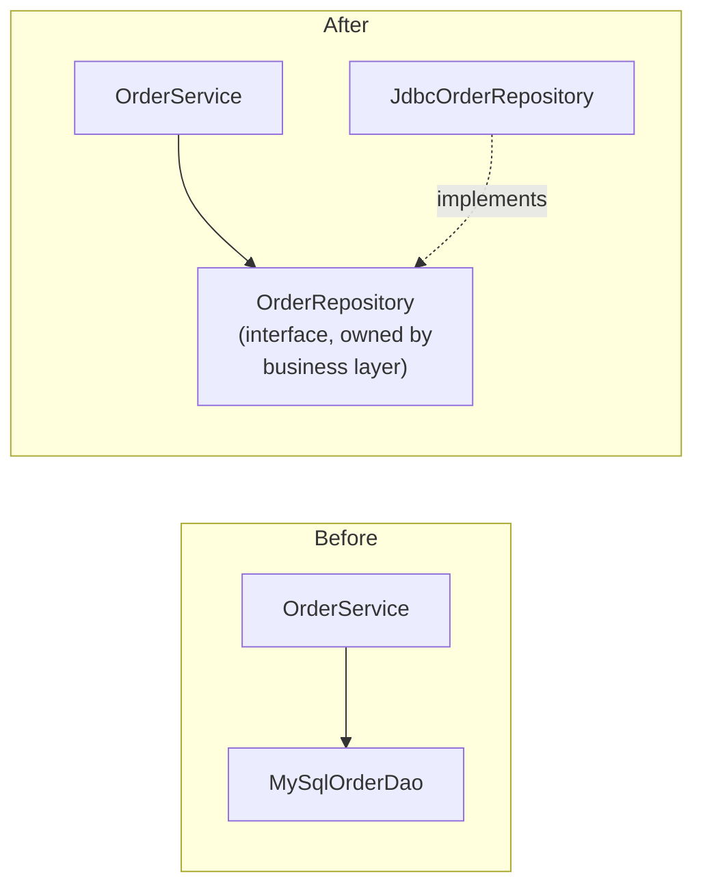

SOLID is five principles, popularised by Robert C. Martin, for designing classes that are easy to change. Almost every LLD interview touches them — either directly ("explain Liskov with an example") or by asking you to extend your design and watching whether it bends or breaks.

## The idea in plain words

All five rules aim at one thing: **when requirements change, you should have to touch as little working code as possible.**

| Principle | In plain words | Everyday picture | Fights |
| --- | --- | --- | --- |
| **S**ingle Responsibility | One class, one job | The cook cooks and the cashier bills. A new GST rule doesn't disturb the kitchen. | God classes |
| **O**pen/Closed | Add new behaviour by adding code, not by editing code that works | A power strip: plug in a new device without rewiring the house | Editing working code for every new case |
| **L**iskov Substitution | A child class must work anywhere its parent works, with no surprises | A substitute driver must drive the same car the same way. One who can't reverse is not a substitute. | Subclasses that surprise callers |
| **I**nterface Segregation | Don't make a class depend on methods it doesn't use | A remote for a child with three buttons, not fifty | Fat interfaces |
| **D**ependency Inversion | Important logic depends on an interface, not on one specific tool | A phone with a USB-C port, not a charger cable soldered on | Business logic welded to infrastructure |

### All five in one small example

```java
interface Notifier { void send(String to, String text); }       // I: small, focused interface

class EmailNotifier implements Notifier {
    public void send(String to, String text) { System.out.println("Email to " + to + ": " + text); }
}
class SmsNotifier implements Notifier {                           // O: a new channel is a new class
    public void send(String to, String text) { System.out.println("SMS to " + to + ": " + text); }
}

class OrderService {                                              // S: it only places orders
    private final Notifier notifier;
    OrderService(Notifier notifier) { this.notifier = notifier; } // D: given an interface, not "new EmailNotifier()"

    void place(String user, String item) {
        System.out.println(user + " ordered " + item);
        notifier.send(user, "Order placed: " + item);             // L: any Notifier works here, no surprises
    }
}

class Demo {
    public static void main(String[] args) {
        new OrderService(new SmsNotifier()).place("asha", "Headphones");
    }
}
```

Treat them as **heuristics for managing change**, not laws. Each has a cost when over-applied, and knowing that cost is what distinguishes a senior answer. The rest of this lesson takes each principle in turn, with the kind of example interviewers use.

## S — Single Responsibility Principle

> A class should have only one reason to change — it should be responsible to one actor.

"Responsibility" is best understood as **a source of change**: a group of people or a requirement area that could ask for modifications.

```java
// ❌ Three reasons to change: invoice rules (finance), PDF layout (design), storage (infra)
class InvoiceService {
    Money calculateTotal(Invoice inv) { ... }
    byte[] renderPdf(Invoice inv) { ... }
    void saveToDatabase(Invoice inv) { ... }
}

// ✅ Each class changes for one reason
class InvoiceCalculator { Money total(Invoice inv) { ... } }
class InvoicePdfRenderer { byte[] render(Invoice inv) { ... } }
interface InvoiceRepository { void save(Invoice inv); }
```

**Signals of violation:** a class name with "And" or "Manager"; methods that use disjoint sets of fields; a change in PDF layout requiring you to retest tax calculation.

<Callout type="warning" title="Over-applying SRP">
Splitting every method into its own class produces a fragmented design where a simple change touches ten tiny files. SRP is about **cohesion**: things that change together should stay together. A 200-line class with one clear purpose is fine.
</Callout>

## O — Open/Closed Principle

> Software entities should be open for extension but closed for modification.

Add new behaviour by **adding new code** (a new class), not by editing existing, tested code. The usual mechanism is polymorphism behind an interface.

```java
// ❌ Every new discount type edits this method — and risks breaking the others
class Checkout {
    Money discount(Order o, String type) {
        switch (type) {
            case "FESTIVE":  return o.total().percent(20);
            case "NEW_USER": return Money.of(100);
            // adding "BANK_OFFER" means modifying this class again
            default: return Money.ZERO;
        }
    }
}

// ✅ New discounts are new classes; Checkout never changes
interface DiscountRule { Money apply(Order o); }
class FestiveDiscount implements DiscountRule { public Money apply(Order o) { return o.total().percent(20); } }
class NewUserDiscount implements DiscountRule { public Money apply(Order o) { return Money.of(100); } }

class Checkout {
    private final List<DiscountRule> rules;
    Checkout(List<DiscountRule> rules) { this.rules = rules; }
    Money discount(Order o) {
        return rules.stream().map(r -> r.apply(o)).max(Money::compareTo).orElse(Money.ZERO);
    }
}
```

Patterns that implement OCP: Strategy, Decorator, Observer, Template Method, Chain of Responsibility, Factory.

**Nuances:**

- You can't be closed against *every* change. Choose the **axes of change** that requirements suggest (discount types, payment methods) and open those. Guessing wrongly yields useless abstraction.
- OCP is not an excuse to avoid fixing bugs — fix the bug in place; don't subclass to patch it.
- A `switch` on a type is acceptable in **one** place — usually a factory that maps input to objects. The problem is the same switch duplicated across the codebase.

## L — Liskov Substitution Principle

> Objects of a subtype must be substitutable for objects of their base type without breaking the program's correctness.

A subclass must honour the **behavioural contract** of its parent — not just compile.

### The classic violation

```java
class Rectangle {
    protected int width, height;
    void setWidth(int w) { width = w; }
    void setHeight(int h) { height = h; }
    int area() { return width * height; }
}

class Square extends Rectangle {          // "a square is a rectangle" — mathematically
    @Override void setWidth(int w) { width = height = w; }
    @Override void setHeight(int h) { width = height = h; }
}

void resize(Rectangle r) {
    r.setWidth(5);
    r.setHeight(4);
    assert r.area() == 20;                // fails for Square: area is 16
}
```

Code written for `Rectangle` assumes width and height vary independently; `Square` silently breaks that assumption. *Is-a* in the real world doesn't guarantee *is-substitutable-for* in code. Fix: don't make `Square` a mutable subtype of `Rectangle` — make both implement a `Shape` interface, or make them immutable.

### The formal checklist

A subtype method must:

| Rule | Meaning | Violation example |
| --- | --- | --- |
| **Not strengthen preconditions** | Accept at least everything the parent accepts | Parent accepts any amount; child throws for amounts over ₹10,000 |
| **Not weaken postconditions** | Guarantee at least what the parent guarantees | Parent's `save()` guarantees durability; child buffers in memory and may lose data |
| **Preserve invariants** | Keep the parent's always-true conditions | Child allows a negative balance in an `Account` hierarchy |
| **Not throw new checked/unexpected exceptions** | Callers' error handling must still work | Child's `save()` throws `UnsupportedOperationException` |
| **Parameter types**: same or more general (contravariant) | Java enforces for overriding by requiring identical types | — |
| **Return types**: same or more specific (covariant) | Java allows covariant returns | Returning `Animal` where `Cat` was promised |
| **History constraint** | Don't allow state changes the parent forbids | An `ImmutablePoint` subclass that adds setters |

### The tell-tale smell

```java
void saveAll(List<Document> docs) {
    for (Document d : docs) {
        if (d instanceof ReadOnlyDocument) continue;   // ❌ caller must know subtypes
        d.save();
    }
}
```

If callers need `instanceof` checks to avoid breaking a subtype, LSP is violated (and OCP too — every new subtype may need another check). Fix the hierarchy: make the *base* type the read-only `Document` and add `WritableDocument extends Document` with `save()` — capabilities should only be **added** going down a hierarchy, never removed.

<Callout type="example" title="In the JDK">
`List.of(...)` returns an unmodifiable list whose `add()` throws `UnsupportedOperationException`. It's a known, documented LSP compromise in the collections framework — the `List` interface declares `add` as "optional". In your own designs, prefer separate read-only and mutable interfaces.
</Callout>

## I — Interface Segregation Principle

> Clients should not be forced to depend on methods they do not use.

```java
// ❌ Fat interface: a basic printer must "implement" scan and fax with stubs or exceptions
interface MultiFunctionDevice {
    void print(Document d);
    void scan(Document d);
    void fax(Document d);
}

// ✅ Role interfaces; a class implements the roles it actually plays
interface Printer { void print(Document d); }
interface Scanner { void scan(Document d); }
interface Fax     { void fax(Document d); }

class BasicPrinter implements Printer { ... }
class OfficeMachine implements Printer, Scanner, Fax { ... }
```

Benefits: implementers aren't forced into `UnsupportedOperationException` stubs (an LSP violation), and clients depending on `Printer` don't recompile or redeploy when fax features change.

**Nuance:** don't split interfaces that are already cohesive into one-method fragments. Segregate along **client needs** — what does each caller actually use?

## D — Dependency Inversion Principle

> High-level modules should not depend on low-level modules; both should depend on abstractions. Abstractions should not depend on details; details should depend on abstractions.

```java
// ❌ Business policy welded to infrastructure
class OrderService {
    private final MySqlOrderDao dao = new MySqlOrderDao();     // concrete, created internally
    private final SmtpEmailClient email = new SmtpEmailClient();
}

// ✅ Policy owns the abstractions it needs; infrastructure implements them
interface OrderRepository { void save(Order o); Optional<Order> find(OrderId id); }
interface Notifier { void orderPlaced(Order o); }

class OrderService {
    private final OrderRepository orders;
    private final Notifier notifier;
    OrderService(OrderRepository orders, Notifier notifier) {   // injected
        this.orders = orders;
        this.notifier = notifier;
    }
}

class JdbcOrderRepository implements OrderRepository { ... }    // detail depends on abstraction
class EmailNotifier implements Notifier { ... }
```



The "inversion": the source-code dependency now points **from the low-level detail toward the high-level policy**, opposite to the flow of control. Three practical steps:

1. Describe what the high-level class needs as an interface **in business terms** (`saveOrder`, not `executeSqlInsert`).
2. Make the high-level class depend only on that interface, receiving an implementation via its constructor.
3. Make the low-level class implement the interface.

**DIP vs dependency injection vs IoC:**

- **DIP** is the principle (depend on abstractions).
- **Dependency injection** is a technique (pass dependencies in, usually via constructors).
- **Inversion of Control containers** (Spring) automate wiring.

You can apply DIP and DI with plain constructors — exactly what you should do in a machine-coding round.

## How SOLID shows up in an interview

When the interviewer adds a requirement — "now support UPI payments", "add a weekend surcharge" — narrate the principle:

> "Payments are behind a `PaymentMethod` interface, so UPI is a new class — open/closed. `Checkout` depends on the interface, not on concrete gateways — dependency inversion. And the fee calculation lives in its own `PricingStrategy`, so the surcharge doesn't touch parking logic — single responsibility."

## Interview questions

<QA q="Explain the Liskov Substitution Principle with an example that isn't Rectangle/Square.">
Consider a Bird class with fly(), and a Penguin subclass that throws UnsupportedOperationException from fly(). Any code iterating over birds and calling fly() breaks when given a penguin, so Penguin isn't substitutable. The fix is to model capabilities correctly: a Bird base without fly(), and a FlyingBird subtype (or a Flyable interface) for birds that can fly. Subtypes should only add capabilities, never remove them or tighten preconditions.
</QA>

<QA q="Doesn't the Open/Closed Principle lead to too many classes?">
It can, if applied speculatively. OCP pays off along axes of change you actually expect — payment methods, pricing rules, notification channels — where new variants keep arriving. For behaviour that's unlikely to vary, a straightforward method is better. A reasonable rule: the first time, write it directly; when a second or third variant appears (or the requirements clearly signal variation), introduce the abstraction.
</QA>

<QA q="What's the difference between Dependency Inversion and Dependency Injection?">
Dependency Inversion is a design principle: high-level policy and low-level details should both depend on abstractions, with the abstraction owned by the policy side. Dependency Injection is a technique for supplying an object's dependencies from outside (constructor, setter or framework) instead of the object creating them. DI is the usual way to achieve DIP, but you can inject concrete classes (DI without DIP), and DIP is about the direction of source-code dependencies.
</QA>

<QA q="How does ISP relate to LSP?">
Fat interfaces often force implementers to stub out methods they can't support, typically by throwing UnsupportedOperationException — which violates LSP because callers relying on the interface's contract get surprised. Segregating interfaces by role lets each class implement only what it truly supports, so every implementation is fully substitutable.
</QA>

<Practice task="Which SOLID principles does this violate, and how would you fix it? A ReportService.export(report, format) method branches on 'PDF' and 'CSV' strings and then calls new MySqlAuditLog().write('exported').">

**OCP**: every new format edits `export`. **SRP**: the service formats reports *and* writes audit logs. **DIP**: it creates a concrete `MySqlAuditLog` instead of depending on an abstraction. Fix: a `ReportExporter` interface with `PdfExporter` and `CsvExporter` implementations chosen by a small registry keyed by format; inject an `AuditLog` interface through the constructor; the service only orchestrates.

</Practice>

<Takeaways>

- SRP: one reason to change — group by source of change, not by method count.
- OCP: extend through new classes behind interfaces along the axes that really vary.
- LSP: subtypes must honour the parent's contract — no stronger preconditions, weaker guarantees or surprise exceptions.
- ISP: role-based interfaces sized to what clients use.
- DIP: business logic owns abstractions; infrastructure implements them; inject via constructors.
- All five are trade-offs — apply them where change is expected.

</Takeaways>

## Further reading

- Robert C. Martin, *Agile Software Development, Principles, Patterns, and Practices* (2002) and *Clean Architecture* (2017).
- Barbara Liskov and Jeannette Wing, "A Behavioral Notion of Subtyping" (TOPLAS, 1994).
- Bertrand Meyer, *Object-Oriented Software Construction* (2nd ed., 1997) — origin of the Open/Closed Principle and design by contract.
- Alexander Shvets, *Dive Into Design Patterns* — "SOLID Principles", including the formal LSP checklist.
