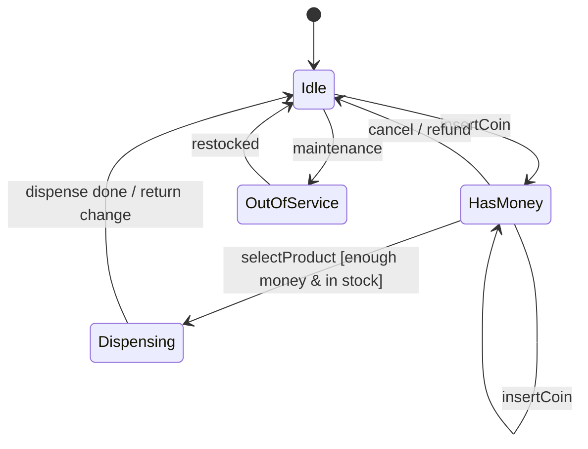
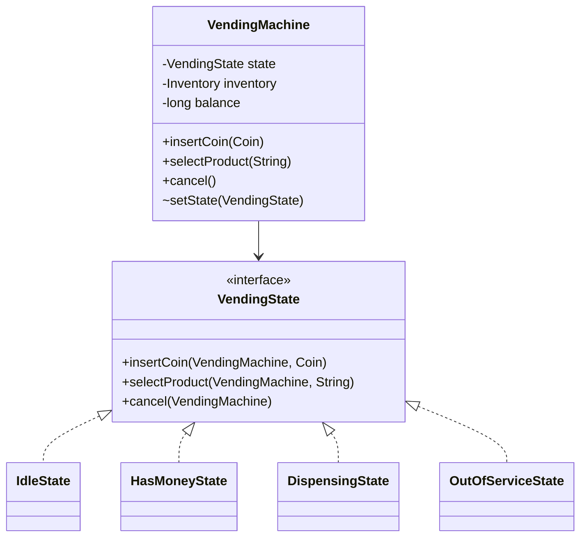

## The idea in plain words

Some objects **behave differently depending on the situation they're in**. Cancelling an order is easy before it ships and impossible after. Instead of an `if (status == ...)` in every method, **each situation (state) becomes a small class** that knows how to handle each action and which state comes next.

**Picture it:** your phone's power button. When the phone is off it turns on, when it's unlocked it locks the screen, when it's ringing it silences the call. Same button, different behaviour, decided by the state the phone is in.

### The smallest example

```java
interface OrderState { OrderState cancel(); }

class Placed implements OrderState {
    public OrderState cancel() { System.out.println("Cancelled. Full refund."); return new Cancelled(); }
}
class Shipped implements OrderState {
    public OrderState cancel() { System.out.println("Already shipped. Please return it after delivery."); return this; }
}
class Cancelled implements OrderState {
    public OrderState cancel() { System.out.println("This order is already cancelled."); return this; }
}

class Order {
    private OrderState state;
    Order(OrderState start) { state = start; }
    void cancel() { state = state.cancel(); }         // same call; the current state decides what happens
}

class Demo {
    public static void main(String[] args) {
        Order a = new Order(new Placed());
        a.cancel();                                    // Cancelled. Full refund.
        a.cancel();                                    // This order is already cancelled.
        new Order(new Shipped()).cancel();             // Already shipped. Please return it after delivery.
    }
}
```

`Order` has no `if` at all. A new state like `OutForDelivery` is one new class.

**The textbook definition:** allow an object to **change its behaviour when its internal state changes**, so that it appears to change its class.

## How to spot it in an interview

Listen for an object whose **allowed actions depend on what has already happened**:

| You hear | The states |
| --- | --- |
| "You can't select a product before inserting money" | Vending machine: Idle, HasMoney, Dispensing |
| "Three wrong PINs and the card is kept" | ATM: Idle, CardInserted, Authenticated |
| "Customers can cancel until it ships" | Order: Placed, Shipped, Delivered, Cancelled |
| "A document can only be edited while it's a draft" | Draft, InReview, Approved, Published |

If you find yourself writing "it depends on the status" for several different actions, that's State.

## Draw the states first

An object with a life cycle like this is a **finite-state machine**: a fixed set of states, events that move it between them, and rules for which moves are allowed. Before writing any code, draw it:



Then make a table: one row per action, one column per state, and what happens in each cell. In an interview, this table is half the answer. Every cell becomes a method in a state class, and every "not allowed" cell becomes a clear error.

## The problem it solves

<Approach verdict="bad" title="A switch on the status in every method">

```java
// ❌ Every method switches on the state; every new state touches every method
public void insertCoin(Coin c) {
    switch (state) {
        case IDLE, HAS_MONEY -> { balance += c.value(); state = HAS_MONEY; }
        case DISPENSING -> throw new IllegalStateException("Please wait");
        case OUT_OF_SERVICE -> refund(c);
    }
}
public void selectProduct(String code) {
    switch (state) {
        case IDLE -> throw new IllegalStateException("Insert money first");
        case HAS_MONEY -> { /* check stock, price, dispense ... */ }
        case DISPENSING, OUT_OF_SERVICE -> throw new IllegalStateException("Unavailable");
    }
}
// ... and the same switch in cancel(), dispense(), maintenance()
```

With 5 states and 5 actions, the rules are spread over 25 `switch` branches in 5 different methods. To understand "what can a user do while the machine has money?", you must read all five methods. Adding a state means editing every one of them.

</Approach>

<Approach verdict="good" title="An enum plus a table of allowed moves">

For small machines where states don't **do** much (orders, bookings), an enum and a table of allowed transitions is clear and short. You'll see it below, and several case studies use it.

</Approach>

<Approach verdict="great" title="One class per state">

Each state becomes a class with one method per action. The object (the **context**) holds its current state and forwards every action to it. All the rules for "has money" live in `HasMoneyState`. Adding a state means adding a class.

</Approach>

## Building it step by step

**Step 1: List the actions as an interface.** One method per button or event: `insertCoin`, `selectProduct`, `cancel`. Give each a **default that throws** "can't do that now". Then a state only has to write the actions it allows.

**Step 2: Write one class per state.** Each overrides the actions it allows, does the work, and tells the context which state comes next.

**Step 3: Make the context forward everything.** The machine keeps `state` and its data (balance, inventory). Each public method is one line: `state.insertCoin(this, coin)`. It also offers a `setState` method the states can call.

**Step 4: Make it thread-safe** if several threads can press buttons: `synchronized` on the context's public methods, so one action finishes before the next starts.



<FullCode title="The full vending machine states (64 lines)" note="one class per state, transitions inside them">

```java
public interface VendingState {
    default void insertCoin(VendingMachine m, Coin c)        { throw invalid("insert a coin"); }
    default void selectProduct(VendingMachine m, String code){ throw invalid("select a product"); }
    default void cancel(VendingMachine m)                    { throw invalid("cancel"); }
    String name();

    private IllegalStateException invalid(String action) {
        return new IllegalStateException("Cannot " + action + " while " + name());
    }
}

public final class IdleState implements VendingState {
    public void insertCoin(VendingMachine m, Coin c) {
        m.addToBalance(c.value());
        m.setState(m.hasMoneyState());
    }
    public String name() { return "IDLE"; }
}

public final class HasMoneyState implements VendingState {
    public void insertCoin(VendingMachine m, Coin c) { m.addToBalance(c.value()); }

    public void selectProduct(VendingMachine m, String code) {
        Product p = m.inventory().find(code)
                .orElseThrow(() -> new IllegalArgumentException("Unknown product " + code));
        if (!m.inventory().inStock(code)) throw new ProductSoldOutException(code);
        if (m.balance() < p.price()) throw new InsufficientFundsException(p.price() - m.balance());

        m.setState(m.dispensingState());
        m.dispense(p);                                   // hardware call
        m.returnChange(m.balance() - p.price());
        m.resetBalance();
        m.setState(m.idleState());
    }

    public void cancel(VendingMachine m) {
        m.returnChange(m.balance());
        m.resetBalance();
        m.setState(m.idleState());
    }
    public String name() { return "HAS_MONEY"; }
}

public final class VendingMachine {
    private final VendingState idle = new IdleState(), hasMoney = new HasMoneyState(),
                               dispensing = new DispensingState(), outOfService = new OutOfServiceState();
    private VendingState state = idle;
    private long balance;
    private final Inventory inventory;

    public VendingMachine(Inventory inventory) { this.inventory = inventory; }

    // Public API simply delegates to the current state
    public synchronized void insertCoin(Coin c)        { state.insertCoin(this, c); }
    public synchronized void selectProduct(String code){ state.selectProduct(this, code); }
    public synchronized void cancel()                  { state.cancel(this); }

    // Package-private hooks used by the states
    void setState(VendingState s) { this.state = s; }
    VendingState idleState()       { return idle; }
    VendingState hasMoneyState()   { return hasMoney; }
    VendingState dispensingState() { return dispensing; }
    // ... balance and inventory helpers
}
```

</FullCode>

Each state class answers one question: *what does each action mean in this state?* Actions it doesn't allow fall through to the `default` methods, which throw a clear error.

## Walk through it

1. The machine starts in `IdleState`. The user presses "select": `IdleState` doesn't override `selectProduct`, so the default throws "Cannot select a product while IDLE".
2. The user inserts ₹20. `IdleState.insertCoin` adds it to the balance and calls `setState(hasMoney)`.
3. The user selects A1 (₹15). `HasMoneyState.selectProduct` checks stock and balance, switches to `Dispensing`, drops the product, returns ₹5 and switches back to `Idle`.
4. The machine's own code never checked a status once. The current state object made every decision.

See the full design in [Design a Vending Machine](/system-design/lld/lld-vending-machine).

## Design decisions

### Who decides the next state?

- **The states decide** (as above): each state knows what comes after it. Flexible, but the transitions are spread across the state classes.
- **A transition table decides**: states report events, and a table `(state, event) → next state` decides. Everything is in one place, easy to draw and check. Better when there are many states or the rules come from configuration.

### One shared object per state, or a new one each time?

If states hold no data of their own (the data lives in the context), create **one instance per state** and reuse it, even across many machines. If a state carries data (a countdown, a number of wrong tries), create a new one on each transition.

### Enum-based state machines

For small machines, an enum where each value overrides a method is compact:

```java
enum TrafficLight {
    RED    { TrafficLight next() { return GREEN; }  Duration duration() { return Duration.ofSeconds(60); } },
    GREEN  { TrafficLight next() { return YELLOW; } Duration duration() { return Duration.ofSeconds(45); } },
    YELLOW { TrafficLight next() { return RED; }    Duration duration() { return Duration.ofSeconds(5); } };

    abstract TrafficLight next();
    abstract Duration duration();
}
```

Use enums when states have little behaviour; use classes when states have real logic or need other objects.

### Status enum plus a transition table

For business objects (orders, bookings), a lighter version is often enough: an enum of statuses plus a table of allowed moves, checked in one method:

```java
enum OrderStatus { CREATED, PAID, SHIPPED, DELIVERED, CANCELLED }

private static final Map<OrderStatus, Set<OrderStatus>> ALLOWED = Map.of(
        CREATED,   EnumSet.of(PAID, CANCELLED),
        PAID,      EnumSet.of(SHIPPED, CANCELLED),
        SHIPPED,   EnumSet.of(DELIVERED),
        DELIVERED, EnumSet.noneOf(OrderStatus.class),
        CANCELLED, EnumSet.noneOf(OrderStatus.class));

void transitionTo(OrderStatus next) {
    if (!ALLOWED.get(status).contains(next))
        throw new IllegalStateException(status + " -> " + next + " is not allowed");
    status = next;
}
```

### Concurrency

If several threads call the context, each transition must happen in one piece: synchronise the public methods (as above) or use a lock, so two coins or two selections can't interleave halfway through a transition.

## Pros and cons

| Pros | Cons |
| --- | --- |
| Each state's behaviour is in one class (SRP) | Many small classes for small machines |
| Adding a state doesn't modify existing states' logic much (OCP) | Transitions scattered across state classes (if states decide) |
| Eliminates large conditionals; invalid operations handled explicitly | Overkill if there are only two or three states with trivial behaviour |

## Don't confuse it with Strategy

Both put behaviour behind an interface. The difference:

| | Strategy | State |
| --- | --- | --- |
| Who chooses the object | The **caller** or configuration | The object's **own life cycle**, as events happen |
| Do the implementations know each other? | No: independent algorithms | Yes: states usually pick the next state |
| How often it changes | Rarely | Constantly |
| Models | *How* to do something | *What* the object is allowed to do right now |

## Common mistakes

- **Coding before drawing the diagram and the action × state table.**
- **Forgetting the "not allowed" cells.** Every action must have a clear answer in every state, even if it's an error.
- **Changing data before all checks pass**, leaving the machine half-way between states.
- **Using full State classes for a two-state toggle.** An enum is clearer.
- **States that reach into each other's data** instead of going through the context.

<Callout type="interview">
In vending machine, ATM, elevator or order problems, start by drawing the state diagram. Interviewers are impressed when you list the states and the invalid actions before coding, and answer "what if the user presses cancel while it's dispensing?" explicitly.
</Callout>

## Interview questions

<QA q="How does the State pattern differ from a switch statement on an enum?">
With a switch, each operation contains branches for every state, so a state's behaviour is spread across many methods and adding a state means editing all of them. The State pattern groups all behaviour for one state into one class, the context delegates to the current state object, and adding a state mostly means adding a class. For small machines with trivial behaviour, an enum with a transition table is a perfectly good, simpler alternative.
</QA>

<QA q="Where should state transition logic live?">
Either in the state classes (each state knows its successors — natural when transitions depend on state-specific logic) or in a central transition table keyed by state and event (better for large or configurable machines, easier to validate and visualise). The important thing is consistency: one approach, and invalid transitions rejected explicitly.
</QA>

<QA q="How do you make a state machine thread-safe?">
Ensure that reading the current state, executing its behaviour and setting the next state happen atomically for each event — synchronise the context's public methods or guard them with a lock — so concurrent events can't interleave mid-transition. Keep state objects stateless (data in the context) so they can be shared safely, and avoid calling slow external systems while holding the lock where possible.
</QA>

<Practice task="Model a document workflow: Draft, In review, Approved, Published, with Rejected sending it back to Draft, and editing allowed only in Draft. Write the state table first, then say where each rule lives.">

Table (operation × state): edit — allowed in Draft, rejected elsewhere. submit — Draft → InReview. approve and reject — InReview → Approved or Draft. publish — Approved → Published. Everything else is rejected. With State classes, each state implements its allowed operations and inherits throwing defaults; `Document` delegates and exposes `transitionTo` to the states. Permission checks (only reviewers approve) live in the service or a protection proxy, not in the states — states model the lifecycle, not roles.

</Practice>

<Takeaways>

- Model lifecycle-driven objects as finite-state machines; draw the diagram first.
- State moves each state's behaviour into its own class; the context delegates to the current state.
- Decide where transitions live (states or a table) and reject invalid transitions explicitly.
- Strategy is chosen from outside; State changes from inside as events occur.

</Takeaways>

## Further reading

- Gamma et al., *Design Patterns* (1994) — State.
- Freeman and Robson, *Head First Design Patterns* (2nd ed.) — the gumball machine chapter.
- Alexander Shvets, *Dive Into Design Patterns* — "State".
