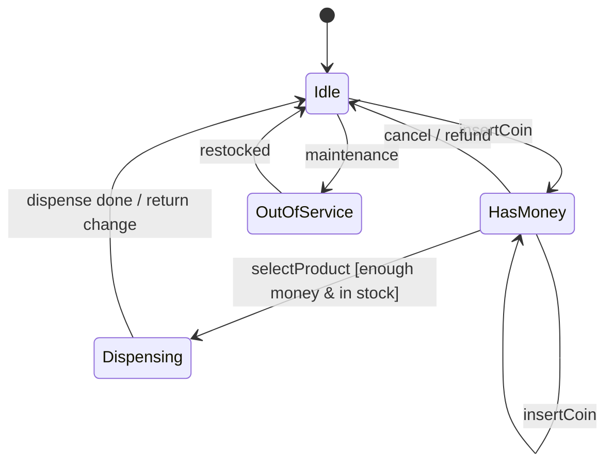
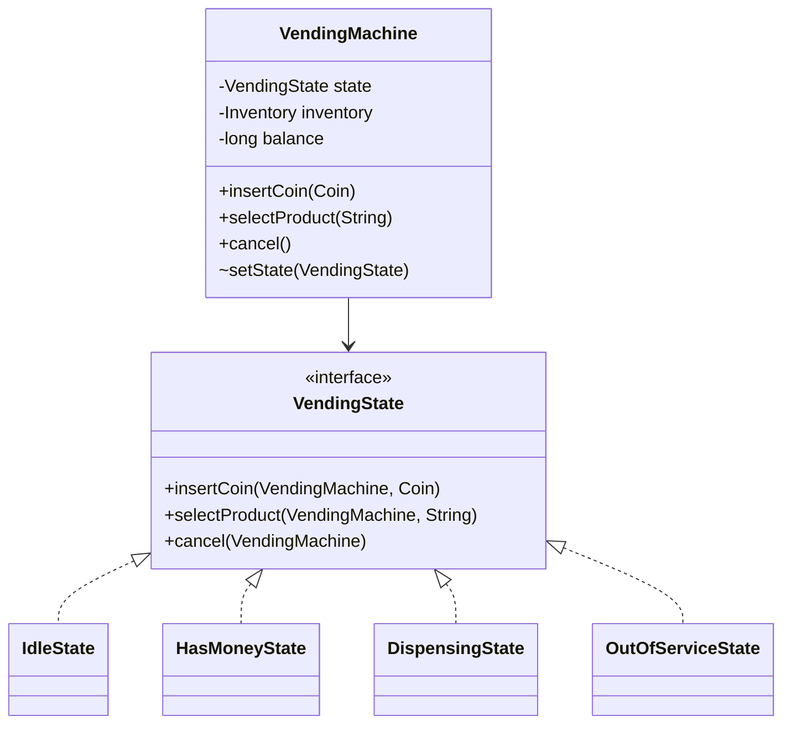

**Intent:** allow an object to **alter its behaviour when its internal state changes** — the object appears to change its class.

State is the backbone of many machine-coding problems: vending machines, ATMs, elevators, orders, document workflows, game turns, traffic lights. If an object's valid operations depend on what "mode" it's in, think State.

## Finite-state machines

An object with a lifecycle is a **finite-state machine**: a finite set of states, events that trigger transitions, and rules for which transitions are allowed.



## The problem: conditionals everywhere

```java
// ❌ Every method switches on the state; every new state touches every method
public void insertCoin(Coin c) {
    switch (state) {
        case IDLE, HAS_MONEY -> { balance += c.value(); state = HAS_MONEY; }
        case DISPENSING -> throw new IllegalStateException("Please wait");
        case OUT_OF_SERVICE -> refund(c);
    }
}
public void selectProduct(String code) {
    switch (state) {
        case IDLE -> throw new IllegalStateException("Insert money first");
        case HAS_MONEY -> { /* check stock, price, dispense ... */ }
        case DISPENSING, OUT_OF_SERVICE -> throw new IllegalStateException("Unavailable");
    }
}
// ... and the same switch in cancel(), dispense(), maintenance()
```

With 5 states and 5 operations, logic is spread across 25 switch branches. Adding a state means editing every method.

## The solution

Move each state's behaviour into its own class implementing a common `State` interface. The **context** (the machine) holds a reference to the current state object and delegates every operation to it. States trigger transitions by telling the context which state comes next.



```java
public interface VendingState {
    default void insertCoin(VendingMachine m, Coin c)        { throw invalid("insert a coin"); }
    default void selectProduct(VendingMachine m, String code){ throw invalid("select a product"); }
    default void cancel(VendingMachine m)                    { throw invalid("cancel"); }
    String name();

    private IllegalStateException invalid(String action) {
        return new IllegalStateException("Cannot " + action + " while " + name());
    }
}

public final class IdleState implements VendingState {
    public void insertCoin(VendingMachine m, Coin c) {
        m.addToBalance(c.value());
        m.setState(m.hasMoneyState());
    }
    public String name() { return "IDLE"; }
}

public final class HasMoneyState implements VendingState {
    public void insertCoin(VendingMachine m, Coin c) { m.addToBalance(c.value()); }

    public void selectProduct(VendingMachine m, String code) {
        Product p = m.inventory().find(code)
                .orElseThrow(() -> new IllegalArgumentException("Unknown product " + code));
        if (!m.inventory().inStock(code)) throw new ProductSoldOutException(code);
        if (m.balance() < p.price()) throw new InsufficientFundsException(p.price() - m.balance());

        m.setState(m.dispensingState());
        m.dispense(p);                                   // hardware call
        m.returnChange(m.balance() - p.price());
        m.resetBalance();
        m.setState(m.idleState());
    }

    public void cancel(VendingMachine m) {
        m.returnChange(m.balance());
        m.resetBalance();
        m.setState(m.idleState());
    }
    public String name() { return "HAS_MONEY"; }
}

public final class VendingMachine {
    private final VendingState idle = new IdleState(), hasMoney = new HasMoneyState(),
                               dispensing = new DispensingState(), outOfService = new OutOfServiceState();
    private VendingState state = idle;
    private long balance;
    private final Inventory inventory;

    public VendingMachine(Inventory inventory) { this.inventory = inventory; }

    // Public API simply delegates to the current state
    public synchronized void insertCoin(Coin c)        { state.insertCoin(this, c); }
    public synchronized void selectProduct(String code){ state.selectProduct(this, code); }
    public synchronized void cancel()                  { state.cancel(this); }

    // Package-private hooks used by the states
    void setState(VendingState s) { this.state = s; }
    VendingState idleState()       { return idle; }
    VendingState hasMoneyState()   { return hasMoney; }
    VendingState dispensingState() { return dispensing; }
    // ... balance and inventory helpers
}
```

Each state class answers one question: *what does each operation mean in this state?* Invalid operations fall through to the `default` methods that throw a clear error.

See the full design in [Design a Vending Machine](/system-design/lld/lld-vending-machine).

## Design decisions

### Who performs transitions?

- **States decide** (as above): each state knows its successors. Flexible; transitions are spread across state classes.
- **Context or transition table decides**: states report events; a table `(state, event) → nextState` determines transitions. Centralised and easy to visualise/validate; good when the state graph is large or configurable.

### Stateless state objects vs per-context state objects

If states hold no data of their own (data lives in the context), share **one instance per state** — even across many machines (they're effectively flyweights/singletons). If states carry data (e.g., a countdown), create new instances on transition.

### Enum-based state machines

For small machines, an enum with abstract methods is compact:

```java
enum TrafficLight {
    RED    { TrafficLight next() { return GREEN; }  Duration duration() { return Duration.ofSeconds(60); } },
    GREEN  { TrafficLight next() { return YELLOW; } Duration duration() { return Duration.ofSeconds(45); } },
    YELLOW { TrafficLight next() { return RED; }    Duration duration() { return Duration.ofSeconds(5); } };

    abstract TrafficLight next();
    abstract Duration duration();
}
```

Use enums when states have little behaviour; use classes when states have rich logic or dependencies.

### Order/workflow state with validation

For domain entities (orders, bookings), a lighter variant is often enough: an enum of statuses plus an explicit transition table, enforced in one method:

```java
enum OrderStatus { CREATED, PAID, SHIPPED, DELIVERED, CANCELLED }

private static final Map<OrderStatus, Set<OrderStatus>> ALLOWED = Map.of(
        CREATED,   EnumSet.of(PAID, CANCELLED),
        PAID,      EnumSet.of(SHIPPED, CANCELLED),
        SHIPPED,   EnumSet.of(DELIVERED),
        DELIVERED, EnumSet.noneOf(OrderStatus.class),
        CANCELLED, EnumSet.noneOf(OrderStatus.class));

void transitionTo(OrderStatus next) {
    if (!ALLOWED.get(status).contains(next))
        throw new IllegalStateException(status + " -> " + next + " is not allowed");
    status = next;
}
```

### Concurrency

If multiple threads call the context, transitions must be atomic — synchronise the public methods (as above) or use a lock, so two coins or two selections can't interleave mid-transition.

## Pros and cons

| Pros | Cons |
| --- | --- |
| Each state's behaviour is in one class (SRP) | Many small classes for small machines |
| Adding a state doesn't modify existing states' logic much (OCP) | Transitions scattered across state classes (if states decide) |
| Eliminates large conditionals; invalid operations handled explicitly | Overkill if there are only two or three states with trivial behaviour |

## State vs Strategy

Both delegate behaviour to an object behind an interface. The difference:

| | Strategy | State |
| --- | --- | --- |
| Who chooses the object | The **client** / configuration | The **context's lifecycle** — transitions |
| Do implementations know each other? | No — independent algorithms | Yes — states often trigger the next state |
| Changes over the object's lifetime | Rarely | Constantly, as events happen |
| Models | *How* to do something | *What* the object is currently allowed to do |

State can be seen as an extension of Strategy in which strategies can replace themselves.

<Callout type="interview">
In vending machine, ATM, elevator or order-workflow problems, start by drawing the state diagram. Interviewers are impressed when you enumerate states and invalid transitions before coding — and handle "what if the user presses cancel while dispensing?" explicitly.
</Callout>

## Interview questions

<QA q="How does the State pattern differ from a switch statement on an enum?">
With a switch, each operation contains branches for every state, so a state's behaviour is spread across many methods and adding a state means editing all of them. The State pattern groups all behaviour for one state into one class, the context delegates to the current state object, and adding a state mostly means adding a class. For small machines with trivial behaviour, an enum with a transition table is a perfectly good, simpler alternative.
</QA>

<QA q="Where should state transition logic live?">
Either in the state classes (each state knows its successors — natural when transitions depend on state-specific logic) or in a central transition table keyed by state and event (better for large or configurable machines, easier to validate and visualise). The important thing is consistency: one approach, and invalid transitions rejected explicitly.
</QA>

<QA q="How do you make a state machine thread-safe?">
Ensure that reading the current state, executing its behaviour and setting the next state happen atomically for each event — synchronise the context's public methods or guard them with a lock — so concurrent events can't interleave mid-transition. Keep state objects stateless (data in the context) so they can be shared safely, and avoid calling slow external systems while holding the lock where possible.
</QA>

<Practice task="Model a document workflow: Draft, In review, Approved, Published, with Rejected sending it back to Draft, and editing allowed only in Draft. Write the state table first, then say where each rule lives.">

Table (operation × state): edit — allowed in Draft, rejected elsewhere. submit — Draft → InReview. approve and reject — InReview → Approved or Draft. publish — Approved → Published. Everything else is rejected. With State classes, each state implements its allowed operations and inherits throwing defaults; `Document` delegates and exposes `transitionTo` to the states. Permission checks (only reviewers approve) live in the service or a protection proxy, not in the states — states model the lifecycle, not roles.

</Practice>

<Takeaways>

- Model lifecycle-driven objects as finite-state machines; draw the diagram first.
- State moves each state's behaviour into its own class; the context delegates to the current state.
- Decide where transitions live (states or a table) and reject invalid transitions explicitly.
- Strategy is chosen from outside; State changes from inside as events occur.

</Takeaways>

## Further reading

- Gamma et al., *Design Patterns* (1994) — State.
- Freeman and Robson, *Head First Design Patterns* (2nd ed.) — the gumball machine chapter.
- Alexander Shvets, *Dive Into Design Patterns* — "State".
