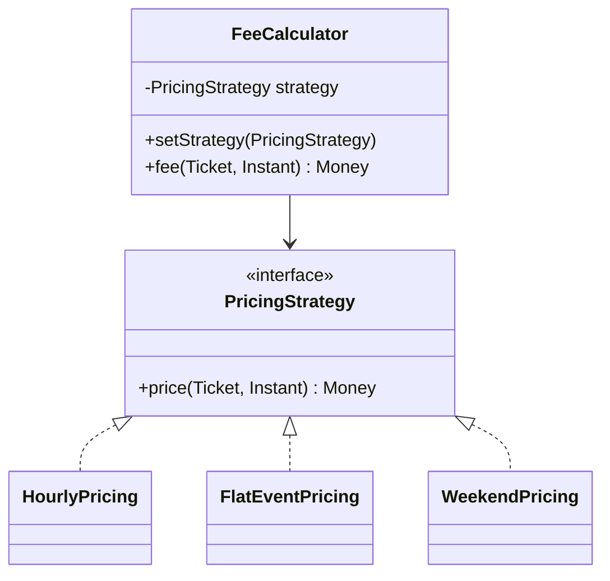

## The idea in plain words

There are **several ways to do the same job**. Put each way in its own class behind one shared interface, and choose which one to use while the program runs. The code that needs the job done only knows the interface.

**Picture it:** paying at a shop. The shopkeeper just says "₹250, please". Whether you pay by UPI, card or cash is your choice, and the shop's billing doesn't change.

### The smallest example

```java
interface PaymentMethod { void pay(int amount); }

class Upi implements PaymentMethod {
    public void pay(int amount) { System.out.println("Paid ₹" + amount + " by UPI"); }
}
class Card implements PaymentMethod {
    public void pay(int amount) { System.out.println("Paid ₹" + (amount + amount * 2 / 100) + " by card (2% fee)"); }
}

class Checkout {
    private final PaymentMethod method;
    Checkout(PaymentMethod method) { this.method = method; }
    void complete(int amount) { method.pay(amount); }    // doesn't know or care which method it has
}

class Demo {
    public static void main(String[] args) {
        new Checkout(new Upi()).complete(250);    // Paid ₹250 by UPI
        new Checkout(new Card()).complete(250);   // Paid ₹255 by card (2% fee)
    }
}
```

Adding wallet payments is a new class. `Checkout` never changes, and each payment method can be tested on its own.

**The textbook definition:** define a **family of algorithms**, put each one behind a common interface, and make them **interchangeable**, so the algorithm can change independently of the code that uses it.

## How to spot it in an interview

Strategy is the most useful pattern in LLD interviews. Listen for requirements that say **"it can be done in different ways"**, or **"we might change how X works later"**:

| You hear | Strategy |
| --- | --- |
| "Pricing is hourly, but events have a flat rate" | `PricingStrategy` |
| "Split equally, by exact amounts or by percentage" | `SplitStrategy` |
| "Pick the nearest driver, or maybe the highest-rated" | `MatchingStrategy` |
| "Evict the least recently used, or least frequently used" | `EvictionPolicy` |
| "A human or a computer can play" | `MoveStrategy` |

## The problem it solves

A parking lot charges an hourly fee. Then the business adds a flat rate for events, weekend rates, a discount for electric vehicles, and monthly passes. The obvious code grows like this:

<Approach verdict="bad" title="One method with a growing chain of ifs">

```java
// ❌ A growing conditional, edited for every new rule
Money fee(Ticket t, Instant exit) {
    if (t.isMonthlyPass()) return Money.ZERO;
    if (isWeekend(exit)) return weekendRate(t, exit);
    if (event.isActive()) return Money.of(300);
    if (t.vehicle().isElectric()) return hourly(t, exit).percentOff(20);
    return hourly(t, exit);
}
```

Every new rule means editing this method, and every edit risks breaking the rules already there. The method grows without limit, and you can't test "weekend pricing" on its own: every test runs through the whole chain.

</Approach>

<Approach verdict="great" title="One class per rule, behind one interface">

Each pricing rule becomes its own small class implementing `PricingStrategy`. The exit gate holds **a** strategy and calls it, without knowing which one it is. A new rule is a new class; nothing that already works is touched.

</Approach>

## Building it step by step

**Step 1: Name the job as an interface.** One method that every way of doing the job will implement. Name it after the domain ("pricing"), not the pattern.

**Step 2: Write one class per way of doing it.** `HourlyPricing`, `FlatEventPricing`, `WeekendPricing`. Each holds its own settings (rates, the flat amount) and nothing else.

**Step 3: Make the user of the job depend only on the interface.** The exit gate receives a `PricingStrategy` in its constructor and calls `price(...)`. This class is called the **context**.

**Step 4: Decide, in one place, which strategy to use** (see "Choosing the strategy" below).



```java
public interface PricingStrategy {
    Money price(Ticket ticket, Instant exitTime);
}

public final class HourlyPricing implements PricingStrategy {
    private final Map<VehicleType, Money> ratePerHour;
    public HourlyPricing(Map<VehicleType, Money> ratePerHour) { this.ratePerHour = Map.copyOf(ratePerHour); }

    @Override public Money price(Ticket t, Instant exit) {
        long hours = Math.max(1, ceilHours(Duration.between(t.entryTime(), exit)));
        return ratePerHour.get(t.vehicleType()).times(hours);
    }
}

public final class FlatEventPricing implements PricingStrategy {
    private final Money flat;
    public FlatEventPricing(Money flat) { this.flat = flat; }
    @Override public Money price(Ticket t, Instant exit) { return flat; }
}

// Context: depends only on the interface
public final class ExitGate {
    private final PricingStrategy pricing;
    public ExitGate(PricingStrategy pricing) { this.pricing = pricing; }

    public Receipt exit(Ticket t, Instant now) {
        return new Receipt(t.id(), pricing.price(t, now));
    }
}
```

## Walk through it

1. At startup, the app creates `new ExitGate(new HourlyPricing(rates))`.
2. A car leaves. The gate calls `pricing.price(ticket, now)`.
3. Java sends the call to `HourlyPricing.price`, which rounds the stay up to whole hours and multiplies by the rate.
4. On a concert night, the app builds the gate with `new FlatEventPricing(Money.of(300))` instead. The gate's code is identical; only the object it was given is different.

## Choosing the strategy

Something has to pick the strategy. Keep that decision in **one place**, not scattered around the code:

```java
// A selector/factory chooses by context
public final class PricingSelector {
    private final PricingStrategy hourly, weekend, event;
    private final EventCalendar events;

    public PricingStrategy forTime(Instant t) {
        if (events.isActive(t)) return event;
        if (isWeekend(t)) return weekend;
        return hourly;
    }
}
```

Other options: wire it up once at startup per parking lot, or let the user choose (shortest vs fastest route).

### Combining strategies

Strategies combine well with [Decorator](/system-design/lld/decorator-pattern): each wrapper adds one rule on top of the one inside it.

```java
PricingStrategy pricing = new EvDiscount(new MinimumCharge(new HourlyPricing(rates), Money.of(20)), 20);
```

## Lambdas: the lightweight strategy

In Java 8+, any interface with a single method can be filled with a lambda. `Comparator` is the strategy you've used most:

```java
orders.sort(Comparator.comparing(Order::placedAt).reversed());     // strategy passed as a lambda
```

Use a lambda for a small, one-off rule with no settings. Use a named class when the strategy has settings, several methods, or deserves a name in the domain (`ExactSplit`, `PercentSplit`).

## Where you've seen it

- `java.util.Comparator`; `ThreadPoolExecutor`'s `RejectedExecutionHandler` (abort, caller-runs, discard).
- Spring's `PasswordEncoder` and `TaskExecutor`: swap implementations through configuration.
- Load-balancing algorithms, retry policies, cache eviction policies, compression algorithms, payment methods.

## Strategy in the case studies

| Case study | Strategy |
| --- | --- |
| [Parking lot](/system-design/lld/lld-parking-lot) | `PricingStrategy`, `SpotAllocationStrategy` |
| [Splitwise](/system-design/lld/lld-splitwise) | `SplitStrategy` (equal, exact, percentage) |
| [Elevator](/system-design/lld/lld-elevator-system) | `DispatchStrategy` (nearest suitable car, zoning) |
| [Rate limiter](/system-design/lld/lld-rate-limiter) | `RateLimiter` implementations (token bucket, sliding window) |
| [Cab booking](/system-design/lld/lld-cab-booking) | `MatchingStrategy`, `FareStrategy` |
| [LRU cache](/system-design/lld/lld-lru-cache) | `EvictionPolicy` (LRU, LFU) |
| [Tic-tac-toe](/system-design/lld/lld-tic-tac-toe) | `MoveStrategy` (human, random bot, minimax bot) |

## Pros and cons

| Pros | Cons |
| --- | --- |
| Swap algorithms while the program runs | More classes and objects |
| Replaces conditionals; each algorithm is testable alone | Someone (the client or a selector) must know which strategy to use |
| Add algorithms without changing the context | Overkill when there are only one or two rules that never change |

## Don't confuse it with

- **State**: the same shape. In Strategy, the **caller** picks the algorithm, and strategies don't know about each other. In [State](/system-design/lld/state-pattern), the object's **current situation** picks the behaviour, and states switch the object to other states.
- **Template Method**: varies some steps through **inheritance** (fixed when the class is written). Strategy varies behaviour through **composition** (an object you can swap while running).
- **Command**: both wrap behaviour in objects. Strategy is *different ways of doing the same thing*; [Command](/system-design/lld/command-pattern) is *a request* turned into an object you can queue, log or undo.
- **Decorator**: changes an object's outside (wraps around it); Strategy changes its inside (replaces how it does the job).

## Common mistakes

- **Moving the `if` chain into whoever creates the strategy**, and then copying it in three places. Keep selection in one selector.
- **A strategy interface with ten methods.** Most strategies need one or two.
- **Naming classes after the pattern** (`StrategyImpl1`) instead of the domain (`WeekendPricing`).
- **Using Strategy for a rule that has only one version and no sign of a second.**

<Callout type="interview">
Name strategies after the domain concept, and say what changes: "Fees vary by event, weekday and vehicle type, so pricing sits behind a `PricingStrategy`; festival surge pricing would just be another implementation."
</Callout>

## Interview questions

<QA q="How does Strategy help with the Open/Closed Principle?">
The context depends only on the strategy interface. New behaviour is added by writing a new implementation rather than editing the context's conditional logic, so tested code stays unchanged: the context is closed for modification but open for extension through new strategies.
</QA>

<QA q="Who should decide which strategy to use?">
Keep the decision in one place: the client passes the strategy explicitly (the user picks a route type), configuration wires it at startup (per tenant or environment), or a small selector chooses based on context (event day vs weekday). Don't put the selection conditionals inside the context; that brings back the switch you removed.
</QA>

<QA q="When would you use a lambda instead of a strategy class?">
When the strategy is a single function with no state, used in one place, such as a sort comparator or a small filter. Use classes when strategies carry settings, have several methods, need clear domain names, are reused, or must be registered and chosen by key.
</QA>

<Practice task="A delivery app computes ETA as distance divided by 25 km/h. Product wants traffic-aware ETAs in big cities, the simple formula elsewhere, and an ML model in an A/B test. Design it.">

An `EtaStrategy` interface (`Duration estimate(Location from, Location to, Instant at)`) with `FixedSpeedEta`, `TrafficAwareEta` (calling a traffic service through an adapter) and `ModelEta`. A selector chooses per request, by city setting and A/B group, in one place. Add a fallback wrapper: if the traffic or model service fails or times out, use `FixedSpeedEta`. The order service depends only on the interface.

</Practice>

<Takeaways>

- Strategy puts interchangeable ways of doing a job behind one interface; the context just calls it.
- Reach for it when a requirement says "it can be done in different ways".
- It replaces growing `if` chains and makes each rule testable on its own.
- Keep the choice of strategy in one place.

</Takeaways>

## Further reading

- Gamma et al., *Design Patterns* (1994): Strategy.
- Freeman and Robson, *Head First Design Patterns* (2nd ed.): chapter 1.
- Alexander Shvets, *Dive Into Design Patterns*: "Strategy".
