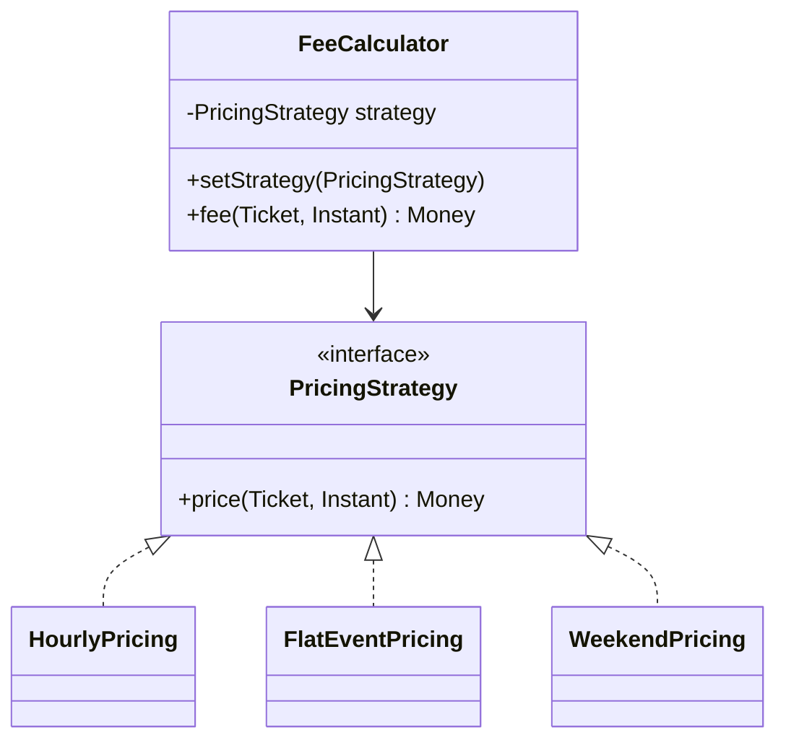

**Intent:** define a **family of algorithms**, encapsulate each one behind a common interface, and make them **interchangeable** — so the algorithm can vary independently from the code that uses it.

Strategy is the single most useful pattern in LLD interviews. Pricing, allocation, splitting, routing, ranking, retry, scheduling — whenever a requirement says "it can be done in different ways", Strategy is the answer.

## The problem

A parking lot computes fees. Initially: hourly. Then: flat rate for events, weekend rates, EV discounts, monthly passes.

```java
// ❌ A growing conditional, edited for every new rule
Money fee(Ticket t, Instant exit) {
    if (t.isMonthlyPass()) return Money.ZERO;
    if (isWeekend(exit)) return weekendRate(t, exit);
    if (event.isActive()) return Money.of(300);
    if (t.vehicle().isElectric()) return hourly(t, exit).percentOff(20);
    return hourly(t, exit);
}
```

Every change risks breaking the others, the class grows without bound, and each rule can't be tested in isolation.

## The solution



```java
public interface PricingStrategy {
    Money price(Ticket ticket, Instant exitTime);
}

public final class HourlyPricing implements PricingStrategy {
    private final Map<VehicleType, Money> ratePerHour;
    public HourlyPricing(Map<VehicleType, Money> ratePerHour) { this.ratePerHour = Map.copyOf(ratePerHour); }

    @Override public Money price(Ticket t, Instant exit) {
        long hours = Math.max(1, ceilHours(Duration.between(t.entryTime(), exit)));
        return ratePerHour.get(t.vehicleType()).times(hours);
    }
}

public final class FlatEventPricing implements PricingStrategy {
    private final Money flat;
    public FlatEventPricing(Money flat) { this.flat = flat; }
    @Override public Money price(Ticket t, Instant exit) { return flat; }
}

// Context: depends only on the interface
public final class ExitGate {
    private final PricingStrategy pricing;
    public ExitGate(PricingStrategy pricing) { this.pricing = pricing; }

    public Receipt exit(Ticket t, Instant now) {
        return new Receipt(t.id(), pricing.price(t, now));
    }
}
```

Adding a "festival surge" rule is a new class; `ExitGate` never changes.

## Choosing the strategy

Something has to pick the strategy — keep that decision in **one place**:

```java
// A selector/factory chooses by context
public final class PricingSelector {
    private final PricingStrategy hourly, weekend, event;
    private final EventCalendar events;

    public PricingStrategy forTime(Instant t) {
        if (events.isActive(t)) return event;
        if (isWeekend(t)) return weekend;
        return hourly;
    }
}
```

Or configure it at startup per lot/tenant, or let the user choose (shortest vs fastest route).

### Composing strategies

Strategies combine naturally with [Decorator](/system-design/lld/decorator-pattern):

```java
PricingStrategy pricing = new EvDiscount(new MinimumCharge(new HourlyPricing(rates), Money.of(20)), 20);
```

## Lambdas: the lightweight strategy

In Java 8+, any functional interface is a strategy slot. `Comparator` is the most familiar strategy in the JDK:

```java
orders.sort(Comparator.comparing(Order::placedAt).reversed());     // strategy passed as a lambda
```

For single-method strategies without state or names worth keeping, a lambda or method reference is enough. Use full classes when strategies have configuration, multiple methods, or deserve names in the domain (`ExactSplit`, `PercentSplit`).

## Where you've seen it

- `java.util.Comparator`; `ThreadPoolExecutor`'s `RejectedExecutionHandler` (abort, caller-runs, discard policies).
- Spring's `PasswordEncoder`, `ResourceLoader`, `TaskExecutor` — swap implementations by configuration.
- Load-balancing algorithms, retry/backoff policies, cache eviction policies, compression algorithms, payment methods.

## Strategy in LLD case studies

| Case study | Strategy |
| --- | --- |
| Parking lot | `PricingStrategy`, `SpotAllocationStrategy` |
| Splitwise | `SplitStrategy` (equal, exact, percentage) |
| Elevator | `DispatchStrategy` (nearest suitable car, zoning) |
| Rate limiter | `RateLimiter` implementations (token bucket, sliding window) |
| Ride-hailing | `MatchingStrategy`, `FareStrategy` |
| Cache | `EvictionPolicy` (LRU, LFU) |
| Tic-tac-toe | `MoveStrategy` (human, random bot, minimax bot) |

## Pros and cons

| Pros | Cons |
| --- | --- |
| Swap algorithms at runtime | More classes/objects |
| Replace conditionals with polymorphism; each algorithm testable alone (SRP) | Clients (or a selector) must know which strategy to use |
| Add algorithms without changing the context (OCP) | Overkill when there are only one or two stable algorithms |

## Comparisons

- **Strategy vs State**: same structure; in Strategy the *client* chooses an algorithm and strategies don't know each other; in [State](/system-design/lld/state-pattern) the *context's state* drives the choice and states may trigger transitions to other states.
- **Strategy vs Template Method**: Template Method varies steps via **inheritance** (static, class level); Strategy varies behaviour via **composition** (dynamic, object level).
- **Strategy vs Command**: both wrap behaviour in objects. Strategy represents *different ways of doing the same thing*; [Command](/system-design/lld/command-pattern) turns *a request* into an object you can queue, log, undo.
- **Strategy vs Decorator**: Decorator changes an object's "skin" (wraps around), Strategy changes its "guts" (replaces internals).
- **Strategy vs Bridge**: similar shape; Bridge separates two hierarchies architecturally, Strategy swaps one algorithm.

<Callout type="interview">
Name strategies after the domain concept, and point to the axis of change: "Fees vary by event, weekday and vehicle type, so I've put pricing behind a `PricingStrategy`; adding festival surge pricing is just another implementation."
</Callout>

## Interview questions

<QA q="How does Strategy help with the Open/Closed Principle?">
The context depends only on the strategy interface. New behaviour is added by writing a new implementation rather than editing the context's conditional logic, so tested code stays unchanged — the context is closed for modification but open for extension through new strategies.
</QA>

<QA q="Who should decide which strategy to use?">
Keep the decision in one place: either the client passes the strategy explicitly (user selects a route type), configuration wires it at startup (per tenant or environment), or a small selector/factory chooses based on context (event day vs weekday). Avoid having the context itself contain the selection conditionals — that reintroduces the switch you removed.
</QA>

<QA q="When would you use a lambda instead of a strategy class?">
When the strategy is a single stateless function used in one place, such as a sort comparator or a small filter. Use classes when strategies carry configuration, have several methods, need clear domain names, are reused, or must be registered and selected by key.
</QA>

<Practice task="A delivery app computes ETA as distance divided by 25 km/h. Product wants traffic-aware ETAs in big cities, the simple formula elsewhere, and an ML model in an A/B test. Design it.">

An `EtaStrategy` interface (`Duration estimate(Location from, Location to, Instant at)`) with `FixedSpeedEta`, `TrafficAwareEta` (calling a traffic service through an adapter) and `ModelEta`. A selector chooses per request — by city configuration and A/B bucket — in one place. Add a fallback decorator: if the traffic or model service fails or times out, use `FixedSpeedEta`. The order service depends only on the interface.

</Practice>

<Takeaways>

- Strategy puts interchangeable algorithms behind one interface; the context delegates.
- It replaces conditionals with polymorphism and keeps each algorithm testable in isolation.
- Keep strategy selection in one place (client, configuration or a selector).
- It is the most common pattern in machine-coding problems.

</Takeaways>

## Further reading

- Gamma et al., *Design Patterns* (1994) — Strategy.
- Freeman and Robson, *Head First Design Patterns* (2nd ed.) — chapter 1 (SimUDuck).
- Alexander Shvets, *Dive Into Design Patterns* — "Strategy".
