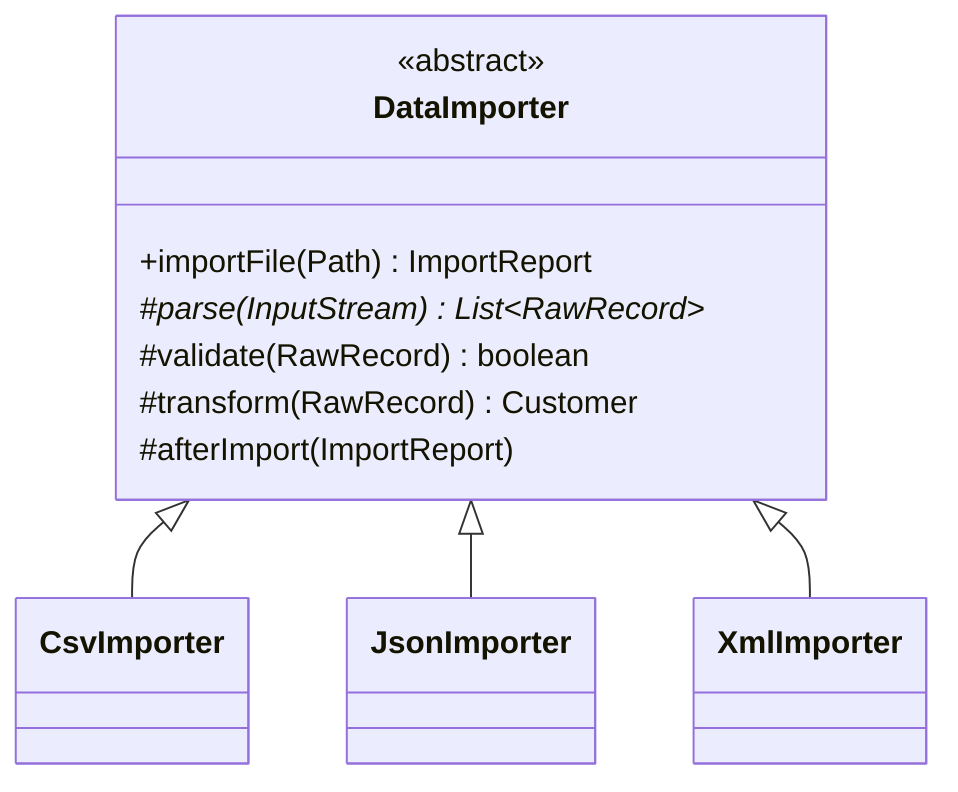

**Intent:** define the **skeleton of an algorithm** in a base class, deferring some **steps** to subclasses. Subclasses redefine specific steps without changing the algorithm's overall structure.

## The problem

You import data files from several partners — CSV from one, JSON from another, XML from a third. Each importer does the same thing in the same order: open the source, parse records, validate them, transform to your model, save, and report. Only parsing (and sometimes validation) differs. Three separate importers duplicate the flow — and when you add "deduplicate before saving", you must change all three.

## The solution

Put the invariant sequence in a `final` method of an abstract base class; make the varying steps abstract (or overridable hooks).



```java
public abstract class DataImporter {
    private final CustomerRepository repository;
    protected DataImporter(CustomerRepository repository) { this.repository = repository; }

    // The template method: fixed order, can't be overridden
    public final ImportReport importFile(Path file) {
        List<RawRecord> raw;
        try (InputStream in = Files.newInputStream(file)) {
            raw = parse(in);                                      // step that varies
        } catch (IOException e) {
            throw new ImportFailedException(file, e);
        }
        var report = new ImportReport(file);
        for (RawRecord r : raw) {
            if (!validate(r)) { report.rejected(r); continue; }   // overridable step
            repository.save(transform(r));                        // overridable step
            report.imported(r);
        }
        afterImport(report);                                      // hook
        return report;
    }

    protected abstract List<RawRecord> parse(InputStream in) throws IOException;   // required

    protected boolean validate(RawRecord r) { return r.has("email"); }             // default behaviour
    protected Customer transform(RawRecord r) { return Customer.from(r); }
    protected void afterImport(ImportReport report) { }                             // hook: no-op by default
}

public final class CsvImporter extends DataImporter {
    public CsvImporter(CustomerRepository repo) { super(repo); }
    @Override protected List<RawRecord> parse(InputStream in) throws IOException { /* CSV parsing */ }
}
```

Three kinds of steps:

- **Abstract steps** — subclasses *must* implement (`parse`).
- **Steps with defaults** — subclasses *may* override (`validate`, `transform`).
- **Hooks** — empty extension points at key moments (`afterImport`), letting subclasses plug in without changing the flow.

Make the template method **`final`** so subclasses can't reorder or skip steps.

## The Hollywood Principle

> "Don't call us, we'll call you."

The base class controls the flow and calls subclass methods at the right moments — the opposite of a subclass calling library code. This inversion is how frameworks work: you fill in steps; the framework decides when they run.

## Where you've seen it

- `java.io.InputStream.read(byte[], int, int)` is implemented in terms of the abstract `read()`.
- `java.util.AbstractList` — implement `get` and `size`, inherit `iterator`, `indexOf`, `equals`, etc.
- `HttpServlet.service()` dispatches to `doGet`/`doPost` that you override.
- Spring's `JdbcTemplate`, `RestTemplate`, `TransactionTemplate` — though these mostly use **callbacks** (Strategy-style lambdas) rather than subclassing, they implement the same "fixed skeleton, variable step" idea.
- JUnit's lifecycle (`@BeforeEach` → test → `@AfterEach`) and many game loops.

## Template Method vs Strategy

| | Template Method | Strategy |
| --- | --- | --- |
| Mechanism | **Inheritance** — subclasses override steps | **Composition** — inject an algorithm object |
| Granularity | Varies *some steps* of an algorithm | Replaces the *whole* algorithm (or one step as an object) |
| When fixed | Compile time (class level) | Runtime (object level) |
| Coupling | Subclasses tied to the base class | Context and strategy loosely coupled |

Modern Java often prefers the **callback form** — pass the varying step as a lambda:

```java
public ImportReport importFile(Path file, Parser parser) { ... parser.parse(in) ... }
```

This keeps the fixed skeleton but swaps inheritance for composition, avoiding a subclass per variant. Use classic Template Method when there are several related steps that vary together, or when building a framework designed for extension.

**Factory Method is a specialisation of Template Method** — the factory method is one overridable step (creation) inside a larger algorithm.

## Pros and cons

| Pros | Cons |
| --- | --- |
| Removes duplicated algorithm structure | Inheritance couples subclasses to the base class |
| Enforces step order (final template method) | Subclasses can violate LSP by overriding defaults badly |
| Clear extension points (hooks) | Harder to follow as the number of steps grows |
| Natural fit for frameworks | Fixed at compile time; one template per subclass |

## Interview questions

<QA q="Why should the template method be final?">
The template method encodes the invariant order of steps — the whole point of the pattern. If subclasses could override it, they could skip, reorder or duplicate steps (for example, saving before validating), breaking guarantees the base class relies on. Making it final restricts customisation to the intended steps and hooks.
</QA>

<QA q="When would you prefer Strategy over Template Method?">
When the variation should be chosen or changed at runtime, when there are several independent variation points (a subclass per combination would explode), when you want to avoid inheritance coupling, or when the varying part is small enough to pass as a lambda. Template Method fits when several closely related steps vary together, the algorithm's order must be enforced, and you control the class hierarchy.
</QA>

<Practice task="Three report jobs share a flow: fetch data, filter, aggregate, render, upload. Only fetch and render differ. Show the template, then explain how you'd do it with composition instead.">

Template: an abstract `ReportJob` with a `final run()` that calls `fetch()` (abstract), `filter()` and `aggregate()` (defaults), `render()` (abstract) and `upload()`, plus an `afterUpload()` hook. Subclasses implement fetch and render. Composition alternative: one `ReportJob` class that receives a `DataSource` and a `Renderer` (strategies) in its constructor — no subclasses, any combination at runtime, easier to test. Prefer composition when fetch and render vary independently.

</Practice>

<Takeaways>

- Template Method fixes an algorithm's skeleton in a final base-class method and lets subclasses fill in steps.
- Steps can be abstract, default-implemented, or empty hooks.
- It embodies the Hollywood Principle and underpins frameworks.
- Prefer Strategy or callbacks for runtime or multi-dimensional variation.

</Takeaways>

## Further reading

- Gamma et al., *Design Patterns* (1994) — Template Method.
- Alexander Shvets, *Dive Into Design Patterns* — "Template Method".
